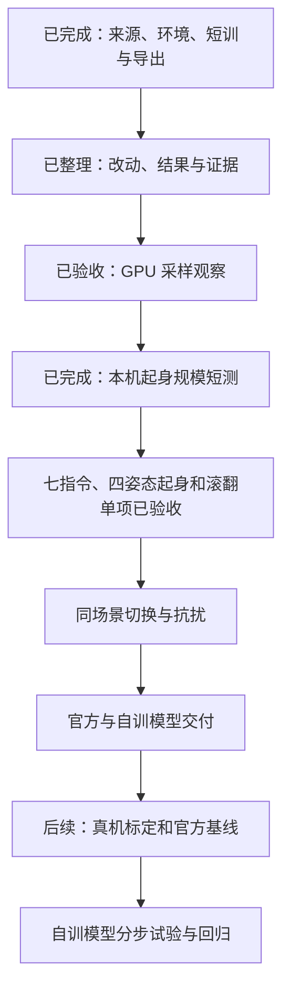

# XGO-Duck 开发路线

**当前阶段为整理交付与真机准备。** 训练和新增动态仿真暂停。优先以官方程序验证实际套机的通信、舵机位置、零点、IMU和低速走停，再检查飞智黑武士4Pro的输入及断联。官方程序验收后再安排自训练策略的同条件对照。[当前目标](current_goal.md) · [阶段移交](../records/handoff/2026-11-21/README.md) · [首次部署与遥控手册](runbooks/xgo_duck_first_deployment_and_vader4pro.md)

仿真续接位置为低摩擦完整轨迹配对。近期完成了三档本机采样短测、承重转正配对、种子1257同释放评估、4ms载荷采集与复算。恢复后先核验反复失分的前进场景439和779及原准入配对的支撑顺序。新候选仍依次验收原起身、滚翻前准入、滚翻落地和连续七指令，再进入独立种子2246。[完整轨迹准入复算](../records/reports/nominal-skill-composition/low-friction-forward-support/pre-support-geometry/README.md) · [配对训练及轨迹](../records/reports/nominal-skill-composition/low-friction-early-transfer-authority/loaded-upright-ppo/README.md) · [VS Code观察入口](../records/training-current.md)

2026-11-21，标称连续路线已通过独立仿真确认。种子2256完整通过872/896，四种实际释放姿态和七项后续指令逐项过线。已登记七个策略和五份可恢复保存点。低摩擦对照的1ms候选完成870/896次滚翻落地，前进入口124/128、左转入口120/128。已复算起身持续前倾的控制观测，后续检查动作调整的可达性及原准入条件。[当前目标](current_goal.md) · [主报告](reports/development_report.md) · [标称连续路线](../records/reports/nominal-skill-composition/closed-loop-timestep-confirmation/README.md) · [低摩擦步长对照](../records/reports/nominal-skill-composition/closed-loop-low-friction-roll-window/README.md) · [真机准备](../records/hardware/deployment-preparation/s19-readiness.md)

2026-11-14的暂停记录保留了六组官方参数评估及第七组在1,400/1,550步的中断。S20与S17使用不同落地过渡，各自的来源和门槛见当日记录。[暂停汇总](../records/reports/roll-domain-parameter-random-s20/README.md) · [初态审计](../records/reports/matched-start-source-audit/README.md)

## 1. 总体路径

电脑端沿用官方XGO-Duck模型、1910执行器模型和PPO任务。目标动作包括站立、前后走、左右转、左右移、跌倒起身和前滚翻。先验收单项，再在同一物理环境串联。实机先验收原厂程序，仿真稳健性复核与板端接口核对为候选部署提供依据。



`xgoduck_rl` 是仿真与训练工程，`xgoduck_runtime_arduino` 提供板端程序和预训练模型。官方原件用于参照，开发副本用于修改。 [来源清单](../official_resources/source_manifest.json)

## 2. 已完成与实测结果

| 阶段 | 做了什么 | 实测结果与状态 |
| --- | --- | --- |
| S0 环境与流程 | 固定官方来源，部署 WSL，跑通短训、回放、保存和 ONNX 导出。线速度跟踪奖励 3.0 → 3.3 作为单因素练习。 | 两组各 256 环境、5 次更新，检查点及 1,000 帧闭环核验通过。完成流程验收。 [电脑端核验](reports/pc_pipeline_validation.md) |
| S1 工程验收 | 核对模型接口、七指令参照、保存停止与恢复。连续画面改为间隔录像。 | 保存与恢复通过。Windows 可独立读到采样、训练曲线和真实原片，右转共享价值实际观察到第 60 与第 100 次更新。 [完成门槛](../records/reports/s1-integration/completion-gate.json) · [观察证据](../records/reports/common-walk-right-startup-ppo/shared-value-analysis.json) |
| 本机吞吐 | 分任务核对规模、GPU 显存、采样、录像和写盘。 | 右转支撑 PPO 用 3,072 环境，两组采样约 23,356、23,139 条转移/秒，显存峰值 12,562、12,568 MiB。3,584 档短测的增益低于门槛。 [规模对照](../records/benchmarks/duck_walk_native-scale_reference_s1135_20261110T090325/README.md) · [策略训练](../records/reports/common-walk-right-support-yaw-training/README.md) |
| S2 行走 | 保留共同物理接口与原七指令门槛，核对支撑、转速和前进反馈。 | 方向反馈两批开发 223/224、224/224，最终留出七项各 32/32，固定动作验收通过。连续切换进入 S5。 [最终留出](../records/reports/common-walk-right-support-yaw-training/yaw-direction-holdout/analysis.json) · [权重与配置](../artifacts/delivery/walking-simulation.json) |
| S3 起身 | 从同一父模型比较改动，按实际释放与指定四姿态分别核验。 | 新独立留出总体 2,983/3,072，实际右侧 179/183，四姿态和总体门槛均通过。三份自训策略及可恢复保存点已归档。 [独立留出](../records/reports/getup-right-robustness/holdout/README.md) · [权重与配置](../artifacts/delivery/getup-simulation.json) · [早期分流结果](../records/reports/getup-pose-routing/README.md) |
| S4 滚翻 | 评估官方权重与角度输入对照，随后核对接触读数的时点。 | 角度试验官方 28/32、对照 29/32、候选 27/32，候选关闭。接触读回新开发集为 116/128，此前独立留出为 112/128。新独立确认在修正接触时点后开发与留出各 117/128，通过单动作门槛。 [角度对照](../records/reports/roll-angle-feature/startup-recovery/analysis.json) · [接触对照](../records/reports/roll-endpoint-readback/README.md) · [独立结果与原片](../records/reports/roll-endpoint-confirmation/README.md) |
| S5 共用场景 | 对齐场景、动作历史及目标过渡，验证连续切换和有界扰动。 | 标称种子2256完整通过872/896。种子2257滚翻横向扰动三组完整路线分别通过874、867和873/896。种子2258的7.4V组与8ms组完整通过881/896和891/896，标称参照在右转入口结束。0.8低摩擦继续独立验收。 [标称确认](../records/reports/nominal-skill-composition/closed-loop-timestep-confirmation/README.md) · [滚翻横向扰动](../records/reports/nominal-skill-composition/closed-loop-roll-lateral-disturbance/README.md) · [供电与舵机时延](../records/reports/nominal-skill-composition/closed-loop-voltage-delay/README.md) · [低摩擦起身步长对照](../records/reports/nominal-skill-composition/low-friction-release-integrator/README.md) |
| S6 多技能训练 | 将起身、滚翻、行走拆成独立技能；复用已验收起身与行走组件，针对滚翻诊断缺口做同父点 control/candidate 学习，再建立路由。 | CPU 奖励差异核验、GPU reset-only 零步、两组各 50 次更新和独立 128 回合评估均完成。官方 108/128、控制组 112/128、候选 111/128；候选没有新增安全回归，但未通过晋级线，训练和 router 已停止。 [失败分析](../records/reports/roll-airborne-support/analysis.json) · [完整记录](../records/reports/roll-airborne-support/README.md) |
| S6 离线准备 | 整理关节顺序、零位、IMU、时序、模型接口及回退步骤。 | 离线映射核验通过。已完成装配，真机通信、零位、方向、时序及实机动作待验。 [映射核验](../records/hardware/deployment-preparation/mapping-check.json) · [标定手册](runbooks/hardware_commissioning.md) |

seed-1212 router 的 CPU 场景编译、GPU reset-only 零步和运行观察入口已留档；连续 dynamics 实际 746 控制步后停止，保留 15 张关键帧、部分 MP4、状态和执行日志。seed-1213/1214 完成站立与 phase/latch 边界筛查，seed-1215 确认 bridge 影响，seed-1216 关闭 bridge 后达到 121/128 latch。 [停止复盘](../records/reports/continuous-roll-stand-walk-s1212/stop-review.json) · [当前边界分析](../records/reports/continuous-roll-bridge-disabled-boundary-s1216/analysis.json)

起身回放覆盖对照在 3,072 个 CUDA 环境完成。新场景中候选为 315/320，固定父策略和原覆盖对照各 311/320。指定仰卧仍为 30/32，继续检查双脚已经着地但机身转正失败的情况。后退已核对外部侧移与关节目标修正，两类试验均保留两路原策略重复对照。 [起身动作评分](../records/reports/getup-side-to-supine-replay/evaluation/README.md) · [后退支撑转移](../records/reports/common-walk-backward-actuator-support/README.md)

现有交付索引收录官方参照和三组自训参考或候选，权重哈希已核验。原始训练、评估、基准与剖析按批归档。 [权重与迭代记录](../artifacts/delivery/iteration_record.md) · [训练归档](../records/training-archive/README.md)

## 3. 文件结构

```text
XGO-Duck/
├── AGENTS.md                       项目范围、执行与归档约定
├── README.md                       项目入口
├── project.json                    已验证状态与索引
├── official_resources/             官方原始源码、快照、哈希；保持原始内容
├── docs/
│   ├── development_roadmap.md       本路线与阶段验收
│   ├── rl_deployment_plan.md        已有控制接口和硬件部署研究
│   ├── hardware_and_accessories.md  硬件与配件核对
│   └── runbooks/                   可以逐步执行的操作说明
├── scripts/
│   ├── setup/                      可见部署与环境核验
│   ├── training/                   基线与修改训练的记录脚本
│   └── validation/                 按需增加导出、接口与结果检查
├── configs/experiments/             每个实验的参数变化与比较规则
├── records/
│   ├── deployment/<date>/          命令日志、安装结果、截图、问题记录
│   └── experiments/<run-id>/        实验摘要、配置、指标与产物索引
├── workspace/                      按需建立开发副本、下载及缓存；不提交
└── artifacts/                      按需建立模型交付包；不提交大文件
```

目录按实际工作产生，不预先铺满空文件夹。Windows 下的本项目目录是文档、脚本与实验定义的唯一维护入口。为避免 `/mnt/c` 的大量小文件开销，Linux 虚拟环境和训练副本使用专属 `~/XGO-Duck/workspace/xgoduck_rl`；绝不复用其他项目的虚拟环境。Linux 的原始 TensorBoard 与 checkpoint 保留在该副本的 `logs/`；Windows 的 `records/experiments/<run-id>/` 保存其绝对路径、配置摘要和哈希，需要交付时再复制指定产物。不得维护两份可随意修改的训练源码。

官方归档用于恢复；开发副本用于修改；实验配置和补丁说明用于复现；产物目录用于部署。每份训练模型都必须能追溯到归档提交、改动、锁文件、训练参数和校准契约。

## 4. 分阶段执行与验收

| 顺序 | 后续工作 | 进入下一步的条件 |
| --- | --- | --- |
| 1 运行观察 | 恢复后先做有界可视化检查。用 VS Code 或浏览器查看运行编号、当前更新与预算、更新时间、指标曲线、最新原片、保存点和本轮文档。 | 不依赖持续显示终端，观察页至少出现两次真实进度更新，曲线追加数据，最新原片可播放，结束或停止状态可查。 |
| 2 本机吞吐 | 按任务和物理接口分别测量。官方行走的参考档是 4,096 环境，共同物理接口的行走和起身已测得有效档为 3,072。固定策略与物理，热身后两遍反向测量。 | 选两遍均有可复现收益、显存和主机内存峰值稳定的最大有效档。吞吐进入平台、热稳变差或写盘、编码开销抵消收益时回到净吞吐最好的档。 |
| 3 S4 固定确认 | 已完成。先运行开发种子 1026，通过后启用留出 2026。 | 实际 GPU 零步通过。开发集满足 116/128 且三类接触一致率各 ≥99.5% 后才启用留出。滚翻单项通过仍需 S5 验证。 |
| 4 S2、S3 与 S4 补缺 | S2 复现后退启动失败，保留前进反馈与七指令。S3 检查仰卧早期支撑，按四姿态作同起点对照。S4 已过单动作门槛，转入连续切换准备。 | 同一物理、样本量和评估条件。逐动作、逐姿态门槛通过，独立种子复算后再使用新留出。报告可比较的多种子结果。 |
| 5 S5 切换与抗扰 | 在共同环境完成起身→站立→行走及滚翻→站立→行走，记录连续轨迹，再按冻结范围测试摩擦、载荷、延迟与扰动。 | 无中途重置地通过两条序列，满足各动作及切换约束，扰动后能恢复且无既有动作退化。 |
| 6 S6 与交付 | 核验官方原件、自训 ONNX、对应可恢复 `.pt`、数值一致性、闭环和控制契约。完成离线映射、校准及回退说明。 | 输出一份迭代索引，区分参照、候选和通过项。模型、成绩、配置、源码、运行文档和原片可按运行编号追溯。 |
| 7 后续实机 | 先装配复核、标定、官方纯推理与低速基线，再逐步评估自训模型。最后用实测时延、摩擦和载荷回填仿真。 | 每一步留测量、视频、停止与回退记录。模型变更后重跑独立回归。当前真机工作后置。 |

本机扩展从已有数据开始。采样短测保持零学习，首次编译单列，记录 GPU 利用率、显存峰值、温度、CPU 与内存以及转移/秒。先保留 85% 的观测显存筛选线。若相邻规模的收益超过重复测量波动，可冻结起身 4,096 或行走 6,144、8,192 等更大档的独立短测。学习阶段用同一父点和等样本量对照。起身草案调整为 1,536 和 3,072 环境，每组 1,253,376 条转移，以覆盖完整训练回合和持稳。分别测采样、学习、编码、写盘与评估耗时。 [PPO 对照草案](../configs/experiments/local_getup_ppo_draft.json)以达到同一动作门槛的总时间选配置。WSL 以本机 CUDA 为主，写盘受限时在专属 Linux 目录暂存并核验归档。若有平台瓶颈，再按相同条件与原生 Ubuntu 短测比较。 [本机方案](reports/development_report.md)

### 参数随机化的验证顺序

共同场景的当前标称量为脚底摩擦系数 1.0、供电 7.7 V、执行器命令延迟 4 ms。已安装官方起身和滚翻训练配置的脚底摩擦范围为 0.7–1.3，供电范围为 7.4–8.0 V，执行器延迟均为一个物理步。首轮参数验证选择摩擦和供电的低、高端点，每次只改一个因素。延迟扩展和载荷后置，按冻结的仿真假设与真机测量分开记录。 [共同场景配置](../scripts/validation/common_skill_plant.py) · [标定手册](runbooks/hardware_commissioning.md)

CPU 已核对四个端点的单因素配置，随后在新 seed 1190 完成 nominal、高摩擦、低电压和高摩擦低电压交叉组合，四组均通过 CUDA 采集与独立读回。候选参数区间暂定为脚底摩擦 1.0–1.3、供电 7.4–7.7 V；低摩擦 0.7 和高电压 8.0 V 排除。参数随机化起身训练的 CPU 场景差异和两个 GPU 零步均通过，下一步冻结同父点、同转移预算的 8 次更新对照并检查首个更新显存。 [交叉复验报告](../records/reports/roll-domain-parameter-cross-check/README.md) · [训练前置核验](../records/reports/parameter-randomized-training/README.md) · [训练草案](../configs/experiments/parameter_randomized_getup_training_draft.json)

### 训练期间怎样查看

- 打开运行观察页，也可从 VS Code 的 `records/training-current.json` 进入当前采样记录。页面标明运行中、停止或完成及最后更新时间。短测关闭录像时，页面标注引用此前观察检查的原片。 [运行观察页](../records/training-live.html)
- 保留从真实训练环境捕获的录像。正式运行默认约每三分钟更新，按动作完整度选择片长，起身与滚翻从开始录到结束。阶段末、异常停止和评估保存对应结果；曲线保留每次更新的数据。真实连续画面和保存片段各自标明来源。
- 历史样例可直接查看同一候选的状态、逐次指标、原片和文档。浏览器实时刷新仍待验收，正式运行前以实际可打开并更新的入口为准。 [状态](../records/experiments/duck_getup_supine-weighted_candidate_s45_20261109T211329/state.json) · [逐次指标](../records/experiments/duck_getup_supine-weighted_candidate_s45_20261109T211329/learning-metrics.jsonl) · [原片](../records/experiments/duck_getup_supine-weighted_candidate_s45_20261109T211329/clip-step-0.mp4) · [对应文档](../records/reports/getup-supine-weighted-learning/README.md)
- 已冻结的滚翻入口要求标准输出是 TTY。可选普通终端，或先离线核验提供 TTY 和持久日志的运行方式。原冻结源码与判据按哈希核对。

## 5. 第一轮修改怎么做

首先原样复现 `Mjlab-Velocity-Flat-XgoDuck`。将官方 4096 并行示例收敛到 256 做环境检查；5–20 次迭代只检查编译、采样、反向传播、保存和加载。看到 loss 或奖励数值不足以证明行走能力。

第一项修改使用 [velocity_tracking.json](../configs/experiments/velocity_tracking.json)：只改变 `src/mjlab_microduck/tasks/__init__.py` 中 XGO-Duck 配置的 `track_linear_velocity` 奖励权重，从 3.0 到 3.3。固定任务、seed、环境数、迭代数、命令分布、姿态、执行器和网络结构。先保留官方 checkpoint 和配置，再修改开发副本；不修改同文件中 MicroDuck 的配置，也不批量替换相似数字。

选择这一改动是为了练习完整流程，并不预设它会改善性能。比较时看速度跟踪误差、跌倒比例、动作变化量、脚底滑移及停止稳定性。奖励项权重变化会改变总奖励的标尺，因此不能用不同实验的总奖励直接宣称改进。

新的运行文档与运行编号一一对应。开跑前记原始问题、改动前后值或代码、改动理由、对照条件、父模型和源码哈希、命令、种子、预算与验收线。运行中链接进度、曲线、日志、录像及最新完整保存点。结束后记录实际步数、墙钟时间、逐项成绩、失败条件、是否采纳、可复现命令和原始证据路径。阶段性结论汇总到一份迭代记录，原始文件按批保留。多种子比较沿用既有阶段门槛，并标明从头训练或继承的检查点与状态。

## 6. sim2real 要对齐的内容

| 对齐项 | 实施方法 |
| --- | --- |
| 机械模型 | 核对舵机型号、脚底、打印材料、电池、相机和线束质量；实测尺寸/质量并更新开发副本的惯量与质心 |
| 执行器 | 先用官方 1910 BAM 模型；记录真实增益、限位、死区、回差和延迟；有实测依据后才调整 |
| 关节映射 | 策略顺序为 `10–14,30–33,20–24`，共 14 维；嘴部 ID 34 不在策略动作内 |
| 观测 | 61 维，逐项核对单位、坐标轴、顺序、默认姿态偏置、上一帧动作和指令槽位 |
| 默认姿态 | 归档训练约 ±24°，普通板端运行约 ±22°；制定同一份 14 关节表并在模拟和运行端数值比较 |
| 动作 | 核对 action scale、位置偏置、限位、滤波、更新频率；上一帧原始动作不能替换成滤波动作 |
| IMU | 核验静止重力方向、陀螺单位和轴向；确认滤波延迟和时间戳 |
| 归一化 | 官方导出包含观测归一化，运行端不得重复处理 |
| 随机化 | 保留官方已有摩擦、质量/惯量、噪声及延迟配置；依据实测范围调整，避免重复叠加 |
| 时序 | 源码设计为策略 50 Hz、MCU 100 Hz；记录实际频率、反馈年龄和推理尾延迟 |

详细观测切片、代码路径和已发现差异见 [已有部署研究](rl_deployment_plan.md#d-新策略部署前的接口核对)。不要在复现官方基线时顺手修正所有差异；先保存原始行为，再单独验证接口调整的影响。

<a id="evaluation-delivery"></a>

## 7. 评估与模型交付

按已冻结的七指令、四姿态起身、前滚翻和切换抗扰协议执行。记录种子、初始状态、首次 episode 的提前终止、各条件成功数及区间。接触滑移从接触状态计算。开发集用于诊断和挑选，留出仅用于最终确认。 [动作判据与停止规则](current_goal.md)

导出时显式指定 checkpoint 和 ONNX 路径，避免默认 `output.onnx` 污染根目录。保存至少 1000 帧真实仿真 actor 观测，并在相同观测上比较 checkpoint actor 与 ONNX 输出；建议初始数值门槛 `atol=1e-5, rtol=1e-4`，不通过时查算子、归一化和精度，不能为通过而随意放宽。随机输入或全零输入只用于接口冒烟，不能代替观测轨迹验证。

进一步必须把导出 ONNX 接回仿真闭环。PyTorch 回放不能替代 ONNX 回放；PC 的 CPU ONNX Runtime 成功也不能证明 UNO Q 的 ARM 性能达标。归档运行依赖 `onnxruntime==1.22.1`，训练环境使用更高版本，需在独立兼容环境和最终板端分别验证 IR、opset、算子与延迟。

候选交付包内容：`policy.onnx`、`manifest.json`、关节/观测/动作契约、训练与评估配置、依赖锁哈希、数值比较报告、模型 SHA-256、运行代码来源、需要的校准标识及回滚说明。未完成实机验证的包必须标为候选，不能替换已验证官方包。

## 8. 装配完成后的板端步骤

1. 依据官方装配资料核对电源、扩展板批次及 U3/U4/U5 接线更正是否适用；逐个设置舵机 ID，确认机械中位和方向。
2. 用 Arduino App Lab 打开选定的官方运行副本。先下载板端库，再停止应用；在 **UNO Q 项目目录** 执行 `python3 tools/prepare-bridge.py` 与 `sudo bash tools/router-2m.sh`，保存输出。
3. 重启应用，打开 `http://<board-ip>:9527`，确认 15/15 舵机和 IMU 在线；先保持 Inference only，备份校准和原始模型。
4. 支撑条件下验证 Default pose、关节方向、限位和卸载，再做官方低速试走并记录基线。`Zero motion` 仅停止行进，`Torque off` 才卸载电机。
5. 对候选模型先核对契约和板端纯推理，再托举验证、低速短时试走；每次只改变一个因素。出现失联、姿态异常或不合理目标即退回已验证模型和配套配置。

这些步骤尚未执行。首次连接时再核实当前板端系统、App Lab 与选定运行提交的匹配关系；2026-10-31 联网可见上游运行仓库已经增加桥接与重连说明，因此不能把最新网页操作与旧归档源码混用。

## 9. 长期开发顺序

九类动作、切换、抗扰和基础实机闭环完成后，再评估复杂地形和感知扩展。感知进程输出限幅指令，低层继续使用已核验的关节控制。新增载荷后重新记录质量、质心和延迟，并重复基础动作回归。

## 10. 依据

- [归档来源与固定提交](../official_resources/source_manifest.json)：本轮复现的精确源码来源。
- [官方训练说明](../official_resources/xgoduck_rl/README.md) 与 [依赖定义](../official_resources/xgoduck_rl/pyproject.toml)：任务、安装、训练和导出。
- [官方运行源码](../official_resources/xgoduck_runtime_arduino/README.md)：归档板端流程。
- [上游训练仓库](https://github.com/LuwuDynamics/xgoduck_rl) 与 [上游运行仓库](https://github.com/LuwuDynamics/xgoduck_runtime_arduino)：联网复核于 2026-10-31；后续采用新提交必须另记来源。
- [Microsoft WSL 安装](https://learn.microsoft.com/en-us/windows/wsl/install)：系统部署与可能需要的重启。
- [uv 安装](https://docs.astral.sh/uv/getting-started/installation/)：Python 环境管理。

本文是实施方案。完成状态只依据执行记录更新，不将计划、短训练或截图单独当作性能验证。

## 11. 当前连续路由门

官方组件的连续路由已经完成同回合闭环检查。关闭跨模型 bridge 后，完整路线使用 128 个并行环境执行 50 步站立、450 步滚翻、50 步落地站立和 1,000 步前进。seed-1218 的滚翻入口为 128/128，落地为 123/128，前进入口为 123/128；恢复原前进判据后为 111/128，低于 116/128 的晋级线。

下一阶段只做离线失败复盘和有界单因素诊断。5 个未进入前进的世界检查站立接力时序，12 个偏航失败世界检查反馈幅度和支撑相位；诊断必须先通过 CPU 和 GPU 零步，物理对照使用固定权重、同初态和短预算。诊断未形成可重复收益前，不重新启动 PPO，也不把当前路由输出作为多技能交付。

证据见[完整序列分析](../records/reports/continuous-roll-full-sequence-s1218/analysis.json)、[接力分析](../records/reports/continuous-roll-stand-handoff-s1217/analysis.json)和[全流程报告](reports/development_report.md#21-完整无重置路由复盘)。

