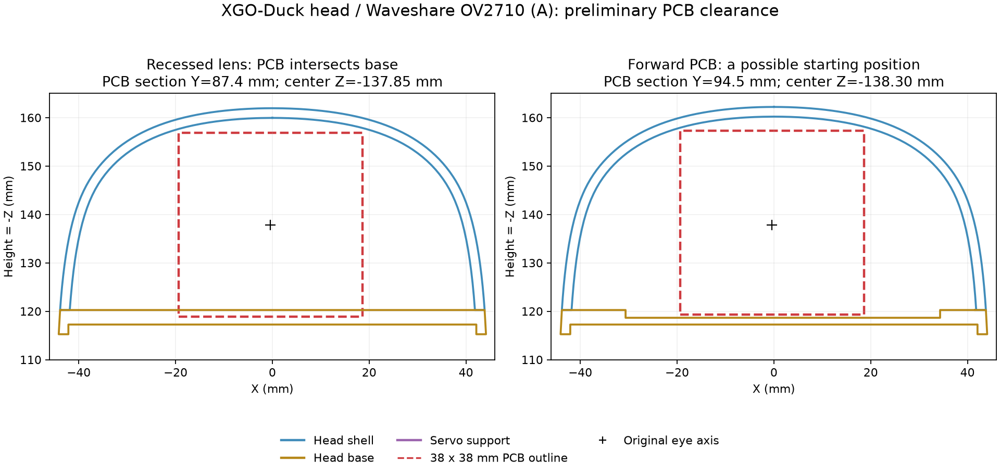

# XGO-Duck 硬件补齐与摄像头路线

更新：2026-10-25。以下选型基于用户已确认拥有 UNO Q、机器人扩展板和舵机；未确认的物品列为“核对”，不直接视为缺失。

## 1. 优先补齐整机基础

| 优先级 | 项目 | 需要核对的内容 |
| --- | --- | --- |
| P0 | 舵机 | 官方标准是 15 个 Feetech 1910；核实实物型号、数量、舵盘及配套螺丝 |
| P0 | 扩展板与 IMU | 官方板含 QMI8658A；先核实装配和在线状态，不先另买 IMU；确认旧板接线更正是否适用 |
| P0 | 舵机线束 | 官方列出 15 条 AMP 3-pin 线；检查接口、长度、极性、接点及关节余量 |
| P0 | 电池、充电器、动力开关 | 官方列为 8.4 V 电池包、容量 >2500 mAh、放电 >3C、XH2.54 接口；充电器 8.4 V、DC5521。实际电池拓扑、匹配充电器、极性和供电路径需供应商/实物确认 |
| P0 | 打印结构 | 身体、左右腿、脚、头颈等；按 `structure/` 文件名前缀数量打印，不能所有文件一件各打一次 |
| P0 | TPU 软件 | 脚底和指定嘴部零件；脚底材料会改变接触与摩擦，影响行走策略 |
| P0 | 轴承与紧固件 | 按官方 BOM 与装配图逐项核数；不要把 PCB 元件采购表误当整机 BOM |
| P1 | 调试工具 | 合适螺丝刀、万用表、可支撑机器人的支架、便于断开动力的装置；按实际供电条件使用限流调试设备 |
| P2 | 摄像头与支架 | 行走基线通过后再增加，先借用已有 USB 摄像头验证采集和负载 |
| P3 | 深度相机、激光雷达、外置算力、滑轮 | 当前阶段不作为基础采购项，由具体任务和测量结果决定 |

来源：[官方机器人 BOM](https://github.com/LuwuDynamics/xgoduck_hardware/blob/b5e9ff16a98f7bbe5c146aad29ad38f0dde30a89/BOM.md)、[元件说明](https://github.com/LuwuDynamics/xgoduck_hardware/blob/b5e9ff16a98f7bbe5c146aad29ad38f0dde30a89/docs/BOM.md)、[打印清单](https://github.com/LuwuDynamics/xgoduck_hardware/blob/b5e9ff16a98f7bbe5c146aad29ad38f0dde30a89/docs/PRINTING.md)。BOM 中最新总数包含可选滑轮：额外 4 个 M2×6 螺丝、8 个 10×15×3 mm 轴承；第一阶段普通行走不必装滑轮。

“8.4 V 电池”通常涉及满充电压标注，不能由这几个字直接确定你手中电池的串并联、保护板和充电方式。UNO Q、扩展板和舵机应按已验证的供电树连接；不要把舵机电压直接施加到 USB/5 V 端。

已有成品扩展板，无需重新购买 `PCBA/BOM.xlsx` 中的每个芯片、电阻、电容。

## 2. 摄像头选择

**当前建议：先不为行走购买摄像头。需要视觉实验时，优先使用 Linux UVC/V4L2 可识别的轻量 USB RGB 摄像头。** 这是工程路线建议，并非已经验证某一商品与本套件兼容。

官方运行仓库已有 [`next-audio-video-tof` 开发分支](https://github.com/LuwuDynamics/xgoduck_runtime_arduino/tree/next-audio-video-tof)，单独保存为 [runtime_media_preview](https://github.com/LuwuDynamics/xgoduck_runtime_arduino/blob/44b2ac852cc3b03aca0de33996a6b4ff3cd0cab4/README.md)：

- 已实现：USB 摄像头 MJPEG 预览/拍照、手机界面、USB 麦克风与扬声器、手柄配置和 USB Host 手动切换。
- 未实现：ToF 传感器集成。分支名里的 `tof` 不代表已有可直接安装的测距方案。
- 分支文档请求 640×480 / 30 fps，实际帧率需要实测；音视频后台与步态线程分开。
- 摄像头需 USB Host 模式，开机默认 Device，切换会中断 USB 电脑连接，需先具备 Wi-Fi 访问。
- 这是开发预览，不是主分支现成功能。其默认姿态为 ±23°，校准和控制代码也与目前主分支不同；不要整包覆盖已验收系统。

先阅读该分支的 [USB camera/audio 文档](https://github.com/LuwuDynamics/xgoduck_runtime_arduino/blob/44b2ac852cc3b03aca0de33996a6b4ff3cd0cab4/docs/usb-camera.md)。图传只是把图像送给操作者，不会自动获得识别、跟随或避障能力。

| 方案 | 适合阶段 | 接入与代价 |
| --- | --- | --- |
| 外置电脑摄像头/已有 USB 摄像头 | 最初识别和跟随原型 | 可先放在外部电脑验证感知；不增加头部重量。外部视角闭环需另做坐标标定；Wi-Fi 只传高层指令，运动稳定环仍在机器人上 |
| 轻量 USB UVC 摄像头 | 首版板载视觉 | UNO Q 官方支持经 USB-C hub 接 USB 摄像头；需验证 USB 主机角色、hub、供电、驱动与安装空间 |
| IMX219 MIPI 相机 + UNO Media Carrier | USB 方案确有尺寸/带宽问题之后 | 官方已提供这条路径，但需要额外 carrier 和合适排线；需核实与机器人扩展板、机身的机械/电气兼容，不能假定直接叠装可用 |
| RGB-D / 双目 | 确实需要距离与地形信息时 | 增加功耗、重量、标定与驱动负担；先定义量程、帧率、安装位置和算法预算再选型 |

Arduino 一手资料：[UNO Q 用户手册](https://docs.arduino.cc/tutorials/uno-q/user-manual/)、[MIPI-CSI 配置](https://docs.arduino.cc/software/app-lab/configure/mipi-camera)。截至本次核查，MIPI 文档列出的支持传感器是 IMX219；Carrier 为 22-pin 接口，常见 Raspberry Pi Camera Module 2 的 15-pin 排线需要适配。不要直接购买任意树莓派 CSI 模组并假定能插到 UNO Q 上。

自建视觉进程的调试初值建议使用 640×480、15 fps，再测实际采集耗时和推理负载；若复用官方预览分支，先按其 30 fps 配置测量。15 fps 是本项目的保守起点，不是硬件规格上限。相机分辨率越高并不自动提高小机器人的闭环效果。

供电和机械安装要同时评估：hub/相机与扩展板共同使用时的电源路径必须先确认，避免未经验证的多路供电；相机及线材尽量轻，提供拉力释放，不妨碍头颈运动。称量新增部件及其位置，必要时更新 MJCF 的质量、重心和惯量。

### OV2710 (A) 的头部安装与 USB 接线核查

2026-10-25 核查对象是 **Waveshare OV2710 2MP USB Camera (A)，SKU 14121**。OV2710 是传感器型号，其他厂商或其他版本的板型不能直接套用以下尺寸。该型号仍是候选产品，没有完成 UNO Q 实机或头部装配验证。

微雪[尺寸图](https://files.waveshare.com/upload/4/4a/OV2710_2MP_USB_Camera_A_Dimension.pdf)标注：PCB 38±0.2 × 38±0.2 mm、厚 1.6 mm，四角安装孔中心距 33.5±0.2 mm，镜头前端直径 17 mm，PCB 背面到镜头前端 24.6±0.3 mm。背面元件、插头及线缆还需要空间。商品页面与旧尺寸图的镜头光学参数存在差异，机械设计应向供应商确认当前出货尺寸。

**原版 STL 不能直接装上这款相机；需要改眼部和固定支架。** 对归档版本的 `head_shell.stl`、`head.stl`、`head_servo_support.stl`、`eye_shell.stl`、`eye.stl` 做了原坐标剖面检查，结合装配手册第 19–22 页核对：

- 头壳外包络约 88 × 124.10 × 48.08 mm，不能当作内部净空间。原眼睛是打印件，中心有螺钉连接结构；不是可直接插入直径 17 mm 镜头的通孔。
- 保持原眼睛光轴、将镜头收在眼部附近时，38 mm PCB 在 Y≈85–93 mm 的若干截面与头部底座干涉。例如 Y=87.4 mm，PCB 下边缘比底座内表面低约 1.40 mm；仅将板子向上挪，还会受到弧形顶壳限制。
- 在模型坐标中，将 PCB 背面初步前移到 Y≈94 mm、中心 Z≈−138.3 mm，38×38×1.6 mm 裸板包络有初步空间，镜头前端将到 Y≈118.6 mm，比原眼部最前端约多出 6 mm。此位置仅是设计起点，净余量小；尚未完成镜头座、PCB 元件、舵机本体、线束、螺丝和打印公差的完整干涉检查。
- 内置改装需重做 `eye` / `eye_shell`、修改 `head_shell` 的镜头通道，并增加按 33.5 mm 孔距固定的支架。镜头不宜深埋在小孔内，以免遮挡广角视野；USB 插座可研究转向侧面，线束沿颈部留活动余量。支架、Hub 和线缆质量也要计入头颈及整机负载。



图中红框只表示 PCB 截面，不表示已装配相机；三维数据与检查范围见 [camera_fit_analysis.json](camera_fit_analysis.json)。STL 本身没有单位信息，本次按与机器人尺寸一致的毫米解释。没有修改归档 STL。

建议先在外部支架上跑通相机，再定制头壳。若要求尽量保留原壳，可进一步筛选更小 PCB 的 USB UVC 模组，但仍需核对镜头厚度和插头位置，不能仅凭 25×25 mm 等板宽判断适配。

**桌面调试接线：**

```text
PD 电源 ──────────────> USB-C Hub 的 PD IN
摄像头 4-pin ──原配 USB 线──> Hub 的 USB-A 数据口
Hub 的 USB-C 上行线 ──────> UNO Q 的 USB-C
电脑/手机 ──Wi-Fi────────> UNO Q 的网页/SSH
```

采用支持 PD 供电直通、带 USB-A 数据口的 USB-C Hub。UNO Q 的官方 USB-C 供电要求为 5 V、至少 3 A，还要给 Hub 和相机留出功率余量。不要把普通无供电 OTG 转接头当作已验证方案；USB 数据 Host 角色不等于已具备可靠的外设供电。依据：[Arduino UNO Q 用户手册](https://docs.arduino.cc/tutorials/uno-q/user-manual/)、[供电规格](https://docs.arduino.cc/tutorials/uno-q/power-specification/)。

摄像头的 4-pin 是 USB（5V、D−、D+、GND），优先使用原配 USB 线，**不接扩展板的舵机 3-pin、I²C 或串口**。第一次测试可在断开机器人动力电源的条件下单独用 PD Hub 给 UNO Q 和摄像头供电；上机后舵机仍由机器人动力供电系统承担。双电源共同连接以及改用整机电池给 Hub 供电，需要先核实实际扩展板版本和供电路径；本次没有验证移动供电设计。

若已经正确部署 `next-audio-video-tof` 的相关服务，先通过 Wi-Fi 打开 **USB Host** 开关（Audio / Gamepad / Settings → General），再开相机预览。该归档分支开机默认 Device，切 Host 会断开电脑 USB 连接。Linux 上先用 `lsusb`、`v4l2-ctl --list-devices` 找到相机，再对实际视频节点查看 `--list-formats-ext`，确认支持 MJPG 640×480；不要默认设备一定是 `/dev/video0`。该分支请求 30 fps，实际帧率须测量。

## 3. 从视觉到动作的实现顺序

```text
USB camera
  -> capture + timestamp
  -> target detector / tag detector
  -> target bearing and confidence
  -> bounded vx / vy / yaw-rate command
  -> existing 50 Hz walking policy
  -> servo position targets
```

1. **只看不动**：验证连续采集、时间戳、丢帧、CPU/内存和供电；并行运行步态推理但卸载电机，确认控制周期未受明显干扰。
2. **只转头/显示目标**：先做颜色目标或标记识别，验证左右方向、相机坐标与头颈坐标。相机固定在头部时，头动会改变视线，需要利用头部关节状态。
3. **低速跟随**：把水平图像误差变成转向指令；有可靠距离依据再前进。单目图像中的物体大小不能无条件等同于真实距离。
4. **完善停止逻辑**：目标丢失、图像过期、视觉进程退出时归零；明确网页遥控和视觉谁有控制权。视觉线程不阻塞步态循环，过期图像和命令不排队重放。
5. **需要时再做视觉强化学习**：先把高层导航/避障和低层运动解耦。若改为视觉直接输出关节动作，需要新观测模型、训练数据与域随机化、计算预算和完整部署接口，现有 61 维步态 ONNX 不能直接接收图像。

可用接口依据：[python/main.py](https://github.com/LuwuDynamics/xgoduck_runtime_arduino/blob/8837d5a3bc7cf3746f6da2b55c7b9191026b9838/python/main.py) 暴露 `/api/status` 和 `/api/command`；[controller.py](https://github.com/LuwuDynamics/xgoduck_runtime_arduino/blob/8837d5a3bc7cf3746f6da2b55c7b9191026b9838/python/controller.py) 接受 `twist`、`head` 和 `mouth`。主分支没有摄像头接入；预览分支的图传也没有替你实现视觉自主控制。先实现命令限幅、控制权和超时，再让视觉获得运动权限。

## 4. 现在建议的实际次序

先清点套件 → 核对旧板接线问题 → 备齐电源、结构与机械件 → 单舵机 ID 和中位 → 完整装配与校准 → 官方平地行走 → PC 仿真训练与模型兼容核对 → 最后增加 USB 摄像头。

下一次实物核对最有用的信息：舵机完整型号及数量、UNO Q 内存规格、扩展板版本、电池/充电器标签、结构件与线束是否齐全。相机预算可以等首个行走基线完成后再定。
