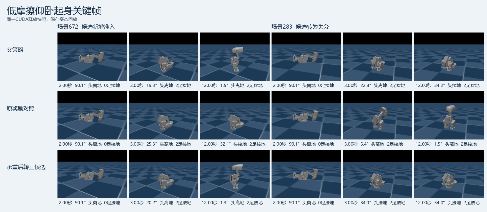

# XGO-Duck 开发与部署报告

更新于2026-11-21。

训练已暂停。报告保留电脑环境、官方基线、自训练策略、动作评估和实际录像。最近完成低摩擦完整轨迹复核，仿真续接从该证据开始。当前工作转向阶段交付与原厂套机的零点、站姿和手柄验收准备。[阶段归档](../../records/handoff/2026-11-21/README.md) · [真机首次部署手册](../runbooks/xgo_duck_first_deployment_and_vader4pro.md)

| 需要查看的内容 | 入口 |
| --- | --- |
| 当前目标与后续阶段 | [当前目标](../current_goal.md) · [阶段矩阵](../../records/reports/stage-acceptance-matrix/README.md) |
| 环境部署与训练操作 | [电脑训练手册](../runbooks/pc_training.md) · 本报告第 3–4 节 |
| 本次训练过程与结果 | [VS Code训练观察入口](../../records/training-current.md) · [低摩擦承重转正配对训练与动作对照](../../records/reports/nominal-skill-composition/low-friction-early-transfer-authority/loaded-upright-ppo/README.md) · [供电与舵机时延对照](../../records/reports/nominal-skill-composition/closed-loop-voltage-delay/README.md) · [标称连续路线滚翻横向扰动](../../records/reports/nominal-skill-composition/closed-loop-roll-lateral-disturbance/README.md) · [低摩擦承重交接奖励训练](../../records/reports/nominal-skill-composition/low-friction-support-effort/support-credit-ppo/README.md) · [低摩擦起身步长对照与原片](../../records/reports/nominal-skill-composition/low-friction-release-integrator/README.md) |
| 暂停进度与恢复位置 | [本次归档](../../records/handoff/2026-11-21/README.md) · [低摩擦完整轨迹核验](../../records/reports/nominal-skill-composition/low-friction-forward-support/pre-support-geometry/README.md) |
| 官方和自训模型 | [标称连续仿真交付清单](../../artifacts/delivery/nominal-continuous-simulation.json) · [权重与迭代记录](../../artifacts/delivery/iteration_record.md) |
| 完整历史与归档 | [过程记录](development_history.md) · [训练归档](../../records/training-archive/README.md) |
| 真机标定与回退 | [官方套机首次部署、零点标定与飞智黑武士4Pro遥控](../runbooks/xgo_duck_first_deployment_and_vader4pro.md) · [原真机准备与接口核验](../runbooks/hardware_commissioning.md) |

## 1. 当前进展

**低摩擦前进起身的实际载荷。** 种子1257、足底摩擦系数0.8，两个同权重父策略分支与原奖励、承重转正候选四组从同一状态释放。每组保存151个场景的500条4ms载荷和扭矩读数，共448,000条仿真转移。候选前进场景439、779在头部卸载确认后分别64ms、76ms重新承重。两者首次持续双足承重后80ms内的颈部俯仰扭矩积分分别为−0.0735和−0.0734N·m·s，峰值达到固件占空比上限。[逐场景4ms记录与四段原片](../../records/reports/nominal-skill-composition/low-friction-forward-support/README.md)


**近承重时点的局部扭矩回放。** 以实测供电、占空比及实际姿态为基准，在34个保存初态各做四路CPU回放，共6,800物理步。30个参照与原轨迹对齐，包含全部8个目标初态。颈部减小负向扭矩或调整双侧髋膝时，目标初态的最大转正增益为0.30°，低于3°回放门槛。下一步从更早的足底接触区域与质心运动定位可作用时点。[逐样本回放及保护判据](../../records/reports/nominal-skill-composition/low-friction-forward-support/short-torque-replay/analysis.json)

**低摩擦承重转正配对训练。** 候选为右脚首次持续承重后80ms内的双足承重转正加奖励，两组使用同一父点、种子5517、3,072个并行场景、各17次更新和1,253,376条场景转移。规模短测为24,645条转移/秒，原奖励组与候选的正式净吞吐为13,673和13,611条/秒，显存峰值13,406和13,393MiB。两组均已核验ONNX、保存点和8秒原片。[配置、训练曲线及权重](../../records/reports/nominal-skill-composition/low-friction-early-transfer-authority/loaded-upright-ppo/README.md)

**同释放动作评分。** 种子1257、足底摩擦系数0.8。父策略、原奖励对照、承重后转正候选的原起身及滚翻前准入为880、882和881/896。三组前进分组为125、126和125/128，左转为122、123和123/128。候选相对原奖励组在场景672恢复左转准入，同时在场景283失去前进准入，整体前进净增未达到原门槛。留存候选模型作为配对实验记录，完整路线继续使用原准入条件。[原评分、12秒原片及逐帧复核](../../records/reports/nominal-skill-composition/low-friction-early-transfer-authority/loaded-upright-ppo/README.md)

**前进分组起身时序。** 两遍同释放同权重参照的前进准入各123/128，场景283和727交换判定。场景439和779是本轮三组和两遍参照共同的持续未准入场景。候选在场景439确认双足着地、头部离地后100ms再次确认头部接地，场景779到第200步未形成连续三个20ms观测的双足接地、头部离地。两者据此分别核验承重维持和初次承重。[五组早段事件](../../records/reports/nominal-skill-composition/low-friction-early-transfer-authority/loaded-upright-ppo/action-comparison/forward-getup-readback.json)



<video controls preload="none" src="../../records/evaluations/duck-getup-loaded-upright-action-friction080-s1257-20261121T201135/loaded-upright-reward/clip-step-0.mp4"></video>

**承重转正指标的来源。** 在此前摩擦系数0.8、种子1257的13对归档中，右脚首次持续承重后的80ms内，12对原准入场景的双足承重转正量较高，配对中位差4.76°。本机CUDA用896场景的246,400条4ms样本复核计分，最大单步误差6.55×10⁻⁶°。[复算、训练指标定义与对照图](../../records/reports/nominal-skill-composition/low-friction-early-transfer-authority/README.md)


**供电与舵机时延。** 种子2258、足底摩擦系数1.0、各896个并行场景。参照为7.7V与4ms舵机时延，另外分别改变供电至7.4V和时延至8ms。7.4V组、8ms组分别完整通过881/896和891/896，七项指令均达到原门槛。标称参照滚翻并站稳872/896，右转入口121/128，于22.50秒结束。实际舵机延迟和带载电压已从求解记录复算。三个工况合计4,816,000条仿真转移，学习更新为0。[逐项验收、VS Code记录及三段原片](../../records/reports/nominal-skill-composition/closed-loop-voltage-delay/README.md)


<video controls preload="none" src="../../records/evaluations/duck-route-voltage-7p4v-2ms-s2258-20261121T180719/clip-step-0.mp4"></video>

<video controls preload="none" src="../../records/evaluations/duck-route-delay-8ms-2ms-s2258-20261121T180719/clip-step-0.mp4"></video>

**标称连续路线的滚翻横向扰动。** 独立种子2257从滚翻开始后160ms做三组配对。无扰动、左向0.08m/s和右向0.08m/s各有874、867和873/896完成42.5秒连续路线，七条指令逐项达到原门槛。左向组右转122/128，位于门槛。三组在本机CUDA共完成4,622,464条场景转移。[三组逐项评分、运行记录及原片](../../records/reports/nominal-skill-composition/closed-loop-roll-lateral-disturbance/README.md)


<video controls preload="none" src="../../records/evaluations/duck-roll-lateral-disturbance-2ms-s2257-20261121T171005/left-push/clip-step-0.mp4"></video>

<video controls preload="none" src="../../records/evaluations/duck-roll-lateral-disturbance-2ms-s2257-20261121T171005/right-push/clip-step-0.mp4"></video>

**低摩擦右髋膝闭环对照。** 释放后720ms的固定前倾窗口在四条策略观测归档分别识别15/15、15/15、12/14、9/9个实际仰卧未准入场景。候选施加80ms的0.02rad位置增量，21个触发场景中20个实际获得两关节指定方向的扭矩变化。两遍参照和候选的滚翻前准入为884、884和885/896，新增场景属于站立分组，左转均为124/128。[观测复算](../../records/reports/nominal-skill-composition/low-friction-right-support-signal/README.md) · [固件位置目标复算](../../records/reports/nominal-skill-composition/low-friction-right-support-position/README.md) · [闭环评分、原片与标注图](../../records/reports/nominal-skill-composition/low-friction-right-support-trial/README.md)

**低摩擦双足接地与转正。** 新增准入场景218在三组均于第139步确认双足接地。候选到第150步右脚前移32.39mm，两遍参照分别为17.69mm和17.76mm。候选第156步确认双足接地、转正及头部离地。8个持续失分场景的候选右脚前移中位数为2.65mm，至第180步均未同时达到这三项条件。[支撑与逐脚位移读回](../../records/reports/nominal-skill-composition/low-friction-right-support-trial/support-timing/README.md)

**右脚前移的执行窗口。** 第136–156步的两遍原策略中，几何可行的右脚前移姿态还剩1或2个连续端点，所需执行时长为5个。达到关节限位、位移和时长条件的左转失分场景为0/4，预检门槛为2/4。释放后400–480ms的载荷复算中，四个匹配准入场景的转正量均较大，配对差中位数10.00°。左足减右足的法向冲量占比配对差中位数为−13.27个百分点。该窗进入舵机响应预检。[关节限位、接地时间和较早载荷](../../records/reports/nominal-skill-composition/low-friction-right-support-trial/support-timing/README.md#支撑窗口与关节限位)

**早段舵机和右脚离地。** 400–480ms的80次4ms读数中，四个持续失分场景的右脚载荷均未达到标称机重2%。降低左髋横滚扭矩0.03N·m使四个目标场景的右脚近地顶点朝地加速，合格端点中位数为0.407m/s²。同初态短回放的持续承重时点最多提前4ms，保护指标为11/13。惯性输入和相对脚高组合的最弱轨迹覆盖2/3。[量测、关节余量与撤回依据](../../records/reports/nominal-skill-composition/low-friction-early-transfer-authority/README.md)


**仰卧起身髋膝扭矩响应。** 对承重确认前的52个保存状态重算接触。在13对配对中，失分场景均至少一个时点达到转正加速度要求，成功场景在两时点均通过保护判据的有8/13，门槛12/13。低摩擦权重和控制器沿用现有配置，标称连续路线进入独立滚翻扰动评估。[扭矩改动、接触响应及逐项结果](../../records/reports/nominal-skill-composition/low-friction-hip-knee-authority/README.md)

**首次承重前的动作差异。** 对齐首次持续双足承重，7对重复失分场景在确认前160–80ms的转正量比对照少14.24°，双髋俯仰和双膝的绝对扭矩积分分别少0.0266和0.0099N·m·s，颈头俯仰多0.0384N·m·s。差值为逐对比较的中位数。后续先用保存状态核对关节作用方向和接触响应。[13对轨迹与关节读数](../../records/reports/nominal-skill-composition/low-friction-first-support-effort/README.md)

**低摩擦起身步长对照。** 从同一释放快照，将起身首1.2秒的物理积分由4ms改为2ms。按请求仰卧的起身持稳由两遍参照的211/224、212/224增至213/224，前进入口由两遍119/128增至122/128。三组滚翻并落地持稳855、859和859/896，候选左转入口119/128，原门槛122/128。该试验共2,844,800条固定权重仿真转移，三组均止于第1125步指令入口。[逐项评分、曲线与三段原片](../../records/reports/nominal-skill-composition/low-friction-release-integrator/README.md)


<video controls preload="none" src="../../records/evaluations/duck-getup-release-clock-friction080-s1257-20261121T162131/release-2ms-candidate/clip-step-0.mp4"></video>

**滚翻前失分。** 七批相同种子原策略归档中，85次实际仰卧未进入滚翻，其中84次在第175步前未出现短时双足支撑、头部离地且倾角不超过15°的组合。9个反复失分场景中，7个在本次三组均未进入滚翻。535个实际仰卧场景全部进入仰卧策略。[七批逐场景复算](../../records/reports/nominal-skill-composition/low-friction-failure-recurrence/README.md) · [路由及指令失分复算](../../records/reports/nominal-skill-composition/low-friction-release-integrator/paired-failure-readback.json)

**低摩擦仰卧起身配对训练与评估。** 两组共用父检查点、CUDA初态和重放抽样，每组3,072个并行场景、17次更新、1,253,376条转移。原奖励对照和承重交接奖励候选正式训练净吞吐分别为13,602和12,774条转移/秒，整卡峰值均为13,185MiB。3,328场景的容量短测触及显存上限后结束。从同一释放快照评估，父策略、原奖励和候选的滚翻前准入依次为885、878和880/896，前进分组均为126/128。候选保留在实验记录中。两组ONNX、可恢复保存点、实际曲线及完整8秒训练原片均已核验。[容量实测、权重、动作评分和原片](../../records/reports/nominal-skill-composition/low-friction-support-effort/support-credit-ppo/README.md)

<video controls preload="none" src="../../records/experiments/duck-getup-support-credit-friction080-control-s5417-20261121T154357/clip-step-0.mp4"></video>

<video controls preload="none" src="../../records/experiments/duck-getup-support-credit-friction080-candidate-s5417-20261121T154357/clip-step-0.mp4"></video>

候选12个实际仰卧未准入场景在末25步均出现头部与双足接地且倾角超过15°。图中分别呈现一个相对父策略新增准入和一个转为失分的同快照场景。[逐时刻姿态与接触复算](../../records/reports/nominal-skill-composition/low-friction-support-effort/support-credit-ppo/action-comparison/support-credit-motion-review.json)


**低摩擦起身载荷与承重交接奖励。** 固定原策略在896个场景中得到880个滚翻前准入。13个实际仰卧未准入场景的持续双足承重中位数为释放后772ms，521个准入场景为600ms。前者在第7–8秒由头部承担约20.4%的标称机重，机身倾角中位数32.86°，固件占空比的峰值为上限的42.9%。新增承重交接奖励在三批归档上分别有6/6、11/14和13/13对由原准入场景取得更高分，达到冻结预检门槛。用五组保存姿态重建接触，单次CUDA归约和奖励计算耗时0.070–0.177ms，法向合力与CPU读数的最大绝对差1.91×10⁻⁶N。[实测、逐对预检及VS Code回看](../../records/reports/nominal-skill-composition/low-friction-support-effort/README.md)

<video controls preload="none" src="../../records/evaluations/duck-getup-support-effort-friction080-s1257-20261121T145447/clip-step-0.mp4"></video>

**提前交还起身目标。** 将交还原策略提前到第450步，两遍原策略及候选滚翻前准入分别为878、878和879/896。新增准入为左平移1个，左转三组均为123/128，原起身评分均为878/896。两轮实际调整场景分别为15和16个，全部在各自交还前末25步持续头部接地。该窗口实际关节相对下发目标的均方根误差场景中位数分别为0.0659和0.0738rad。随后核验原第8秒起身期限前的足底及头部荷载转移。[提前交还评分、目标跟踪与原片](../../records/reports/nominal-skill-composition/low-friction-upright-early-return/README.md)


**低摩擦前倾恢复。** 两条归档轨迹的29个滚翻前未准入姿态中，25个在原关节限位内可达到12°倾角，头部离地，质心投影进入双足估算支撑区域。该几何检查没有推进物理时钟。三组同快照实测中，候选动作作用于15个场景，三组第600步滚翻前准入均为881/896，其中左转各123/128。候选有3个场景在第550步交还原策略后才抬头并降到15°以内，晚于原站立切换。三段12秒原片、目标与实际姿态记录均已归档。[目标可达性](../../records/reports/nominal-skill-composition/low-friction-upright-target/README.md) · [闭环试验与原片](../../records/reports/nominal-skill-composition/low-friction-upright-recovery/README.md)

**低摩擦滚翻早段步长对照。** 足底滑动摩擦0.8，三组共用种子1257第600步的同一快照。两遍2ms参照及首1.20秒使用1ms的候选完成滚翻并落地持稳853、862和870/896。候选前进入口124/128，左转入口120/128，左转距原门槛122/128差2个。候选左转的8个失分中，6个在共同起身阶段持续前倾并出现头部与双足接地读数，另外2个有效支撑转角不足。三组按原入口门槛在22.50秒指令下发前结束，种子2246保留。对保存完整控制观测的三个开发轨迹复算，带噪声的陀螺仪和投影重力识别42/42个滚翻入口失分，原通过的2,646个场景均无触发。[逐项评分、观察和原片](../../records/reports/nominal-skill-composition/closed-loop-low-friction-roll-window/README.md) · [控制观测复算](../../records/reports/nominal-skill-composition/closed-loop-low-friction-roll-window/observed-tilt-readback.json)


**低摩擦起身奖励对照。** 原奖励组和候选共用父保存点，各完成17次更新和1,253,376条训练转移。再次核验训练日志、保存点与标称评分后，在足底滑动摩擦0.8下从同一第100步释放快照对照。仰卧父策略、原奖励组及候选分别有880、882和881/896通过滚翻前准入，实际仰卧分别为522、523和524/535。前进分组三组均为125/128，左转分别为123、124和122/128。候选在实际仰卧分组比原奖励组多1个，前进分组增量为0，左转分组少2个。候选权重归入实验档案，现行模型用于仿真交付。三段实际录像各12秒，覆盖跌倒、释放、起身和滚翻前站稳。[逐项对照、训练配置、曲线和三段原片](../../records/reports/nominal-skill-composition/early-getup-load/support-progress/low-friction-action-comparison/README.md)

<video controls preload="none" src="../../records/evaluations/duck-getup-upright-reward-friction080-s1257-20261121T130630/upright-band-reward/clip-step-0.mp4"></video>

**本机处理速度。** 候选使用3,072个并行环境，训练净吞吐12,928条转移/秒，显存峰值12,959MiB，约占16GiB的79%。对照组在相同采样量下为12,636条转移/秒、12,962MiB。评估阶段固定896个场景以保持配对关系。后续训练的规模选择按同配方的净吞吐、显存和写盘开销短测。[本轮资源读数与训练观察](../../records/reports/nominal-skill-composition/early-getup-load/support-progress/README.md#训练结果) · [此前起身并行规模对照](../../records/reports/getup-observed-throughput-20261116/README.md)

**低摩擦滚翻时钟。** 取16个归档滚翻入口场景，在CUDA以相同归档电机输入复现20ms控制区间。2ms和1ms分别用两次和四次求解覆盖每个4ms电机间隔。此项验证时钟，动作成绩由后续同快照闭环试验给出。[CUDA求解时钟及复现配置](../../records/reports/nominal-skill-composition/low-friction-roll-clock/README.md)

**2ms连续路线独立确认。** 保留种子2256的896个场景中，888个按时起身并保持，872个完成滚翻、落地和完整动作。七项最终通过数按站立、前进、后退、左转、右转、左平移、右平移依次为125、125、126、124、124、123、125，每项均以128为分母、122为门槛。七个策略及对应五份保存点已按哈希归入标称仿真清单。舵机每4ms更新，策略及观测每20ms更新，仅滚翻阶段每个电机周期执行两次2ms求解。[评分、配置与运行记录](../../records/reports/nominal-skill-composition/closed-loop-timestep-confirmation/README.md)

<video controls preload="none" src="../../records/evaluations/duck-roll-fixed-policy-2ms-heldout-s2256-20261121T121926/heldout-nominal/clip-step-0.mp4"></video>

**低摩擦配置读回。** 两组各896个开发场景在CUDA初始化后，位置、速度、电机控制和策略观测逐位相同。33项编译模型字段一致，仅两个足底碰撞几何的实际滑动摩擦由1.0降为0.8。首次加载导致的零步随机状态差异已复现，使用标称评估的隔离加载后通过读回。[初态与修复凭据](../../records/reports/nominal-skill-composition/closed-loop-timestep-low-friction-preflight/README.md)

**低摩擦连续路线。** 开发种子1257在足底滑动摩擦0.8时，滚翻并落地859/896。总入口达到门槛，前进120/128和左转121/128距122/128分别差2个和1个。两组有9个场景在滚翻前因倾角超限失分，末25步均未达到15°，双足接地、高度、角速度和关节区间逐步满足要求。另6个场景的正向转角有34.55°至43.43°在20ms读数无接触时未计入，集中在滚翻开始后1.20秒内。原片记录至22.50秒的指令下发前。[逐场景失分、曲线与原片](../../records/reports/nominal-skill-composition/closed-loop-timestep-low-friction-development/README.md) · [站稳与接触复算](../../records/reports/nominal-skill-composition/closed-loop-timestep-low-friction-development/standing-and-roll-mechanisms.json)

**固定策略的2ms连续滚翻。** 开发种子1257的两个分支从同一第100步释放快照恢复，使用相同权重和控制时钟。滚翻并落地分别为873/896和874/896，两遍完整路线均通过873/896，七项各自达到122/128的门槛。共有30个场景在两遍的最终通过状态不同。前进指令的9个准入分歧中，6个来自滚翻前、3个来自滚翻期间。两段42.5秒原片、逐帧状态和VS Code进度已复核。[两遍逐项评分、算力与原片](../../records/reports/nominal-skill-composition/closed-loop-timestep-repeat/README.md)


**仰卧起身站稳带奖励。** 候选在释放后480–820ms对30°至15°之间的转正给有界奖励，再倾倒时扣回。归档预检中，种子1256和1257的原准入仰卧场景分别在6/6与13/14对中得分更高。原奖励对照与候选各用3,072个并行环境、17次更新及1,253,376条训练转移，只更新十个腿部输出。两组净吞吐分别为12,636和12,928条转移/秒。已核验保存点、ONNX、VS Code过程曲线及两段完整8秒原片，动作效果以同一释放快照的独立对照计分。[奖励源码、训练经过、视频与权重](../../records/reports/nominal-skill-composition/early-getup-load/support-progress/README.md)

<video controls preload="none" src="../../records/experiments/duck-getup-upright-band-candidate-direct-s5117-20261121T112756/clip-step-0.mp4"></video>

**同释放快照动作对照。** 种子1257的896个场景从同一第100步快照分支。仰卧父策略、原奖励组和候选的滚翻前准入依次为877/896、882/896和884/896，实际仰卧准入依次为518/535、524/535和525/535。候选相对原奖励组新增6个准入、转为失分4个。前进分组由124/128增至125/128，低于净增2个的晋级要求。共用策略的右侧场景9在首个动作输出与延迟力矩一致的情况下，第101步已出现物理位置差异。候选权重及保存点归入实验记录。[逐组评分](../../records/reports/nominal-skill-composition/early-getup-load/support-progress/action-comparison/analysis.json) · [共用策略场景复算](../../records/reports/nominal-skill-composition/early-getup-load/support-progress/action-comparison/unchanged-route-review.json) · [三组12秒原片](../../records/reports/nominal-skill-composition/early-getup-load/support-progress/README.md#同释放快照对照)

旧2ms连续路线在前进指令入口为120/128，门槛122/128。先前5个滚翻前失分场景在本轮按初值和实际释放姿态匹配，三组分别有1、1、2个通过本轮滚翻前准入。下一阶段用同策略重复评估连续路线的准入波动。[2ms连续路线归档对账](../../records/reports/nominal-skill-composition/early-getup-load/support-progress/action-comparison/timestep-forward-readiness.json)


**仰卧起身早段足底载荷。** 种子1256和1257各用896个并行场景，到第600步的滚翻前站稳准入分别为886/896与879/896。按实际仰卧释放分组，两批进入滚翻者首次足部受力中位数均为48ms，持续双足承重均为596ms。两批未准入者首次足部受力中位数均为44ms，持续双足承重分别为696ms与656ms，确认时倾角中位数分别为26.18°与25.06°。种子1256选出的提前识别条件在种子1257覆盖9/14个未准入场景，低于原75%门槛。[载荷、冻结配置与两段12秒原片](../../records/reports/nominal-skill-composition/early-getup-load/README.md)

按相近释放状态配对后，未准入场景的机身倾角在双足确认前80ms分别高5.42°和13.87°，在确认后80ms分别高16.98°和21.31°，均为未准入场景相对同种子准入参照的配对中位差。下一项以这段持续转正不足为依据准备训练对照。[逐场景配对复算](../../records/reports/nominal-skill-composition/early-getup-load/rotation-aligned-to-load.json)


<video controls preload="none" src="../../records/evaluations/duck-getup-early-load-s1257-20261121T104422/clip-step-0.mp4"></video>

**仰卧起身足部实际响应对照。** 两次原起身策略与未承重脚前移组从同一第131步CUDA快照出发。候选短时调整一条腿的髋俯仰、膝和踝目标。57个场景实际改变了关节目标与电机输入。33个场景至多获得一个共同离地读数，40个有共同读数的场景前移峰值扣除参照差后的中位数为0.142mm，仅1个场景达到1mm。第600步三组均为880/896通过原站稳准入，逐场景结果一致。前进分组均为122/128。该调整完成诊断，连续动作仍需整段复评。[逐场景响应、评分和三段12秒原片](../../records/reports/nominal-skill-composition/supine-pre-bilateral-support/README.md)


<video controls preload="none" src="../../records/evaluations/duck-getup-unloaded-foot-authority-s1257-20261121T101810/unloaded-foot-placement/clip-step-0.mp4"></video>

**仰卧起身双足确认前的筛查。** 种子1256选出的第130步倾角规则提前识别6/7个原未准入场景，两份种子1257分别为8/12和6/9，覆盖率均低于75%预检门槛。第122步的前移迈脚几何在三批原未准入场景的覆盖均为零。把几何条件逐步用于第122–160步，两份种子1257分别有11/12和9/9个原未准入场景在双足确认前至少60ms出现过可行时刻。沿用种子1256选出的第135步，前进分组覆盖分别为3/4和1/2。[筛查、迈脚几何与命令日志](../../records/reports/nominal-skill-composition/supine-pre-bilateral-support/README.md)

首次足地接触的读回显示，三份归档的513、535和533个实际仰卧释放均在第108步或更早至少读到一次接触。后续足底载荷测量按当前进展记录的两份新仿真轨迹复算。[释放与再接触读回](../../records/reports/nominal-skill-composition/supine-pre-bilateral-support/release-contact-chronology.json)

**仰卧起身早段支撑与策略接手。** 两个开发种子的1,048个实际仰卧释放按首次确认双足接地对齐。至该时刻，19个原未准入场景均已出现重心越过足地前缘2mm的读数。随后从第120步同一CUDA快照比较原起身策略和归档策略接手，滚翻准入分别为885/896和884/896，前进分组的滚翻准入分别为126/128和125/128。18个实际接手场景中，原策略10个通过，接手组8个通过。[归档曲线、两组评分和原片](../../records/reports/nominal-skill-composition/supine-early-support/README.md)


<video controls preload="none" src="../../records/evaluations/duck-getup-early-takeover-s1257-20261121T095255/archived-fallback-takeover/clip-step-0.mp4"></video>

**仰卧起身末段姿态对照。** 从种子1257第400步的同一物理快照比较原起身、颈部归位、颈部归位后调整腿部姿态，三组滚翻前准入均为881/896。两种归位在12/12个触发场景中解除了头脚接触，末步有向俯仰中位数分别为83.26°和62.85°，原起身参照为32.92°。联合组10/12个触发场景在腿部修正前已经失去双足接触。按第400步足地接触点重建时，11/12个场景的重心已越过接触区域的前缘。后续优先确定早段重心前移与头脚接触的时序。[三组完整录像、逐项评分和重心复算](../../records/reports/nominal-skill-composition/supine-terminal-stance/README.md)


<video controls preload="none" src="../../records/evaluations/duck-getup-terminal-stance-s1257-20261121T093422/neck-clearance-and-stance/clip-step-0.mp4"></video>

**滚翻闭环积分步长对照。** 种子1257的896个场景在第600步恢复同一状态，三组共用权重。候选在滚翻段把每个4ms电机周期拆成两次2ms求解，按原4ms周期更新电机，按原20ms周期更新策略和观测。两条4ms参照与2ms候选滚翻并落地持稳分别为855/896、851/896和872/896。实际仰卧分组分别为506/533、502/533和518/533。候选前进准入120/128，距原门槛差2个场景。8个未准入场景中，5个仰卧场景在滚翻前失分，3个滚翻场景有效支撑转角不足。滚翻段的实测净吞吐分别为8,083、7,706和6,754条/秒，包含采样、录像和写盘。[逐项评分、时钟读回、原片及日志](../../records/reports/nominal-skill-composition/closed-loop-timestep/README.md)


<video controls preload="none" src="../../records/evaluations/duck-roll-solver-2ms-vs-4ms-s1257-20261121T091015/solver-2ms-during-roll/clip-step-0.mp4"></video>

**前进准入的起身末段复算。** 5个未进入滚翻的仰卧场景，第600步倾角为32.11°–33.54°，末25个采样均超过原15°门槛。同期双足接触、机身高度和角速度满足站立要求。下一轮对照针对起身末段倾角，沿用原滚翻入口连续25步的要求。[逐场景姿态与原判据](../../records/reports/nominal-skill-composition/closed-loop-timestep/forward-pre-roll-admission.json)

**仰卧滚翻支撑取样。** 在五条有4ms载荷记录的轨迹上逐轨迹对齐20ms评分位置。仰卧有效支撑转角失分组共计269个20ms边界漏计区间，其中268个在前一求解有载荷、后一求解短暂卸载。各轨迹中87.9%–90.8%的漏计区间转角实际发生在承重子步。腿部对称小幅动作的最大下压估算仅为原间隙中位数的3.76%。颈部与头部的方向补偿大幅减小了静态头部转动，下压估算为原间隙中位数的2.24%。[取样图、固定状态复算与命令记录](../../records/reports/nominal-skill-composition/support-sampling-audit/README.md)


**积分步长短回放。** 两组12ms回放共使用496个保存的头部再接触事件。4ms CPU先复现原载荷顺序，失分组34/42、通过组393/454。对原顺序复现的34个失分事件，2ms积分下同一中间时刻仍无载荷的事件为26个，4ms为34个。两个复现组的12ms总卸载时间配对变化中位数均为0ms。16场景的CUDA核验读回两次2ms积分共用同一电机输入，外层时刻为4ms、8ms和12ms。随后在闭环落实了同一更新频率。[短回放、CUDA时钟凭据及原始数据索引](../../records/reports/nominal-skill-composition/support-sampling-audit/README.md#4ms与2ms短回放)

**起身后滚翻启动状态训练对照。** 两组继承同一官方滚翻模型。候选以种子1256的886个真实启动状态替换1,152个训练环境的默认站立重置，保留原站姿、运动状态和前一关节目标，其余3,456个环境的初态逐项一致。两组各完成30次更新和3,317,760条环境转移，净吞吐分别为24,631和24,577条/秒。种子1257从同一物理状态评估最终权重，官方、训练对照和候选滚翻并落地分别为853/896、848/896和847/896。三组在七指令入口结束。候选的前进和后退入口各123/128，左转119/128、右转116/128、左平移120/128，全程入口要求每项至少122/128。两份ONNX及其保存点已归档。[训练方案、评估、曲线与录像](../../records/reports/nominal-skill-composition/post-getup-roll-curriculum/README.md)

下方训练原片记录候选首次完整滚翻，完整动作评估使用训练后的权重。

<video controls preload="none" src="../../records/experiments/duck-roll-post-getup-start-curriculum-e4608-s1258-20261121T081905/clip-step-0.mp4"></video>

实际滚翻入口的879个场景中，候选32个场景因有效支撑转角不足失分。其中19个为仰卧释放，官方为15个。滚翻后0.54–0.92秒，仰卧组中候选新增通过的15个场景相对官方少了22.59°的无接触正向转角，转为失分的19个场景增加25.46°，均为20ms边界的逐场景配对差中位数。下方标注图及22.50秒原片从共同跌倒起点记录至七指令入口。[分姿态复算及三组最终权重的动作原片](../../records/reports/nominal-skill-composition/post-getup-roll-curriculum/README.md#分姿态结果)


<video controls preload="none" src="../../records/evaluations/duck-roll-post-getup-actor-comparison-s1257-20261121T082647/post-getup-start-curriculum/clip-step-0.mp4"></video>

**滚翻颈部目标下调对照。** 从种子1257第600步的共同状态分出两次原策略及一次候选。三个分支滚翻并落地持稳依次为855/896、859/896和856/896。候选受限调整879个场景的颈部目标，前进、左转和右转入口依次为121/128、120/128和121/128，距每项122/128的入口门槛分别差1、2和1个场景。滚翻后0.40–1.10秒，候选相对两次参照的逐场景头部法向冲量差中位数为−0.00457和−0.00459N·s，峰值法向力差中位数均小于0.001N。三分支完成固定权重仿真；已提取种子1256的886个实际启动状态供后续训练。[冻结口径、评分、三段原片与状态样本](../../records/reports/nominal-skill-composition/neck-descent-pair/README.md)


<video controls preload="none" src="../../records/evaluations/duck_nominal_roll_neck_descent_retry_s1257_20261121T075537/one-sided-descent-limit/clip-step-0.mp4"></video>

**仰卧恢复后的滚翻支撑。** 种子1257补录224,000条场景子步的4ms载荷和14路力矩。原路线滚翻与落地站立860/896，站立指令入口121/128，运行在22.50秒处结束。两个种子的仰卧失分组中，头部卸载后由头部重新承重的事件分别为45/49和42/46，头足接棒间隔的中位数在各通过与失分组均为84ms。卸载时最近脚底离地中位数约172mm。候选针对颈部原目标下降超过0.02rad的控制步提供幅度受限的修正，在42个归档事件中有23个于卸载前达到设定的调整量。[物理载荷、力矩复算、候选草案及原片](../../records/reports/nominal-skill-composition/support-transfer/README.md)


<video controls preload="none" src="../../records/evaluations/duck_nominal_roll_support_transfer_recovery_s1257_20261121T073129/clip-step-0.mp4"></video>

**独立连续动作评估。** 同一原站立路线在独立种子1257的四姿态起身全部过线，滚翻与落地站立为848/896，满足滚翻812/896门槛。七指令总入口要求852/896，独立运行在指令下发前结束。仰卧释放的有效支撑转角失分从种子1256的11例增至23例，其他姿态合计均为9例。独立种子仰卧失分组在滚翻后0.54–0.92秒出现的无接触未计分转角中位数为34.90°。该窗口用于下一阶段支撑交接对照。[各指令入口、实测曲线与原片](../../records/reports/nominal-skill-composition/independent-development/README.md)

<video controls preload="none" src="../../records/evaluations/duck_nominal_skill_composition_independent_s1257_20261121T071821/clip-step-0.mp4"></video>

**标称滚翻4ms载荷核验。** 种子1256复用原站立和官方滚翻策略，完整通过866/896。七条指令均过线，左转为122/128。20个有效支撑转角失分场景在滚翻后0.54–0.92秒内共出现91个评分边界无接触的正向转动区间。91个区间的末子步均有承重，下一次求解均卸载。累计正向转角的89.06%发生在承重子步。此结果定位了20ms边界取样的影响，独立验证继续使用冻结的原评分。[载荷原始记录、曲线和独立复算](../../records/reports/nominal-skill-composition/contact-load/README.md)


载荷核验中环境0的42.50秒原片，从跌倒准备到预分配左平移。

<video controls preload="none" src="../../records/evaluations/duck_nominal_roll_contact_load_s1256_20261121T071122/clip-step-0.mp4"></video>

**滚翻前站立策略对照。** 三条分支恢复第575步同一实际快照的346项状态。原站立参照完成864/896和866/896条路线，第一条左转为121/128，第二条满足七条指令门槛。候选将滚翻前最后25步改为零指令的官方行走策略，入口机身倾角中位数从参照的1.559°和1.558°降到1.275°。候选滚翻867/896，右转入口121/128，其中5个场景的有效支撑转角不足330°，因此采样结束于22.50秒。参照相同权重的两次运行有33个场景滚翻结果不同。标称路线继续以原站立策略作为参照。[分支评分、采样曲线及三段原片](../../records/reports/nominal-skill-composition/pre-roll-stand-pair/README.md)


原站立参照二从跌倒到预分配左平移的42.50秒原片。

<video controls preload="none" src="../../records/evaluations/duck_nominal_pre_roll_stand_pair_s1256_20261121T065028/second-common-standing-policy-repeat/clip-step-0.mp4"></video>

标称共同场景完成首轮连续动作实测。896个场景从跌倒开始，依次起身、站立、执行官方前滚翻并落地站立。独立复算确认起身与末段持稳886/896，滚翻865/896，高于812/896门槛。全过程只重置一次，共1,008,000条仿真转移。后退与左转分组在指令入口各有118/128与121/128，低于各122/128的门槛，运行在22.50秒结束。[各姿态和七指令入口评分](../../records/reports/nominal-skill-composition/README.md#标称运行结果)

首轮31个未进入指令段的场景中，10个未进入滚翻，21个有效支撑转角不足。865个通过滚翻的场景均达到了指令前站立条件。[首轮逐场景复盘](../../records/reports/nominal-skill-composition/zero-recovery/pre-command-handoff-analysis.json)


<video controls preload="none" src="../../records/evaluations/duck_nominal_skill_composition_zero_recovery_s1256_20261121T063200/clip-step-0.mp4"></video>

起身、滚翻和七指令保留各自的关节默认位姿与原始动作历史。首次CUDA检查在0个物理步时检测到方向预测器初始化改变CPU随机数状态。隔离初始化后，预测输出逐位一致，七份ONNX在实际CUDA初态上的最大误差为2.15×10⁻⁶rad。[首轮退出与恢复记录](../../records/reports/nominal-skill-composition/README.md) · [当前训练记录](../../records/training-current.md)

三分支对照共采集3,785,600条环境转移，复用575步共同轨迹，减少1,030,400条转移。采集末尾计数字段名写错，原始轨迹和三段录像均已写完。独立评分从原账本核对了控制步与物理子步，保留实际退出和恢复记录。[计数读回](../../records/reports/nominal-skill-composition/pre-roll-stand-pair/closeout-readback.json)

三分支共54条有效支撑转角失分记录中，20ms评分边界无接触导致的未计分转角中位数依次为36.43°、36.49°、37.49°。候选右转组的5条支撑失分记录在滚翻后0.54–0.92秒的未计分量为30.40°至42.19°。该窗口已作为下一轮4ms载荷核对的位置。[转角分解与原接触记录](../../records/reports/nominal-skill-composition/pre-roll-stand-pair/supported-rotation-review.json)

滚翻进度奖励的接触时点已完成CUDA固定策略核验。128个场景共采集46,080条转移，复算旧奖励的最大误差为1.49×10⁻⁸。新读数改变了725个场景步的进度支付，差值超过2×10⁻⁵；128次自动重置均核对了终止支付和下一回合的计数。正式候选使用4,608环境，与归档的原奖励训练共用种子1246、父保存点、低摩擦抽样和每组5,529,600条转移。[训练方法、VS Code状态和录像](../../records/reports/roll-forward-input-integration/endpoint-progress-training/README.md)

末端接触奖励候选已完成50次更新。候选训练阶段耗时268.48秒，净吞吐20,596条转移/秒，显存峰值9,453MiB，整卡GPU利用率中位数62%。同规模原奖励组的归档单次实测为290.02秒、19,066条转移/秒、9,953MiB和67%。两个训练用相同种子和初态，在不同时段执行。新保存点、最终ONNX与两段完整7秒原片已经复核，实际滚翻按原动作门槛独立评分。[对照口径、保存点和原片](../../records/reports/roll-forward-input-integration/endpoint-progress-training/README.md)


滚翻候选后段训练的完整7秒原片。

<video controls preload="none" src="../../records/experiments/duck_roll_endpoint_progress_e4608_s1246_20261121T050751/clip-step-700.mp4"></video>

**低摩擦滚翻动作对照**

| 种子 | 原奖励自训第一次参照 | 原奖励自训第二次参照 | 末端接触奖励候选 | 候选相对两次参照的净增 |
| --- | ---: | ---: | ---: | ---: |
| 1247 | 119/128 | 116/128 | 111/128 | −8／−5 |
| 1248 | 110/128 | 114/128 | 112/128 | +2／−2 |

两组均从第49步共同站立快照恢复，按第500步原门槛评分。两组候选均未达到116/128。候选33个失分场景的几何前翻峰值均达到330°，有效支撑转角峰值的组内中位数分别为323.39°和322.30°。相同原奖励策略的两次参照在两个种子分别有19和26个场景的通过状态不同。六条分支累计358,912条仿真转移，候选权重随本轮实验归档。[逐场景配对结果与原因](../../records/reports/roll-forward-input-integration/endpoint-progress-training/action-evaluation/paired-roll-support-analysis.json) · [六段完整10秒原片](../../records/reports/roll-forward-input-integration/endpoint-progress-training/action-evaluation/current-evaluation.md)


在候选失分且两次参照均通过的24个配对场景中，主要缺口出现在180°–270°几何前翻角区间。候选相对两次参照多扣的端点离地转角中位数，种子1247分别为20.48°和20.49°，种子1248分别为16.79°和19.57°。其中21个候选场景的最大离地段前后均为头部单独触地。按每个种子全部128场景复算，该区间的四个配对中位数在−0.01°至+0.07°之间。原判据使用20ms端点接触，后续同状态对照补测4ms子步承重与电机力矩。[768条轨迹复算与区间定义](../../records/reports/roll-forward-input-integration/endpoint-progress-training/README.md#有效支撑角复盘)


补测4ms载荷时，两组各128场景的原奖励两次参照与候选分别为115、118、115/128，以及114、113、109/128。按新测两次参照均通过而候选失分的11和13个场景汇总，在180°–270°内，评分未计入的正向转角分别有85.57%和87.54%发生在仍有头部承重的子步。94个相关控制间隔中，93个在最后一次求解仍有载荷，随后一次求解均无高于0.078263N阈值的载荷。两个种子各有1个配对失分场景与上次记录重合。[载荷、力矩和原评分](../../records/reports/roll-forward-input-integration/endpoint-progress-training/README.md#头部再接触载荷测量) · [两组完整10秒原片](../../records/reports/roll-forward-input-integration/endpoint-progress-training/head-recontact-load-recovery/current-evaluation.md)

在1,045条卸载记录上复算原电机力矩，最大绝对误差为1.89×10⁻⁷N·m。颈部俯仰目标上调0.02rad时，两个候选配对失分组分别有37/45和40/48条记录同时满足力矩变化、静态头部间隙减小和头部无约束法向加速度向下。头部俯仰目标下调同样幅度时，分别为9/45和10/48条。此结果用于筛选动作改动，实际承重及滚翻完成仍以接触仿真为准。[关节目标预检](../../records/reports/roll-forward-input-integration/endpoint-progress-training/README.md#关节目标预检)

颈部相位对照使用同一个低摩擦自训模型，候选根据投影重力与俯仰角速度上调颈部目标，最高0.02rad。两个开发种子从共同站立快照开始，各评估128场景。下表统计第500控制步按原门槛完成滚翻的次数，晋级条件为116/128且相对两次参照各净增至少4个。[冻结协议、动作改动与采样记录](../../records/reports/roll-forward-input-integration/endpoint-progress-training/README.md#按观测相位调节颈部目标)

| 种子 | 原策略第一次参照 | 原策略第二次参照 | 按观测相位调节颈部目标 | 候选相对两次参照的净增 |
| --- | ---: | ---: | ---: | ---: |
| 1247 | 113/128 | 117/128 | 108/128 | −5／−9 |
| 1248 | 114/128 | 115/128 | 115/128 | +1／0 |

候选有33个场景因有效支撑转角不足失分。在180°–270°区间，按各128个场景计算的头部承重时长配对中位变化为0／0ms和−2／0ms。在两次参照都通过而候选失分的12和8个场景中，端点离地扣除转角的配对中位数分别多14.00°／12.55°和18.85°／24.05°。该项颈部调整结束。[逐场景评分与六段完整10秒原片](../../records/reports/roll-forward-input-integration/endpoint-progress-training/observed-neck-support/current-evaluation.md) · [4ms支撑复算](../../records/reports/roll-forward-input-integration/endpoint-progress-training/observed-neck-support/physical-support-analysis.json)


用1,536条已有轨迹复核两种改动的头足接棒。按各128个场景配对，首次持续单足或双足承重与此前头部承重的时间间隔，中位变化均为0ms。配对失分场景的中位变化介于−2和+4ms，两个方案均未显示系统性的足部接棒延迟。下一阶段推进标称共同场景中的起身、官方滚翻和七指令连续评估，低摩擦滚翻与路线保留独立验收。[接棒复算与当前目标](../../records/reports/roll-forward-input-integration/endpoint-progress-training/README.md#头部与足部支撑接棒)

标称路线的七份ONNX已复核哈希、61维输入、14路关节输出和CPU推理结果。起身、站立行走、官方滚翻模型的默认左髋俯仰分别为−0.349、−0.384和−0.419rad。起身接站立的过渡使用25个控制步。官方滚翻原协议的说明栏沿用25步，实际执行字段为0步，与独立评分中的条件一致。组合控制器按这些参数构造各策略的输入和动作历史，再验证同一场景中的实际切换。[模型接口、来源评分和过渡条件](../../records/reports/goal-review/nominal-skill-composition-sources.json)

起身模型的独立留出已完成：父模型、同步组和监控候选组分别为 **2,736、2,735、2,737／2,816**。三组请求仰卧分别为 247、249、244／264，均低于 251／264 门槛；候选因此未通过完整四姿态留出，不替换现有交付模型。候选相对父模型在实际右侧净增 18 个场景、实际仰卧净减 19 个场景，总体净增 1。留出数据不用于继续挑参数。[留出评分与 12 段原片](../../records/reports/getup-monitored-pair-holdout-s4268/README.md)

以下两段为候选的完整 11 秒留出原片，相机环境按请求姿态选取，释放时实际姿态与标签一致。单个画面用于观察过程，整体成绩以上面的逐环境复算为准。

仰卧：

<video controls preload="none" src="../../records/evaluations/duck_getup_monitor-pair_holdout-bounded_e2816_s4268_20261116T145425/evaluation-candidate-supine/clip-step-0.mp4"></video>

右侧：

<video controls preload="none" src="../../records/evaluations/duck_getup_monitor-pair_holdout-bounded_e2816_s4268_20261116T145425/evaluation-candidate-right-side/clip-step-0.mp4"></video>

候选起身模型的 3,072 环境独立留出评估因观察器读取状态文件错误，在 1,275／1,450 控制步停止；3,916,800 条部分环境转移已保存，不能作为完整留出成绩。显存峰值 13,914 MiB，遥测未记录显存超限。无物理步的 1,500 次替换和 4,700 次读取未复现根因；针对短暂缺失增加的最多 0.5 秒重读已通过实际观察进程测试，持续缺失仍停止。新的留出需另设种子，不根据中断数据调参。[停止与修复检查](../../records/reports/getup-monitored-pair-holdout-s4267/README.md)

起身动作开发对照中，父模型、同步组和监控候选组共享 1,024 个跌落状态，及时起身且末段持稳分别为 **1,003、998、1,006／1,024**。候选通过该开发门槛，实际右侧为 162／170，刚好达到门槛；父模型和同步组的实际右侧未通过。候选较父模型有 15 个场景改善、12 个退化，净增 3；后续独立留出结果如上。本次评估没有更新权重。[逐姿态分析与完整原片](../../records/reports/getup-monitored-pair-action-s3267/README.md) · [运行截图](../../records/reports/getup-monitored-pair-action-s3267/running-view.png)

原视频按请求姿态选取相机，其中请求侧卧的两个环境在释放时实际变为仰卧。为展示真正的右侧起身，下面从已保存状态重建候选同时改善两组参照和同时退化的两个案例；这些案例按结果选取，不代表总体成功率。[完整回放与来源](../../records/reports/getup-monitored-pair-action-s3267/README.md)


同步检查组和监控候选组各完成17次更新、1,253,376条训练转移。2026-11-20按原文件复算，训练过程总耗时为172.19秒和133.13秒，等样本吞吐提高29.3%；GPU利用率中位数从35%升至45%，显存峰值分别为12,577和12,502 MiB。两组间隔约三小时，结果来自单次顺序对照。保存点、ONNX和8秒训练原片均通过核验；动作能力以独立留出为准。 [对照记录、曲线和原片](../../records/reports/getup-monitored-authorization-20261116/README.md) · [VS Code训练观察入口](../../records/training-current.md)

此次修改把重复文件检查交给独立监控线程，每次检查后等 0.1 秒；训练回调拒绝超过 0.5 秒未更新的结果，初始化和外层监督仍同步检查。11 项 CPU 故障检查及两组 CUDA 初态核验通过，候选运行中未记录监控故障。检查回调累计 34.18→0.93 秒，但监控线程另有并行开销；候选环境控制步计时 56.87 秒。各计时可能嵌套，不能直接相加。本次没有改奖励、学习率或动作门槛，诊断模型未替换交付模型。[修改依据](../../records/reports/getup-runtime-review-20261116/README.md) · [代码注释](../../scripts/training/observed_getup_monitor_entry.py) · [监控记录](../../records/reports/getup-monitored-authorization-20261116/training/throughput/authorization-monitor.json)

本轮起身评估的采集与保存阶段，1,024 和 2,816 环境分别约为 5,822、10,097 条环境转移／秒，显存峰值分别为 6,046、12,850 MiB。两次使用不同种子，属于单次评估实测，不能当作训练吞吐或稳定加速结论；更大规模带来更高显存占用，后续选择仍需考虑余量和完整保存时间。[留出资源记录](../../records/reports/getup-monitored-pair-holdout-s4268/README.md)

滚翻参数对照已完成CPU配置预检：供电由7.7V升到8.0V时，电机编译限幅由±0.9782 N·m升至±1.0163 N·m。标称与低摩擦已完成CUDA初态与动态评估，本轮动态采样固定7.7V。初态位置、速度、观测、首动作、接触摘要、执行器和随机状态按协议核对一致；部分内部求解器摘要在标称重复中也不同。 [参数预检](../../records/reports/roll-matched-factor-preflight-20261116/README.md)

动态对照开始前曾两次停止：第一次观察确认误用了目录联接解析后的路径；第二次初态指纹的输出目录不符合原检查要求。两次均未产生物理步，已保留日志和截图。路径确认和报告优先的指纹适配均完成离线检查；新首组已核对 310 项指纹，执行器和随机状态一致，发现的内部字段差异没有超出此前同条件重复中的范围。[停止与路径检查](../../records/reports/roll-matched-factor-dynamic-s1242/README.md) · [指纹适配检查](../../records/reports/roll-matched-factor-observed-s1242/README.md)

### 脚底摩擦对照

固定官方权重、种子1242和128个环境，将脚底摩擦配置值从1.0改为0.8。两次标称采于2026-11-16，均完成1,550步，完整路线分别为118/128、123/128。2026-11-20低摩擦组第500步已完成滚翻的场景为**112/128**，低于116/128；守卫按计划结束采样，保存64,000条环境转移。下面并列相同500步的滚翻成绩，并单列完整路线。

| 组别 | 第500步已完成滚翻 | 完整路线成功 |
| --- | ---: | ---: |
| 标称组 | 118/128 | 118/128 |
| 标称重复组 | 123/128 | 123/128 |
| 低摩擦组 | 112/128 | 未采满完整路线 |

低摩擦组相对两次标称分别净少6个、11个场景；两次标称之间净差5个。三组对齐可见初态与随机状态，已登记求解器差异仍存在。这是一组开发种子，不用于确认模型泛化。低摩擦组的16个排除场景均满足头部接触判据，但未达到有效支撑转角。图中场景27的低摩擦几何转角359.8°，有效支撑转角312.9°，低于330°门槛。图像来自保存状态重建；原片另列。 [逐场景分析](../../records/reports/roll-matched-factor-low-continuation-s1242/matched-prefix-analysis.json) · [运行记录与采样曲线](../../records/reports/roll-matched-factor-low-continuation-s1242/README.md)

在两个标称组通过而低摩擦组未通过的15个场景中，三组几何转角都越过330°。按各场景首次达到330°对齐，几何转角与有效支撑转角差值的中位数分别为12.3°、5.5°、35.2°。低摩擦组15/15例的差值主要来自正向转动时无接地记录，且大半出现在首次满足头部接触判据之后；三组有接触时由横向姿态折减的转角中位数均为0°。这是按已观察失败选取的诊断子集，不是总体或留出结论。 [支撑转角分解](../../records/reports/roll-matched-factor-low-continuation-s1242/support-deficit-audit.json)


低摩擦组相机环境0原片，10.04秒，采样于第500步结束：

<video controls preload="none" src="../../records/evaluations/duck_roll-friction-low-continuation_s1242_20261120T195158/clip-step-0.mp4"></video>

下图从首组环境 0 的真实原片提取，滚翻阶段取帧较密，并按同一控制步的状态标注阶段；它用于看动作过程，不能代表全部场景。[取帧记录](../../records/reports/roll-matched-factor-report-capture-s1242/nominal-a/route-keyframes.json)


<video controls preload="none" src="../../records/evaluations/duck_roll-factor-observed_nominal-a_s1242_20261116T152655/clip-step-0.mp4"></video>

### 滚翻支撑预警筛查

控制器以滚翻指令起点计时，在进入滚翻后第16、18、20、22、24个控制步读取惯性测量单元与关节反馈及过去4步的变化。使用接地记录定义未来支撑缺口；接地、摩擦参数和之后的数据均不进入模型。每次整次留出一组，并从另外两组排除待评分的同编号场景。门槛为提前至少80毫秒、失败覆盖至少75%、成功误触发不超过5%。

| 输入 | 标称组失败覆盖／误触发 | 标称重复组失败覆盖／误触发 | 低摩擦组失败覆盖／误触发 |
| --- | --- | --- | --- |
| 惯性测量单元 | 0/10；0/118 | 0/5；1/123 | 7/16；67/112 |
| 惯性测量单元与关节反馈 | 0/10；0/118 | 0/5；2/123 | 7/16；69/112 |

两种规则均未达逐组门槛，未接入控制器。低摩擦16个失败中14个符合这次预先定义的缺口和时序条件，另2个仍计入失败分母。接下来用官方已有的脚底摩擦随机化作对照，只提高低摩擦抽样比重，不增加接触传感输入。 [冻结筛查](../../configs/experiments/roll_policy_visible_support_screen.json) · [逐场景筛查结果](../../records/reports/roll-matched-factor-low-continuation-s1242/policy-visible-support-screen.json)

### 低摩擦抽样配方

候选训练只改变脚底滑动摩擦的抽样分布。官方从0.7–1.3均匀抽样，候选将同一个均匀抽样映射到两段区间，使低于0.85的预期比例由25%增加到50%；双脚仍共用每个环境的摩擦样本。奖励、策略输入和控制器保持配对一致。CPU30,000次抽样为25.28%与50.49%；同种子256环境的CUDA零步，官方两次均为67/256，候选为131/256。重置状态、观测、电机供电、其他输入字段与随机状态通过检查，两项求解器派生字段允许已验证的数值误差。 [低摩擦训练预检与代码](../../records/reports/roll-friction-exposure-preflight/README.md)

正式对照使用同一份策略、价值网络与初始Adam优化器保存点。CPU对288条实际输入复核与官方ONNX输出的最大绝对差为5.96×10⁻⁷。独立评估同时检查标称和低摩擦，每组至少116/128达到滚翻及完整路线门槛。 [共用保存点及来源](../../records/reports/roll-friction-exposure-preflight/common-ppo-parent.json) · [配对训练与评估计划](../../configs/experiments/roll_friction_exposure_training_draft.json)

使用固定官方权重对三个滚翻场景规模各跑两次。3,584环境两遍实测净吞吐为26,336–26,743条转移/秒，计时含录像与写盘；较慢一遍比3,072环境最快一遍高5.1%。六段7秒原片已完整解码。此处没有PPO更新；整机显存随同一进程累计，下一轮使用独立进程测完整更新。 [三档结果与六段原片](../../records/reports/roll-friction-sampling-capacity-bound/README.md) · [VS Code运行截图](../../records/reports/roll-friction-sampling-capacity-bound/running-view.jpg)


八轮滚翻PPO容量对照在独立进程执行，每轮包含15次价值网络更新和5次完整PPO更新，计时含仿真、录像和保存点。首档中，4,096环境对3,584环境的保守净吞吐增益为3.67%。最后一档中，4,608环境实测19,351–19,463条环境转移/秒，4,096环境实测18,384–18,441条/秒。取较大档的慢轮与较小档的快轮，增益为4.94%。4,608环境的整卡显存峰值为9,940 MiB，在85%上限下最少还有3,986 MiB，作为正式两组的训练规模。[本机容量对照、曲线和原片](../../records/reports/roll-friction-ppo-capacity-live/README.md) · [最终选档复算](../../records/reports/roll-friction-ppo-capacity-live/phase-2-selection.json)

正式配对使用同一初始点和等量仿真样本。训练在相同的动作时刻记录滚翻和持稳比例，每次更新检查固定观测上的动作偏移。两组各计划两段完整录像，分别来自预热和策略更新后。动作对照沿用站立、滚翻、落地持稳和20秒前进路线，将官方模型、均匀摩擦训练组和低摩擦加权组放在同一评分条件下比较。[正式配对记录](../../records/reports/roll-friction-paired-training/README.md) · [训练检查代码](../../scripts/training/roll_friction_paired.py)

正式配对的4,608环境CUDA零步中，对照组和候选组的关节初态、抽查策略输入与输出、随机状态一致。脚底摩擦低于0.85的场景分别为1,150和2,312。两组各完成50次更新、5,529,600条环境转移，含记录环节的净吞吐分别为19,254和19,066条/秒。两组复核了优化器、最终权重和各两段完整录像。候选动作质量进入独立连续路线评分。[配对初态证据](../../records/reports/roll-friction-paired-training/reset-admission/paired-check.json) · [对照组完整训练曲线](../../records/reports/roll-friction-paired-training/uniform/final-view/native-curve.png) · [候选完整训练曲线](../../records/reports/roll-friction-paired-training/low-friction/final-view/native-curve.png)

两组自训ONNX在288条归档观测上均通过导出读回，输出最大绝对差分别为7.15×10⁻⁷和5.96×10⁻⁷，14路关节顺序与原模型元数据保持一致。连续路线开发对照12轮全部复核，覆盖两个种子、两种摩擦及三个模型。[对照组导出](../../records/reports/roll-friction-paired-training/uniform/export.json) · [候选组导出](../../records/reports/roll-friction-paired-training/low-friction/export.json) · [路线评估方法与结果](../../records/reports/roll-friction-paired-development/README.md)

候选在低摩擦两个种子下完成118/128、116/128次滚翻，较均匀组净增7个和2个。两轮分别有118、116个场景完成接续前进，唯一失分均为20秒平均绝对偏航速度高于0.20 rad/s，完整路线均为0/128。相同候选模型在同编号的标称与低摩擦场景中，两个种子的偏航速度中位数均由约0.189升至约0.230 rad/s，前进末段仍持续。标称完整路线分别为125/128、117/128。候选作为可复现的开发权重归档。[配对结果](../../records/reports/roll-friction-paired-development/paired-analysis.json) · [种子1247偏航复算](../../records/reports/roll-friction-paired-development/s1247-forward-yaw-diagnosis.json) · [种子1248偏航复算](../../records/reports/roll-friction-paired-development/s1248-forward-yaw-diagnosis.json)

同模型的站立接前进对照在种子1247和1248各完成标称与低摩擦两组。两个标称直接前进均为127/128，两个低摩擦直接前进均为0/128。低摩擦直接前进的256个场景均仅因偏航失分。对两条路线均进入前进的低摩擦场景，滚翻后减直接前进的场景偏航差中位数分别为−0.00081和−0.00030 rad/s。直接前进重现了低摩擦偏航。[四组对照、运行截图与21秒原片](../../records/reports/roll-friction-stand-forward/README.md)

种子1247低摩擦的直接前进关节修正上限由0.030提高至0.035 rad。关节修正被限幅的比例中位数由26.15%降至0.20%，两组完整动作均为0/128。各场景20秒平均绝对偏航速度的中位数为0.23030和0.22916 rad/s，同编号场景的偏航差中位数为−0.00077 rad/s。诊断接下来转到低摩擦行走策略。[单变量对照及实际命令复算](../../records/reports/forward-correction-limit-probe/README.md)

归档的行走教师约束权重通过6,144条控制输入读回。种子1247、摩擦0.8的同初态对照沿用0.030 rad单步关节修正。官方和教师约束权重的前进均为0/128，唯一失分项为偏航；20秒组内偏航中位数为0.23030和0.22656 rad/s，场景配对差中位数为−0.00369 rad/s。现有候选的偏航仍超过0.20 rad/s门槛。[权重、作用量复算及独立评分](../../records/reports/forward-teacher-actor-probe/README.md)

<video controls preload="none" src="../../records/evaluations/duck_forward_teacher_actor_e128_s1247_20261120T225535/clip-step-0.mp4"></video>

低摩擦前进奖励配对从经真实初态核验的官方行走权重开始。候选增加物理机身Z轴角速度绝对值代价，权重为1.20，输入以0.8 rad/s封顶。新增代价按原0.20 rad/s门槛定标为线速度跟踪峰值的8%。四组512,000条前进控制样本用于复算代价，8,192条保存输入用于验证CUDA反馈的同一数学实现。4,096环境初始化峰值为15,760 MiB。3,072环境两组独立零步初态逐项匹配，峰值均为12,178 MiB；并行正式规模以实测PPO净吞吐选择。[配对方案、复算及初始化](../../records/reports/forward-low-friction-yaw-reward/README.md) · [VS Code运行记录](../../records/reports/forward-low-friction-yaw-reward/capacity/current-training.md)

四轮前进PPO短测各完成10次更新。2,560环境实测16,205–16,233条转移/秒，3,072环境实测18,568–18,785条/秒。保守增益14.39%，较大档的GPU利用率中位数为60%和63%，显存峰值13,176 MiB。以3,072环境作为正式配对规模。[容量选择复算](../../records/reports/forward-low-friction-yaw-reward/capacity/selection.json) · [VS Code实时截图](../../records/reports/forward-low-friction-yaw-reward/capacity/p1-e2560/running-in-vscode.jpg)

正式配对用同一官方行走父点，原奖励对照与偏航奖励候选各完成24次更新和1,769,472条转移。训练净吞吐分别为18,376和18,202条转移/秒，整卡显存峰值均为13,205 MiB。两份ONNX、训练保存点及四段原片均已独立读回。[配对证据清单](../../records/reports/forward-low-friction-yaw-reward/pair/training-check.json) · [候选训练曲线](../../records/reports/forward-low-friction-yaw-reward/pair/candidate/native-view/native-curve.png) · [候选运行截图](../../records/reports/forward-low-friction-yaw-reward/pair/candidate/running-in-vscode.jpg) · [独立动作评价](../../records/reports/forward-low-friction-yaw-reward/pair/development/current-evaluation.md)

<video controls preload="none" src="../../records/experiments/duck_forward_yaw_reward_control_e3072_s1250_20261120T232536/clip-step-400.mp4"></video>

<video controls preload="none" src="../../records/experiments/duck_forward_yaw_reward_candidate_e3072_s1250_20261120T232536/clip-step-400.mp4"></video>

同种子1247的20秒动作评价汇总如下。四个自训评估组各有128个场景进入前进，唯一失分项为偏航。偏航为各场景20秒平均绝对偏航速度的组内中位数，动作评分上限为0.20 rad/s。

| 脚底摩擦 | 官方通过数／偏航（rad/s） | 原行走奖励对照通过数／偏航（rad/s） | 偏航奖励候选通过数／偏航（rad/s） |
| --- | ---: | ---: | ---: |
| 0.8 | 0/128／0.23030 | 0/128／0.31858 | 0/128／0.29516 |
| 1.0 | 127/128／0.18934 | 0/128／0.30311 | 0/128／0.27953 |

新增偏航代价在两种摩擦下分别降低同预算对照的偏航中位数0.02342和0.02358 rad/s。候选仍高于原偏航门槛，官方权重作为后续仿真参照。[完整评分、曲线及分条件原片](../../records/reports/forward-low-friction-yaw-reward/README.md) · [配对评分原始记录](../../records/reports/forward-low-friction-yaw-reward/pair/development/paired-action-analysis.json)

低摩擦下，官方、原奖励对照和候选的20秒前进速度组内中位数为0.15929、0.15832和0.15850 m/s，均高于0.10 m/s下限。最后10秒的平均绝对偏航组内中位数为0.23380、0.32499和0.30054 rad/s，偏航超限延续至前进后段。[轨迹复算](../../records/reports/forward-low-friction-yaw-reward/pair/development/physical-metrics-readback.json) · [VS Code评分截图](../../records/reports/forward-low-friction-yaw-reward/pair/development/results-in-vscode.jpg)

<video controls preload="none" src="../../records/evaluations/duck_forward_yaw_s1247-friction-low-control_20261120T233112/clip-step-0.mp4"></video>

<video controls preload="none" src="../../records/evaluations/duck_forward_yaw_s1247-friction-low-candidate_20261120T233112/clip-step-0.mp4"></video>

种子1247、摩擦0.8同场景中，只将第1秒的站立替换为官方权重。两组前进均为0/128，偏航组内中位数从0.29516变为0.29477 rad/s，场景配对差中位数为−0.00098 rad/s。替换站立阶段后仍可复现这批自训前进的偏航超限。[分阶段动作、复算及21秒原片](../../records/reports/forward-official-stance-probe/README.md)

<video controls preload="none" src="../../records/evaluations/duck_forward_official_stance_e128_s1247_20261120T234314/clip-step-0.mp4"></video>

同一低摩擦候选分别使用确定性推理和训练保存点的高斯探索。种子1247、摩擦0.8，两组各完成128次官方站立1秒及前进20秒，均为0/128，偏航是唯一失分项。20秒平均绝对偏航速度的场景中位数分别为0.29468和0.28916rad/s，原上限为0.20rad/s。逐场景配对差中位数为−0.00458rad/s。两组各保留526帧、21.04秒完整原片。[配对复算、运行曲线和早期保存点验证](../../records/reports/forward-action-sampling/README.md)

<video controls preload="none" src="../../records/evaluations/duck_forward_action_deterministic_e128_s1247_20261120T235632/clip-step-0.mp4"></video>

<video controls preload="none" src="../../records/evaluations/duck_forward_action_gaussian_e128_s1247_20261120T235632/clip-step-0.mp4"></video>

实际训练配置启用了陀螺仪、投影重力、关节位置和关节速度四项观测噪声，原评估关闭了输入噪声。训练为8秒可自动重置的行走环境，评估由1秒官方站立进入20秒前进。归档训练零步与评估前进首帧的14维原始动作历史RMS场景中位数分别为0和0.03733rad。在4,096组保存输入上固定偏航反馈后，训练噪声引起候选关节目标的逐样本RMS差中位数为0.01307rad。干净输入下候选与官方权重的对应中位数为0.01353rad。[环境核对](../../records/reports/forward-action-sampling/environment-contract.json) · [固定状态复算](../../records/reports/forward-action-sampling/observation-noise-readback.json)

闭环中，使用同一候选权重与确定性动作，仅在前进区间向策略和偏航反馈共用的观测加入训练噪声。种子1247、摩擦0.8的128场景中，20秒平均绝对偏航速度的场景中位数从0.29468降至0.28219rad/s，逐场景配对差中位数为−0.01189rad/s，原门槛仍为0/128。[闭环独立评分和运行记录](../../records/reports/forward-observation-noise-trial/README.md)

<video controls preload="none" src="../../records/evaluations/duck_forward_training_noise_e128_s1247_20261121T001102/clip-step-0.mp4"></video>

用11批、1,408个归档场景比较前8秒偏航与原20秒动作评分，批次判定一致，逐场景有两处判定差。后续训练在早期保存点使用8秒窗口标记偏航退化，完整动作仍按20秒的偏航、速度、姿态与接触联合验收。[8秒早期筛查复算](../../records/reports/forward-observation-noise-trial/early-screen-calibration.json)

<video controls preload="none" src="../../records/evaluations/duck_forward_joint_limit_e128_s1247_20261120T224621/clip-step-0.mp4"></video>

**前进输出层配对**

两组使用同一官方策略和价值网络初态、偏航代价、3,072个CUDA并行环境和固定0.05rad探索。前8次更新价值网络，后4次对照更新全策略层、候选仅更新最后一个线性输出层。两组各完成884,736条转移，运行净吞吐分别为18,823和20,583条/秒，整卡峰值分别为13,166和13,039MiB。两份ONNX、可恢复保存点和完整4秒训练原片均已复核。[训练曲线、首个策略保存点和导出复算](../../records/reports/forward-output-layer-pair/README.md)

<video controls preload="none" src="../../records/experiments/duck_forward_output_layer_control_e3072_s1250_20261121T002624/clip-step-0.mp4"></video>

<video controls preload="none" src="../../records/experiments/duck_forward_output_layer_candidate_e3072_s1250_20261121T002624/clip-step-0.mp4"></video>

种子1247下，标称官方参照通过127/128，使用第12次保存点时，全层对照通过46/128，末端输出层候选通过12/128。低摩擦两组均为0/128，20秒平均绝对偏航速度的场景中位数为0.24009和0.24380rad/s。前8秒偏航筛查已标记四组。四组唯一失分项均为偏航，学习预算截至这次保存点。[独立评分、前8秒核对和四段原片](../../records/reports/forward-output-layer-pair/development/current-evaluation.md)

<video controls preload="none" src="../../records/evaluations/duck_forward_layer_s1247-nominal-candidate_20261121T003240/clip-step-0.mp4"></video>

<video controls preload="none" src="../../records/evaluations/duck_forward_layer_s1247-friction-low-candidate_20261121T003240/clip-step-0.mp4"></video>

两批官方低摩擦前进的20秒轨迹显示，左脚和右脚单独接触期间的有符号偏航均值符号相反。对每个场景减去自身有符号均值后，两批平均绝对偏航速度的场景中位数仍为0.23114和0.23043rad/s，各128场景均高于原上限。后续检验可直接比较随步态交替的偏航幅度。[官方两种子偏航成分复算](../../records/reports/forward-output-layer-pair/official-yaw-components.json)

双髋俯仰速度之和对60毫秒后偏航的场景相关系数中位数，在两个官方低摩擦种子为0.6447和0.6445。四批归档共512个场景都能在左右单脚接触时分别安排一次髋偏航±0.01rad目标对照，保持原关节区间和整体修正上限。后续用同一物理状态测量这项目标变化带来的偏航响应。[编码器复算](../../records/reports/forward-output-layer-pair/encoder-phase-readback.json) · [执行器目标余量](../../records/reports/forward-output-layer-pair/hip-yaw-pulse-bounds.json)

**髋偏航脉冲的同态复算**

四组首个支撑时刻的试验共160,768条物理转移。左右侧分别恢复同一仿真、延迟环、动作历史和观测，再采双零以及±0.01rad单步脉冲。两个低摩擦种子的负脉冲在前60毫秒使左脚组的绝对偏航降低0.00409至0.00423rad/s，右脚组降低0.00063至0.00065rad/s。以上为每场景时间均值的场景中位变化。160毫秒平均降幅均低于同组双零差异的第95百分位。[同态分支、响应定义和完整来源](../../records/reports/forward-hip-yaw-pulse/README.md)


<video controls preload="none" src="../../records/evaluations/duck_forward_hip_yaw_s1247-friction-low_20261121T005418/clip-step-0.mp4"></video>

原编码器及IMU识别器在归档的512,000条观测上通过原识别门槛，最早分支的左脚识别覆盖为57%至67%。使用实际分支及脉冲前陀螺仪在左脚选向时，前60毫秒绝对偏航变化中位数为0rad/s。[原识别器复算](../../records/reports/forward-hip-yaw-pulse/stance-observer-transfer.json) · [早期分支选向复算](../../records/reports/forward-hip-yaw-pulse/pulse-adaptive-sign-readback.json)

第二项对照从前进2秒后开始选取识别器与实际单脚接触一致的状态。沿用官方权重、两条零脉冲和±0.01rad单步脉冲，另完成160,768条物理转移。两个低摩擦种子的左脚正脉冲在前60毫秒降低绝对偏航0.000092至0.000098rad/s，其中一个种子的降幅仅略高于本组双零差第95百分位。右脚负脉冲降低0.000760至0.000891rad/s。以上采用每场景的平均绝对偏航降幅，再取场景中位数。在160毫秒窗口，第二项四组的左右侧降幅均低于同组双零差第95百分位。两项对照的分支时刻和筛选条件不同，结果对应各自的支撑状态。[状态筛选、响应表和四段原片](../../records/reports/forward-observed-hip-yaw-pulse/README.md)

<video controls preload="none" src="../../records/evaluations/duck_observed_hip_yaw_s1247-friction-low_20261121T010347/clip-step-0.mp4"></video>

两项髋偏航对照共核验321,536条物理转移和8段共同路线原片，分支响应保存在逐步轨迹中。[逐关节余量](../../records/reports/forward-observed-hip-yaw-pulse/support-joint-headroom.json)

**共同支撑状态下的髋侧摆与髋俯仰**

四组从同一状态比较两关节的正负单步脉冲和两次零脉冲重放，共177,152条物理转移。两个低摩擦种子的左脚髋俯仰负脉冲使前160毫秒平均绝对偏航降低0.00148至0.00155rad/s，右脚正脉冲降低0.00060至0.00068rad/s。各数值为场景中位降幅，均超过本组双零差第95百分位。髋侧摆在同一批低摩擦场景中的最大降幅不足0.000020rad/s。[同态评分、四段原片和运行曲线](../../records/reports/forward-support-joint-pulse/README.md)

<video controls preload="none" src="../../records/evaluations/duck_forward_support_joints_s1247-friction-low_20261121T012024/clip-step-0.mp4"></video>

512,000个官方20秒前进物理样本的分组结果表明，左脚单独支撑第1至3步、右脚单独支撑第1至8步共同贡献种子1247和1248低摩擦绝对偏航增量的93.3%和94.5%。实际脉冲均在传感器识别到对应单脚支撑后的前3步。下一阶段使用编码器、IMU及关节目标余量触发髋俯仰脉冲，验证20秒平均绝对偏航上限0.20rad/s及每组至少116/128场景通过的原验收条件，同时复核速度、姿态和接触。[绝对偏航分组](../../records/reports/forward-support-joint-pulse/archived-yaw-by-support-age.json) · [髋俯仰触发方案](../../configs/experiments/forward_phase_hip_pitch_draft.json)


四条官方20秒轨迹完成触发规则的离线回放。低摩擦左脚触发与实际支撑一致率分别为99.79%和99.75%，标称摩擦为94.97%和95.20%。右脚四组均为100%。各侧匹配的触发处于单脚支撑前3步，目标符合原限幅。[离线触发规则与计数](../../records/reports/forward-phase-hip-pitch/archived-schedule.json)

**定时髋俯仰闭环前进**

四组完成537,600条物理转移。两个标称摩擦闭环组均通过128/128，存档官方组各127/128。两个低摩擦闭环组的20秒偏航中位数从0.23030、0.22947降至0.22855、0.22825rad/s，均高于0.20rad/s上限，通过数均为0/128。该指标按每个场景先取完整20秒平均绝对偏航，再取场景中位数。其余原动作评分全部过线。[完整评分、运行曲线及四段原片](../../records/reports/forward-phase-hip-pitch/README.md)


<video controls preload="none" src="../../records/evaluations/duck_forward_phase_hip_pitch_s1247-friction-low_20261121T013457/clip-step-0.mp4"></video>

四组闭环与官方存档在重置和首步目标处一致，从第1步开始出现物理差异。低摩擦种子1248的同编号场景偏航配对差的95%重抽样区间包含0。两组低摩擦的右脚支撑第4至8步偏航贡献略增，此时约99.98%的样本仍满足右侧识别、陀螺仪和关节余量。归档分别匹配118和124个共同场景，之后进行同快照时长对照。[触发前物理配对](../../records/reports/forward-phase-hip-pitch/pre-pulse-pairing.json) · [实际支撑阶段分解](../../records/reports/forward-phase-hip-pitch/route-effect-by-support-age.json)

**右脚支撑髋俯仰时长对照**

本机CUDA完成80,384条物理转移。两个低摩擦种子分别有122和119个场景在同一快照上比较。按每场景前160毫秒的平均绝对偏航降幅取场景中位数，追加一拍分别降低0.001286和0.001033rad/s，持续修正降低0.003989和0.003583rad/s，两组均达到门槛。持续组实际追加步数的中位数为5，两组在320毫秒窗口仍可量出更大的偏航降幅。[分支响应、命令限幅和两段原片](../../records/reports/right-support-hip-pitch-duration/README.md)


<video controls preload="none" src="../../records/evaluations/duck_right_pitch_duration_s1247-friction-low_20261121T020251/clip-step-0.mp4"></video>

持续触发在四条保存的20秒轨迹上复算，共99,064个追加控制步。各组逐步目标均符合原关节限幅，所有追加控制均与实际右脚单独支撑一致。整段仿真从前进满2秒的同一快照分支，每条再运行18秒，以原偏航、速度、姿态和接触条件评分。[持续修正规则和预检](../../records/reports/forward-right-support-continuation/README.md) · [当前逐组评分和运行入口](../../records/reports/forward-right-support-continuation/current-evaluation.md)

**20秒前进同快照对照**

两条路线共用1秒站立和2秒前进。仅首段脉冲组和持续修正组均使用官方行走权重。持续修正组允许在传感器识别右脚支撑的第4至8步追加+0.01rad右髋俯仰目标，沿用0.03rad关节修正上限。四组共998,400条完整采样转移，独立复核了每次快照、实际接触和原动作门槛。四组共98,791次实际追加控制，均处在真实右脚单独支撑时。八段完整原片各含1秒站立和20秒前进。[冻结方案、执行日志和原片](../../records/reports/forward-right-support-continuation/README.md)

| 种子／脚底摩擦系数 | 仅首段脉冲通过数 | 持续修正通过数 | 仅首段脉冲偏航（rad/s） | 持续修正偏航（rad/s） |
| --- | ---: | ---: | ---: | ---: |
| 1247／0.8 | 0/128 | 0/128 | 0.228815 | 0.230367 |
| 1248／0.8 | 0/128 | 0/128 | 0.229229 | 0.229883 |
| 1247／1.0 | 128/128 | 128/128 | 0.188018 | 0.188942 |
| 1248／1.0 | 127/128 | 126/128 | 0.188354 | 0.189717 |

表中偏航为各场景前进20秒的平均绝对偏航速度，再取场景中位数。两个低摩擦组的唯一失分项为偏航。按同场景计算候选减去参照的20秒平均绝对偏航速度，种子1247、1248低摩擦组的配对差中位数分别为+0.001655、+0.000121rad/s，种子1248的95%配对重抽样区间跨过0。两个低摩擦组的实际右脚支撑第4至8步内，按该相位所有样本计算的平均绝对偏航分别从0.18313升至0.19322rad/s、从0.18464升至0.19143rad/s。两组首次追加前的最大瞬时偏航速度差分别为0.000274和0.002120rad/s。下一阶段加入重复参考轨迹，检查修正能否在完整左右支撑周期中形成可重复的下降。[逐组配对分数](../../records/reports/forward-right-support-continuation/closed-loop-comparison.json) · [分时段和分支撑相位复算](../../records/reports/forward-right-support-continuation/paired-yaw-windows.json)


标注图使用八条路线各自保存的三个同期实景帧，时间从站立起点计，以对应物理控制步的接触标注支撑脚。[前进关键帧标注图](../../records/reports/forward-right-support-continuation/paired-forward-keyframes.jpg) · [关键帧来源](../../records/reports/forward-right-support-continuation/paired-forward-keyframes.json)

首次标称采样在1,353/1,950步触发观察守卫，保留173,184条部分转移和9.04秒的候选录像。原记录未保留细分原因。之后两个标称组按单独冻结的观察协议完成验证，状态、采样曲线、原片和日志均可从VS Code打开。[中断原片与观察复核](../../records/reports/forward-right-support-continuation/README.md#标称摩擦观察中断)

<video controls preload="none" src="../../records/evaluations/duck_forward_support_continuation_s1247-friction-low_20261121T021532/clips/onset-only/clip-step-0.mp4"></video>

<video controls preload="none" src="../../records/evaluations/duck_forward_support_continuation_s1247-friction-low_20261121T021532/clips/right-support-continuation/clip-step-0.mp4"></video>

**完整步态周期对照**

按归档中实际的前4秒偏航反推，若后16秒维持现有步态，两个低摩擦种子的后段平均绝对偏航须分别降低约0.0360和0.0348rad/s。新对照在相同CUDA快照上使用两次首段脉冲参照，比较反向右髋俯仰和0.130、0.115m/s两档内部前进模型输入，外部验收指令为0.15m/s。保留两次参考的数值波动，并按左脚和右脚分别取步态周期。[本阶段方案、状态、曲线与实景](../../records/reports/forward-stride-yaw-response/README.md)

两个低摩擦种子的3秒配对偏航降幅按场景取中位数。0.130m/s模型输入分别降低0.088751和0.088664rad/s，0.115m/s分别降低0.111922和0.112260rad/s。双参照的场景绝对差第95百分位分别为0.016122和0.014928rad/s。入选的0.115m/s组两次实测后段速度中位数均约0.128m/s，每组128/128场景达到偏航投影和已测动作筛选条件。完整20秒验收使用实际轨迹。[完整周期评分](../../records/reports/forward-stride-yaw-response/current-evaluation.md)


在两个低摩擦种子的完整周期复算中，按场景取中位数的周期时长从双参照的0.47秒变为0.115m/s输入的0.46秒。每周期水平净位移中位数从约0.074m变为约0.058m。过渡结束后的样本中，左脚单独支撑前3步与右脚单独支撑前8步合计贡献约85%至86%的汇总绝对偏航降幅。[周期时长、净位移与接触分解](../../records/reports/forward-stride-yaw-response/input-gait-phase-analysis.json)

**0.115m/s前进输入完整验收**

同快照比较0.15m/s参照和0.115m/s内部输入，外部0.15m/s指令用于完整评分。候选从前进第4秒起在0.30秒内过渡至新输入，保留官方ONNX和原关节反馈。四组共947,200条环境转移，八段21秒原片均已独立解码。[完整运行与复核](../../records/reports/forward-input-full-route/README.md)

| 种子／脚底摩擦系数 | 参照通过数 | 候选通过数 | 参照偏航（rad/s） | 候选偏航（rad/s） | 候选速度（m/s） |
| --- | ---: | ---: | ---: | ---: | ---: |
| 1247／0.8 | 0/128 | 128/128 | 0.229228 | 0.136721 | 0.133786 |
| 1248／0.8 | 0/128 | 128/128 | 0.229180 | 0.136766 | 0.133764 |
| 1247／1.0 | 128/128 | 128/128 | 0.188299 | 0.131434 | 0.133960 |
| 1248／1.0 | 128/128 | 128/128 | 0.187641 | 0.131778 | 0.133896 |

偏航按每个场景20秒平均绝对偏航速度取场景中位数，速度按每个场景20秒有符号前进均速取场景中位数。原偏航上限为0.20rad/s，速度下限为0.10m/s，每组至少116/128个场景须同时满足原位姿和接触条件。[逐场景评分](../../records/reports/forward-input-full-route/full-route-comparison.json)


[低摩擦前进关键帧](../../records/reports/forward-input-full-route/full-forward-keyframes.jpg) · [八段完整原片](../../records/reports/forward-input-full-route/current-evaluation.md)

<video controls preload="none" src="../../records/evaluations/duck_forward_input_full_forward-input-0115_s1247-friction-low_20261121T031951/clips/reference-a/clip-step-0.mp4"></video>

<video controls preload="none" src="../../records/evaluations/duck_forward_input_full_forward-input-0115_s1247-friction-low_20261121T031951/clips/forward-input-0115/clip-step-0.mp4"></video>

滚翻接前进使用每个场景实际进入前进的控制步计时。归档复核覆盖四份自训滚翻候选轨迹，逐场景计时与四组20秒实际ONNX输入一致。[连续路线计时预检](../../records/reports/forward-input-full-route/archived-roll-entry-timing.json)

**自训滚翻接站立与前进**

两条路线共用自训滚翻权重与官方行走权重，在第300步恢复同一CUDA物理状态、动作历史和落地计数。按每个场景真正进入前进的时刻计时，候选从第4秒开始用0.30秒将内部前进模型输入调至0.115m/s。外部评分指令仍为0.15m/s。滚翻与完整路线各须达到116/128，前进按原20秒速度、偏航、姿态和接触门槛评分。[冻结方案与评分口径](../../records/reports/roll-forward-input-integration/README.md)

| 种子／脚底摩擦系数 | 原输入滚翻／完整路线 | 调整输入滚翻／完整路线 | 20秒偏航率场景中位数（rad/s） |
| --- | ---: | ---: | ---: |
| 1247／0.8 | 120/128／0/128 | 120/128／120/128 | 0.230056→0.137129 |
| 1248／0.8 | 112/128／未采满 | 未启动 | — |

种子1247的两条路线已完成31秒采样。首个控制步的力矩比较在收尾时报出随后物理子步差异，候选五个力矩子步数组未写盘。独立CPU复算通过了恢复状态、策略输入、动作目标和两段原片核验。种子1248在第500步触发原滚翻门槛，顺序评估结束，两个后续标称组与种子2246留出待用。两组共保存422,400条仿真转移。[种子1247逐场景复算](../../records/reports/roll-forward-input-integration/s1247-friction-low-low-friction/trajectory-readback.json) · [种子1248停止复盘](../../records/reports/roll-forward-input-integration/remaining/s1248-friction-low-low-friction/roll-prefix-readback.json)

种子1248的16个失分场景均转过330°，有效支撑转角为312.58°至329.46°。同种子的旧实测为116/128。两次轨迹从第1控制步就出现数值差异，早于第300步快照恢复。两种子三批低摩擦数据共36个失分轨迹，主要支撑计分缺口位于滚翻开始后0.54–0.92秒。依据原20毫秒接触记录先定位时间窗，再用4毫秒求解载荷核验区间内承重。[逐场景支撑数据](../../records/reports/roll-forward-input-integration/remaining/s1248-friction-low-low-friction/roll-prefix-readback.json)

4毫秒载荷核验以相同权重和种子1248完成500个控制步，原滚翻评分为111/128。未通过场景中，83个正向转动区间在20毫秒评分点无接触。39个区间内有4个子步承重，44个区间内5个子步均承重。按这些区间汇总，90.86%的正向子步转角发生在承重时，下一次求解的83个对应样本均低于机器重量1%的诊断下限。后续验证以延续头部向双脚的支撑交接为目标，继续采用原滚翻门槛。[载荷核验与原片](../../records/reports/roll-forward-input-integration/support-window-force/force-readback.json) · [转角和接触时序](../../records/reports/roll-forward-input-integration/support-window-force/contact-sample-timing.json)


复核已安装仿真器源码时，确认原训练先计算奖励，再刷新控制步终点的接触。固定轨迹的第76–100步中，旧缓存与终点接触在3,200个场景步中相差551次。17个失分场景的83个终点失分区间里，有81个在旧缓存中仍有地面接触。对同一段正向转角分别用两种接触读数计入支撑，旧缓存相对终点的场景净增中位数为17.74°。[取样顺序、固定轨迹和逐组复核](../../records/reports/roll-forward-input-integration/support-window-force/reward-contact-timing-audit.json)

在失分场景中，68个区间含头部载荷。保存姿态上，颈部俯仰目标增加0.02rad时，54个区间同时出现头部间隙线性估计缩小和预期方向力矩变化。间隙变化的中位数为−0.76mm，力矩变化的中位数为0.0215N·m。两个开发种子的原目标序列均通过第74–99步的单关节和限幅核验。后续同快照对照使用两次原策略参照，测量候选相对各参照的净通过数及原第500步滚翻门槛。[关节预检](../../records/reports/roll-forward-input-integration/support-window-force/head-contact-authority.json) · [目标限幅](../../records/reports/roll-forward-input-integration/support-window-force/neck-support-target-preflight.json) · [后续对照方案](../../configs/experiments/roll_forward_input_integration/neck_support_probe_draft.json)

**低摩擦支撑交接对照**

种子1247和1248各从第70步的同一CUDA快照完成三条路线，候选在第74–99步增加最多0.02rad颈部俯仰目标。两个种子共348,160条仿真转移，六条10秒路线均完成独立复算。以下为第500步的原滚翻通过数。[实时留档、完整原片与逐场景复算](../../records/reports/roll-forward-input-integration/neck-support-pair/current-evaluation.md)

| 种子 | 第一次原策略参照 | 第二次原策略参照 | 颈部俯仰候选 |
| --- | ---: | ---: | ---: |
| 1247 | 118/128 | 118/128 | 114/128 |
| 1248 | 110/128 | 110/128 | 108/128 |

候选分别较两次原策略参照净少4个和2个通过场景。最大头部穿透3.66mm，在原5mm范围内。颈部实际位置发生变化，第74–100步的未接地正向转角按场景配对差取中位数为0至0.00405°，通过数与支撑转角均未达到改进条件。[关节、接触和数值波动复算](../../records/reports/roll-forward-input-integration/neck-support-pair/neck-support-response.json)


种子1247第一次原策略参照，完整10秒原片。

<video controls preload="none" src="../../records/evaluations/duck_roll_neck_support_s1247_20261121T042922/clips/reference-a/clip-step-0.mp4"></video>

种子1247颈部俯仰候选，完整10秒原片。

<video controls preload="none" src="../../records/evaluations/duck_roll_neck_support_s1247_20261121T042922/clips/neck-pitch-positive/clip-step-0.mp4"></video>

随后核验了同一训练的第30次更新保存点。导出的ONNX在288条固定观测上与保存点的最大关节输出误差为7.75×10⁻⁷rad，保留官方61维输入、14路关节输出。下一组固定其他参数，只比较两个训练保存点的滚翻策略。[保存点及输出误差](../../records/reports/roll-friction-paired-training/low-friction/checkpoint-comparison/assessment.json) · [后续实验方案](../../configs/experiments/roll_forward_input_integration/roll_checkpoint_selection_draft.json)

两份模型在本机CUDA上另用768条保存滚翻观测核对推理。对比CPUONNX参考，最大关节输出误差为9.54×10⁻⁷rad。两份模型的动态滚翻对照使用相同场景和原动作判据。[CUDA输出核验与观测来源](../../records/reports/roll-friction-paired-training/low-friction/checkpoint-comparison/cuda-policy-readback.json)

**低摩擦滚翻保存点对照**

每个种子从第49步站立快照恢复，使用两次最终保存点参照和一次较早保存点候选。六条分支共采集358,912条仿真转移，独立复算核对了恢复后首条站立目标和首个物理子步力矩。[VS Code逐组状态、原片与复现步骤](../../records/reports/roll-forward-input-integration/checkpoint-selection/README.md)

| 种子 | 第50次保存点第一次参照 | 第50次保存点第二次参照 | 第30次保存点候选 | 相对两次参照的净增 |
| --- | ---: | ---: | ---: | ---: |
| 1247 | 116/128 | 113/128 | 121/128 | +5／+8 |
| 1248 | 117/128 | 111/128 | 111/128 | −6／0 |

原开发门槛为第500步滚翻通过至少116/128，且分别比两次参照净增至少4个场景。第30次保存点只通过种子1247。两次同权重参照分别有19和20个场景的通过状态不同。相对各次参照，候选在第74–100步无接触正向转角的场景配对中位数减少0.61°至4.53°，第二组完整滚翻仍未达到门槛。[独立评分和配对差值](../../records/reports/roll-forward-input-integration/checkpoint-selection/comparison.json)


用同一批固定轨迹复算原加权进度项，改用控制步末端接触后，111个已通过场景的奖励配对变化中位数为+0.117，17个未通过场景为−0.382，后者逐场景均下降。复算保留权重8、单圈封顶和5rad/s计分上限。下一训练对照共用父保存点和低摩擦抽样，仅将该进度项的接触改为控制步末端。两份新权重继续使用原滚翻、落地和同场景门槛。[固定轨迹奖励复算](../../records/reports/roll-forward-input-integration/support-window-force/endpoint-progress-payment-replay.json)


种子1247原输入，完整路线时长31秒。

<video controls preload="none" src="../../records/evaluations/duck_roll_forward_input_s1247-friction-low-low-friction_20261121T034627/clips/original-forward-input/clip-step-0.mp4"></video>

种子1247调整输入，完整路线时长31秒。

<video controls preload="none" src="../../records/evaluations/duck_roll_forward_input_s1247-friction-low-low-friction_20261121T034627/clips/admitted-forward-input/clip-step-0.mp4"></video>

种子1248原输入，第500步停止，物理时长10秒。

<video controls preload="none" src="../../records/evaluations/duck_roll_forward_input_s1248-friction-low-low-friction_20261121T035848/clips/original-forward-input/clip-step-0.mp4"></video>


<video controls preload="none" src="../../records/experiments/duck_roll_friction_low-friction_e4608_s1246_20261120T213457/clip-step-700.mp4"></video>

首次标称零步在执行器组合检查处停止；另一次诊断在观察确认前因观察器或项目检查拒绝而停止，旧日志未区分具体拒绝项。随后单独诊断保存了实际电压和扭矩，在场景指纹断言处停止：平面地形也会被场景源码加入实体字典，而原检查只允许机器人。适配地形后的新诊断通过该断言，随后在传感器类型检查处停止；同配置 CPU 场景含 13 个旧清单未允许的内置传感器。上述失败均无物理步，后续的低摩擦零步与动态采样见本节，高电压动态对照尚未启动。实际前一扭矩存在非零值，说明不能假设重置后它必为零，但第一次停止的具体触发项没有保存，仍无法确定。[停止与分析](../../records/reports/roll-matched-factor-preflight-20261116/README.md)

上轮固定路径对照已完成：两组共用父点、种子和 3,072 环境，各完成 17 次更新、1,253,376 条转移。只改变固定路径的重复解析，仍逐次读取暂停标记、协议及源码哈希。训练过程总耗时由 209.16 秒降到 153.18 秒，对应吞吐提高 36.5%；检查回调累计由 80.20 秒降到 32.50 秒。两组工作器均已退出，该轮预算关闭。[方案与记录](../../records/reports/getup-canonical-path-20261116/README.md)

两组保存初态一致，但首个控制步已有约 10⁻⁷ 的数值差异，最终模型也有差异，原因尚未确定。这一次顺序对照尚未验证动作改善；两份模型只作为性能诊断材料保留。GPU 利用率中位数为 33% 与 33.5%，充分利用算力的目标仍未完成。暂停后仅复算保存数据、核对模型哈希并完整解码录像，没有新增学习或仿真。[暂停复核](../../records/reports/pause-archive-20261116/saved-evidence-readback.json)

| 内容 | 已验证结果 | 尚需完成 |
| --- | --- | --- |
| 站立与六方向运动 | 最终留出七项各 32/32；采用多个策略组件和反馈。 | 完整技能组合与扰动验证。 |
| 四姿态起身 | 留出 2,983/3,072；实际右侧 179/183，原右侧门槛通过。 | 总体比两组参照分别少 4、5 例；保留对应失败与适用范围。 |
| 前滚翻 | 官方模型开发与留出各 117/128，单动作门槛通过。 | 滚翻阶段扰动与连续切换。 |
| 连续动作 | 起身接七指令留出 2,992/3,072；最近官方标称滚翻路线 123/128。 | 参数抗扰与最终模型组合尚未全部通过。 |
| 真机 | 已装配；离线接口、关节映射、标定模板和回退材料已准备。 | 通信、ID、零位、方向、IMU、供电和现场部署尚未验证。 |

上述结果按各自场景和协议解释。[行走清单](../../artifacts/delivery/walking-simulation.json) · [起身原门槛复核](../../records/reports/getup-gate-clarification/README.md) · [滚翻验收](../../records/reports/roll-endpoint-confirmation/README.md) · [连续动作留出](../../records/reports/continuous-routed-turn-feedback-holdout-zero-recovery/README.md) · [最近官方路线](../../records/reports/duck_roll-native_nominal_s1241_20261115T230228/README.md)

本机训练网页无法访问，现用 VS Code 直接打开本地状态、曲线与完整录像。1,536 和 3,072 环境组均已完成，每组 1,253,376 条转移；训练过程总耗时分别为 229.33、209.13 秒，净吞吐约为 5,465、5,993 转移/秒。较大规模总过程吞吐提高 9.7%，显存峰值多 5.16 GiB；GPU 利用率中位数仅 31%、33%，尚未充分利用本机算力。两组保存点、ONNX 和完整 8 秒原片通过独立核验，工作器已退出。本轮尚未做最终策略的独立动作评价，不替换交付模型。[本轮详细报告](../../records/reports/getup-observed-throughput-20261116/README.md) · [本地训练记录](../../records/training-current.md)

上述规模对照的总时间包含环境初始化、导出和收尾。另按采样开始至末次指标发布计算，两组分别为 221.50、199.05 秒，窗口吞吐约提高 11.3%；PPO 占该窗口约 57%–66%。只读测量定位了固定路径重复解析开销，随后完成了本节开头所述对照。两批结果分别记录，不能混用种子或计时范围。[计时复核与优化依据](../../records/reports/getup-observed-throughput-20261116/performance-review/README.md)

首次短训在 24 控制步后因元组与 JSON 列表的比较错误停止；策略梯度更新为 0，价值网络更新 120 次。新入口只统一序列化表示，数值与进度检查保留。该问题已离线复现，修复后完成了上述实际短训。旧失败和部分保存点保留，未自动续跑。[修复检查](../../records/reports/getup-observed-throughput-20261116/publication-verification.json)

### 训练录像

下方为监控候选组训练环境 0 的完整 8 秒原片，包含释放、起身和终态；它用于观察训练过程，不是训练结束后的独立动作评分。

<video controls preload="none" src="../../records/experiments/duck_getup_auth-monitor_e3072_s3266_20261116T095241/clip-step-0.mp4"></video>


曲线覆盖全部 17 次更新。下图按两段原片的实际时间取帧，帮助查看起身过程；单个环境的画面不能代表总体成功率。[两组完整视频与指标](../../records/training-current.md) · [候选运行中截图](../../records/reports/getup-monitored-authorization-20261116/training/throughput/progress-mid-run.png)


## 2. 路径与来源

| 位置 | 用途 |
| --- | --- |
| `C:\Users\atlas-win\Desktop\RL-Project\XGO-Duck` | Windows 工程根目录；文档、脚本、协议和记录 |
| `/mnt/c/Users/atlas-win/Desktop/RL-Project/XGO-Duck` | 同一目录在 WSL 中的路径 |
| `/home/atlas/XGO-Duck/workspace/xgoduck_rl` | Linux 训练副本、虚拟环境和原始 checkpoint |
| `/home/atlas/XGO-Duck/cache` | uv、CUDA、Torch、Triton 缓存 |

官方源码放在 `official_resources/`，保持原始内容。训练源码固定为 `fa621fc77ad9a05d69da13270e86118bdd3603fe`；原运行程序固定为 `8837d5a3bc7cf3746f6da2b55c7b9191026b9838`。本轮官方行走 ONNX 另固定到 `b401d85d20bb5bfd0237242a8a5ab6847fc962a2`，原归档模型仍保留。ONNX 元数据中的训练目录名不足以还原完整训练配方。来源和逐文件校验见[官方归档说明](../../official_resources/README.md)。

## 3. 电脑环境部署

### 3.1 实测环境

| 项目 | 本机实测 |
| --- | --- |
| Windows | Windows 11 Pro for Workstations，10.0.26200 |
| CPU / 内存 | Ryzen 9 5900HX / 约 64 GB |
| GPU | RTX 3080 Laptop / 16 GB，驱动 592.54 |
| WSL / Linux | WSL 3.0.3.0 / Ubuntu 24.04.5，用户 atlas |
| Python / uv | 3.12.3 / 0.13.6 |
| PyTorch | 2.9.1，CUDA 12.8 构建 |
| mjlab / Warp | 1.3.0 / 1.12.0 |
| MuJoCo / mujoco-warp | 3.10.0 / 3.8.1 |
| rsl-rl-lib | 5.0.1 |
| ONNX Runtime | Linux 1.24.4；独立 Windows 兼容检查 1.22.1 |

Ubuntu 24.04 和 WSL2 是本机选择。归档官方训练说明要求 CUDA GPU、Python 3.12 和 uv，没有指定 Ubuntu 24.04。本机是否适用依据实际 CUDA、训练、回放和导出结果判断。

### 3.2 安装 WSL 和 Ubuntu

以下记录完整安装路线；当前电脑已经安装完成，无需重装。所有安装在单个可见终端顺序执行，保留命令、开始结束时间、输出和退出码。

```powershell
Set-Location -LiteralPath 'C:\Users\atlas-win\Desktop\RL-Project\XGO-Duck'
.\scripts\setup\install_wsl.ps1
```

初次调用微软 `wsl.exe --install --no-distribution --web-download` 无有效进度，随后采用 `scripts/setup/install_wsl_msi.ps1` 下载并核验微软 MSI 的签名和 SHA-256。WSL 安装完成后，VirtualMachinePlatform 返回 3010，表示需要重启。实际从开始菜单执行“电源 → 重启”，不能把重启应用当作系统重启。

```powershell
wsl --version
wsl --status
wsl --list --verbose
.\scripts\setup\install_ubuntu.ps1
```

在线 Ubuntu 安装出现 `WININET_E_INVALID_SERVER_RESPONSE`，保留失败记录后改用官方本地镜像：

```powershell
.\scripts\setup\install_ubuntu.ps1 -UseLocalPackage
.\scripts\setup\initialize_ubuntu.ps1
```

本地包 `ubuntu-24.04.5-wsl-amd64.wsl` 大小为 388975696 字节，SHA-256 为 `bb415d824822c4b878125729af451a5d18fb13d1cf5cbed9a7393ad64ac6039e`。脚本检查包后调用 `wsl --install --from-file`。用户本人完成用户名 atlas 和密码设置；密码不进入记录。

在 Ubuntu 内检查：

```bash
cat /etc/os-release
uname -r
nvidia-smi
python3 --version
df -h ~
free -h
```

### 3.3 网络与镜像源

本机 FlClash 自动切换节点，Windows 的本机代理可用，但 WSL NAT 下下载超时。实际创建的 `C:\Users\atlas-win\.wslconfig` 为：

```ini
[wsl2]
networkingMode=mirrored
autoProxy=true
dnsTunneling=true
```

结束当时的项目同步进程后，只重启 WSL，再检查代理连通性。配置与执行记录见 [网络恢复记录](../../records/deployment/2026-10-31/network-recovery-224217-result.json)。现有文件不得盲目覆盖；未来网络失败先检查自动切换的节点、原进程和缓存。

包下载优先使用 `https://pypi.tuna.tsinghua.edu.cn/simple`。本机镜像下载仍需经现有代理通路。辅助脚本 `sync_locked_mirror.py` 只替换下载地址，保留官方包的精确依赖、哈希和平台条件，不重新求解依赖：

```powershell
.\scripts\setup\run_linux_bootstrap.ps1 -UseMirror
```

该步骤依次核验源码、建立 Linux 副本、安装 uv、同步锁定依赖、验证 CUDA 张量运算、列出任务和保存 CLI 帮助。镜像同步使用 `uv sync --frozen --default-index https://pypi.tuna.tsinghua.edu.cn/simple`，结束后恢复官方 `uv.lock` 并执行 `uv sync --locked --offline`。官方锁文件 SHA-256：`0ef769135d86e63c03663b2df570c0217217b541ab234460a879dff8fb260fa9`。

工作副本曾做奖励修改，2026-11-01 正式训练前已撤回补丁并核对官方源码哈希；存在未撤回修改时，首次部署脚本会拒绝覆盖。后续在既有副本中核验依赖即可，不要删除实验来重装。每次进入 Linux 训练终端先加载项目环境：

```bash
source /mnt/c/Users/atlas-win/Desktop/RL-Project/XGO-Duck/scripts/setup/project_environment.sh
cd /home/atlas/XGO-Duck/workspace/xgoduck_rl
uv sync --locked --offline
```

uv、CUDA、Torch、Triton 等缓存放在 `~/XGO-Duck/cache/`。已有缓存迁移记录，不重复下载。上述为首次部署路径；当前日常任务集中在现有 VS Code 的共享终端，浏览器只显示曲线、回放和报告。

### 3.4 实际问题与处理

| 现象 | 排查所得 | 实际处理与验证 |
| --- | --- | --- |
| WSL 安装无进度 | 在线安装没有形成可用安装结果 | 改官方 MSI，校验签名、哈希及退出码 |
| 安装后仍提示重启 | 虚拟机平台返回 3010，启动时间未变 | 真正重启 Windows 后核验 WSL |
| Ubuntu 在线下载失败 | 下载服务器响应异常 | 官方本地镜像断点续传、校验、注册 |
| PyPI 超时 | Windows 代理可用，WSL NAT 通路不通 | 镜像网络与代理继承后重测 |
| 原下载路径很慢 | 同一文件的小范围测速存在明显差别 | 保留锁定依赖，改清华传输地址 |
| 任务列表返回非零 | 官方入口返回任务数量，被解释为退出码 | 直接调用列表函数，并断言目标任务存在 |
| 修改后首次部署脚本拒绝覆盖 | 副本已不是官方原始内容 | 保留副本与实验，仅按记录应用或撤回补丁 |

完整时间线与原始输出见 [部署记录](../../records/deployment/2026-10-31/README.md)。没有保存到的历史安装画面不伪造，使用真实文本日志作为证据。
## 4. 在 VS Code 中操作

打开 XGO-Duck 文件夹，选择 **Terminal → Run Task…**。任务复用同一个共享终端，上一项退出后再启动下一项。

在VS Code打开当前训练记录，从顶部进入本轮状态、曲线和录像。训练时状态自动刷新，完整动作录完后可回放。“状态与当前阶段”任务读取实际运行进程和最近训练，按项目目录查找保存的状态与原片。已独立复核的归档显示归档结论，同时从原始状态读取更新次数和录像。[当前训练记录](../../records/training-current.md) · [观察入口核对](../../records/reports/native-ppo-observation-preflight/entry-audit.json)

| 任务 | 用途 | 怎样判断完成 |
| --- | --- | --- |
| `XGO-Duck · 重放已保存的起身失败（不训练）` | 从原始完整状态生成六帧对照图 | 输出 `physics_steps=0`；属于状态重放，不是新 episode |
| `XGO-Duck · 状态与当前阶段` | 查看阶段与协议 | 与当前目标清单一致 |
| `XGO-Duck · 离线核验观察与停止` | 检查观察、保存和停止逻辑 | 表示离线检查正确 |
| `XGO-Duck · 更新全流程报告` | 生成 HTML、检查引用和媒体 | 两项检查均通过 |
| `XGO-Duck · 新建七指令练习（不训练）` | 恢复动态评估后，用固定控制器新建独立练习 | 输出 `PRACTICE_COMPLETE`，读取新 `analysis.json` |

任务定义见 [.vscode/tasks.json](../../.vscode/tasks.json)。已完成的起身覆盖评价、策略对照、共同场景回归、七指令确认及原失败诊断任务归入[任务历史](../../configs/environments/vscode_tasks_history.json)。恢复动态评估后，可使用“新建七指令练习”：输入新的英文名称并选择练习种子，会生成独立协议和记录，不覆盖旧结果、不使用留出种子，也不更新权重。

若自行使用 WSL 终端，先在现有 VS Code PowerShell 终端执行 `wsl -d Ubuntu-24.04`，可用以下命令查看状态：

```bash
bash /mnt/c/Users/atlas-win/Desktop/RL-Project/XGO-Duck/scripts/training/training_workflow.sh status
```

恢复动态评估后，新建七指令练习的命令为：

```bash
bash /mnt/c/Users/atlas-win/Desktop/RL-Project/XGO-Duck/scripts/training/training_workflow.sh practice-walking walk-practice 1101
```

导出通过证明 PyTorch 与 ONNX 输出一致；评估脚本通过证明记录计算正确。模型是否会走，还需看分指令数值、失败次数和真实视频。

### 4.1 自己复现和修改

已部署的电脑先读当前目标，再运行“状态与当前阶段”。S1a、S1b 已完成的入口会核验原有证据，不重复训练或覆盖历史评估。S2a 是一轮冻结诊断，已有运行记录时会拒绝重复学习；不要删除记录来强行重跑。

恢复动态评估后，如需自己观察固定策略，可在任务菜单选“新建七指令练习（不训练）”，名称例如 `walk-practice`、种子 `1101`。等待上一任务结束后启动，仍复用同一终端。它运行七项各 32 个、20 秒的首次 episode；终端输出进度，结束后打印结果绝对路径。视频在新建的 `records/evaluations/duck_walk_user-…/videos/`，分析在 `records/reports/user-trials/<名称>_s<种子>/s<种子>/analysis.json`；按照其中 `evaluator` 路径找录像。同名同种子不覆盖，下一次更换名称。该入口的 CPU 预检已经通过，尚未为演示额外重复一次 GPU 练习。

对应代码为 [practice_walking.py](../../scripts/validation/practice_walking.py) 和[固定控制器](../../scripts/validation/walking_command_controller.py)。恢复动态评估后，若自行从现有 VS Code 的 WSL 终端启动，执行：

```bash
bash /mnt/c/Users/atlas-win/Desktop/RL-Project/XGO-Duck/scripts/training/training_workflow.sh practice-walking walk-practice 1101
```

每次新实验先写“现象、假设、唯一改动、共同父模型、预算、通过条件”，再按下表定位代码。先做 CPU 配置检查并核对观察入口。结束后复算固定指令结果，再决定是否继续。

| 想检查或改变什么 | 位置 | 需要一起核验的内容 |
| --- | --- | --- |
| 颈部姿态指令的可达范围 | `scripts/training/head_command_bounds.py` | HOME、硬限位、软限位和课程阶段；不能只改动作输出 |
| 历史髋姿态惩罚 | `scripts/training/hip_limit_repair.py` | 实际关节位置、选中的两个关节、0 / −2 权重及 0.15 rad 带宽；该诊断已结束 |
| 已关闭的平面速度对照 | `configs/experiments/planar_filter_pair.json` 及两组协议 | checkpoint 哈希、优化器与归一化、真实起点；冻结后不修改 |
| 已关闭的速度奖励统计改动 | `scripts/training/planar_velocity_reward.py` | 世界坐标记忆、身体坐标误差、重置语义、原竖向惩罚和匹配开销 |
| 当前固定策略的输入映射 | `scripts/validation/command_input_mapping.py` | 只改速度输入，评价保留外部原目标；试新增益要新建适配和协议 |
| 当前转向反馈 | `scripts/validation/gyro_turn_controller.py` | 使用带噪声及延迟的 gyro，保留状态和选择性重置；不使用仿真真值 |
| 滚翻模型导入与坐标 | `scripts/training/metadata_actor_import.py`、`roll_top_contact.py` | 官方 actor 导入、归一化冻结；原 22° 重置与模型 24° HOME 分开；价值网络与优化器为新建 |
| 滚翻完成奖励假设 | `scripts/training/completion_frontier_pilot.py` | 仅屏蔽五项未完成时的奖励；头顶支点和早期起升保持原样，该试验已关闭 |
| 连续站立准备 | `scripts/validation/roll_standing_preparation.py`、`stand_preparation_pair.py` | 不重置物理状态，保留初始扰动；准备失败计入分母，零学习 |
| 角度输入与观察器 | `scripts/training/angle_feature_pilot.py`、`scripts/validation/roll_angle_observer.py` | 第 55 项累积弧度、归一化和原始历史；对照列梯度为零，真机 IMU 仍待标定 |
| 训练保存与恢复 | `scripts/training/guarded_training.py` | 完整更新后保存、实际最终索引、恢复的课程计数 |
| 观察间隔和异常窗口 | `configs/experiments/training_watch.json` | 当前为每 180 秒记录短片；异常检测不等到拍摄时才进行 |
| 判断当前固定控制器是否有效 | `scripts/validation/verify_seven_command_confirmation.py` | 三种子逐条件成功数、原瞬时成绩、姿态、脚中心、接触与原始轨迹 |
| 官方策略导入 | `scripts/training/official_actor.py` | 网络、归一化、HOME 与 ONNX 一致；不伪造价值网络或优化器历史 |
| 适应预算与进步门槛 | `configs/experiments/official_continuation.json`、`scripts/validation/analyze_official_adaptation.py` | 先固定继续条件；导出通过和行为通过分别判断 |
| 挂载盘短暂占用 | `scripts/training/record_io.py` | 最多 1 秒重试；持续权限错误或其他写入错误仍退出 |

修改参数时先建立新的实验协议和适配检查，不能改一个 JSON 数字就沿用旧核验结论。入口会核对冻结的源码和配置哈希。新批次使用新名称与记录位置，保留旧源码、配置与结果；具体改动与原因写在适配代码注释，第 6、7 节给出对应效果。

查看当前画面时，打开 `records/training-current.json` 指向的目录，再按 `state.json` 的 `clips` 字段打开已完成短片。停止后先看 `stop.json` 的原因和 `last-checkpoint.json` 的完整点，不按文件修改时间猜测恢复模型。完整点包含策略、价值网络、优化器和归一化状态；单独的 ONNX 用于推理，不能当成完整 PPO 续训点。

### 4.2 按动作观察

观看起身应从倒地一直看到站稳或失败终态，录像时长按动作安排。新训练入口采用[动作录像配置](../../configs/environments/action_recording.json)：起身覆盖实际 8 秒训练 episode，评估覆盖 11 秒；滚翻读取实际训练或评估时长，覆盖转动和落地；站立、连续行走采用 4 秒片段。连续技能切换按声明的完整序列记录。

每约 180 秒安排一次拍摄；短暂动作会等待下一次 episode 开始，再录到结束，不从动作中间截取。自动重置前保存末帧；异常中止的录像标为未完成，不为凑时长增加仿真步。CPU 起点、时长和重置顺序检查见[录像检查](../../records/reports/action-video/preflight.json)。新学习器须使用 `ActionVideo`；已在真实对照训练和独立评估中接入，见第7.7.4–7.7.5节。每段核对25fps、真实控制步、首尾状态及自动重置前的末帧；不把放慢或循环的3秒片段当完整动作。旧协议和旧3秒原片保持原样。

旧训练的8秒连续物理状态已用于补充完整状态回放。它由真实保存姿态逐帧渲染，无插值、无新 episode，和原始摄像机录像分列；不能据回放新增起身成功率。[完整性核验](../../records/reports/action-video/verification.json)已通过：两段均覆盖原始控制步 0–400，25 fps、201 帧，包含两端状态，播放时长约 8.04 秒；逐帧姿态哈希与原始保存值一致。环境 0 展示完整起身过程；环境 20 按保存的前 32 个环境中末段头腿接触最多选取，展示持续卡住的诊断个案。

[完整起身回放](../../records/reports/action-video/getup-env0-complete.mp4) · [接触个案回放](../../records/reports/action-video/getup-env20-complete.mp4)


图：完整起身过程。

上行为环境0，下行为环境20，依次为0、2、3、5、8秒的实际保存状态；前2秒是原任务的冻结与落地阶段。这两段回放、第7.7.6节和第7.7.12节各两段回放均单列为状态重放，不计入369段原始摄像机录像。

## 5. 怎样评估动作

训练录像包含随机指令、随机动作和重置，用于发现异常。固定评估发出明确指令，每个环境只计第一次 episode；失败后的重置轨迹不能提高成绩。

最初开发筛查使用每条指令 32 个 episode、每个 20 秒、seed 1001，头部和躯干姿态指令均为零。后续功能确认的统计方式、开发重复与留出条件见第 7.13 节。旧五条指令的数据保持不变，左右平移按冻结的补充条件采集。复用旧数据前核对模型、仿真源码、依赖、配置、控制周期和观测/动作转换。

六份评估配置均保留官方 play 设置中的观测噪声。首次汇总错误地要求噪声关闭，因此被断言中止；修正为核对实际配置一致后，直接从原轨迹复算通过。没有改变噪声、阈值或轨迹，也没有为修复汇总重跑仿真，见[修复记录](../../records/reports/s1-evaluation/analysis-recovery.json)。

| 指令 | 指令值 | 平面速度误差上限 | 沿指令方向平均速度下限 |
| --- | --- | --- | --- |
| 站立 | 0 | 0.03 m/s | 不适用，另查位移 |
| 前进 | 0.15 m/s | 0.08 m/s | 0.10 m/s |
| 后退 | −0.10 m/s | 0.05 m/s | 0.06 m/s |
| 左转、右转 | ±0.40 rad/s | 0.05 m/s | 0.28 rad/s |
| 左移、右移 | ±0.08 m/s | 0.03 m/s | 0.05 m/s |

各条件还要求存活比例至少 95%、偏航速度误差不超过 0.20 rad/s；站立位移中位数不超过 0.15 m。平面误差先求每个时刻二维速度误差的长度，再按 episode 等权平均。同时报告满足全部单次条件的 episode 数和 Wilson 95% 区间。以上是项目开发标准，不是官方认证；旧五指令成绩不按新标准改写。

实际髋角、脚位投影、头部角速度和滑脚单独报告。负脚位投影是异常线索，不能单独证明网格穿透；转弯、横移的姿态判据仍需结合动作和几何校准。

### 5.1 原瞬时指标结果

三组在全部条件中均为 32/32 存活，但只有站立通过条件平均指标。自训模型在站立时同样严重内收，所以站立数值通过不等于姿态合格。颈部修正组的前进有 3/32 个 episode 满足单次速度条件，成功率 9.4%，Wilson 95% 区间约 3.2%–24.2%；其条件平均平面误差仍未达标。完整逐条件数据和置信区间见[汇总表](../../records/reports/s1-evaluation/summary.csv)、[逐 episode 表](../../records/reports/s1-evaluation/episodes.csv)。


上图成功数只检查存活、速度、方向和站立位移，姿态另列。下图统计双髋同时内收超过 20° 的有效帧比例。32 个 episode 是统计单位，连续视频帧不作为独立重复。

| 模型 | 前进平均速度 | 前进平面误差 | 双髋内收比例 |
| --- | --- | --- | --- |
| 官方参照 | 0.1019 m/s | 0.1269 m/s | 0.0% |
| 自训对照 | 0.1052 m/s | 0.0993 m/s | 99.58% |
| 颈部修正 | 0.1135 m/s | 0.0888 m/s | 99.57% |

前进指令为 0.15 m/s，平面误差门槛为 0.08 m/s。官方模型姿态更合理，但在当前条件中也存在跟踪不足；不能据此推断它在原始训练环境或真机上的全部表现。官方训练历史与自训模型不同，二者不是成对训练消融。

### 5.2 步态与视频


三行依次为官方参照、自训对照、颈部修正，三列为 2、8、16 秒。截图保留完整实际画面，标注取自同一帧对应的真实关节状态。官方髋角在这些帧中远离内收限位，两组自训模型则长期停在约 −22.5°/+22.5°。脚位投影变化不能单独证明穿模，需结合姿态和碰撞设置解释。来源、时间、帧索引及哈希见[媒体清单](../../records/reports/s1-evaluation/media-provenance.json)。

官方参照：

<video controls preload="none" src="../../records/evaluations/custom_onnx_reference_20261101T195044_s1001/videos/forward_env0.mp4"></video>

自训对照：

<video controls preload="none" src="../../records/evaluations/custom_onnx_reference_20261102T001353_s1001/videos/forward_env0.mp4"></video>

颈部修正：

<video controls preload="none" src="../../records/evaluations/custom_onnx_reference_20261102T002515_s1001/videos/forward_env0.mp4"></video>

三段均为固定指令推理回放，不是训练直播。其他指令的录像位置列于[评估清单](../../records/reports/s1-evaluation/progress.json)。实际 VS Code 单任务终端与视频预览见[界面截图](../../records/reports/s1-evaluation/vscode-evaluation-visible.png)。

以下为真实短训练回放，仅说明仿真显示已经跑通：


全部历史视频的关键帧见[单张标注总览](training-gait-overview.jpg)和[逐段图册](training-gait-gallery.html)。每张图保留来源和时间，不使用生成画面替代真实步态。

## 6. 修改与效果

| 修改 | 原因 | 当前证据 |
| --- | --- | --- |
| 速度奖励 3.0 → 3.3 | 增加优化时对速度跟踪的重视程度 | 两组各 5 次只完成流程检查，不能判断收益 |
| 请求关节目标超额惩罚 | 降低过大动作目标 | 成对各 250 次后请求超额下降，但两组仍并脚，运动与姿态未通过 |
| 颈部后两段指令收窄 | 期望姿态最高约 83.03°，超过 60° 硬限位 | 成对各 250 次；前进误差 0.0993 → 0.0888 m/s，仍未达标，内收基本不变 |
| 实际髋限位邻近惩罚 | 对左右髋接近限位的实际位置施加代价，检查能否缓解持续内收 | 权重 0 / −2、带宽 0.15 rad，各 50 次；首秒后内收比例均为 100%，本轮结束 |
| 稀疏观察与完整点保存 | 降低持续渲染开销，减少中断丢失的更新 | 真实录像、8 次停止/5 次恢复通过；50 次更新的开销对比为 4.18% |

实现入口：[速度奖励补丁](../../configs/experiments/velocity_tracking.patch)、[目标惩罚](../../scripts/training/gait_rewards.py)、[颈部指令](../../scripts/training/head_command_bounds.py)、[训练与保存](../../scripts/training/guarded_training.py)。每次实验写明修改原因、唯一主要变化、完整配置、父模型、源码哈希、样本量和真实结果。不同奖励权重下的总分不能直接用于判断优劣。

本轮还修复导出检查器不识别头部实验的问题，新增组别、协议、源码和最终预算拒绝检查。失败的旧记录保留；从已保存模型补处理，不重新训练。

颈部修正的收益有边界。前进时，去掉首秒后的颈俯仰波动从 4.09° 降到 3.15°，头滚转从 2.56° 降到 2.15°；但头俯仰从 0.63° 升到 0.98°，头偏航从 1.38° 升到 2.04°。这些是每个 episode 去均值后波动的平均值，只有一个训练种子，不能概括为头部全面稳定。原五指令成对分析见[头部试验核验](../../records/experiments/head_command_repair_pilot_20261101T213026_s42/verification.json)。

本轮修复选择颈部修正模型作为工程父模型，保留已修正的指令可达范围和完整优化器/归一化状态。它仍是失败步态，选它不代表验收通过。只新增官方已有的实际关节位置惩罚 `joint_pos_limit_proximity`，作用于左右 `hip_roll`，边界带宽 0.15 rad，先试权重 −2；对照权重为 0。初始权重参考现有姿态奖励上限 1.3，尚未证明最优。每组最多 50 次更新，比较实际内收、速度跟踪和站立回归，再决定是否扩展。依据和轨迹代价复算见[修复选择](../../records/reports/s1-evaluation/next-repair-decision.json)，本轮操作与实际结果见[执行记录](../../records/reports/s2-hip-repair/progress.json)。

S2 已新增[髋姿态适配](../../scripts/training/hip_limit_repair.py)，两组均声明同一个奖励项，仅权重为 0 / −2。该项惩罚实际髋角接近两端硬限位的程度，不能理解为专门拉开双脚的控制器。代码保留为什么修改和预期效果；启动时比较真实初态、全部观测、CPU/CUDA 随机状态及首次动作，候选不匹配就停止。

本轮继续条件预先定为：前进时首秒后的双髋内收比例，相比对照及父模型均至少下降 10 个百分点；全部七指令的存活数不下降且至少 95%，平面误差增加不超过 0.01 m/s，偏航误差增加不超过 0.05 rad/s，站立仍须通过。沿指令速度下降容差为直线/横移 0.01 m/s、转向 0.05 rad/s。这里只决定是否值得扩大诊断，不作为稳定行走验收标准；未满足就停止复盘。完整数值和源码绑定见[成对协议](../../configs/experiments/hip_limit_pair.json)。

### 6.1 髋姿态诊断结果

本轮不继续扩大预算。父模型、对照和候选在前进首秒之后，双髋同时内收超过 20° 的比例均为 100%，改善为 0 个百分点，未达到预先规定的 10 个百分点。第 5 节约 99.6% 的结果包含启动首秒，两者统计窗口不同，并不矛盾。

| 前进指标 | 父模型 | 对照：权重 0 | 候选：权重 −2 |
| --- | --- | --- | --- |
| 新增训练更新 | 作为共同起点 | 50 | 50 |
| 平均前进速度 | 0.1135 m/s | 0.1096 m/s | 0.1138 m/s |
| 平面速度误差 | 0.0888 m/s | 0.0963 m/s | 0.0903 m/s |
| 首秒后双髋内收比例 | 100% | 100% | 100% |
| 满足单次跟踪条件 | 3/32 | 0/32 | 1/32 |

两组七条指令均为 32/32 存活，只有站立通过条件平均数值筛查，站立的髋姿态仍不合格。候选前进成功率为 3.1%，Wilson 95% 区间约 0.6%–15.7%。相对父模型和对照的 14 项指令回归检查均在容差内，但主要姿态指标失败，因此不能晋级。逐指令结果见[汇总表](../../records/reports/s2-hip-repair/summary.csv)、[逐 episode 表](../../records/reports/s2-hip-repair/episodes.csv)和[判定记录](../../records/reports/s2-hip-repair/decision.json)。


各行分别为父模型、对照和候选，各列为同一前进指令下的 2、8、16 秒。图中使用环境 0 的完整真实帧，标注来自同一时刻的轨迹；它用于说明姿态，不替代全部 32 个 episode 的统计。图片来源见[帧与轨迹记录](../../records/reports/s2-hip-repair/media-provenance.json)。

对照组前进：

<video controls preload="none" src="../../records/evaluations/custom_onnx_reference_20261102T012356_s1001/videos/forward_env0.mp4"></video>

候选组前进：

<video controls preload="none" src="../../records/evaluations/custom_onnx_reference_20261102T013634_s1001/videos/forward_env0.mp4"></video>

两组实际保存的完整训练配置，除运行名称和惩罚权重外一致；初始物理状态、观测、随机状态和首次动作逐项相同。惩罚项在候选日志中实际产生了代价。两组最终模型均通过 1000 帧导出一致性核验，没有超容差帧，最大误差分别为 5.72×10⁻⁶ 和 4.77×10⁻⁶。因此，不能把本次没有改善归因于修改未生效或比较起点不同；核对见[实际配置记录](../../records/reports/s2-hip-repair/runtime-config-check.json)。

进一步复算发现，自训策略的髋目标长期超出内侧限位。下表均统计前进首秒之后，左、右顺序保持一致：

| 模型 | 平均请求髋角：左 / 右 | 平均实际髋角：左 / 右 | 两侧请求同时越过内侧限位的比例 |
| --- | --- | --- | --- |
| 官方参照 | 2.9° / −3.1° | −1.2° / 0.8° | 0% |
| 父模型 | −274.7° / 146.8° | −22.5° / 22.5° | 100% |
| 对照 | −298.4° / 179.2° | −22.5° / 22.5° | 100% |
| 候选 | −375.8° / 156.1° | −22.5° / 22.5° | 100% |

“请求髋角”是策略输出经 home、缩放和滤波转换后的目标，不是关节真实转过的角度。仿真配置的髋范围为 ±22°，实际数据约为 ±22.5°，需要继续检查目标处理、执行器和限位响应。贴近限位的现象早在父模型中就存在；本轮短训练没有解除它。该分析是事后诊断，没有改变原定通过条件，也不能证明哪一个权重或更长预算能够修复。来源见[目标与限位复算](../../records/reports/s2-hip-repair/saturation-diagnostic.json)。

这项诊断促使后续改用官方策略网络初始化，结果见第 7 节。官方 ONNX 只提供推理网络，缺少 PPO 的价值网络和优化器状态；初始化过程单独记录，不视为原训练的完整续接。两组失败模型没有继续追加学习。

两组学习段分别用时 227.59、224.61 秒，各保留两段完整短片。包含启动退出的训练进程共 8.54 分钟，导出及一致性检查 2.73 分钟，固定评估 22.11 分钟，独立核验与汇总 0.66 分钟。当前完整诊断的主要时间花在评估，不能只用学习段速度评价总效率。后续可预先设计“先检查姿态主指标，再对有希望的候选做全指令确认”的顺序；本轮已经冻结的七指令条件全部完成。计时依据见[分项记录](../../records/reports/s2-hip-repair/timing-summary.json)。

训练短片：[对照首段](../../records/experiments/duck_walk_hip-limit_control_s42_20261102T011208/clip-step-129624.mp4)、[对照第二段](../../records/experiments/duck_walk_hip-limit_control_s42_20261102T011208/clip-step-130588.mp4)、[候选首段](../../records/experiments/duck_walk_hip-limit_candidate_s42_20261102T011208/clip-step-129624.mp4)、[候选第二段](../../records/experiments/duck_walk_hip-limit_candidate_s42_20261102T011208/clip-step-130604.mp4)。这些是实际学习中的随机指令画面，和上面的固定评估分开解释。


截图记录候选前进视频在原 VS Code 编辑器中播放，固定评估仍在同一个可见终端顺序运行。整个过程未调整窗口大小或面板布局。

## 7. 官方起点与训练策略

### 7.1 初始化方法

原有自训模型长期并脚，因此换用姿态较合理的官方行走策略作为起点。官方 ONNX 只包含推理网络和归一化参数，没有价值网络、优化器和完整训练历史，不能直接当作 PPO 续训点。

| 设置 | 做法与原因 |
| --- | --- |
| 策略网络 | 直接导入官方权重及归一化；18,432 组输入核验通过 |
| HOME | 按模型元数据对齐，保留可达颈部指令修正 |
| 价值网络和 Adam | 新建；先做 10 次价值网络预热，再做 40 次策略更新 |
| 学习设置 | 初始动作标准差 0.05 rad，固定学习率 0.0001，策略归一化固定 |
| 数值精度 | 完整 FP32；同一批输入上通过严格 ONNX 一致性检查 |
| 观察与停止 | 约每 180 秒保存真实短片；持续新并脚、跌倒或无效数值停止 |

50 次更新共 4,915,200 个环境转移，学习段用时 226.62 秒。检查点计数、价值网络预热期间策略不变、最终导出和两段真实录像均已核验。来源见[初始化协议](../../configs/experiments/official_actor_bootstrap.json)、[训练核验](../../records/reports/official-actor-bootstrap/training-verification.json)。精度故障、修复和原始过程见[过程记录](development_history.md#official-initialization)。


各行是官方参照、旧失败模型和初始化后的模型；各列取同一前进指令下环境 0 的 2、8、16 秒。初始化改变了网络起点及共同学习设置，不能把图中的姿态差异归因于某一个奖励。

### 7.2 独立评估与停止决定

下表使用相同场景和原定判据，每个模型、每条指令各 32 次、每次 20 秒。速度误差是逐时刻平面向量误差，再对每个 episode 等权平均。

| 指令 | 初始化后误差 | 适应后误差 | 初始化后方向速度 | 适应后方向速度 | 适应后成功数 |
| --- | --- | --- | --- | --- | --- |
| 站立 | 0.00169 m/s | 0.00121 m/s | — | — | 32/32 |
| 前进 0.15 m/s | 0.12515 m/s | 0.13766 m/s | 0.10917 m/s | 0.07395 m/s | 0/32 |
| 后退 0.10 m/s | 0.10283 m/s | 0.09987 m/s | 0.02908 m/s | 0.00013 m/s | 0/32 |

适应后 96 次评估均存活，首秒后持续双髋内收为 0，但前进变慢、后退接近停住，未满足提前固定的继续条件。因此关闭直接续训路线，保留初始化模型作为下一轮对照的共同父模型。后退误差略降并不代表后退改善，方向速度揭示了停步问题。逐轨迹复算见[评估判定](../../records/reports/official-adaptation/screen-analysis.json)。

初始化后的前进：

<video controls preload="none" src="../../records/evaluations/custom_onnx_reference_20261102T182248_s1001/videos/forward_env0.mp4"></video>

适应后的后退指令：

<video controls preload="none" src="../../records/evaluations/custom_onnx_reference_20261102T185851_s1001/videos/backward_env0.mp4"></video>

速度分解还发现，官方参照和初始化模型的前进误差包含明显的周期性横向摆动。以初始化模型为例，首秒后横向速度标准差约 0.133 m/s，但平均横向速度约 0.007 m/s；1 秒分块平均后的误差约 0.042 m/s。这个事后分析用于区分摆动和持续偏航/侧滑，不替换原来的瞬时误差标准；后退平均速度不足仍是明确问题。见[速度分解](../../records/reports/official-adaptation/velocity-diagnostic.json)。

适应预算为 150 次实际计算。首次在完成 99 次更新后遇到挂载盘记录发布错误，完整模型保留 76 次；只恢复剩余 51 次，未保存的 23 次仍计入预算。加上初始化，实际计算共 200 次，最终模型保留 177 次更新。记录写入增加最多 1 秒的占用重试，持续错误仍退出。见[故障与恢复](../../records/reports/official-actor-bootstrap/io-recovery-review.json)、[最终模型核验](../../records/reports/official-adaptation/training-verification.json)。

### 7.3 速度奖励宽度对照

本轮只改变速度奖励的误差宽度：对照 0.25 m/s，候选 0.10 m/s。原公式下，静止机器人接到 −0.10 m/s 指令仍获得约 85.2% 的速度项奖励；宽度改为 0.10 时降至约 36.8%。这提示低速误差可能受到的惩罚不足，但单凭公式不能证明它导致了停步。

两组从相同的初始化检查点开始，各 50 次更新，奖励权重、指令采样和其余配置不变。CPU 预检核对配置差异和奖励函数，实际运行核对初始物理状态、观测、随机状态和动作一致。继续门槛预先规定：候选相对父模型及同预算对照，在至少一条运动指令上同时降低误差 0.005 m/s、提高方向速度 0.01 m/s，并通过站立、姿态和退化检查，才补齐另外四条指令。详见[冻结协议](../../configs/experiments/tracking_precision_pair.json)、[预检](../../records/reports/tracking-precision/preflight.json)。

两组已在同一个可见终端完成训练、导出核验和固定评估。实际配置及初始物理状态、观测、随机状态和动作均已核对；每组新增 50 次更新，对照学习段 218.22 秒，候选 226.75 秒。每组保留两段真实短片。

| 指令 | 对照速度误差 | 候选速度误差 | 对照方向速度 | 候选方向速度 |
| --- | --- | --- | --- | --- |
| 站立 | 0.00130 m/s | 0.00148 m/s | — | — |
| 前进 | 0.13294 m/s | 0.12867 m/s | 0.09045 m/s | 0.09424 m/s |
| 后退 | 0.09975 m/s | 0.09975 m/s | 0.00025 m/s | 0.00026 m/s |

两组各 96 次均存活、站立通过、持续双髋内收为 0；运动条件均未通过。候选相对对照的前进差异较小，且两组都低于父模型的前进速度 0.10917 m/s，后退均接近停住。未满足预定收益和回归门槛，因此停止本轮，不扩展预算。这只是 50 次、单个训练种子的结果，不证明缩窄奖励在所有训练条件下都无效。见[逐项判定](../../records/reports/tracking-precision/analysis.json)、[修改代码](../../scripts/training/tracking_precision.py)。随后进行了实际奖励分项诊断，结果如下。

### 7.4 奖励分项诊断

两个固定模型分别执行前进、后退，每条件 16 个场景、10 秒；不更新权重。首秒作为过渡排除，之后对每条轨迹等权平均。两组物理配置及模型坐标原点一致，和原先正式评估的重置姿态略有区别，因此不混用成绩。

| 后退场景 | 初始化模型 | 缩窄奖励后模型 |
| --- | --- | --- |
| 指令方向速度 | 0.01985 m/s | 0.00001 m/s |
| 实际总奖励率 | 9.58036 | 9.57645 |
| 腾空奖励 | 0.26458 | 0 |
| 站姿奖励 | 1.09640 | 1.24923 |
| 角速度跟踪奖励 | 1.89239 | 1.99855 |

停步损失的腾空收益，被站姿和角速度等项大致抵消，总回报几乎相同。这支持检查低速任务的奖励区分，但不能把固定轨迹差异解释成完整训练过程的因果分解。仅把同一状态上的速度项改为窄宽度时，初始化模型总奖励率仍较高；因此不能据此简单认定“停住奖励更高”并继续缩窄。

原分析的一致性断言失败，原因是记录的速度位于 `sim.forward()` 之后，而框架在此前计算奖励，两者相差一个物理子步。已保留失败记录；新分析使用实际奖励分项并核对总和，最大差异为 7.45×10⁻⁸。窄宽度反事实由指数项的精确代数关系计算，没有再次仿真。见[独立复算](../../records/reports/reward-incentives/reanalysis.json)、[分析代码](../../scripts/validation/analyze_reward_incentives.py)。

保存的训练标量还显示，价值损失下降时，固定指令动作仍可能变差。14 个动作维度的探索标准差几何平均值，从初始化后的 0.04903 rad 降至适应后的 0.03250 rad，减少 33.7%；宽度对照与候选分别为 0.04184、0.04127 rad。探索缩小是待验证线索，不能仅凭这组相关变化判断停步原因。原日志没有按指令拆分优势估计，也没有解释方差，因而不能只凭较小的价值损失认定价值网络充分。完整标量、模型哈希和统计方法见[训练动力学复算](../../records/reports/reward-incentives/training-dynamics.json)。

### 7.5 官方起身参照

使用原归档 `xgoduck_getup.onnx` 和全身碰撞模型。物理 HOME 保留源码的 22°，模型相对关节观测与动作目标按其元数据的 20° 显式换算；前 2 秒按训练任务冻结在物理 HOME，动作历史为零。四个落姿各 32 次，种子固定为 1001，所有结果保留。

起身需在第 8 秒前开始持稳，并连续保持 3 秒：高度距 0.139158 m 不超过 2 cm、倾角不超过 15°、角速度不超过 1 rad/s、双脚支撑，实际关节在模型限位加 2° 数值容差内。评估总长 11 秒，训练任务的 8 秒时长不变。释放时姿态不符合预设的场景单独计为失败，不能反复采样到有利姿态。协议和 CPU 边界检查见[冻结协议](../../configs/experiments/standup_reference.json)、[判据检查](../../records/reports/standup-reference/metric-check.json)。

首轮侧向落下经常在 2 秒冻结期间转为仰卧。因此，下表的首轮成功条件同时要求“释放姿态正确”和“及时起身持稳”；姿态不符计为失败，原结果不改写。

| 预设落下方向 | 首轮成功数 | 释放姿态不符 | 实际符合该姿态的恢复情况 |
| --- | --- | --- | --- |
| 俯卧 | 31/32 | 0 | 31/32 |
| 仰卧 | 32/32 | 0 | 32/32 |
| 左侧 | 15/32 | 17 | 15/15 |
| 右侧 | 11/32 | 21 | 11/11 |

首轮实际共有 127/128 次及时起身持稳，但侧卧覆盖不足。随后另行冻结左右方向各 128 次、种子 1002 的补充协议，按动作开始前的实际姿态分组，保留全部 256 次；每侧至少 32 次且成功率达到 95% 才通过开发筛查。

| 补充组的实际释放姿态 | 起身并持稳 | 比例 | Wilson 95% 区间 |
| --- | --- | --- | --- |
| 左侧卧 | 65/66 | 98.5% | 91.9%–99.7% |
| 右侧卧 | 56/56 | 100% | 93.6%–100% |
| 仰卧，辅助记录 | 133/134 | 99.3% | 95.9%–99.9% |

两侧达到预定开发门槛，置信区间也表明小样本仍有不确定性。这不是独立留出确认，尚未证明切换到站立或行走后稳定。起身模型权重未修改，新增的是姿态覆盖、接口适配和独立验证，不能写成训练带来的提升。来源见[首轮独立核验](../../records/reports/standup-reference/analysis.json)、[释放姿态诊断](../../records/reports/standup-reference/release-diagnostic.json)、[侧卧补充协议](../../configs/experiments/lateral_recovery_coverage.json)和[覆盖分析](../../records/reports/lateral-recovery/coverage-analysis.json)。


各行选取首轮环境 0 的第 2 秒与第 8 秒，分别对应恢复动作开始和动作期限。左、右落下示例实际都转成了仰卧，已在图中标明，不能用这两行充当侧卧成功的视觉证据。完整录像与其他训练片段见[阶段图册](stage-video-gallery.html)；原始帧、哈希与选帧时间见[媒体清单](../../records/reports/stage-media/manifest.json)。

俯卧起身录像：

<video controls preload="none" src="../../records/evaluations/duck_getup_official-reference_s1001_20261102T195051/videos/prone_env0.mp4"></video>


此截图记录真实录像在现有 VS Code 中播放至 11 秒，以及同一个任务终端。

随机跌落随后按固定种子 1003、官方随机欧拉角与高度分布完成 256 次。预先以第 2 秒倾角超过 45° 的样本作为主要恢复组，要求至少 128 次且成功率不低于 95%；已经站立的样本单列，全部提议保留。

| 随机跌落组 | 及时起身并持稳 | 比例 | Wilson 95% 区间 |
| --- | --- | --- | --- |
| 主要倾倒组 | 249/249 | 100% | 98.48%–100% |
| 未明显倾倒，辅助记录 | 7/7 | 100% | 64.57%–100% |

主要组通过开发门槛，独立程序已复算首次 episode、持稳、动作接口、实际限位和完整录像。复用的四姿态记录器会把名称 `random-drop` 标为不匹配固定姿态，该字段不用于本次主判定；随机跌落的主要组和结论以启动前冻结的随机协议及 `random-analysis.json` 为准。该结果未消费留出集，尚未验证切回站立/行走；模型权重未修改，不能归因于新增训练。见[冻结协议](../../configs/experiments/random_recovery_reference.json)、[完整复算](../../records/reports/random-recovery/random-analysis.json)。

<video controls preload="none" src="../../records/evaluations/duck_getup_random-drop_reference_s1003_20261102T210949/videos/random-drop_env0.mp4"></video>


### 7.6 滚翻参照与失败分析

官方滚翻参照协议固定为 32 次、种子 1001，不更新权重。使用全身碰撞、站立重置和原 61 维观测；模型 HOME 为 24°、物理 HOME 为 22°，分别转换观测与目标。“增加累计角度观测”的任务占用了原填充通道，不能直接把现有模型放进去比较。

从躯干四元数计算有方向的累计转角，正向进展还需有地面支撑且基本沿身体前后平面。成功要求先有脚部支撑，随后头顶部在前翻过程接触地面，完成一周旋转，并在第 7 秒前开始连续 2 秒的稳定站立。累计角度容差为 30°，站立倾角不超过 15°，其他持稳条件沿用起身。实际关节范围加 2° 数值容差、头部接触穿透不超过 5 mm，均只作本次仿真判据。

判定观察到首次完整动作及持稳结束；此前发生后滚、重复转圈、侧滚、无支撑翻转、超限或提前重置均不能通过。轨迹仍保留至第 9 秒，用于检查完成后的行为，后续技能切换另行验收。15 项合成轨迹检查及第二套边界复算通过后，在可见终端完成了实际参照评估。见[冻结协议](../../configs/experiments/roll_reference.json)、[判据检查](../../records/reports/roll-reference/metric-check.json)、[独立边界复算](../../records/reports/roll-reference/independent-metric-check.json)。

实际为 28/32 次通过，成功率 87.5%，Wilson 95% 区间为 71.9%–95.0%，低于原定 90% 门槛。全部 32 次都能在期限内连续站稳 2 秒；四次失败发生在翻转资格条件，不能以站稳代替完整动作。

| 失败环境 | 最大几何转角 | 最大有效支撑转角 | 主要缺失 |
| --- | --- | --- | --- |
| 6 | 361.1° | 315.7° | 支撑转角不足 |
| 9 | 360.5° | 330.3° | 缺少规定的脚部—头顶部接触顺序 |
| 15 | 358.3° | 320.9° | 支撑转角不足 |
| 16 | 358.7° | 329.8° | 支撑转角不足 |

这些场景没有实际关节超出 2° 容差，最大头部穿透约 1.2–2.5 mm，低于本次 5 mm 容差。缺失的支撑进展来自短暂无地面接触，不是侧向翻转折扣。原判定保持失败，本轮不追加次数。见[独立核验](../../records/reports/roll-reference/analysis.json)、[阶段复算](../../records/reports/roll-reference/failure-diagnostic.json)。


这六帧来自环境 0 的连续真实录像，展示接触、翻转、完成及持稳。环境 0 是成功示例，其他四个失败环境未单独录像，不能用此图代表其视觉表现。选帧时使用事件之后第一张实际视频帧，并标注真实采样时间和转角。

<video controls preload="none" src="../../records/evaluations/duck_roll_official-reference_s1001_20261102T211324/videos/forward-roll_env0.mp4"></video>

源码初始姿态的髋俯仰/踝为约 22°，模型参考为约 24°。随后另行冻结两组各 32 次、种子 1002 的对照，只改变四个初始角度，保持模型、物理和判据不变；配置预检恰好发现四项差异。预定继续门槛为候选达到 90% 且至少比匹配对照多成功 1 次。这是初始化诊断，不是新增学习，也不替换原 28/32 结果。见[对照协议](../../configs/experiments/roll_reset_pair.json)、[预检](../../records/reports/roll-reset-pair/preflight.json)。

| 同场景初始化 | 成功数 | 比例 | Wilson 95% 区间 |
| --- | --- | --- | --- |
| 源码约 22° | 31/32 | 96.9% | 84.3%–99.4% |
| 模型约 24° | 27/32 | 84.4% | 68.2%–93.1% |

候选比匹配对照少成功 4 次。逐场景配对有 1 次由失败变成功、5 次由成功变失败，未达到继续条件，因此不采用，不扩展本轮。实际起点的横向位置、朝向与其他关节一致，四个指定角度按计划改变；几何落地高度自然变化最多约 0.49 mm。两组均通过独立轨迹、接口与录像核验。这个样本支持关闭本轮初始化改动，不能外推为所有物理模型下的普遍优劣；原 28/32 参照仍保留。见[实际比较](../../records/reports/roll-reset-pair/analysis.json)。

此后开展了第 7.8–7.13 节的行走统计、输入适配和独立确认。该段滚翻仍未通过，此后的动作滤波与训练诊断见第 7.6.1–7.6.7 节；共同环境回归见第 7.7 节。本段固定模型评估没有更新任何权重。

#### 7.6.1 动作滤波对照

四个原失败主要涉及短暂无地面接触或缺失规定接触顺序。新的假设是：减少关节请求急变可能改善接触连续性。先在原始动作序列上重放归档公式 `0.15 × old + 0.85 × raw`，动作增量 RMS 从 0.0777 降到 0.0692 rad，最大请求差约 9.59°。这只改变假设目标，没有执行候选动力学，也不能预测成功数。[CPU 重放](../../records/reports/roll-action-memory/prior-action-review.json)保留原轨迹和实现哈希。

随后固定 seed 1003，每组 32 次、9 秒，共最多 28,800 个转移、零学习更新。两组都计算相同记忆，仅候选将滤波输出送入执行器；模型元数据 HOME、原始网络动作历史、初始姿态、物理条件与原有完整旋转/接触/持稳标准不变。候选须达到 90%，且至少比匹配对照多成功一次，才进入独立确认。它没有模拟归档程序的共享 HOME 和定时切换，不能写成完整真机程序复现。

首次可见启动在创建环境之前发现新封装漏导入 `MODEL`，零仿真帧，原失败保留。独立适配只从原模块补齐同一模型常量，没有修改已冻结源码或删除旧记录；CPU 配置和全局名称检查通过，剩余预算仍为两组各 32 次。对应[原协议](../../configs/experiments/roll_action_memory_pair.json)、[恢复协议](../../configs/experiments/roll_action_memory_startup_recovery.json)、[启动记录](../../records/reports/roll-action-memory/startup-recovery/startup-repair.json)。

两组已在同一可见终端执行并独立核验：原输出 28/32、滤波候选 24/32；配对有 4 次变成功、8 次变失败。初始 qpos/qvel、捕获的模型参数和首个观测匹配，部分输入重放误差为零。候选未达到继续条件，本轮关闭，不追加或部署该滤波改动。[结果](../../records/reports/roll-action-memory/startup-recovery/analysis.json)保留原门槛与独立核验。

| 失败阶段 | 原输出 | 输出滤波 |
| --- | --- | --- |
| 缺少规定头顶接触 | 2 | 3 |
| 有效支撑转角不足 | 2 | 5 |
| 实际关节越界 | 0 | 0 |
| 头部穿透超限 | 0 | 0 |


两行都是运行前指定的环境 0：原输出成功，滤波候选未通过。候选虽然完成近一圈几何旋转并站起，有效支撑转角仍不足；这说明不能用看起来站稳代替完整滚翻。选帧时间、两个转角及来源哈希见[失败复盘](../../records/reports/roll-action-memory/startup-recovery/failure-review.json)。随后完成以下短训，检验奖励改动；原滤波候选保持否决。

#### 7.6.2 头顶接触短训

源码已经包含支撑旋转和头顶接触门槛，但中段头部非顶面接触仍获得 30% 的支点基础奖励。本次只检验取消这一奖励是否有帮助：对照精确返回原奖励，候选只保留头顶接触部分；无接触、静止、反转或阶段之外仍为零。两组共同保留原 22° 重置，按官方模型 24° HOME 转换 actor 关节位置和动作偏移，避免重做已否决的初始姿态改动。

两组均从同一官方 actor 初始化，新建 critic、Adam 和标准差 0.05；冻结未知历史的 actor 归一化，不称作官方 PPO 续训。[CPU 检查](../../records/reports/roll-top-contact/input-checks.json)覆盖 1024 条真实观测、512 条压力输入、带偏置和不带偏置的坐标，以及奖励夹具；重建误差均在 2e−5 容差内。

[冻结协议](../../configs/experiments/roll_top_contact_pair.json)为 seed 42，每组 1024 环境、50 次更新，前 14 次仅拟合 critic，后 36 次允许 actor 更新；固定学习率 2e−5。每组最多 1,228,800 个转移。每次更新在固定真实观测上检查动作偏离，RMS 超过 0.15 rad 或最大差超过 0.6 rad 就保存完整点并停止；接近动作期限时另查完成与持稳，明显退化同样停止。原生实时窗口关闭，每约 180 秒保存真实三秒短片。

同一可见 VS Code 任务先做 seed 1004 的官方参照，再顺序训练、核验、评价两组；三项评价各 32 次、9 秒。启动前还有真实 GPU 导入和原始动作历史检查，候选首步须匹配对照。只有候选至少 29/32、至少比匹配对照多成功一次且不低于官方参照，才进入独立确认。两组均完成预算并通过完整点、导出、原始动作历史和录像核验。[原始轨迹复算](../../records/reports/roll-top-contact/analysis.json)给出以下结果。

| 模型 | 成功数 | 成功比例的 95% Wilson 区间 | 判定 |
| --- | --- | --- | --- |
| 官方固定模型 | 27/32 | 68.2%–93.1% | 未达 90% |
| 原奖励短训 | 30/32 | 79.9%–98.3% | 当前场景通过，独立筛查待完成 |
| 仅奖励头顶接触 | 28/32 | 71.9%–95.0% | 不及对照且未达门槛，关闭 |

修改组否决，本协议不追加训练。原奖励短训的 30/32 仅作为新研究线索，下一步另立协议，用未使用的物理种子与官方模型比较；不能据此改写头顶奖励候选失败，或宣称训练方法已获可靠改善。训练段连同录像和导出的墙钟时间分别为 116.9、114.2 秒；每组实际 1,228,800 个转移。两项导出数值误差最大分别为 8.34e−7、6.56e−7。初态、首个观测与已捕获物理参数匹配；不据此声称未记录的求解器状态也相同。

真实训练首段来自前 14 次的 critic 预热，不代表最后权重；最后权重以各自九秒固定评价录像为准：[对照](../../records/evaluations/duck_roll_top-contact-eval_control_s1004_20261103T012605/videos/forward-roll_env0.mp4)、[修改组](../../records/evaluations/duck_roll_top-contact-eval_candidate_s1004_20261103T012930/videos/forward-roll_env0.mp4)。[VS Code 任务截图](../../records/reports/roll-top-contact/vscode-task-start.jpg)与[片段播放截图](../../records/reports/roll-top-contact/vscode-training-video.jpg)记录了可见执行过程。

#### 7.6.3 原奖励模型独立筛查

[新筛查协议](../../configs/experiments/roll_adaptation_screen.json)保持物理配置、九秒时限和原滚翻判据，采用独立开发种子 1005；官方模型与刚完成的原奖励模型各 32 次，零学习更新。原奖励模型须至少 29/32 且不低于官方参照，才考虑训练种子 43、44 的确认；否则关闭这条线索。它是开发筛查，未消费最终留出。[CPU 预检](../../records/reports/roll-adaptation-screen/preflight.json)与实际轨迹复核均已完成：[结果](../../records/reports/roll-adaptation-screen/analysis.json)为官方 25/32、原奖励短训 27/32。原奖励模型未达门槛，该线索关闭，不追加其他训练种子。


误差线为每模型 32 次开发场景的 Wilson 95% 区间；两种短训各只有一个训练种子，不能据此作多种子改善结论。


竖虚线为前 14 次 critic 预热结束。曲线来自全部 50 次更新的固定真实观测重放，作为偏离停止检查，不是蒸馏损失；两组最大 RMS 分别为 0.03260、0.03229 rad，低于事前 0.15 rad 门槛。

#### 7.6.4 支撑旋转复盘

[逐样本分析](../../records/reports/roll-support-diagnosis/analysis.json)汇总上述 160 次轨迹，共 23 次失败。其中 2 次缺少头顶接触顺序，另外 21 次有效转角为 311.5°–329.4°，未达到原 330° 要求。后者因短暂离地损失 29.2°–45.8° 正向转角，中位数 33.9°；偏离矢状面造成的折扣均为零。所有失败样本在最后一秒都稳定站立，说明站稳画面不能代替完整支撑滚翻。

源码的五项完成奖励在有效转角 260°–330° 之间逐渐开启，未完全达标也能拿到接近全部奖励。这提示一个可检验的原因：提前结束旋转后仍能持续获得站立收益。随后按下一节检验“有效 330° 之前不支付这些完成奖励”的单因素假设；保留早期起升、旋转进度、头顶支点、姿态与全部物理配置，旧评价门槛不变。轨迹分解只说明观察到的损失来源，奖励是否导致该行为需由新对照验证。

#### 7.6.5 完成奖励门槛

[新协议](../../configs/experiments/roll_completion_frontier_pair.json)检验上述原因：两组都使用同一个包装函数，修改组只在有效转角不足 330° 时将五项完成奖励置零；达到后与原值相同。旋转进度、头部支点、早期起升、模型输入、物理参数和评价标准不变。[CPU 预检](../../records/reports/roll-completion-frontier/preflight.json)确认配置差异仅为五项完成开关及运行名称；边界夹具保留头顶接触门槛，并检查正、负奖励值。

仍是每组 1024 环境、50 次更新，14 次 critic 预热和 36 次 actor 更新。官方同条件参照为 28/32，对照短训为 27/32，评价 seed 1006；候选至少 29/32、比对照多一次且不低于官方，才进入独立确认。

候选最初在零步初始化停止，没有物理推进、学习或录像。新增的逐位模型字段检查发现两个逆惯性派生量分别相差最多 3、6 ULP；其他已捕获字段一致。[原始差异](../../records/reports/roll-completion-frontier/initial-field-differences.json)和[库源码说明](../../records/reports/roll-completion-frontier/inverse-weight-source.json)保留。随后单独冻结[启动恢复协议](../../configs/experiments/roll_completion_frontier_startup_recovery.json)：仅这两个派生量同时要求不超过 8 ULP 和相对差 1e−6，其他捕获参数仍逐位一致，不修改字段值。CPU 原失败输入与超界反例检查通过，对照不重训，候选仍最多 50 次更新；不将其写成失败学习后的追加预算。

恢复后的实时导入、初态与首步检查通过，候选完成 50 次更新，导出最大误差 5.96e−7。实际九秒评价为官方 28/32、对照 27/32、候选 28/32，[结论](../../records/reports/roll-completion-frontier/startup-recovery/analysis.json)为否决候选并关闭本轮，不追加学习。[执行记录](../../records/reports/roll-completion-frontier/startup-recovery/progress.json)及[可见执行截图](../../records/reports/roll-completion-frontier/vscode-current-training-video.jpg)保留，原初始化失败状态不覆盖。

#### 7.6.6 站立后触发滚翻

此前固定评价直接从官方带扰动初态触发滚翻：初始躯干倾斜最多 5°，关节位置噪声标准差 0.08 rad。新的[零学习对照](../../configs/experiments/roll_stand_preparation_pair.json)保留这些初态和相同模型，比较直接触发与先运行一秒官方零速度站立策略。两组各 32 次、seed 1007，不使用留出。

准备组沿同一物理轨迹切换：不重建环境，不重置机身、关节、执行器或物理时钟；仅清零新选中滚翻模型的原始输出历史。准备时不允许倾倒或实际关节越界，最后 0.2 秒还须满足原滚翻落地的站稳条件。所有准备失败继续计入 32 次分母。

准备使总时长从 9 秒变为 10 秒；滚翻仍按触发后第 7 秒前开始连续 2 秒持稳的原判据验收。影片包含真实的一秒准备和后续滚翻，轨迹单独记录切换边界并核验前后状态完全衔接。站稳和接触量用于仿真评价；部署时的触发与故障检测还须使用实际可测的 IMU、编码器等信号验证。

[CPU 预检](../../records/reports/roll-stand-preparation/preflight.json)及两项实际轨迹、原始动作重放和影片解码均已完成。结果为直接 30/32、准备后 29/32；准备段 32/32 通过，切换位姿与速度完全衔接。准备没有改善完整滚翻，按事前条件关闭。

父[汇总进程](../../records/reports/roll-stand-preparation/progress.json)在跨组字段比较时停止：直接触发前与准备后一秒的 BAM 摩擦预算本就会随动作更新，不能要求它们相同。实际变化的是 dof_frictionloss，阻尼 dof_damping 保持一致。原停止记录不改写，[独立 CPU 结案](../../records/reports/roll-stand-preparation/postprocessing-review.json)保留两组真实结果和时间点说明；没有重跑 GPU，也不宣称所有干预前字段都被捕获。

[准备与滚翻影片](../../records/evaluations/duck_roll_stand-preparation_prepared_s1007_20261103T021830/videos/forward-roll_env0.mp4)来自同一物理 episode，非拼接独立试验。图示环境 0 成功，整体仍有 3 次失败，不能以单段影片代表全部样本。


六帧来自预先选定的环境 0 和同一影片，包含准备、切换、翻转及后段；[时点与来源](../../records/reports/roll-stand-preparation/sequence-image.json)保存原帧索引和哈希。本例有效转角超过 330° 并持稳，整组结果仍为 29/32。

#### 7.6.7 官方角度输入

固定的官方源码另有 Mjlab-Roulade-Angle-Flat-XgoDuck。它用累积旋转角替换一个原本置零的身体指令位置，再保留五项零填充，输入仍为 61 维；没有增加接触 latch、最大转角或角度跟踪奖励。actor 角度添加 ±30° 均匀噪声，critic 使用训练时的累积角度；物理配置和奖励与原任务一致。

[离线核验](../../records/reports/roll-angle-input/source-contract.json)确认位置索引为 55，原归一化均值和标准差均为零、分母为 0.01。直接向原策略填入弧度会改变输入尺度；新的初始化先将对应权重列置零、保留其原常量对偏置的贡献，再为角度设置明确的归一化。2560 条真实观测上，策略输出与原模型最大差 8.34e−7；任意改变新角度项也不影响这个初始策略。此时没有学习，不能称作性能改善。

同一审计还用已有 160 次轨迹验证了从投影重力方向重建累积转角的数学关系，最大误差小于 5e−7 rad；对重力分量添加标准差 0.02 的合成扰动时，样本最大角度偏差约 6.6°。这些是离线和合成噪声检查，不能代替真机 IMU 坐标、融合与动态加速度标定。

[冻结对照](../../configs/experiments/roll_angle_feature_pair.json)只检验策略能否利用角度：两组共用角度任务、带角度的 critic、初始策略和原始奖励；对照将第一层角度权重列及其梯度保持为零，候选允许在 critic 预热后学习该列。它参考官方输入方案，并增加保持初始行为和单因素比较的适配。可见 CPU 预检确认梯度屏蔽跨越冻结/解冻仍有效：对照第 55 列梯度为零、候选 512 个对应权重有梯度，其余列梯度一致；因果逐步角度与离线计算误差小于 2e−14 rad。[预检记录](../../records/reports/roll-angle-feature/preflight.json)和[终端截图](../../records/reports/roll-angle-feature/vscode-preflight.jpg)保留。

本次是新的有界对照：各 1024 个环境、50 次更新、每次 24 步，前 14 次仅训练新 critic，后 36 次开放 actor，学习率固定 2e−5、探索标准差从 0.05 开始。总学习预算 2,457,600 个转移；第 700 个控制步增加三秒真实录像，不额外推进物理。源模型、对照、候选在新开发种子 1008 各评估 32 次、9 秒，成功标准保持不变。候选须至少 29/32、比对照多 1 次且不低于源模型，才考虑下一项独立确认。

本轮启动入口已归档，原任务为“XGO-Duck · 角度策略对照训练与评估”，先检验零步导入一致性与同一时点物理参数，再学习。新导出模型的第 55 项必须填入以触发时刻为零的累积弧度角，其他填充仍为零；源模型仍使用原零填充。评价观察器只用策略已有的三项重力方向，保存实际模型输入供独立重放。共用的 critic 角度是双方共同适配，因此不能把组间结果解释为对原 critic 的单独改进。原有失败任务保持关闭。

首次启动检查在 0 步、0 更新时停止：检查误将官方训练任务的速度指令第 48–50 项也要求为零，而源码配置允许 20% 的前进指令采样。实际首批 32 个输入中有 5 个为 0.3，触发保护。该错误属于检查范围，不是数值发散；[失败记录](../../records/reports/roll-angle-feature/progress.json)保留。源模型新开发场景已完成 28/32，[单独修复协议](../../configs/experiments/roll_angle_feature_startup_recovery.json)已冻结，[预检](../../records/reports/roll-angle-feature/startup-recovery/preflight.json)确认只有检查边界和阶段标识改变，训练配置仅运行名不同，错误填充的反例仍被拒绝。实际输入、物理状态、奖励、学习和评价门槛不变，复用原 28/32 参照。

对照组已完成 50 次更新及导出检查。第 55 列权重始终为零，288 条含真实非零角度的输入上，PyTorch 与 ONNX 最大动作误差为 7.15e−7 rad。记录时长约 119.9 秒，包括启动核验、录像与导出，并非单独的优化器耗时。下方是第 700–850 个控制步的真实训练录像，开始时已完成 15 次 actor 更新；它不是实时画面，也不是固定评价。

<video controls preload="none" src="../../records/experiments/duck_roll_angle-feature-recovery_control_s42_20261103T032207/clip-step-700.mp4"></video>

[VS Code 中的实际画面](../../records/reports/roll-angle-feature/startup-recovery/vscode-learned-control.jpg)保留原窗口布局。对照和候选各完成 50 次更新，所有学习片段与最终评估均已核验。

候选组的学习后片段也已在原 VS Code 播放并[截图](../../records/reports/roll-angle-feature/startup-recovery/vscode-learned-candidate.jpg)。两组在物理步 0 的 actor、critic、观测和真实初态匹配，首个采样动作一致；物理参数在同一时点比较，主字段严格一致，只有预先声明的两个派生逆惯量字段使用 ULP 容差。第 14 次更新时 actor 均保持不变，最终计数为各 1,228,800 个转移，未超预算。

| 模型 | 成功数 | 比例 |
| --- | --- | --- |
| 官方原模型 | 28/32 | 87.5% |
| 角度列冻结的对照 | 29/32 | 90.625% |
| 角度列可学习的候选 | 27/32 | 84.375% |

候选在配对场景中新增 3 次成功，也丢失 5 次原对照的成功，未达到至少 30/32 的本次继续条件。本轮关闭，不追加、不重开。[独立汇总](../../records/reports/roll-angle-feature/startup-recovery/analysis.json)保留原判据、全部失败和零步修复。所有失败仍以有效支撑旋转不足为主：官方 4 次、对照 3 次；候选另有 1 次缺少头顶接触。


图中区间为同一个开发种子下 32 个物理场景的 Wilson 95% 区间，不能代表多个训练种子的泛化。两组固定观测上的动作偏离 RMS 最大分别为 0.0338、0.0351 rad，均未触发 0.15 rad 的保护；这说明学习保持在有界范围，不等于动作达标。


[CPU 输入敏感度复算](../../records/reports/roll-angle-feature/startup-recovery/phase-sensitivity.json)使用 288 条保存的真实观测，仅将角度项置零再推理：对照输出完全不变，候选输出差异 RMS 为 0.00161 rad、最大 0.00583 rad。候选确实使用了角度，但本预算下没有成功率收益；这项反事实推理没有额外执行物理轨迹。此后转入第 7.7 节的共同环境回归，先区分接口和物理差异，再决定新的训练假设。

### 7.7 技能切换接口

源码与模型元数据审计发现，独立仿真和归档运行程序的接口并不完全相同，须先核对再验证连续动作：

| 项目 | 归档运行程序 | 当前仿真参照 |
| --- | --- | --- |
| 起身、滚翻 HOME | 共用约 22° 腿部参考姿态 | 各自按元数据约 20°、24° 转换 |
| 起身前等待 | 1 秒 | 2 秒 |
| 滚翻切回 | 1.9 秒后回到行走 | 第 7 秒前完成并开始 2 秒持稳 |
| 外部动作滤波 | 按腿部、头部与滚翻分别设置 | 原始模型动作，保留执行器内部延迟 |

动作历史记录的是滤波前的原始网络输出，不能用已经发送的关节目标替代。运行程序切换时清零历史与滤波；未来若增加连续目标适配，它属于新的工程改动，需要在相同条件下比较。现有起身成绩适用于已声明的仿真接口，不能直接作为归档程序的部署成绩。

归档 `policy.py` 的滤波公式为 `filtered = alpha × filtered + (1 − alpha) × raw_action`。因此滚翻 `alpha=0.15` 保留 15% 旧值、加入 85% 新动作；切换时滤波状态清零。不能将它误写成每步只加入 15% 新动作，也不能据参数名称推断公式。

三项任务也没有共用完全相同的物理配置：行走为 5 ms 物理步长、15–30 ms 命令延迟，起身和滚翻为 4 ms、4 ms；接触规则与随机化也不同。后续将优先检查全身碰撞模型能否作为共同环境，并在其中复查七条行走指令、起身和滚翻，再做连续切换。边界不重建环境、不重置关节，所有结果来自同一条物理轨迹。

本轮实际执行了模型/源码读取与纯状态机重放，没有推进物理或访问机器人。连续切换仍未验收。[切换手册](../runbooks/skill_switching.md)列出了复查命令、状态和目标语义；[接口审计](../../records/reports/skill-interfaces/analysis.json)、[任务配置](../../records/reports/skill-interfaces/physics.json)保留实际输入及哈希，[切换草案](../../configs/experiments/skill_transition_protocol.json)等待参照和共同物理环境证据后再冻结。

另对 192 个已保存的直立状态做了 CPU 首步推理，保持关节位置对应关系，清零新技能的原始动作历史和指令。未滤波的首个目标与前一目标之间，起身转站立的腿部最大差约 15.48°；滚翻转站立的头部最大差约 48.28°；站立转滚翻的腿部最大差约 49.15°。这是假设请求差，未执行切换，也不代表实际关节瞬间转过该角度。后续共同环境应同时评估头部状态、滤波初始化与落地持稳；[输入及逐关节结果](../../records/reports/skill-interfaces/boundary-requests.json)可独立重放。

共同物理配置已完成[CPU 核验](../../records/reports/common-plant/source-contract.json)，入口为“XGO-Duck · 共同物理环境离线预检（不训练）”，[可见终端截图](../../records/reports/common-plant/vscode-audit-passed.jpg)已保存。三项技能均使用同一全身碰撞机器人，保留官方声明的三组 CAD 外壳排除。

| 项目 | 共同配置 |
| --- | --- |
| 物理步长 / 控制周期 | 4 ms / 20 ms |
| 执行器电压 / 压降增益 | 7.7 V / 0.1 |
| 指令缓冲延迟 | 1 个物理步，4 ms |
| 接触容量 | 每环境 200，所有技能一致 |
| 物理随机化与外部推扰 | 名义筛查暂关闭，后续另测扰动 |
| 传感器 | 滚翻接触传感器与行走脚部高度扫描的并集 |

三任务的 33 组 MuJoCo 编译字段（包括网格顶点、面、法线与纹理坐标）完全一致。原始 XML 仅在十五个 STL 网格的可选 `content_type` 声明上不同；仅规范化该声明后，其余 XML 一致。原差异和初次配置模板别名错误保留在[预检过程](../../records/reports/common-plant/preliminary-checks.json)。没有修改物理数值来使比较通过，检查过程未构建完整场景、未步进物理、未学习，也未初始化 Torch CUDA。

各技能原始观测、动作缩放、等待和模型 HOME 接口仍分别核验，不能将编译一致当作动作通过。[共同环境筛查草案](../../configs/experiments/common_plant_screen_draft.json)计划复查七条行走指令、四姿态起身和原滚翻，共最多 384 个 episode、308800 个物理转移，不更新权重。完整场景的实际字段、初始输入/目标和接触容量须在零步及运行中核对；此筛查本身也不能充当连续切换证据。

#### 7.7.1 共同场景回归

[共同场景协议](../../configs/experiments/common_plant_screen.json)已冻结，学习更新数为零。CPU 完整场景编译核验通过；随后在原 VS Code 终端完成三项[实际 GPU 零步检查](../../records/reports/common-plant-screen/startup-summary.json)，各项策略的 HOME、原始动作历史和数值接口一致，检查前后随机状态不变。完整场景的物理字段和名义参数在步进前匹配；这比此前只编译机器人本体的检查范围更完整。

| 固定评估 | 场景数与时长 | 控制转移上限 |
| --- | --- | --- |
| 站立与六方向运动 | 七项各 32 个首次 episode，每项 20 秒，分组并行 | 224000 |
| 四姿态起身 | 四项各 32 个首次 episode，总时长 11 秒，含 2 秒冻结 | 70400 |
| 前滚翻 | 32 个首次 episode，9 秒 | 14400 |

总预算最多 384 个 episode、308800 个控制转移，开发种子 1009，不使用留出，不更改任何动作成功判据。草案曾把起身 2 秒冻结重复算入总时长，冻结前已按原代码修正；第 8 秒前开始持稳和连续 3 秒持稳的要求保持原样。行为失败保留并继续其他已冻结的独立技能诊断；接口、无效数值或接触容量错误会停止整项筛查。评估已结束，结果按原始轨迹和录像独立复算。

日常入口为“XGO-Duck · 共同场景三技能固定评估（不训练）”。已冻结、已运行的协议不能重复执行；后续练习仍使用新名称和独立开发种子。每项完整命令、时间、输出和退出码保存在 `records/reports/common-plant/screen-*.log` 与 `screen-commands.jsonl`，原始轨迹和视频在相应 `records/evaluations/` 运行目录。

本轮实际完成全部 308800 个控制转移，没有更新权重或消费留出种子。每条行走指令、每种起身姿态及滚翻均保留原判据。[独立汇总](../../records/reports/common-plant-screen/analysis.json)中 `status=passed` 表示证据核验通过，动作是否通过由下表单独判断。

| 动作 | 成功 / 次数 | 结论 |
| --- | --- | --- |
| 站立、前进、左转、右转、左移、右移 | 各 32/32 | 本开发种子的功能门槛通过 |
| 后退 | 31/32 | 总体门槛通过，1 次几乎未移动 |
| 俯卧起身 | 31/32 | 本姿态门槛通过 |
| 仰卧起身 | 27/32 | 未通过 |
| 左侧起身 | 17/32 | 未通过；15 次释放时已变成仰卧 |
| 右侧起身 | 14/32 | 未通过；18 次释放时已变成仰卧 |
| 前滚翻 | 30/32 | 单开发种子的 90% 门槛通过，可靠性确认未完成 |

全部行走场景存活，没有持续内收、双脚过近、姿态或关节超限样本。后退失败环境 184 的平均有符号速度约 −0.00013 m/s，一秒块误差 0.1004 m/s，超过 0.05 门槛。六项运动的原瞬时平面误差仍未通过。完整启动字段和控制预算已核验，三项最大接触数均未触及分配容量，没有为观察额外推进物理。

[起身复算](../../records/reports/common-plant-screen/failure-review.json)区分了覆盖不足与持稳失败：33 次侧倒在两秒等待期内变成仰卧，其中 30 次后来达到及时持稳；合计 119/128 达到及时持稳。后者仅解释失败构成，不能替代原四姿态成绩 89/128。仰卧的 5 次失败持续停在约 31–33° 倾角，颈部保持折叠；俯卧失败环境 27 已接近直立，但摆动和双脚接触中断使最长稳定段仅 0.54 秒。


图中是同一仰卧组的两个真实轨迹，灰区为 0–2 秒等待；不把这两个例子作为成功率样本总体。本轮仍保留原任务的观测加噪、0–1 步 IMU 延迟和最多 6° 的固定 IMU 安装偏差；“名义共同物理参数”不表示输入无噪声。保存的原始关节初态一致，actor 关节估计另含噪声，二者分别记录。

[接触几何复盘](../../records/reports/common-plant-screen/contact-geometry-review.json)将已保存的高度、姿态与关节位置放回 CPU 模型，不积分、不生成新成功率。失败的折颈姿态中，共同规则会计算头与脚、髋部的碰撞，而原起身掩码不计算这些接触。这是待验证的约束差异，不能由几何复盘直接认定根因。原轨迹未保存根部水平坐标，复盘在同一无限平地原点重建，结果只表示接触候选，不是 GPU 实测接触力。

本轮 12 段真实录像已全部解码，新增 N151–N162 两帧标注卡；[图册](stage-video-gallery.html)与[单张总览](assets/all-video-overview.jpg)同步更新。[VS Code 播放截图](../../records/reports/common-plant-screen/vscode-walk-playback.jpg)来自原窗口，尺寸和布局未调整。固定官方提交中的起身、滚翻 Git 对象与当前模型一致，[哈希核对](../../records/reports/official-reference-refresh/getup-roll-blob-check.json)没有发现可直接替换的模型更新。

#### 7.7.2 起身碰撞规则诊断

为区分模型在真实碰撞约束下的不足与其他随机因素，新对照只测试仰卧：每组 32 次、种子 1010、11 秒含 2 秒等待，总预算 35200 个控制转移，学习数为零。两组只改变碰撞掩码，保留相同机器人、三组 CAD 排除、执行器、观察配方及原起身门槛。放宽碰撞的组只用于定位原因，不能作为最终机器人配置。

[原协议](../../configs/experiments/getup_contact_isolation.json)两组零步快照逐项一致，但启动配置默认俯卧，正式采样选择仰卧，初态核对在零步拒绝继续。[原失败记录](../../records/reports/getup-contact-isolation/progress.json)保留。单独的[启动修复](../../scripts/validation/recover_getup_contact_release.py)只让预检选择协议声明的仰卧；CPU 核验确认编译物理字段未变，没有运行 episode 或增加原预算。修复后仍先核对两组实际零步场景、输入、初态、IMU、参数与随机状态，再执行固定对照。

固定对照现已结束：[独立结果](../../records/reports/getup-contact-release-recovery/analysis.json)为完整碰撞 30/32（Wilson 95% 区间 79.9%–98.3%），原起身掩码 32/32（89.3%–100%）。配对改善 2 次、退化 0 次，原 95% 起身门槛未改。只在单一仰卧开发种子比较，不能外推所有姿态或真机成功率。

[完整状态与接触核对](../../records/reports/getup-contact-release-recovery/independent-contact-check.json)确认：完整碰撞组失败环境 15、31 在最后 100 个控制步均有头脚、头髋约束接触，末态倾角分别为 31.98°、32.31°，颈部约 −135°；配对的原掩码组均直立持稳。这里记录的是末个物理子步的实际约束接触计数，不是接触力。新核对还逐步比较了完整 `qpos` 与原报告的高度、关节和姿态；四元数归一化前后有 1 ULP 浮点差，归一化后的最大角差仅 7.15×10⁻⁸ rad，没有改动动作判据或重跑物理。


六帧图使用保存的完整 `qpos`、速度和原始水平坐标重放，仅调用几何更新、不积分，已在同一可见终端生成。它不是原摄像机录像，也不是额外试验；每帧来源及坐标哈希见[重放清单](../../records/reports/getup-contact-release-recovery/replay-figure.json)。原始环境 0 的两段录像另收录为 N163、N164，不能用环境 0 的成功画面代替失败环境的证据。完成碰撞诊断时总览为 295 段原始录像、590 张标注帧；本组六帧重放图另列，不混入原始录像数量。

#### 7.7.3 起身训练准备

下一轮保留完整碰撞，拟让策略在起身末段抬头脱离脚边。先解决训练接口，再做同预算对照。[坐标适配](../../scripts/training/getup_model_coordinates.py)将 actor 关节观测和释放后目标恢复到模型约 20° 的参考；物理重置和前两秒冻结仍保持已核验的约 22° 默认姿态，冻结期间原始动作历史保持零。若只改模型偏移而沿用原冻结动作，前两秒会悄悄变成模型姿态，所以必须单独检查这个边界。

[CPU 核验](../../records/reports/getup-adaptation/coordinate-preflight.json)已覆盖计数 0、1、98、99、100、101、300、带偏差关节转换及 1440 条真实模型输入，最大导入误差 1.19×10⁻⁶；该坐标适配本身没有改变场景、重置、原奖励及 critic 观测。实际 GPU 零步检查随后通过：actor 61 维、critic 75 维、完整物理字段及 nominal 展开参数一致，最大导入误差 1.22×10⁻⁶；冻结与释放边界、动作历史、随机状态不变。

[训练草案](../../configs/experiments/getup_collision_adaptation_draft.json)分两步：先保持 actor 不变，验证新价值网络能拟合回报；通过后再比较原奖励与末段头脚接触惩罚。两组都保留完整碰撞，并做相同传感器计算，不惩罚合法的头部触地支撑。每段先限定最多 50 次更新；有希望才另行冻结扩展。价值预检已单独冻结并完成，成对策略草案仍不可直接执行；策略损失掩码、有限 GAE、成对起点和实际运行门槛还须核验。模型目标确需改变时，动作偏离先作为诊断量，不以旧的折颈目标强行阻止学习。

本轮已先通过[价值预检 CPU 检查](../../records/reports/getup-adaptation/value-cpu-preflight.json)，并冻结[具体协议](../../configs/experiments/getup_value_bootstrap.json)。1024 个环境各运行一次 8 秒 episode，共 409600 个控制转移；按完整环境划分 960 个训练、64 个验证，每种请求方向分别为 240/16。固定官方 actor，探索标准差明确设为 0.05，只对新 critic 做 50 次、每次 8192 个样本的梯度更新。这与 50 次 PPO 采样更新不同，也不会改善策略动作。

critic 单独增加剩余时间，采用完整有限 episode 的折扣回报，gamma=0.99、末端价值为零。输入统计与回报 RMS 缩放只用训练环境，验证环境不参与。预先门槛为验证解释方差至少 0.5、缩放后均方误差至多 0.25，各请求方向解释方差非负；任一未通过都先分析原因，不自动放开 actor。

新动作适配还修正了原冻结函数原地改写调用者采样值的问题，保留冻结期零动作历史与物理默认姿态，避免 PPO 的动作与概率不对应。专用原生传感器固定四个头腿配对；CPU 用真实保存姿态确认头脚卡住为正例、仅头部触地为负例。原生匹配的 `secondary_policy="any"` 会忽略第二对象，因此采用明确的单头部对象匹配。实际 GPU 启动也已逐项核验，未用 CPU 测试代替运行证据。

首次冻结因配置对象无法直接序列化而停止，未创建 GPU 环境、未训练；[格式失败记录](../../records/reports/getup-adaptation/cpu-freeze-format-failure/failure.json)及未完成协议保留，修正记录格式后重新完成 CPU 冻结。原可见任务已关闭；单独恢复入口为 `XGO-Duck · 起身价值预检（零步类型修复）`，复用原任务终端，保存首段与末段真实短片，结果如下。 实际首次启动在 0 物理步遇到 Tensor 与 TorchArray 的比较类型错误；[原记录](../../records/experiments/duck_getup_value-bootstrap_reference_s42_20261103T052758/runtime.json)保留。单独[启动恢复协议](../../configs/experiments/getup_value_bootstrap_startup_recovery.json)只转换包装类型，比较容差、预算和学习语义保持不变。

价值预检已按原预算结束，[独立复算](../../records/reports/getup-value-bootstrap/startup-recovery/analysis.json)通过。采集耗时 43.56 秒；从进程开始到结束为 55.72 秒，包含启动、录像、压缩保存和 50 次 critic 梯度更新。验证解释方差从 0.017 提高到 0.828，缩放后均方误差从 0.982 降到 0.024。训练与验证环境不同；方向按请求分层，冻结期实际姿态变化另作覆盖评价。actor、探索参数及其归一化保持逐位不变；本轮没有策略学习或新增起身成功率结论。

| 验证请求方向 | 解释方差 | 缩放后均方误差 |
| --- | --- | --- |
| 俯卧 | 0.775 | 0.027 |
| 仰卧 | 0.780 | 0.035 |
| 左侧倒 | 0.882 | 0.017 |
| 右侧倒 | 0.872 | 0.017 |
| 全部 64 个验证环境 | 0.828 | 0.024 |


图：价值拟合。

固定同一策略和数据，50 次 critic 梯度更新；训练曲线用 8192 个固定探针状态，验证曲线用独立 64 个环境的全部 25600 个状态。虚线为事先规定的两个门槛，图中不表示步态成功率。

两段原始短片来自本轮环境 0，分别覆盖控制步 0–150 与 250–400，每段 76 帧、25 fps；[首段](../../records/experiments/duck_getup_value-bootstrap_reference_s42_20261103T053111/clip-step-0.mp4)与[末段](../../records/experiments/duck_getup_value-bootstrap_reference_s42_20261103T053111/clip-step-250.mp4)可直接播放，对应图册 N165、N166。视频叠字的 t 是片段内时刻，episode 时间为控制步乘以 0.02 秒。16 次运行时接触审计均与同一时刻的真实物理接触配对一致，包含实际正例；未发生数值或接触容量异常。119.19 MiB 的压缩样本是回报、归一化及训练划分审计输入，予以保留。

下一步两组继承同一价值初始化、固定回报缩放 15.46696 和归一化；只比较是否启用末段头腿接触惩罚。前两秒动作被强制覆盖，策略损失必须排除这些样本，价值损失仍可使用；有限 episode 在终止处不 bootstrap。[数学检查](../../records/reports/getup-adaptation/ppo-math-preflight.json)已用手算回报、终止边界、冻结期零梯度和裁剪正反例通过；真实学习器与成对协议随后已执行，结果见下一节；本次价值预检不延长。

复查当前证据可在现有终端执行以下 CPU 命令，不启动新 episode：

```powershell
wsl -d Ubuntu-24.04 --exec /home/atlas/XGO-Duck/workspace/xgoduck_rl/.venv/bin/python -B /mnt/c/Users/atlas-win/Desktop/RL-Project/XGO-Duck/scripts/validation/verify_getup_contact_diagnosis.py
wsl -d Ubuntu-24.04 --exec /home/atlas/XGO-Duck/workspace/xgoduck_rl/.venv/bin/python -B /mnt/c/Users/atlas-win/Desktop/RL-Project/XGO-Duck/scripts/validation/check_getup_model_coordinates.py
```

#### 7.7.4 起身策略适配

[本轮协议](../../configs/experiments/getup_late_contact_pair.json)已冻结。原始官方 ONNX 没有可恢复的 critic/Adam 历史，因此两组都使用刚通过验证的局部价值网络和它的 Adam，策略 Adam 重新建立；归一化固定，探索标准差固定 0.05，回报统一除以 15.46696。局部学习器保留 PPO 的裁剪策略/价值损失、gamma=0.99、lambda=0.95、5 轮与4小批量；前两秒只训练价值网络，策略优势统计和策略损失排除被强制覆盖的动作。两组仅在末段头腿接触惩罚是否启用上不同，不放宽碰撞。

[真实优化器 CPU 检查](../../records/reports/getup-adaptation/masked-optimizer-preflight.json)验证了新 Adam 和已有动量两种情况下冻结期均不移动策略，主动期策略确实改变，归一化与探索保持原值。每组最多50次采样更新、24步、1024环境，共1228800个转移；全部冻结的采样批次不会推进策略 Adam，实际策略梯度步数另记。每次策略更新的 KL 过大时停止该批剩余策略更新；严重越界或末段运动状态持续退化则停止整个尝试，不追加预算。

独立评价使用新开发种子1011，官方、对照、候选各俯卧/仰卧32次，保留8秒前起身、连续3秒持稳、错误释放姿态计失败的原判据。候选须仰卧至少31/32、比对照至少多2次，俯卧至少31/32，才进入确认；共同训练适配本身的线索另列，不能混称为接触奖励效果。未使用最终留出。可见任务为 `XGO-Duck · 起身接触奖励成对训练（完整录像）`，先检查实际零步接口，候选还须与对照初态、权重、优化器、IMU及随机状态逐项匹配。

两组均接入完整动作录像器，从重置开始记录到自动重置前的终态。首段8秒与学习后完整episode均保存；固定评估视频11秒，不再用3秒片段替代全过程。官方参照已完成独立核验：俯卧32/32、仰卧31/32。原奖励对照完成50次采样更新，实际749次策略 Adam 步、1000次新价值 Adam 步；10个完全冻结批次没有推进策略 Adam。两个完整8秒训练片段与224条 ONNX 导出输入核对通过。独立评价与官方相同：俯卧32/32、仰卧31/32。

本轮[结案复核](../../records/reports/getup-late-contact/analysis.json)已完成。继续门槛要求候选仰卧比对照至少多2次，但对照为31/32，所需33次已超过32次上限。门槛可行性检查放晚了，发现时保存并停止候选。今后先核对可达到的上限，再启动候选学习；该协议保持关闭，原门槛不改。

| 模型 | 俯卧 | 仰卧 | 本轮学习 |
| --- | --- | --- | --- |
| 固定官方模型 | 32/32 | 31/32 | 无 |
| 原奖励对照 | 32/32 | 31/32 | 50次完整采样更新 |
| 接触惩罚候选 | 未评价 | 未评价 | 42次完整更新，第43次采样后部分优化 |

候选保存了609次策略 Adam 步、846次新价值 Adam 步的部分点，以及1032个完成控制步的轨迹。中断发生在价值损失反向传播阶段，物理采样已经结束。本轮实际使用2285568个学习转移、70400个固定评价转移；剩余172032个学习转移及35200个评价转移未使用。候选没有完成规定预算或最终评价，不能据此判定接触惩罚有效或无效。


图：起身对照。

每个模型、每种姿态32个新开发场景，误差线为Wilson95%区间；一项训练种子和一项评价种子不能代表稳定性确认。候选未评价，图中没有填成零分。


图：起身学习过程。

两图分别展示全部1024个环境的实际运动学状态，包含高度、倾角、角速度和关节范围，不是完整的起身成功率。灰带为两秒冻结阶段，虚线仅在末段生效，斜线区为停止后无数据。对照与候选预算不同，曲线用于过程诊断，不用于宣称接触奖励改善。

本轮保存3段完整8秒训练录像、1段4.64秒中断录像、4段11秒固定评价录像。完整训练片段已在同一VS Code窗口播放，终态在重置前保存；中断段保持实际长度，未追加仿真凑够8秒。

<video controls preload="none" src="../../records/experiments/duck_getup_late-contact_control_s42_20261103T060246/clip-step-800.mp4"></video>

图：完整起身训练。

此段为对照的第800–1200控制步，完整8秒，末帧在重置前记录；其余录像见图册。


#### 7.7.5 起身覆盖复查

[旧共同场景轨迹复算](../../records/reports/getup-release-coverage/diagnosis.json)进一步分离了两类问题：原请求分组仍是31/32、27/32、17/32、14/32；左右侧倒共有33次在冻结期变成了仰卧。按实际释放姿态观察，俯卧32次中31次及时持稳、仰卧65次中57次，左侧卧17/17、右侧卧14/14。真实运动失败主要集中于仰卧，左右侧卧则样本不足。

这只是旧数据诊断，原89/128成绩与错误释放失败保留。全部及时持稳为119/128，左右释放样本也不足各32次，仍不足以完成动作验收。下一阶段先固定新的独立覆盖采样，分别报告起始姿态、实际释放姿态、及时持稳和覆盖数量；保持两秒冻结、八秒前恢复、连续三秒持稳及完整碰撞。先验证官方与已训练对照的实际能力，再决定是否有必要新学习。新[覆盖协议](../../configs/experiments/getup_release_coverage.json)使用未用过的开发种子1012：官方、完整训练对照各320个首个episode，俯卧/仰卧各32、左右侧倒各128，并随机排列。每个实际释放方向至少32次；每个起始组、每个实际释放组及总体均需至少95%及时持稳，未知释放类别为失败。四类预先固定代表各录11秒。零学习、最大352000个评价转移；样本不足不追加重采样，旧错误释放成绩保持原值。

[CPU预检](../../records/reports/getup-release-coverage/fixed-evaluation/preflight.json)已核对两模型各224条观测、门槛边界及共同物理字段。旧数据在新条件下仍不通过：119/128及时持稳且侧卧释放不足32。此轮检验完整起身能力与覆盖，不用“比31/32多2次”作为功能门槛；若两者通过，优先保留更简单的官方模型。独立可靠性、连续切换及扰动仍需后续证据。

该轮已在同一可见终端完成，实际640个首个episode、352000个转移、零学习；[独立结果](../../records/reports/getup-release-coverage/fixed-evaluation/analysis.json)如下。两组四类实际释放均不少于32次，没有未知类别，覆盖要求通过；起身功能要求未通过。

| 模型 | 及时起身并持稳 | 实际仰卧组 | 功能结果 |
| --- | --- | --- | --- |
| 固定官方策略 | 299/320 | 143/164 | 未通过 |
| 原奖励训练对照 | 298/320 | 142/163 | 未通过 |


图：姿态覆盖结果。

左图按初始落下方向分组，右图按两秒后实际姿态分组，分母可不同；每点标明成功数和样本数，误差线为Wilson95%区间。完整碰撞、两秒冻结、八秒前恢复和三秒持稳条件未改变。旧严格的“初始方向必须保持到释放”分数另记为官方188/320、对照185/320，对应132、131次姿态改变；没有覆盖掉此前89/128的历史成绩。

[失败复盘](../../records/reports/getup-release-coverage/fixed-evaluation/failure-review.json)显示，官方21次失败都来自侧倒后转为仰卧；对照22次失败，其中21次实际仰卧、1次右侧卧。按共同初始环境比较，对照改善13次、退化14次，没有显示继续这项短训的线索。两组初态、观测、IMU和随机状态完全相同，但相同冻结动作下的物理轨迹在主动控制前已有数值分歧，释放类别差1次。其机制尚未唯一确定，不能把单个结果差直接归因于训练权重；这轮不重启、不追加。


图：完整起身过程。

上行为官方、下行为对照，均取协议预选的仰卧环境5，连续展示0、2、3、5、8、11秒。每个时刻来自同一个episode，没有拼接不同尝试或补帧。下方第一段为这次官方完整过程；第二段为预选侧倒环境4的对照失败全过程，保留两秒后变成仰卧及后续姿态。

<video controls preload="none" src="../../records/evaluations/duck_getup_release-coverage_original_s1012_20261103T063355/videos/supine_env5.mp4"></video>

<video controls preload="none" src="../../records/evaluations/duck_getup_release-coverage_control_s1012_20261103T063355/videos/left-side_env4.mp4"></video>

八段原始录像均完整覆盖0–11秒，25fps、276帧；文件时长约11.04秒。逐帧qpos来源、完整解码、两模型各224条实时观测导入和零优化器更新均通过核验；仿真与渲染没有额外推进物理。实际采集循环两组分别为103.0、102.9秒，不将这项无顺序性能对照的记录解释为加速倍数。[可见播放记录](../../records/reports/getup-release-coverage/fixed-evaluation/vscode-complete-playback.jpg)显示同一窗口播放到11秒，原生实时窗保持关闭。

下一步从这些保存轨迹核对侧倒转仰卧后的姿态、接触证据与比较方式，再冻结新的有界适配。当前原始记录没有逐环境保存专用头腿传感器结果，不能仅凭画面把每次失败都判成接触卡住；此前碰撞诊断仍是该机制的独立证据。可靠滚翻、连续技能切换、扰动及最终复现文档仍待完成。


#### 7.7.6 末段颈部解困

[保存姿态的CPU几何复查](../../records/reports/getup-release-coverage/neck-clearance/analysis.json)表明，官方21个起身失败中20个末段持续有头腿重叠；其颈部实际角的中位数约−135.3°，请求目标约−206.7°。按实际仰卧释放匹配的21个成功个案没有这类末段重叠。原奖励训练对照也出现同类现象。这里计算的是保存姿态的接触几何，不是原GPU约束冲量，尚不能单独证明卡住的动力学原因。

把43个失败的截止时刻姿态固定，仅扫描颈部下限，−75°是扫描网格中首个同时消除头腿重叠、没有新增自碰撞且头部入地不超过2毫米的值。静态扫描没有积分，不能计为修复成功；它只用于在新数据采集前选择一个可检验假设。

新[冻结协议](../../configs/experiments/getup_neck_relief_pair.json)保持官方权重和完整碰撞，唯一组间差异是是否启用[末段颈部规则](../../scripts/training/getup_neck_relief.py)。从第5秒起，带噪声的重力观测显示身体倾角不超过45°且原颈部目标过低时触发；本episode内保持触发，修正量按每秒2rad逐步增加，使目标靠近−75°下限。原模型目标抬高时立即撤去多余修正，避免叠加过冲。限制的是新增修正，不是整个原目标的变化速度，也不代表真实舵机已通过验证。

控制器只读模型已有重力观测和本地计时，不使用仿真真值高度或脚接触作为触发条件。修改发生在处理后的一个关节目标，策略继续看到原始网络动作历史，其余13个目标、两秒冻结、模型参考姿态和物理配置保持原义。[CPU预检](../../records/reports/getup-neck-relief/preflight.json)已核验真实动作处理器、249/250步边界、逐步修正与退出、部分重置、原始历史，以及两组各224条模型导入输入。

新开发种子1013，两组各320个首个episode，最多352000个控制转移，零学习；姿态分配、四类实际释放至少32次、各起始组和释放组及总体至少95%的条件不变。先运行原模型；若它已通过，就优先使用更简单的原模型，不再运行候选。若释放覆盖不足，末段规则无法解决两秒前的覆盖问题，也不启动候选。候选只有全部功能条件通过且总体成功数不低于对照，才算开发线索；仍需独立确认。该协议不延长旧试验，也不消费留出场景。

本轮已在同一个可见VS Code终端完成640个首个episode、352000个控制转移，零学习；未消费留出。两组初态、观测、IMU和随机状态匹配，模型导入、动作历史、完整场景及同瞬时接触审计均通过。每组四段原始录像完整覆盖0–11秒，25fps、276帧，逐帧保存状态哈希及完整解码通过。已完成入口移入历史菜单，不能重复执行。

| 统计 | 原样对照 | 颈部解困 |
| --- | --- | --- |
| 总体及时起身并持稳 | 291/320 | 288/320 |
| 起始俯卧、仰卧 | 32/32、27/32 | 32/32、25/32 |
| 起始左侧、右侧 | 116/128、116/128 | 119/128、112/128 |
| 实际仰卧释放 | 147/172 | 144/172 |
| 末段有头腿接触的环境 | 29 | 0 |
| 实际施加颈部修正的环境 | 0 | 31 |


点为episode成功比例，线为95% Wilson区间；灰色为原样对照，蓝色为解困规则。实际释放另有俯卧32次、左侧67次、右侧49次，两组分别均为32/32、67/67、45/49。各类覆盖充分，均无未知姿态，但两组都未通过全部功能条件。[独立核验](../../records/reports/getup-neck-relief/analysis.json)中的`status=passed`只表示证据一致，候选晋级为false。原严格起始姿态分数仍保留。

[失败分量复算](../../records/reports/getup-neck-relief/failure-review.json)显示，对照29次失败全部不满足15°倾角条件，末段高度、角速度、双脚支撑和关节范围均满足；候选32次失败也全部违反倾角，另有少量高度或支撑失败。候选失败的末段倾角中位数约34.2°。解困确实清除了接触，却没有完成直立；本轮没有成功率收益，协议关闭，不延长，也不能据此断言接触与起身无关。


上行为对照，下行为候选，列为0、2、5、6.48、8、11秒。环境11按“干预前两组均持续头腿接触、实际释放相同、候选有修正”的规则取最小编号，没有按成功挑选。两组均从左倒转成仰卧；候选约6.48秒后没有原生头腿接触，最终仍前倾。干预前关节状态已有小幅分歧，单例只用于说明过程，结论依据全部episode。

以下是原始轨迹的精确保存状态回放：每段11秒、276帧，不插值、不新增物理步，不是事后重新采集的摄像机录像。画面姿态来自保存的控制时刻qpos，接触标签来自原GPU控制步末个物理子步，两者采样时点已分别记录。[逐帧核验](../../records/reports/getup-neck-relief/replay/verification.json)及[原VS Code播放截图](../../records/reports/getup-neck-relief/replay/vscode-complete-playback.jpg)可复查。

<video controls preload="none" src="../../records/reports/getup-neck-relief/replay/control-env11-complete.mp4"></video>

<video controls preload="none" src="../../records/reports/getup-neck-relief/replay/candidate-env11-complete.mp4"></video>

预选的普通左侧起身原片对应环境7，没有触发颈部修正，其[六时刻图](assets/getup-neck-relief-sequence.jpg)保留为完整过程示例，不作为解困效果证据。

#### 7.7.7 站立接力准备

接触解除后仍前倾，因此下一条待检验路线是接入已有站立策略。先对3200条真实保存观测做CPU首次请求审计，未应用这些请求，也未执行物理切换。[审计记录](../../records/reports/getup-stand-handoff/analysis.json)确认关节顺序、信号函数、单位和延迟一致，按各自HOME转换后保留同一带噪声关节测量；新策略的原始动作历史单独归零，速度、头部和身体指令为零。

| 观测噪声 | 起身 | 行走/站立 |
| --- | --- | --- |
| gyro | ±0.03rad/s | ±0.06rad/s |
| 重力分量 | ±0.01 | ±0.03 |
| 关节位置 | ±0.001rad | ±0.01rad |

原先“全部本体观测等价”的CPU检查因这三项差异失败，保留[原失败记录](../../records/reports/getup-stand-handoff/initial-profile-mismatch.json)。旧轨迹仍使用原噪声，不改写成共同噪声结果。后续新协议拟让两组、两个控制阶段使用较大的行走噪声范围，并重新采集验证。

直接切换也存在目标不连续：对照在第5秒的站立首次请求，相对上一实际执行目标最大跳变约93.3°；解困候选在6.5秒仍约57.5°。部分请求越出关节范围。以2rad/s计算的固定终点爬坡时间只是算术估计，不能证明动态稳定或真实舵机可承受。

因此动态测试前须明确共同噪声、物理目标限幅和过渡速度、各模型独立原始动作历史，完成CPU边界检查及实际零步接口检查，再冻结新种子和有界预算。不得重置或重建物理环境，也不放宽第8秒前开始连续3秒持稳的标准。连续接力、后续行走和扰动目前均未验收。

[接力组件](../../scripts/training/getup_stand_handoff.py)现已实现，[CPU检查](../../records/reports/getup-stand-handoff/component-preflight.json)通过：核对3200条保存输入，站立首次输出与审计完全一致；真实动作处理器覆盖冻结、249/250步切换、延后触发、独立历史和部分环境重置。28000个随机关节请求验证每步目标变化上限及旧越界量不增加；共同噪声配置和完整物理字段也已核对。若旧请求已经越界，过渡期间可能仍在范围外，不能写成所有目标瞬间合法。

随机压力检查最初假定固定401步足以抵达终点，一个极远起点仍差约0.10rad；[失败记录](../../records/reports/getup-stand-handoff/component-initial-check-failure.json)保留。检查时长改为由实际最大距离推导，控制器和原误差阈值不变，随后通过。上述均为CPU检查，未执行共同噪声下的动态episode。该阶段的[接力草案](../../configs/experiments/getup_stand_handoff_draft.json)保留原样，之后以独立冻结协议完成真实验证，见第7.7.8节。

#### 7.7.8 起身接力对照

新[冻结协议](../../configs/experiments/getup_stand_handoff_pair.json)检验已有站立策略能否接续起身后的前倾姿态。两组均使用共同的较大观测噪声及第5秒后的目标投影/限速，环境配置完全一致；唯一差别是候选启用站立模型。旧颈部解困规则不叠加，官方两个模型权重均固定。

候选从第5秒起，带噪声的重力观测显示倾角不超过45°时，单向切至零速度指令的站立模型，保持到本episode结束。模型各用自己的HOME与原始输出历史；切换时不重置物理状态、不重建环境。目标从上一个实际处理请求按2rad/s逼近关节范围内的目标；旧请求越界量只能减小，过渡期间仍可能暂时越界。该速率尚未代表真实舵机能力。

新开发种子1014，两组最多各320个首次episode，共352000个控制转移，零学习、不消费留出。起始分配为俯卧32、仰卧32、左侧128、右侧128次，全部保留。第2秒的实际释放四类均至少32次且无未知姿态；起始组、实际释放组和总体均须达到95%及时起身持稳，候选还须不低于对照且发生实际切换。简单对照已通过则跳过候选，释放覆盖不足也不启动候选。两秒冻结、第8秒前开始连续3秒持稳、完整观察至11秒的要求不变。

[CPU预检](../../records/reports/getup-stand-handoff/fixed-evaluation/preflight.json)已核验相同环境配置、完整物理字段、真实处理器边界及两个模型各224条导入输入。两组真实GPU零步检查均通过：模型输出、HOME转换、249/250步目标过渡及动作历史一致；探测过的处理器内存、随机状态和物理状态原样恢复，之后才开始积分。实际在原VS Code的同一可见终端完成640个首次episode、352000个控制转移，零学习。

| 统计 | 共同接口对照 | 站立接力 |
| --- | --- | --- |
| 总体及时起身持稳 | 292/320 | 296/320 |
| 起始俯卧、仰卧 | 32/32、27/32 | 32/32、28/32 |
| 起始左侧、右侧 | 119/128、114/128 | 119/128、117/128 |
| 实际仰卧释放 | 148/173 | 151/173 |
| 实际切入站立模型 | 0 | 320 |
| 末段出现头腿接触的环境 | 27 | 8 |


两组实际释放均为俯卧32、仰卧173、左侧62、右侧53次，无未知姿态；实际左侧均61/62，右侧分别51/53、52/53。覆盖充分，但总体、起始仰卧及侧倒组、实际仰卧组仍未全部通过。候选没有达到继续门槛，本轮关闭，不追加、不进入留出确认。两组共用噪声和目标处理，因此不能把新对照与旧较小噪声的成绩直接相比，归因于某一项共同适配。

[独立核验](../../records/reports/getup-stand-handoff/fixed-evaluation/analysis.json)重建了全部时刻的切换标记、两个模型各自的原始动作历史、请求目标和实际处理目标，目标重建最大误差为0；两组每个模型各224条推理输入均通过。没有物理重置、额外渲染积分或权重更新。`status=passed`表示记录一致，动作门槛和候选晋级均为false。

[失败复盘](../../records/reports/getup-stand-handoff/fixed-evaluation/failure-review.json)显示，对照28次失败均违反倾角条件，27次末段出现头腿接触；候选24次失败均在最后3秒出现高度、倾角、角速度或双脚支撑不稳，其中16次末段没有头腿接触。候选失败的末段倾角中位数约42.2°、高度约0.099米，颈部实际角约−95.7°，站立模型仍请求约−113.1°；失败关节请求中约25.2%越出硬范围，约68.8%的实际处理目标与投影后的瞬时目标不同。直接接入站立没有把这些异常姿态带回稳定区域，不能把继续运行当作改善。

作为附加复查，两组在8–11秒连续稳定的数量也分别是292、296，没有出现“原判据已成功、末段却失稳”的成功个案。对应场景比较为共同成功285次、候选单独成功11次、对照单独成功7次、共同失败17次。但干预前轨迹已有分歧：相同初态、观测、IMU和随机状态通过核对后，第一个控制步后就出现数值差，4.5–5秒的关节RMS差约0.183rad。没有单独定位其来源；4次总分差和单个画面差不能视作严格的切换因果收益。


该图取冻结前预选的仰卧环境7，两组均成功；第5秒仍执行起身，第6秒候选已切入站立。图用于看清完整流程，不代表全部320次，也不把切换前的画面差解释为策略效果。两段原始录像均完整覆盖0–11秒、25fps、276帧，逐帧qpos来源及完整解码已核验。全部8段原片已加入逐段图册，新增16张真实标注帧。 [原共享终端采样](../../records/reports/getup-stand-handoff/fixed-evaluation/vscode-task-start.jpg)和[候选原片播放终态](../../records/reports/getup-stand-handoff/fixed-evaluation/vscode-candidate-playback.jpg)均已截图，窗口与面板尺寸未调整。两组采样及录像段分别用时约110.1秒、112.6秒，不含前置导入与场景建立；这不是PPO学习吞吐。

<video controls preload="none" src="../../records/evaluations/duck_getup_stand-handoff_control_s1014_20261103T073718/videos/supine_env7.mp4"></video>

<video controls preload="none" src="../../records/evaluations/duck_getup_stand-handoff_candidate_s1014_20261103T073718/videos/supine_env7.mp4"></video>

进一步的[CPU条件输入审计](../../records/reports/getup-stand-handoff/fixed-evaluation/neck-state-sensitivity.json)核对208条保存输入的真实推理，再仅把颈部位置观测改为该模型HOME，保留其他关节、速度、重力和动作历史。候选失败组第5秒的颈部目标中位数从约−114.8°变为−2.7°，其他13个请求RMS差约0.244rad；这是对网络依赖关系的检查，不是实际归位过程，不新增成功次数。第8秒这样改变观测后，仍有部分请求越界，说明不能把晚期单通道修改当作恢复方案。该证据促成了下一项颈部归位顺序评估，实际实施和结果见第7.7.9节；条件输入审计与真实动态结果分别记录。

本轮45°直接接力已关闭。后续归位顺序评估见下节。共同噪声和目标过渡下的七指令回归、可靠滚翻、完整连续序列及扰动仍待完成。

#### 7.7.9 颈部归位顺序

上一对照中，异常颈部观测会使站立模型继续请求极低的颈部目标；单通道条件推理提示应实际检验归位和接力的顺序。新[冻结协议](../../configs/experiments/getup_neck_home_order.json)分为三个顺序执行的组，使用新开发种子1015，不修改任何权重。

| 组别 | 改动 |
| --- | --- |
| 共同接口起身 | 保持前一轮共同噪声和目标处理，继续使用起身模型 |
| 颈部归位起身 | 只增加颈部处理目标归位，其他13个目标仍由起身模型给出 |
| 归位后站立 | 在上一组基础上，颈部和躯干观测同时就绪后接入站立模型 |

从第5秒起，带噪声的重力观测显示躯干倾角不超过45°时，归位组将颈部处理目标保持在模型元数据HOME，约20°；这不是机械标定零位。站立组还要求带噪声颈部角在HOME前后20°内，才单向接力。两个模型各用自己的原始动作历史；归位发生在物理目标处理处，不把覆盖后的目标写入网络动作历史。覆盖后的目标只经过一次共同投影和2rad/s过渡，既有越界请求逐步收回；不在技能边界重置物理状态。

三组环境配置完全一致，相邻两组只启用一个控制功能。每组最多320个首次episode，最多三组、528000个转移，零学习、不使用留出。简单组通过即跳过后续组；实际释放四类覆盖不足或接口异常则停止，不重采样、不追加。原两秒冻结、第8秒前开始连续3秒持稳的成绩保留，并在冻结前额外要求最后8–11秒的同标准持稳：各起始组、实际释放组和总体均至少95%，各实际释放类至少32次、无未知姿态。早期成功后若因归位或接力失稳，不能据此晋级。

[CPU预检](../../records/reports/getup-neck-home-order/preflight.json)已通过：关闭新功能时与旧处理器输出逐位相同；开启时只覆盖颈部处理目标，其他13个目标、调用方原始动作和历史保持一致；冻结、249/250步、颈部就绪边界、单向保持及部分重置均已检查。最后持稳检查在前一轮保存轨迹上复得292、296次，并用“早期已成功、末帧角速度失稳”的测试证明它能拒绝晚期失稳，原起身分数不受改写。新采集器从已完成的采集逻辑抽取为[公共入口](../../scripts/validation/collect_fixed_recovery.py)，旧冻结源码保留原字节。

本轮已在原VS Code共享终端顺序完成三组评价。每组均先通过真实GPU零步检查，新增处理器内存、动作历史、物理和随机状态恢复一致，再推进550个控制步。每组320个首次episode、176000个控制转移，合计960次、528000个转移；学习更新为0。两模型各224条实际输入的独立推理对比通过，最大导入误差低于1.7×10⁻⁶，处理目标重建误差为0。三组的[证据核验](../../records/reports/getup-neck-home-order/analysis.json)通过，功能结果如下。

| 指标 | 共同接口起身 | 颈部归位起身 | 归位后站立 |
| --- | --- | --- | --- |
| 及时起身并持稳 | 291/320（90.94%） | 288/320（90.00%） | 287/320（89.69%） |
| 比例的95% Wilson区间 | 87.29%–93.62% | 86.22%–92.83% | 85.87%–92.56% |
| 最后8–11秒连续持稳 | 291/320 | 288/320 | 287/320 |
| 实际释放：俯卧 | 32/32 | 32/32 | 32/32 |
| 实际释放：仰卧 | 145/171 | 142/172 | 139/170 |
| 实际释放：左侧倒 | 57/57 | 56/56 | 58/58 |
| 实际释放：右侧倒 | 57/60 | 58/60 | 58/60 |
| 颈部归位实际触发 | 0 | 318 | 319 |
| 实际切入站立 | 0 | 0 | 287 |
| 末段头腿接触 | 27 | 0 | 0 |
| 采样及录像墙钟时间 | 109.49秒 | 110.13秒 | 111.15秒 |
| 晋级 | 未通过 | 未通过 | 未通过 |

三组各起始姿态的成功数依次为：俯卧32/32、32/32、32/32；仰卧28/32、24/32、26/32；左侧倒120/128、118/128、115/128；右侧倒111/128、114/128、114/128。四类实际释放均不少于32次且没有未知类别，主要不足集中在仰卧恢复。原严格起始姿态成绩分别为174、170、174，仍在原记录保留。


点为比例，线为95% Wilson区间；每组320个首次episode。左侧按声明起始姿态统计，右侧按2秒冻结结束时的实际姿态统计；95%虚线表示预先固定的功能门槛。


最后8–11秒采用相同姿态和支撑标准复查，本轮通过集合与原及时持稳集合一致。

[全部轨迹复盘](../../records/reports/getup-neck-home-order/mechanism-review.json)解释了为何“头不再卡住”仍未达标。共同接口组29次失败中，27次末段有头腿接触，失败组末段倾角中位数32.4°。颈部归位组的32次失败均出现高度和倾角不合格：颈部实际位置中位数已约22.5°，处理目标为模型HOME约20°，但躯干倾角约83.0°、高度约0.080米。全身仍趴低；单独归位未恢复支撑。归位后站立组有33次失败，末段情况相近，且这33次均未满足站立切换条件；实际切换的287次全部持稳。该切换条件筛选了就绪姿态，没有解决尚未恢复的姿态。

相邻组的初始物理与随机状态相同，但第1个控制步后已有数值分歧；4.5–5秒关节差的RMS约0.175和0.170rad，实际释放分类也有少量变化。因此逐环境的得失用于诊断，不能把3次或1次总分差解释成确定因果。本轮没有入选方案，三组均关闭，不追加。


三行为预先选定的同号仰卧环境12，列为0、2、5、6、8、11秒的真实录像帧。它们均未达标：后两组头部归位后躯干仍趴低，且第三组始终没有切入站立。完整片段包含两秒冻结、主动起身和最后持稳观察。

[俯卧成功片段](../../records/evaluations/duck_getup_neck-home-order_ordered-stand_s1015_20261103T082238/videos/prone_env11.mp4) · [仰卧失败片段](../../records/evaluations/duck_getup_neck-home-order_ordered-stand_s1015_20261103T082238/videos/supine_env12.mp4) · [只归位的失败片段](../../records/evaluations/duck_getup_neck-home-order_neck-home_s1015_20261103T082238/videos/supine_env12.mp4)

<video controls preload="none" src="../../records/evaluations/duck_getup_neck-home-order_ordered-stand_s1015_20261103T082238/videos/prone_env11.mp4"></video>

<video controls preload="none" src="../../records/evaluations/duck_getup_neck-home-order_ordered-stand_s1015_20261103T082238/videos/supine_env12.mp4"></video>

每组四个预选环境，共12段原始摄像机录像。均为25fps、276帧，包含0和11秒两端状态，实际媒体时长约11.04秒；逐帧姿态哈希已与采样状态核对。图册N199–N210提供原片播放和来源；VS Code正常速度播放至末帧的[成功截图](../../records/reports/getup-neck-home-order/vscode-prone-complete.jpg)与[失败截图](../../records/reports/getup-neck-home-order/vscode-ordered-stand-complete.jpg)记录了同一终端和原窗口布局。

仅重算分析与图片，可在已配置的WSL环境执行：

```bash
cd /home/atlas/XGO-Duck/workspace/xgoduck_rl
./.venv/bin/python /mnt/c/Users/atlas-win/Desktop/RL-Project/XGO-Duck/scripts/validation/review_getup_neck_home_order.py
./.venv/bin/python /mnt/c/Users/atlas-win/Desktop/RL-Project/XGO-Duck/scripts/validation/render_getup_coverage_results.py --study neck-home-order
./.venv/bin/python /mnt/c/Users/atlas-win/Desktop/RL-Project/XGO-Duck/scripts/validation/render_getup_coverage_results.py --study neck-home-order --final-hold
```

以上读取现有证据，不新增物理步或学习。已结束的动态任务已归入任务历史，入口拒绝覆盖旧记录。下一阶段先检查失败状态的全身请求、可达目标与价值估计，另建有界适配协议；共同接口七指令回归、可靠滚翻、完整连续序列及扰动仍待完成。

#### 7.7.10 可达目标与训练起点

逐关节复盘把网络请求、处理目标和实际关节位置分开。共同接口组的29次失败在5–8秒中，99.61%的控制步有至少一个请求越界，颈部占越界总幅度的96.69%，正越界幅度中位数约1.22rad。原探索标准差为0.05rad，相当于约24.4个标准差。旧50次更新在另一组固定探针上的最大请求变化约0.087rad；它说明已经发生学习，仍不足以证明摆脱了这些饱和状态。


共同接口种子1015的291次末段站稳与29次末段失败分别统计。每格为该关节在相应时段的请求越界比例，单位为百分比；不足1%的非零值单列，0表示确实为零。成功样本2–3秒仍有53.45%的控制步出现任一请求越界，而5–8秒仅0.44%；因此新目标只约束5秒后的请求，保留前期起身过程。这是保存轨迹的描述性比较。

旧价值网络使用原起身噪声、未加末段目标处理及0.05rad探索拟合。新的共同噪声、5秒后投影/2rad/s目标过渡和0.10rad探索改变了训练数据分布，故重新采样并拟合价值网络。行为网络及其归一化保持官方；训练时长仍为8秒、前两秒冻结，环境奖励不变。

首次执行在第1个控制步后，因日志误读不存在的 `processed_actions` 字段停止，消耗1024个控制转移，行为与价值更新均为0。错误及[终端截图](../../records/reports/getup-interface-value/vscode-readback-failure.jpg)保留。单独[读取修复协议](../../configs/experiments/getup_interface_value_readback_recovery.json)用只读属性精确返回 `_processed_actions`，CPU核对张量身份、错误比较拒绝和完整配置一致；原源码与失败记录不改。新测量重新开始完整episode，不从残缺物理状态续跑。

| 项目 | 实际结果 |
| --- | --- |
| 完整测量 | 1024个世界，各400个控制步、8秒，仅首次episode |
| 新测量／合并失败开销 | 409600／410624个控制转移 |
| 价值网络更新 | 50次小批量，每批8192条 |
| 行为网络更新 | 0，权重逐位不变 |
| 数据分组 | 960个训练世界、64个独立开发验证世界 |
| 开发验证解释方差 | 0.82861，门槛0.5 |
| 开发验证归一化MSE | 0.02473，门槛0.25 |
| 各起始姿态解释方差 | 俯卧0.7455、仰卧0.8440、左侧倒0.8507、右侧倒0.8631 |
| 请求／处理目标重建 | 各5734400项，最大误差0 |
| 头腿接触同瞬时核对 | 16次，全部一致 |
| 数据采集至拟合结束 | 56.14秒；含录像及存档，另有进程和环境初始化 |


曲线来自保存的0、1、10、25、50次更新指标。归一化、奖励尺度和梯度只使用训练世界；开发验证世界不参与拟合。新尺度为15.41633。价值准入通过后得到新的训练起点，机器人行为尚未因此改变。[独立核验](../../records/reports/getup-interface-value/readback-recovery/analysis.json)保存完整数值与哈希。

[完整8秒原片](../../records/experiments/duck_getup_interface-value-readback_reference_s42_20261103T090629/clip-step-0.mp4) · [终端核验](../../records/reports/getup-interface-value/readback-recovery/vscode-value-verified.jpg) · [播放末帧](../../records/reports/getup-interface-value/readback-recovery/vscode-value-complete.jpg)

<video controls preload="none" src="../../records/experiments/duck_getup_interface-value-readback_reference_s42_20261103T090629/clip-step-0.mp4"></video>

原片为25fps、201帧，包含0和8秒终态，媒体时长约8.04秒。图册N211显示相应真实帧。初次错误留下的t=0单帧文件在图册“启动中止证据”单列，没有动作过程，不计入动作录像或评估次数。

据此形成的[训练草案](../../configs/experiments/getup_late_feasibility_draft.json)采用同一官方行为网络、同一新价值网络及优化器、同一物理环境和随机起点。对照只用原PPO目标；候选在5秒后额外最小化14个关节均值目标到合法区间的平方距离，系数为1。合法目标和前期动作的辅助梯度为0，环境奖励、价值目标及61→14推理接口保持相同。这项损失只在训练时使用，效果须由完整动作评价判断。

[真实优化器CPU检查](../../records/reports/getup-target-feasibility/auxiliary-preflight.json)已通过：系数0时，行为、价值及两套Adam均与原实现逐位一致；正系数只改变行为网络；没有有效行为样本时，已有Adam动量也不前进。随后完成可见训练协调器、动态起点与停止规则核验、独立评价和76份来源冻结，并执行第7.7.11节的有界对照。

冻结预算为每组50次更新、1024环境、24步rollout，共每组1228800个转移。新开发评价种子为1016，各模型320个完整11秒首次episode，保留起始姿态、实际释放姿态、原及时持稳和最后8–11秒各组95%门槛。对照先达标就转入独立确认；候选只在对照未达标且覆盖充分时训练，并在消费其预算前检查“至少多2次”是否可达。无自动延长、重试或留出集调参。

只复核已保存的数据或检查新损失，可在现有WSL环境执行：

```bash
cd /home/atlas/XGO-Duck/workspace/xgoduck_rl
./.venv/bin/python /mnt/c/Users/atlas-win/Desktop/RL-Project/XGO-Duck/scripts/training/recover_getup_interface_value.py --verify
./.venv/bin/python /mnt/c/Users/atlas-win/Desktop/RL-Project/XGO-Duck/scripts/validation/check_getup_feasibility_loss.py
```

第一条只做CPU独立复核，第二条是CPU优化器样例检查，均不产生新物理轨迹。已经结束的价值任务归入历史；下一项学习必须从另行冻结的新协议启动。

#### 7.7.11 末段可达目标训练

候选降低了末段不可达请求的幅度，但没有增加成功次数。本轮关闭，不延长、不重跑。三项评价均为seed1016的320个首次episode、完整11秒；四类实际释放覆盖均不少于32，无未知姿态。原及时持稳与最后8–11秒连续持稳的成功数相同，全部功能门槛均未通过。

| 策略 | 俯卧 | 仰卧 | 左侧落下 | 右侧落下 | 合计 |
| --- | --- | --- | --- | --- | --- |
| 官方固定权重 | 32/32 | 30/32 | 118/128 | 115/128 | 295/320 |
| 原奖励训练对照 | 32/32 | 27/32 | 117/128 | 107/128 | 283/320 |
| 末段可达目标候选 | 32/32 | 21/32 | 120/128 | 110/128 | 283/320 |

上表按起始姿态分组。下图同时给出实际释放姿态和95% Wilson区间；每个episode是统计单位，一个训练种子不能代替多种子确认。[独立结果](../../records/reports/getup-late-feasibility/analysis.json)中的`status=passed`表示数据和计算核验通过，动作是否通过由功能字段单独判断。


**改了什么。** 两组从同一官方actor和已准入的共同接口critic/Adam开始，行为Adam新建，归一化和0.10rad探索固定，环境、原奖励、价值尺度和目标处理相同。候选仅在5秒后，把14个关节的均值请求到合法区间的平方距离加入行为损失，系数1；对照系数0。冻结期与早期借力动作不增加此项。CPU检查确认零系数与原优化器逐位一致，正系数只改变行为网络；实际GPU检查通过后才积分。

**实际训练。** 每组完成50次rollout更新，每次24步、1024环境，各1228800个转移、800次行为小批量更新和1000次价值小批量更新。对照和候选学习段分别150.25、152.10秒，包含采样、更新和录制；进程初始化与独立评价另计。候选初始物理状态、观测、随机状态、权重和优化器与对照逐位一致。两组均未触发晚期持续恶化停止条件，预算耗尽即停止，合计2457600个学习转移；三项评价另有528000个转移。

**效果与原因。** 最后一次学习更新的末段越界损失由对照0.1197降至候选0.0469；该曲线来自训练中的变化策略。固定最终模型评价中，5–8秒全样本关节平方越界距离由0.1491降至0.0752rad²。失败样本的请求仍在约99.6%的末段采样时刻越界，两组失败末段均有37个头腿接触案例，躯干高度中位数约0.133m、倾角约33°。目标请求缩小没有恢复可靠支撑和站立，不能写成动作性能提高。


同场景编号下候选新增成功24次、同时损失24次；实际评价的初始qpos/qvel一致，但冻结期第1步就出现数值轨迹分歧。这些逐场景变化只能作诊断，不能逐例归因于辅助损失。下一步先复盘释放后2–3秒是否已经进入卡住姿态及支撑丢失；另立有依据的新协议前不继续消耗学习预算。

**完整过程。** 本轮4段训练原片各201帧、25fps，物理时间0–8秒；12段评价原片各276帧、25fps，0–11秒。评价原片逐帧姿态哈希与保存数据一致，训练原片核对真实控制步和重置前末帧。训练末帧在自动重置前捕获，没有为录像追加物理步。训练片段中权重持续更新，最终效果看固定模型评价。


三行均为启动前选定的仰卧环境13，依次为0、2、3、5、8、11秒；候选行显示失败终态。该图从原始视频取帧，没有插值或补造状态。它展示一次完整动作，全部320次的结论仍以上表和分组指标为准。

[官方完整原片](../../records/evaluations/duck_getup_late-feasibility-eval_original_s1016_20261103T095147/videos/supine_env13.mp4)、[对照完整原片](../../records/evaluations/duck_getup_late-feasibility-eval_control_s1016_20261103T095147/videos/supine_env13.mp4)、[候选完整原片](../../records/evaluations/duck_getup_late-feasibility-eval_candidate_s1016_20261103T095147/videos/supine_env13.mp4)可原速播放。所有片段进入[图册](stage-video-gallery.html)，每段显示真实时间范围、帧数和帧率。


本轮始终复用原VS Code可见任务终端，未改变窗口或面板尺寸。[证据索引](../../records/reports/getup-late-feasibility/README.md)集中列出冻结协议、代码改动、命令、训练及独立评价复核、全身目标复盘和截图。已结束入口归入任务历史；下次实验创建新的名称、预算和来源冻结，不能覆盖本轮。

#### 7.7.12 早期卡住识别

[保存数据审计](../../records/reports/getup-early-support/analysis.json)复查全部960次首次episode，不改评分。官方25次失败中，23次在3秒前开始至少0.5秒连续头腿接触；对照和候选分别36/37、34/37。旧辅助损失到5秒才启用，已晚于多数卡住现象。成功动作也会短暂接触，不能见接触就立即中止起身。

[识别规则筛查](../../records/reports/getup-early-support/guard-screen.json)只使用原61维观测中的重力、颈角和颈速度、原始请求及时钟，不读取特权接触或高度。倾角15–45°、颈角小于−110°、颈速度绝对值不大于1rad/s、原目标低于关节下限，持续16个观测点即0.30秒后触发。它覆盖官方24/25次失败，也触发9/295次原成功动作；只证明保存数据中的触发重叠，不证明干预能起身。

新[独立协议](../../configs/experiments/getup_early_guard_study.json)固定83份来源并通过[CPU核验](../../records/reports/getup-early-guard/preflight.json)：两组均用官方权重、共同物理与噪声，候选只开启早期颈部修正，新增向上修正每秒最多2rad，原请求升高时立即退出修正。下界−75°沿用既有静态几何诊断。两秒冻结、原始动作历史及五秒后的全身目标处理保留。原及时持稳和末段持稳各组95%门槛不变，候选还须比对照至少多成功2次。

实际GPU零步及独立数据复核通过后，在原VS Code同一个可见任务终端完成seed1017两组各320次首次episode，每次11秒，共352000个评价转移、零学习。[总结果](../../records/reports/getup-early-guard/analysis.json)如下；两组及时持稳与最后8–11秒持稳的成功数相同。

| 统计范围 | 官方原样对照 | 早期解困候选 |
| --- | --- | --- |
| 全部首次episode | 291/320 | 296/320 |
| 实际俯卧释放 | 32/32 | 32/32 |
| 实际仰卧释放 | 158/185 | 163/185 |
| 实际左侧释放 | 55/55 | 56/56 |
| 实际右侧释放 | 46/48 | 45/47 |


各实际释放类别不少于32次，没有未知类别，覆盖充分。候选多5次成功，但总体、仰卧等功能门槛仍未通过，因此没有入选方案，本轮关闭，不追加、不使用留出。[全样本复盘](../../records/reports/getup-early-guard/mechanism-review.json)确认候选29次实际触发，其中7次最终持稳、22次未持稳。候选全部24次失败均无末段头腿接触，倾角中位仍为31.34°；消除接触不足以保证稳定支撑。相同环境编号中10次由失败变成功、5次由成功变失败，冻结期首个物理步已出现数值分歧，这些重叠只作描述，不能据此证明逐场景因果改善。

本轮8段原始相机录像均完整覆盖0–11秒、276帧、25fps，首尾状态哈希和模型/目标接口已核验。预选的四个相机环境都没有触发规则，不能用它们证明修正过程。[普通起身时间轴](assets/getup-early-guard-sequence.jpg)明确标注未触发。

为观察实际触发，按“候选5秒前触发的最小环境编号”选取环境2，不按成功筛选，从连续保存的qpos生成两段完整11秒回放。它们没有插值或新增物理步，与原相机录像分列；每帧姿态来源及视频哈希见[回放核验](../../records/reports/getup-early-guard/replay/verification.json)。候选这次持稳、对照未持稳，但仍受上述干预前分歧限制。


按[实际事件](../../records/reports/getup-early-guard/event-frame-review.json)选取0、2、2.88、2.96、8、11秒帧；两行使用候选的事件时刻对齐。2.88秒首次施加修正，2.96秒新增目标修正达到约11.46°峰值。固定3秒或4秒截图会漏掉这段变化，完整视频保留原时间和正常播放速度。

[对照完整回放](../../records/reports/getup-early-guard/replay/control-env2-complete.mp4) · [候选完整回放](../../records/reports/getup-early-guard/replay/candidate-env2-complete.mp4) · [原VS Code播放截图](../../records/reports/getup-early-guard/replay/vscode-complete-playback.jpg)

重放已在原VS Code播放到11秒终态，窗口仍为1214×818、位置与面板布局未变。[本轮索引](../../records/reports/getup-early-guard/README.md)集中说明代码修改、只读复核命令及原始证据。后续可靠起身须另立有依据的新协议，不能继续本轮。

#### 7.7.13 滚翻独立确认

原共同场景30/32只是一项开发筛查。扩大确认保持同一官方权重、共同物理、原滚翻噪声和判据，每种子128次、至少116次成功；两个开发种子都通过后才使用一次独立留出。有效支撑下的正向旋转、头顶接触顺序、关节可达和及时落地持稳均不放宽。

为减少逐环境ONNX调用，先核验批量导入：[512组真实输入](../../records/reports/roll-common-confirmation/cpu-import-check.json)的CPU最大误差5.96×10⁻⁷；[CPU准入](../../records/reports/roll-common-confirmation/preflight.json)还独立复算旧32次为30次成功，并比较完整物理字段与截止时间边界。87份来源冻结后，首次GPU零步在随机状态守卫处停止，[运行契约](../../records/reports/roll-common-confirmation/startup/runtime-contract.json)确认物理步和控制转移均为0，没有开发或留出成绩。

[CPU根因复现](../../records/reports/roll-common-confirmation/rng-root-cause.json)确认旧导入器只保护CPU随机状态，`torch.manual_seed`仍调用CUDA全设备设种子。原协议保持原字节，[独立修复协议](../../configs/experiments/roll_common_rng_recovery.json)固定88份来源，只在导入外层恢复CPU/CUDA随机状态；权重、物理、种子、评分与预算不变。新的[实际GPU零步](../../records/reports/roll-common-confirmation/rng-recovery/startup/gpu-import-parity.json)通过，最大动作误差7.15×10⁻⁷，物理初态、随机状态和归一化均未改变。更早的一次启动器换行错误在进入Python前退出，LF修复与Bash检查见[单独记录](../../records/reports/roll-common-confirmation/launcher-repair.json)。

在原VS Code同一个可见终端顺序完成以下[独立结果](../../records/reports/roll-common-confirmation/rng-recovery/analysis.json)：

| 条件 | 成功数 | 成功率 | Wilson95%区间 | 原门槛 |
| --- | --- | --- | --- | --- |
| 开发A，seed1020 | 117/128 | 91.4% | 85.3%–95.1% | 通过 |
| 开发B，seed1021 | 116/128 | 90.6% | 84.3%–94.6% | 通过 |
| 独立留出，seed2020 | 112/128 | 87.5% | 80.7%–92.2% | 未通过 |


本轮384个首次episode、172800个评价转移、零学习，三组均无物理重置。两个开发条件通过后才消费留出；留出未通过，可靠性确认失败，本轮关闭，不追加。seed2020已消费，不用于后续选择参数。图中三项为同一固定模型的不同物理种子，不是三个训练种子的改进证据。

[开发失败复盘](../../records/reports/roll-common-confirmation/rng-recovery/development-failure-review.json)只用于后续假设：23次开发失败中，7次缺少规定头顶接触顺序，15次有头顶接触但没有足够有效支撑旋转，另1次完成旋转但未满足其余条件。新假设依据开发数据提出，不利用留出反复挑参数。

三段原始相机录像均完整0–9秒、226帧、25fps，逐帧qpos来源和原始动作历史/目标转换已核验。每组预定环境0都成功；这只展示动作过程，不能代替全部128次成绩。关键帧按各自实际头顶支撑、有效旋转完成和持稳结束选取，标明事件时间及对应原片帧时间。


[开发A完整原片](../../records/evaluations/duck_roll_rng-preserved_development-a_s1020_20261103T121517/videos/forward-roll_env0.mp4) · [开发B完整原片](../../records/evaluations/duck_roll_rng-preserved_development-b_s1021_20261103T121517/videos/forward-roll_env0.mp4) · [留出完整原片](../../records/evaluations/duck_roll_rng-preserved_heldout_s2020_20261103T121517/videos/forward-roll_env0.mp4)

开发A原片已在[原VS Code播放到9秒终态](../../records/reports/roll-common-confirmation/rng-recovery/vscode-complete-playback.jpg)，窗口与面板未调整。每组采样、录像及轨迹保存约48秒，整轮含初始化和CPU复核约5分7秒；这是固定模型评价用时，不是PPO训练速度比较。[证据索引](../../records/reports/roll-common-confirmation/rng-recovery/README.md)保留命令、失败及修复边界。共同噪声/目标过渡、连续动作与扰动仍属于后续S5。

两个开发种子的256条保存轨迹进一步区分了支撑损失的时点。23次失败中7次缺少规定的头顶接触顺序；其余16次在接触后损失的离地旋转均超过接触前。以达到合格旋转的时点为终点，成功样本的接触后离地损失中位数为12.51°。未完成的样本取7秒内接触后的最佳合格进度，16次失败的中位数为35.70°。两类终点定义不同，数据用于定位后续对照的观察阶段。保留原330°合格旋转及着地持稳判据，后续优先检查头顶借力到双脚重新着地的目标和接触时序。[开发轨迹复算](../../records/reports/roll-common-confirmation/rng-recovery/development-support-timing.json)

上述 16 次失败中，最大的一段连续离地发生前，15 次由头部支撑，离地后 14 次先恢复头部接触。两批失败的最大离地段均在头顶事件后约 0.28 秒开始，损失角中位数为 23.06°、16.10°。通过轨迹有离地段的样本约在 0.32 秒开始，损失中位数为 7.45°、7.49°。两组离地前俯仰转速中位数接近。下一步优先定位头部支撑为何更早中断，保留穿透及落地门槛。 [离地分段复算](../../records/reports/roll-common-confirmation/rng-recovery/development-contact-handoff.json)

以前翻转角约 160° 且头部仍着地时的姿态和速度配成 6 对、9 对。两批失败减成功的头部离地法向速度差中位数分别为 −2.87 和 +2.46 mm/s。到实际离地前，机身和颈部的运动趋向抬升头部，头部俯仰运动抵消其中大部分。在 15 个失败样本中，离地前的颈部和头部俯仰目标均在范围内，实际角度至少分别还有 30.8° 和 56.6° 余量。该分解来自保存姿态的几何速度。 [头部支撑几何](../../records/reports/roll-common-confirmation/rng-recovery/development-head-support-geometry.json)

按保存指令重放 4 ms 目标延迟和 STS3215 内部限速，两批各 450 个控制点与原缓冲及固件算法逐点一致。在离地前最后一个头部支撑时刻，按 7.0 V 和 7.7 V 两个端点复算，头部俯仰在 12/15 个失败样本、105/184 个成功样本达到 PWM 上限。失败样本的颈部俯仰均有调节余量，且两关节均未触发目标速率限制。复算使用保存的关节位置和速度，缺少逐子步的实际电压、摩擦和接触力。 [电机与目标复算](../../records/reports/roll-common-confirmation/rng-recovery/development-head-motor-envelope.json)

颈部支撑对照在前翻 145–185°、头部仍接触而双脚离地、颈部角速度为负时，把颈部俯仰请求沿正方向调高最多 0.08 rad，并检查机械限位。原开发轨迹中，15 个相关失败均可提前 60–260 ms 触发，其中 14 个首次触发的几何方向符合减缓头部抬升的假设。1,144 个触发点在固定保存状态上复算，颈部正向电机力矩均增加至少 0.025 N·m。触发依赖仿真接触传感器。 [颈部触发与复算](../../records/reports/roll-common-confirmation/rng-recovery/neck-support-timing-preflight.json)

##### 颈部支撑动态对照

开发种子 1023 的三组共享前 0.20 秒。恢复时 296 项状态及策略历史一致，首个分支输入、原始动作和延迟电机读回完全一致。候选在 126 个环境实际修正 521 次，每个 4 ms 子步保留电机目标、内部平滑目标、电压与仿真输出。共采样 170,240 条转移，零学习更新。 [冻结协议与复算](../../records/reports/roll-neck-support/README.md)

| 分支 | 头部支撑顺序 | 有效旋转并及时持稳 |
| --- | ---: | ---: |
| 官方一 | 126/128 | 116/128 |
| 官方二 | 126/128 | 114/128 |
| 颈部候选 | 126/128 | 111/128 |

候选比两次官方分别少 5 次、3 次成功，未达到 116/128 成功和至少多 4 次通过的门槛。触发时双方仍有头部支撑的环境各 122 个，剩余支撑时长的中位数变化均为 0 秒。两次官方自身有 10 个环境评分不同。三组均无头部穿透或关节超限。候选关闭，S4 可靠性待验证。 [逐环境结果](../../records/reports/roll-neck-support/log-recovery/readback/analysis.json) · [实际驱动和支撑](../../records/reports/roll-neck-support/log-recovery/mechanism-review.json)

三段原片均为预定环境 0 的完整 0–9 秒，每段 226 帧、25 fps。该环境三组均通过。截图的编辑区是先前的左转片段，下方显示本次滚翻的实际采样进度。 [逐段图册](stage-video-gallery.html)


<video controls preload="none" src="../../records/evaluations/duck_roll_neck-support_log-recovery_s1023_20261109T202419/evaluation-reference-a/clip-step-0.mp4"></video>

<video controls preload="none" src="../../records/evaluations/duck_roll_neck-support_log-recovery_s1023_20261109T202419/evaluation-reference-b/clip-step-0.mp4"></video>

<video controls preload="none" src="../../records/evaluations/duck_roll_neck-support_log-recovery_s1023_20261109T202419/evaluation-neck-support/clip-step-0.mp4"></video>

##### 脚掌触地复盘

复算两个开发种子的 256 条轨迹，原评分保持 117/128 和 116/128。最大离地段前由头部独立支撑的轨迹有 199 条，其中失败 15 条。15 条失败都在截止前重新触地，14 条先恢复头部接触。以下比较的是各组首次脚掌触地时的有效支撑旋转中位数。

| 开发条件 | 成功组 | 失败组 | 失败与成功配对数 |
| --- | ---: | ---: | ---: |
| A | 279.1°（92 条） | 252.0°（6 条） | 6 |
| B | 277.3°（92 条） | 259.4°（9 条） | 8 |

配对只比较离地姿态与转速相近且均先恢复头部接触的样本。两批首次脚掌触地延迟的配对中位差均为 0，首次触地角度的中位差小于 1°。失败轨迹在首次重新接触时，较低脚掌与地面的距离中位数为 196 和 181 mm。有效旋转缺口在脚掌触地前已经形成，后续优先检查头部再接触及后续支撑时序。这些结果来自保存状态的几何和接触记录。 [逐场景复算](../../records/reports/roll-common-confirmation/rng-recovery/development-foot-transfer.json)

沿用 14 个固定配对，将未计入的正向转角分成离地前、离地至头部再次触地、再次触地至首次脚掌触地三段。最大离地段的失败组平均多损失 9.3° 和 9.5°，分别占首次脚掌触地前额外损失均值的 68% 和 53%。14 对中 13 对在这段多损失转角。到首次脚掌触地时，两批配对的有效转角缺口中位数为 17.5° 和 18.4°，几何转角的配对中位差均小于 1°。原接触记录每 20 毫秒采样一次。准备以 4 毫秒记录实际法向力，区分短接触与持续无支撑。 [分段证据](../../records/reports/roll-common-confirmation/rng-recovery/development-head-recontact.json)

##### 接触计时核验

新开发种子 1024 使用官方固定策略完成 128 个首次 episode。独立复算为 109/128，低于 116/128。全程执行 57,600 条控制转移，0.20–1.40 秒记录了 300 个 4 毫秒物理时点，积分前后的姿态与原控制边界逐位对齐。 [冻结条件与独立结果](../../records/reports/roll-contact-clock/README.md)

15 个失败场景的最大离地段有完整采样。原信号标为离地的 45 个控制区间，在第 16 毫秒都没有地面法向力，到第 20 毫秒同姿态的下一次求解时都有载荷。每段未承载子步比例的中位数为 20%。20 毫秒记录对应原评分的扣分时点，区间内的实际受力由 4 毫秒记录给出。 [边界复算](../../records/reports/roll-contact-clock/boundary-review.json)


在 7,552 个场景边界中，三类原接触标记分别与积分前的对应接触点完全一致。原地面标记与积分后的同姿态接触点相差 548 次。实际 `ContactSensor` 的 CPU 复现表明，底层数据更新后，原接口仍可能返回先前由奖励读取的缓存。下一轮在同一物理轨迹并排记录两种接触读法，并与同时刻的求解器原始接触点核对。 [缓存复现](../../records/reports/roll-contact-clock/sensor-cache-review.json) · [开发评估条件](../../configs/experiments/roll_endpoint_readback_draft.json)


终端截图显示本轮采样进度，编辑区是此前打开的站立参照。下面是本轮环境 0 从站立、滚翻到第 9 秒终态的原片。该环境通过原判据，整批成绩见上文。 [原窗口播放证据](assets/roll-contact-clock-playback.jpg)

<video controls preload="none" src="../../records/evaluations/duck_roll_contact-clock_development_s1024_20261109T221332/clip-step-0.mp4"></video>

##### 同轨迹接触对照

新开发种子 1025 的固定官方策略完成 128 个首次 episode。每个控制边界同时保存缓存读数、前向更新后的读数和原始约束接触点。更新后的地面、头部和任一脚掌标记各有 57,728 个读数，全部与约束接触点一致。累计 57,600 条控制转移，两种评分共用一次物理采集。 [同轨迹核验](../../records/reports/roll-endpoint-readback/README.md)

| 原判据下的场景结果 | 个数 |
| --- | ---: |
| 两种读法均通过 | 109 |
| 仅缓存读法通过 | 7 |
| 仅前向更新后的读法通过 | 7 |
| 两种读法均未通过 | 5 |

两种读法均通过 116/128，达到本次开发门槛。接触时点改变了个别场景的判定。可靠性还须以新开发种子和新的留出场景验证。 [独立确认条件](../../configs/experiments/roll_endpoint_confirmation_draft.json)


终端显示种子 1025 的实际采样，编辑区为此前的种子 1024 原片。下方是本次预先选定的环境 0，完整 9 秒、226 帧。

<video controls preload="none" src="../../records/evaluations/duck_roll_endpoint-readback_development_s1025_20261109T223430/clip-step-0.mp4"></video>

开发种子 1026 和独立留出 2026 已完成，两组按修正接触读数均为 117/128，达到 116/128 的单动作门槛。缓存读法分别为 118/128 和 111/128。两种读法对同一条轨迹评分，模型、物理和判据保持原样。每组对齐后的地面、头顶、脚底读数各与 57,728 条物理约束记录完全一致。留出仍有 10 例未达支撑转角及持稳时限，另 1 例关节越限。共 115,200 条控制转移、4,500 个批量物理子步，零学习。连续动作及抗扰待 S5。 [方案、复算及两段原片](../../records/reports/roll-endpoint-confirmation/README.md)

转站立的离线筛查使用开发轨迹的理想机身重力和角速度。连续 2 秒条件触发了全部 128 个场景，包括 11 个原评分失败的场景。117 个原评分成功场景中有 77 个提前触发。连续仿真前先核对可观测的落地支撑。 [触发筛查](../../records/reports/roll-endpoint-confirmation/stand-readiness-development.json)

使用同一时点的足底、头部接触和有支撑的正向转角后，误触发由 11 个降至 1 个。加入原高度、关节范围和头部穿透判据后，117 个通过场景在原持稳完成点触发，11 个失败场景均被拦截。改用站立模型的首步目标直接变化最大约 49.5°，按 2 rad/s 过渡后的首步约为 2.3°。连续试验按站立、滚翻、站立、前进 20 秒采集，保留原物理状态。 [落地时点核验](../../records/reports/roll-endpoint-confirmation/stand-contact-gate-development.json) · [连续仿真](../../records/reports/continuous-roll-stand-walk/README.md)

首轮连续试验中，128 个场景均完成起始站立并进入滚翻，88 个达到有支撑的转角及落地持稳。全部场景超过原 5 mm 头部穿透限值，后续站立及前进没有启动。滚翻窗口在第 500 步结束；程序缺少此处自动停止，人工信号到达时已完成 690 步、88,320 条转移。13.8 秒部分原片保留，Windows 运行中验证了 14 次实际画面。下一项从同一站立释放点隔离原始请求、目标投影和入口限速。 [退出核验与原片](../../records/reports/continuous-roll-stand-walk/README.md)

按原滚翻门槛复算提前停止条件。滚翻开始后 22 步，也就是整段第 72 步，可能通过的场景数已降为零。同一轨迹上可少采 618 个控制步。后续入口对照将使用该停止条件。 [提前停止复算](../../records/reports/continuous-roll-stand-walk/roll-entry-impossibility-replay.json)

三组从同一个站立结束快照进入滚翻，逐项恢复 300 个字段。原始目标通过 119/128，仅目标投影通过 124/128；两组头部穿透均未超过 5 mm。投影加入口限速组在第 22 个滚翻步已无可能达标，自动停止，最大穿透为 9.51 mm。下一轮只去掉进入滚翻的限速，保留目标投影和滚翻后转站立的过渡。 [三路评分、观察与原片](../../records/reports/continuous-roll-entry-isolation/README.md)

仅投影的滚翻入口随后在 128 个新场景中验证。126 个完成滚翻、转回站立和 20 秒前进，111 个通过全部判据，低于 116 个的继续门槛。15 个已前进的失败场景仅超出偏航上限。将轨迹分段复算，去掉前进第一秒后 15 个仍超限，最后 10 秒有 13 个超限。现有内部输入修正约 14% 时间触顶。保存输入支持检查小幅放宽该修正上限，关节修正上限仍为 0.03 rad。 [独立连续试验与偏航复算](../../records/reports/continuous-roll-projected-entry/README.md)

按持续左脚触地对齐步态，旧开发轨迹的周期中位数约为 0.46 秒。用前半段拟合后半段偏航，原通过与仅偏航失败场景的预测决定系数中位数为 0.91、0.90。前进 20 秒的绝对净航向变化中位数为 20.18°、21.85°。 [脚底接触与偏航复算](../../records/reports/continuous-roll-projected-entry/forward-yaw-gait-phase.json)

新场景从同一个首次前进决策点配对。归一化偏航反馈乘数由 0.12 提高到 0.15 rad/s，同一观测下反馈输入放大 25%，关节修正上限保持 0.03 rad。原反馈通过 110/128，扩大反馈通过 122/128，配对增加 12 次，无原通过场景退步。平均绝对偏航速度下降 0.00602 rad/s，配对 95% 区间为 0.00530–0.00674 rad/s。两组共享 259 个控制步，保存两段完整 31 秒原片。 [改动、观察与两段原片](../../records/reports/continuous-forward-yaw-pair/README.md)

新开发种子复验中，125/128 个场景完成滚翻、站立和 20 秒前进，124/128 通过全部判据，达到原 116/128 门槛。剩余三个场景未完成滚翻，一个场景前进偏航为 0.20412 rad/s。全程 198,400 条转移，Windows 观察 63 次真实画面。下一步单独验证前进阶段的横向扰动，留出与其他连续序列各自验收。 [独立复验与原片](../../records/reports/continuous-forward-yaw-replication/README.md)

抗扰对照共享前 550 步，只在前进阶段加一次左右 0.08 m/s 水平速度。无扰动、左推、右推分别有 125/128、124/128、125/128 个场景通过原序列和两秒恢复判据，均达到 116/128 门槛。左推少一个通过场景，原因是全段偏航略超限。采集 454,400 条转移，Windows 读到 143 次实际画面。三段 31 秒原片和首子步速度逐项核验。 [抗扰评分与原片](../../records/reports/continuous-forward-lateral-push/README.md)

<video controls preload="none" src="../../records/evaluations/duck_switch_roll-projected-entry_development_s1092_20261110T050708/clip-step-0.mp4"></video>

<video controls preload="none" src="../../records/evaluations/duck_switch_roll-stand-walk_development_s1090_20261110T044455/clip-step-0.mp4"></video>

<video controls preload="none" src="../../records/evaluations/duck_roll_endpoint-confirmation_heldout_s2026_20261109T224300/clip-step-0.mp4"></video>

#### 7.7.14 累计策略漂移

旧末段可达目标训练的两组都完成50次更新，但最终仅283/320，低于当轮官方295/320。新[只读审计](../../records/reports/getup-policy-drift/analysis.json)把相同3520组官方真实观测分别输入官方、原奖励训练对照和辅助损失模型。覆盖全部320个环境、11个预先固定时刻，原成功/失败标签只用于分组，不按修改组结果挑选。

两组最后一次更新KL约0.0038/0.0040，50次都未触发原KL守卫；这约束的是单次更新。相对固定官方策略的累计输出偏离更大。在7.98秒这一固定输入时刻，14个关节输出的RMS偏离如下：

| 官方原结果 | 样本数 | 原奖励训练对照 | 辅助损失模型 |
| --- | --- | --- | --- |
| 原成功输入 | 295 | 0.0801rad | 0.0762rad |
| 原失败输入 | 25 | 0.0394rad | 0.1005rad |

这说明局部KL小不能保证累计保留原动作；静态输入差异不能证明起身退化的因果原因。[新草案](../../configs/experiments/getup_teacher_anchor_draft.json)据此检验训练时保持成功动作：官方成功输入的目标均值作为固定回放，只对训练损失增加约束，部署仍是一份61→14策略，不额外运行教师。

[CPU准备](../../records/reports/getup-teacher-anchor/preparation.json)已提取2–7.98秒的2360组原成功输入，按四种起始姿态和八个时刻构成32个单元，独立采样器每单元取8组。解析损失/梯度、教师目标无梯度、零系数张量保持和CPU随机状态检查通过；没有优化器或物理步。[完整PPO的CPU检查](../../records/reports/getup-teacher-anchor/ppo-preflight.json)随后通过：零系数网络与Adam逐位一致，正系数仅改变actor，冻结期不应用actor动量，回放采样不消耗物理随机流。[新种子价值检查](../../configs/experiments/getup_anchor_value_check.json)在物理第0步因尺度来源的精度差异停止：报告独立复算值比检查点保存值大一个双精度浮点单位。保留原82份来源和零步失败，另建[精确尺度协议](../../configs/experiments/getup_anchor_scale_recovery.json)，直接继承检查点标量；断言、物理、模型、价值门槛和400步预算均不放宽。


[独立复算](../../records/reports/getup-anchor-value-check/scale-recovery/analysis.json)通过：新种子43、1024环境、400控制步，合计409600转移；actor和critic均零更新且逐位不变。验证集64环境、25600输入的解释方差为0.80780、归一化MSE为0.02909，四姿态解释方差均为正。准入只说明当前价值起点可用，不说明起身功能通过。

[完整8秒原片](../../records/experiments/duck_getup_anchor-scale_reference_s43_20261103T131707/clip-step-0.mp4)保留从初态到终态的201帧、25fps，全部帧与实际qpos哈希对应；没有为拍摄增加物理步。旧3秒片段保持历史原样，新入口按动作长度记录，不能把旧短片当作完整起身过程。

[成功动作保持对照](../../configs/experiments/getup_teacher_anchor_pair.json)随后冻结87份来源：训练种子43，评价种子1030。每组最多50次更新，每次24控制步×1024；两组保留相同官方actor起点、准入critic及其Adam、共同物理与噪声、原奖励和目标处理，只把回放约束系数从0改为0.01。每次完整更新后检查全部2360组固定成功输入；累计RMS超过0.05rad或单关节偏离超过0.25rad就保存停止。候选最多使用对照实际完成的预算，提前停止不作同预算改善结论。功能使用每组320个完整11秒首次episode独立评估，现已结束，结果如下。

| 模型 | 完整训练更新 | 最后三秒持稳 | 固定成功输入的输出RMS |
| --- | --- | --- | --- |
| 固定官方 | 0 | 285/320 | 0，参照 |
| 原奖励训练 | 41 | 287/320 | 0.05154rad |
| 成功动作保持 | 41 | 303/320 | 0.02422rad |

对照在第41次触发停止线，候选严格使用同样41次，没有触线；合计2015232个学习转移和528000个评价转移。保持约束使固定成功输入上的累计偏离降低约53%，而候选仍未通过功能门槛：总体需要304/320，实际仰卧需要162/170但仅154/170；原指定仰卧28/32、左侧121/128也未通过。因此本轮关闭，不追加、不使用最终留出。一个训练种子、一个评价种子的结果只是开发线索。


每点对应320个首次episode；误差线为该开发种子的Wilson区间。图中仅显示总体持稳，完整验收还要求指定与实际四姿态逐组通过。


约束只作用于训练损失，部署仍是原尺寸的单策略推理。回放两组都按相同独立随机流采样；零系数等价和正系数梯度作用已在CPU检查，不将这一次顺序运行的耗时差归因于约束。

[全样本失败复盘](../../records/reports/getup-teacher-anchor-pair/failure-review.json)确认候选17次失败全部存在最后8–11秒的头腿接触和倾角超限，倾角中位约33°，其中16次实际释放为仰卧。高度、双脚接触、角速度和关节范围均未造成这些候选末段失败。说明本轮主要保留了已掌握行为，持续卡住仍未解除；单一接触关联不能证明只修颈部就能解决问题。两秒冻结阶段已数值分歧，不能按同编号逐项归因。

按第 2 秒的实际身体和关节状态重新配对。成功动作保持模型与官方有 314 个接近的释放样本，其中 166 个为实际仰卧。及时起身且末段持稳分别为 150 次、135 次。与原奖励模型的 167 个仰卧近配对为 151 次、139 次。各臂释放没有逐位相同的样本。第 7.7.23 节使用新开发种子核对同一完整释放状态下的结果。 [配对口径与结果](../../records/reports/getup-teacher-anchor-pair/release-match-review.json)


图中使用协议预先固定的仰卧环境0，未按结果挑选；官方个案通过而两训练个案失败，不能替代全样本结论。事件时刻对应到已有25fps原片，未发生的事件明确标注。完整过程可从以下11秒原片观察。

<video controls preload="none" src="../../records/evaluations/duck_getup_success-anchor-eval_original_s1030_20261103T132750/videos/supine_env0.mp4"></video>

<video controls preload="none" src="../../records/evaluations/duck_getup_success-anchor-eval_candidate_s1030_20261103T132750/videos/supine_env0.mp4"></video>

两组各保留首段完整8秒201帧训练原片，末段在预算边界只有3.68秒93帧，按中断段记录，没有补帧或追加物理步。12段评价原片均完整11秒276帧；[原VS Code截图](../../records/reports/getup-teacher-anchor-pair/vscode-training-complete-playback.jpg)显示完整8秒训练片段已播放至终态，窗口1214×818、位置49/28保持不变。全部来源、真实命令、优化器计数及复核入口见[证据索引](../../records/reports/getup-teacher-anchor-pair/README.md)。旧试验不重启，全部九类动作、技能切换与部署准备继续保留。

#### 7.7.15 持续接触复盘

持续卡住与短暂借力需要分别处理。对上一轮三组共960个首次episode复算：从第2秒释放开始，逐控制步累计连续头腿接触时长，任一无接触步清零；统计到第8秒动作期限，并按最后三秒持稳结果分组。没有增加物理步或学习更新。

| 模型 | 成功 / 失败 | 成功动作最长接触 | 失败动作接触时长中位数 |
| --- | --- | --- | --- |
| 固定官方 | 285 / 35 | 0.76秒 | 5.32秒 |
| 原奖励训练 | 287 / 33 | 0.86秒 | 5.34秒 |
| 成功动作保持 | 303 / 17 | 0.84秒 | 5.34秒 |


图中每点对应一个episode，短横线为中位数。三组共875次成功的接触均短于0.9秒；描述性检查的1.2秒条件标出官方31/35、原奖励29/33、保持约束17/17次失败，未标出成功动作。它不能覆盖所有起身失败，也未证明施加惩罚后能脱困。[全样本数据](../../records/reports/getup-teacher-anchor-pair/contact-duration/analysis.json)保留全部episode和输入哈希。

持续接触计时及共同价值起点的核验见下一节。上一轮训练结果保留。

#### 7.7.16 共同价值起点

每个控制步在奖励阶段读取与原项相同的头脚、头髋接触。第2秒释放后累计连续接触，断开即清零，1.2秒封顶。只有连续接触达到1.2秒、双脚有地面支撑且机体倾角小于45°时才触发。候选奖励权重为−2，每个控制步的惩罚为−0.04。两组都计算计时。控制器保持61维actor输入，critic增加一项归一化接触年龄，位于剩余时间之前。GPU实测重置了环境2、4，清零指定环境的正计时，其他环境的物理状态、动作历史和计时逐位一致。

固定官方actor采集1024个环境各400步。960个环境用于50次critic小批量更新，64个开发环境仅验证。用同一批状态和动作算出两套回报，共同critic拟合两者均值，并分别通过预设门槛。样本共409600条，actor更新为0且权重逐位一致。

| 奖励 | 解释方差 | 归一化均方误差 |
| --- | ---: | ---: |
| 原奖励 | 0.8133 | 0.02834 |
| 加入持续接触项 | 0.8070 | 0.03140 |
| 准入门槛 | ≥0.50 | ≤0.25 |


第一次独立核验发现CPU直接除法与GPU的float32倒数乘法存在舍入差异，整数计时一致。第二次仅用GPU对应算术重建期望值，409600项逐位一致，原判据均通过。全过程保留首次失败记录。临时CPU克隆用真实PPO和Adam核对更新路径，确认同一奖励产生逐位一致的更新，切换奖励能改变actor和critic的更新。[共同价值和优化器证据](../../records/reports/getup-persistent-contact/README.md)


<video controls preload="none" src="../../records/experiments/duck_getup_contact-duration-value_reference_s44_20261103T160850/clip-step-0.mp4"></video>

画面覆盖0–8秒，包含释放前、主动起身和终态，共201帧，按25帧/秒记录。固定相机环境0在2.46秒首次接触头腿，2.62秒首次接近站姿，连续接触未达到1.2秒。录像帧按真实采样时点标注。

#### 7.7.17 持续接触对照

两组共享官方actor、共同critic及其Adam状态，成功动作保持系数同为0.01。冻结配置唯一差异为持续接触惩罚的开关。训练seed44，每组最多50次更新，每次24步、1024环境。候选使用对照实际完成的更新数。每次更新复查2360组成功姿态的输出偏离，均方根超过0.05 rad或单个关节输出超过0.25 rad即保存并停下；持续姿态恶化或严重KL异常也会停止。

独立开发seed1050评估每组320次完整11秒起身，保持原四姿态覆盖、及时持稳和最后三秒门槛。候选须预算配对、通过全部功能门槛并比对照多至少2次末段持稳。通过开发评估的方案再安排独立多种子确认。两组GPU零步核对已经通过，观察、物理初态、随机状态、模型及Adam逐位匹配。[冻结协议](../../configs/experiments/getup_persistent_contact_pair.json) · [CPU预检](../../records/reports/getup-persistent-contact/pair/preflight.json) · [GPU核验](../../records/reports/getup-persistent-contact/pair/zero-step/verification.json)


每次完整更新在同一终端显示控制步数、姿态比例、持续接触比例、输出偏离和KL。这里的姿态比例来自当步训练批次。独立起身成绩见评估记录。[执行进度](../../records/reports/getup-persistent-contact/pair/coordinator.json)

两组各完成50次更新，合计2457600条转移。每组核验了三个自动重置边界，终止时的接触年龄和重置后的零计时分别保存。输出偏离来自固定成功状态回放。

| 训练条件 | 更新数 | 转移数 | 满足接触惩罚条件 | 实际扣分样本 | 输出均方根偏离（rad） |
| --- | ---: | ---: | ---: | ---: | ---: |
| 原奖励 | 50 | 1228800 | 38399 | 0 | 0.03799 |
| 持续接触惩罚 | 50 | 1228800 | 45709 | 45709 | 0.03918 |

<video controls preload="none" src="../../records/experiments/duck_getup_persistent-contact_candidate_s44_20261109T145844/clip-step-800.mp4"></video>

候选组从第800个控制步开始的完整8秒录像。两组各保存两段，均从episode起点开始。 [对照训练核验](../../records/reports/getup-persistent-contact/pair/control/training-verification.json) · [候选训练核验](../../records/reports/getup-persistent-contact/pair/candidate/training-verification.json)

独立开发评估共960次首次episode、528000条控制转移。及时起身和最后三秒持稳的总体计数相同。总体需达到304/320，实际仰卧需达到171/179。三组均未通过，候选比原奖励对照少5次，协议按预算关闭。

| 模型 | 总体 | 实际俯卧 | 实际仰卧 | 实际左侧卧 | 实际右侧卧 |
| --- | ---: | ---: | ---: | ---: | ---: |
| 固定官方 | 296/320 | 32/32 | 157/179 | 55/55 | 52/54 |
| 原奖励对照 | 294/320 | 32/32 | 159/179 | 55/55 | 48/54 |
| 持续接触候选 | 289/320 | 32/32 | 151/179 | 55/55 | 51/54 |


竖线是各组的Wilson 95%区间。候选的31次失败均在最后三秒出现头腿接触及倾角超限，实际仰卧从对照的159/179降到151/179。持续接触计时识别出了这些失败，加入惩罚后仍然卡住。320个对应环境中，候选独有成功15次，对照独有成功20次。

两组的初始 `qpos`、前2秒实际发送目标和实际释放姿态类别一致。从第1个控制步起，保存轨迹已出现物理状态差异。第2秒释放时，配对环境之间躯干位置差最大1.38 cm，躯干姿态差最大13.21°。成绩差包含本次独立运行的释放差异。下一步先核对能否共享实际释放状态，再决定新的仰卧动作干预。[保存轨迹复核](../../records/reports/getup-persistent-contact/pair/saved-data-review.json)


<video controls preload="none" src="../../records/evaluations/duck_getup_persistent-contact-eval_candidate_s1050_20261109T145844/videos/supine_env4.mp4"></video>

图中三组均用预先指定的环境4。候选画面覆盖完整11秒，8秒期限到达后仍未及时持稳。新收录4段完整8秒训练录像与12段完整11秒评估录像，见[图册](stage-video-gallery.html)。[官方核验](../../records/reports/getup-persistent-contact/pair/original-analysis.json) · [对照核验](../../records/reports/getup-persistent-contact/pair/control-analysis.json) · [候选核验](../../records/reports/getup-persistent-contact/pair/candidate-analysis.json)

#### 7.7.18 释放状态复现

三组旧起身轨迹的初始位置、速度、观察、随机状态和展开后的物理模型数组逐位一致。前100步动作均为零，动作处理器送出的目标也逐位一致。第1步出现约百万分之几度的机体姿态差，第2秒释放时，官方与原奖励、官方与候选、原奖励与候选的最大躯干姿态差分别为2.75°、13.25°和13.21°。这些差异出现在策略动作生效之前。[前缀复核](../../records/reports/getup-shared-release/prefix-audit.json)

新诊断只运行一次两秒跌落，再以同一状态重复两次固定官方策略。实际恢复需覆盖Warp积分量、接触和约束数组、BAM摩擦与延迟状态、观测历史、首个观测及随机状态。开发规模为32个环境，每次分支运行到11秒，最多32000条实际转移。仍按原及时起身及最终3秒持稳标准复算。

首次诊断在实际GPU零步检查停止。场景把固定地形与机器人都登记为实体，原快照检查只接受机器人。此轮物理积分、转移和学习均为0，保留原协议和日志。[零步停止](../../records/reports/getup-shared-release/zero-step-stop.json)

地形适配只补齐固定地形和内置传感器的快照字段，并核对 BAM 展开摩擦字段。CPU 和实际 GPU 分别在积分前修改状态并逐位恢复，均核对 335 个字段。新协议使用独立开发 seed1052，预算和动作评分保持一致。 [CPU 回读](../../records/reports/getup-shared-release/fixed-terrain/preflight.json) · [冻结协议](../../configs/experiments/getup_shared_release_terrain.json)

原 VS Code 共享终端完成采集。第 2 秒释放时核对 345 个字段。两分支的首个策略输入、动作、下发目标和首个实际执行器控制逐位一致。两次共运行 1,000 个批量控制步、5,000 个物理子步，合计 32,000 条转移，零学习。实际释放为俯卧 8 次、仰卧 15 次、左侧 4 次、右侧 5 次。两次各 31/32 及时起身且在最后 3 秒持稳，逐环境判定一致。四姿态各至少 32 次的正式覆盖要求留待独立评估。 [独立核验](../../records/reports/getup-shared-release/fixed-terrain/analysis.json)

第一个积分后的躯干姿态最大差为 0.00019°。第 11 秒最大差达到 31.56°，对应环境 22 的水平朝向差也是 31.56°。两次都通过持稳，32 对样本的末帧倾角大小差最大为 0.17°。成功样本的持稳起点差中位数为 0.02 秒，最大 1.14 秒。后续配对评估应核对干预前的状态，并同时报告逐环境结果与多种子分布。 [姿态复算](../../records/reports/getup-shared-release/fixed-terrain/motion-review.json)


两段原片均为 25 fps、276 帧，覆盖 0–11 秒。前两秒来自同一次跌落，第 2 秒以后分别采样。预定相机环境 0 在两次运行中都未及时持稳。录像使用了通用录制器的画面字样，本节所示均为固定官方策略的评估。 [重复一原片](../../records/evaluations/duck_getup_shared-release-terrain_reference_s1052_20261109T154754/evaluation-repeat-a/clip-step-0.mp4) · [重复二原片](../../records/evaluations/duck_getup_shared-release-terrain_reference_s1052_20261109T154754/evaluation-repeat-b/clip-step-0.mp4)

<video controls preload="none" src="../../records/evaluations/duck_getup_shared-release-terrain_reference_s1052_20261109T154754/evaluation-repeat-a/clip-step-0.mp4"></video>

<video controls preload="none" src="../../records/evaluations/duck_getup_shared-release-terrain_reference_s1052_20261109T154754/evaluation-repeat-b/clip-step-0.mp4"></video>


#### 7.7.19 仰卧支撑

复算 seed1050 的三组实际仰卧各 179 条轨迹。第 2–5 秒内，70 次失败有 67 次检测到至少 0.10 秒的连续双脚着地，其中只有 2 次在连续双脚支撑时达到 15° 倾角要求。467 次成功中有 464 次在该窗口达到这项组合条件。单看脚接触会把大多数仰卧失败判断为已经有支撑。传感器给出接触布尔值，承载力和失败原因仍须单独验证。 [支撑复算](../../records/reports/getup-shared-release/fixed-terrain/supine-support-review.json)

另一开发 seed1016 的 502 条实际仰卧轨迹有同样的分布。93 次失败中 91 次达到双脚接触，只有 2 次在连续双脚接触时达到倾角要求。对齐首个 0.10 秒双脚接触的确认时点后，两批六组失败轨迹的倾角中位数为 27.3°–33.0°，对应成功组为 5.2°–8.4°。失败组左膝目标中位数为 +19.4° 至 +23.6°，右膝为 −27.4° 至 −19.7°，方向与成功组相反。两侧膝目标均在模型硬范围内。后续先检验带触发条件的小幅伸膝能否改变转正过程，并单独统计原成功样本的退化。 [两批逐样本复算](../../records/reports/getup-shared-release/fixed-terrain/supine-support-review.json)

候选只在实际仰卧释放、连续双脚着地、躯干前倾且转动缓慢时触发一次。以 2 rad/s 逐步增加并撤回左右相反的伸膝偏移，每侧最多 0.12 rad，整个脉冲 0.24 秒。偏移作用于物理关节目标，原策略输入、权重和原始动作历史继续沿用共同接口。阈值及停止条件集中在[伸膝诊断草案](../../configs/experiments/getup_knee_support_draft.json)。

| 开发种子 | 失败轨迹触发 | 成功轨迹触发 | 其他释放姿态触发 |
| --- | ---: | ---: | ---: |
| 1050 | 63/70 | 2/467 | 0 |
| 1016 | 88/93 | 2/409 | 0 |

回放保存的目标时，改动限于左右膝，未新增关节越界。两批均通过离线触发准入。表中计数表示哪些旧轨迹满足触发条件，干预后的倾角、起身成功率和原成功动作退化率需在新成对仿真中测量。 [筛查结果](../../records/reports/getup-knee-support/preflight.json)

在已初始化的 CPU 场景中，用同一条保存动作和相同的 335 项状态比较两条目标通路。首个控制周期的膝目标分别偏移 −0.04 和 +0.04 rad，其余目标及原始动作历史逐位一致。执行器从第二次写入开始读到差异。测试只写入目标和执行器缓冲区，物理积分为 0。下一项是从首次触发前的共同状态分支，比较官方重复轨迹与伸膝轨迹。 [目标通路核验](../../records/reports/getup-knee-support/target-path.json)

#### 7.7.20 同状态伸膝筛查

两次固定官方策略估计同一状态下的自然波动，候选只在处理后的两个膝目标上叠加脉冲。64 个开发环境共享跌落，直到首次触发，再分三路观察至第 11 秒。继续验证要求触发后 0.50 秒的倾角相对较好的官方重复至少改善 5°。两条官方轨迹都失败的样本至少有两次恢复，两条官方轨迹都成功的样本没有退化。评价沿用第 8 秒前开始持稳、连续 3 秒且末段持稳的标准。四姿态可靠性仍需独立样本。

首次 seed1053 在执行器零步断言处停止，物理步和转移均为 0。CPU 用相同初始化与相同目标复现了差异。第二次写入先有两个膝电机响应，第三次起才出现供电变化。BAM 按上一子步的同环境电机总负载计算压降，最大差约 6.41 mV。同环境非膝电机最大差约 0.000040 N·m。保持两条路径供电相同时，该差异消失，其他环境始终逐位一致。新协议使用独立 seed1054，实际仿真保留 BAM 的正常供电计算。 [停止记录](../../records/reports/getup-knee-support/screen/zero-step-stop.json) · [供电读回](../../records/reports/getup-knee-support/supply-cpu/readback.json)

新协议的 GPU 零步复核得到了相同的供电时序。第 2.82 秒，环境 31、43 首次触发。三路的 345 项快照、首个策略输入、原始动作、未修正目标和第一子步的电机控制逐位相同。延迟后的膝电机差在候选与两个官方分支的比较中均达到约 0.0414 N·m，两个官方分支之间最大为 3.13×10⁻⁷ N·m。实际采集共 87,552 条转移、6,840 个物理子步、零学习。 [独立复算](../../records/reports/getup-knee-support/supply-recovery/analysis.json) · [冻结协议](../../configs/experiments/getup_knee_support_supply_recovery.json)

| 分支 | 及时起身且末段持稳 | 实际仰卧持稳 | 实际收到伸膝脉冲 |
| --- | ---: | ---: | ---: |
| 官方一 | 56/64 | 42/50 | 0 |
| 官方二 | 57/64 | 43/50 | 0 |
| 伸膝候选 | 54/64 | 40/50 | 7 |

两个最早触发场景在 0.50 秒后仍有头腿接触，候选倾角约为 33.2° 和 32.9°。相对较好的官方重复，倾角中位收益为 −0.19°，低于 +5° 门槛。七个实际收到脉冲的场景均未持稳。候选额外失败的环境 45、47 都没有收到脉冲，两次官方重复本身也有一例判定分歧。候选关闭。后续将对齐成功和失败轨迹中头腿接触形成与双脚着地的顺序，再决定适配应从哪一段起步。 [逐时点复算](../../records/reports/getup-knee-support/supply-recovery/motion-review.json)


阴影为脉冲时间窗，水平虚线为 15° 倾角门槛，竖直虚线为触发后 0.50 秒。


关键帧来自最早触发的环境中编号最小的环境 31，按保存状态回放。三段 11 秒原片均为预定相机环境 0，该环境未触发伸膝，三次均站稳。 [关键帧来源](../../records/reports/getup-knee-support/supply-recovery/trigger-frames.json)

<video controls preload="none" src="../../records/evaluations/duck_getup_knee-support-supply_fixed_s1054_20261109T182915/evaluation-reference-a/clip-step-0.mp4"></video>

<video controls preload="none" src="../../records/evaluations/duck_getup_knee-support-supply_fixed_s1054_20261109T182915/evaluation-reference-b/clip-step-0.mp4"></video>

<video controls preload="none" src="../../records/evaluations/duck_getup_knee-support-supply_fixed_s1054_20261109T182915/evaluation-knee-pulse/clip-step-0.mp4"></video>


#### 7.7.21 仰卧接触与转正

三个开发种子共 395 次实际仰卧释放。按原持稳标准，341 次通过、54 次失败。第 5 秒前记录到头腿接触的样本分别为 166/341 和 53/54，首次接触中位均在约 2.46 秒。失败样本的 53 次首次接触在 CPU 几何回读中均涉及右脚。第 2.30 秒按姿态和速度配成 54 对。下一拍颈部请求的差异在种子之间没有一致方向。 [首次接触复算](../../records/reports/getup-contact-entry/analysis.json)


图中比较双方首次接触均涉及右脚的 51 对轨迹。倾角实线为中位数，色带为中间 50%。接触后 0.24 秒，三个种子的失败组俯仰转速中位数已接近零或转正值，通过组仍继续向直立转动。接触后 0.50 秒，失败组 50/51 有头腿接触，37/51 双脚着地，倾角中位均约 33°。通过组 9/51 有头腿接触，43/51 双脚着地。两组都出现过暂时脱离，后续研究集中在着地和转正之间的动作协调。 [对齐数据与复现命令](../../records/reports/getup-contact-entry/README.md)

接触后 0.20 秒，三批失败轨迹的质心比配对通过轨迹低 1.38–3.59 mm，前向位置略靠前 0.24–2.06 mm。接触后 0.10 秒，失败轨迹的右髋俯仰需求低 5.63–11.51°，右膝需求高 5.57–8.64°，到 0.24 秒差值方向反转。需求按限位内的下一拍请求减去本拍关节角计算。该差异用于选定短时髋膝协调对照。CPU 几何回读与原 GPU 传感器采样有子步差异，质量和几何位置可由保存状态核对，接触力需实际仿真验证。 [支撑与关节复算](../../records/reports/getup-contact-entry/support-geometry.json)

#### 7.7.22 接触后髋膝协同

固定官方起身模型。候选只在仰卧首次头腿接触涉及右脚后，短时上调右髋俯仰目标、下调右膝目标，各最多 0.08 rad。第 0.06 秒开始，第 0.16 秒归零。关节限位、官方权重与原始动作历史按原接口处理。CPU 和 GPU 零步读回确认修正从第二次电机写入开始生效。 [冻结协议](../../configs/experiments/getup_contact_shift.json) · [CPU 预检](../../records/reports/getup-contact-shift/preflight.json)

开发种子 1055 在第 2.44 秒、环境 54 和 59 首次触发时分支。三路起点的 345 项状态和首个策略输入、动作、目标及电机命令逐位一致。运行在原 VS Code 共享任务终端完成，含独立核验约 151 秒。共 89,984 条转移、7,030 个物理子步，学习更新为 0。 [过程与截图](../../records/reports/getup-contact-shift/README.md)

| 分支 | 及时起身且末段持稳 | 实际仰卧持稳 | 收到修正 |
| --- | ---: | ---: | ---: |
| 官方一 | 54/64 | 39/48 | 0 |
| 官方二 | 57/64 | 42/48 | 0 |
| 髋膝候选 | 57/64 | 42/48 | 34 |

34 个收到修正的环境在三路的触发时点一致。0.50 秒后，候选相对每个环境较好官方对照的倾角收益中位数为 −0.16°。候选在 3 个双对照失败样本中恢复，在 3 个双对照成功样本中退化。官方重复也有 5 个判定分歧。候选未达 5° 中位收益和无退化门槛，协议关闭。 [全部结果](../../records/reports/getup-contact-shift/analysis.json)


三段原片均用预设环境 0，覆盖 0–11 秒。图中两次官方未达持稳标准，候选从第 2.86 秒进入连续持稳。该环境展示了 3 次恢复中的一次。 [逐帧核验](../../records/reports/getup-contact-shift/frame-review.json)

官方一

<video controls preload="none" src="../../records/evaluations/duck_getup_contact-shift_paired_s1055_20261109T192009/evaluation-reference-a/clip-step-0.mp4"></video>

官方二

<video controls preload="none" src="../../records/evaluations/duck_getup_contact-shift_paired_s1055_20261109T192009/evaluation-reference-b/clip-step-0.mp4"></video>

髋膝候选

<video controls preload="none" src="../../records/evaluations/duck_getup_contact-shift_paired_s1055_20261109T192009/evaluation-hip-knee-shift/clip-step-0.mp4"></video>

#### 7.7.23 起身同一释放对照

三组使用同一次前 2 秒跌落和第 2 秒的完整释放状态。实际 GPU 回读核对 345 项状态，首个策略输入和首个延迟执行器值逐位一致。两次官方策略作为重复对照，第三组使用第 7.7.14 节训练的成功动作保持模型。三组共完成 464,000 条控制转移、7,250 个物理子步，无学习更新。 [冻结协议](../../configs/experiments/getup_anchor_same_release.json) · [运行与核验](../../records/reports/getup-anchor-same-release/README.md)

| 分组 | 官方一 | 官方二 | 已训练模型 | 至少通过 |
| --- | ---: | ---: | ---: | ---: |
| 总体 | 301/320 | 294/320 | 305/320 | 304 |
| 指定仰卧 | 29/32 | 28/32 | 27/32 | 31 |
| 实际仰卧 | 153/171 | 148/171 | 157/171 | 163 |
| 实际俯卧 | 32/32 | 32/32 | 32/32 | 31 |
| 实际左侧 | 61/61 | 60/61 | 60/61 | 58 |
| 实际右侧 | 55/56 | 54/56 | 56/56 | 54 |

候选在两次官方均未通过的实际仰卧场景中恢复 11 次，在两次官方均通过的场景中退化 10 次。两次官方在实际仰卧中有 13 个逐场景分歧。候选虽通过总体门槛，指定仰卧的成功数低于两次官方，仍需提高仰卧可靠性。其 15 次失败均在第 8 秒后出现头腿接触和倾角超限，13 次在第 3 秒时或之前已经接触。基于这批样本，拟保持奖励、成功动作保持约束和动作接口，只提高仰卧释放首秒的 PPO 策略损失权重。 [逐场景复盘](../../records/reports/getup-anchor-same-release/mechanism-review.json) · [训练草案](../../configs/experiments/getup_supine_weighted_learning_draft.json)

后续训练将这部分样本的策略损失权重从 1 提高到 2。第 7.7.24 节记录实际 GPU 起点、训练及评估结果。


从同一个可见 VS Code 任务终端运行。以下录像是三组同一仰卧场景的预设环境 0，每段覆盖 0–11 秒。候选的俯卧、左侧和右侧录像及两帧标注也在原片索引中。 [六段原片](../../records/reports/getup-anchor-same-release/README.md)

官方一

<video controls preload="none" src="../../records/evaluations/duck_getup_anchor-same-release_paired_s1056_20261109T204411/evaluation-reference-a-supine/clip-step-0.mp4"></video>

官方二

<video controls preload="none" src="../../records/evaluations/duck_getup_anchor-same-release_paired_s1056_20261109T204411/evaluation-reference-b-supine/clip-step-0.mp4"></video>

已训练模型

<video controls preload="none" src="../../records/evaluations/duck_getup_anchor-same-release_paired_s1056_20261109T204411/evaluation-success-anchor-supine/clip-step-0.mp4"></video>

#### 7.7.24 仰卧释放加权

从同一个训练检查点开始。两组各用 512 个环境完成 50 次 PPO 更新，共采集 1,228,800 条学习转移。候选仅提高实际仰卧释放后首秒的策略损失权重，计入 38,700 条样本。两组保持相同物理、奖励、目标限速和原成功动作约束，GPU 起点与优化器读回一致。两组首次释放的实际仰卧计数相差一次。 [冻结协议](../../configs/experiments/getup_supine_weighted_learning.json) · [训练核验与命令](../../records/reports/getup-supine-weighted-learning/README.md)


图中比较 2,360 个固定成功输入的动作偏差。等权组和加权组的末次 RMS 分别为 0.03976 和 0.03777 rad，均低于 0.05 rad 停止阈值。起身能力按独立开发种子 1057 的共同释放评估。

| 分组 | 父模型 | 等权续训 | 仰卧加权 | 至少通过 |
| --- | ---: | ---: | ---: | ---: |
| 总体 | 303/320 | 302/320 | 310/320 | 304 |
| 指定仰卧 | 27/32 | 26/32 | 30/32 | 31 |
| 实际仰卧 | 170/186 | 173/186 | 180/186 | 177 |
| 实际右侧 | 40/41 | 36/41 | 37/41 | 39 |

实际仰卧相对等权组挽回 11 次、损失 4 次。候选在两项未达标分组中丢失了父模型的 5 次成功，分别为实际右侧 3 次、指定仰卧 2 次。相关失败均在第 3 秒时或之前出现头腿接触，且末段有头腿接触及倾角超限。该试验关闭，保留候选的仰卧收益证据与两处分组失败。 [独立评估](../../records/reports/getup-supine-weighted-learning/analysis.json) · [逐场景复盘](../../records/reports/getup-supine-weighted-learning/mechanism-review.json)

从两个开发种子的父模型成功轨迹核对了 900 条释放首秒观测，供下一节检查实际右侧及指定仰卧动作的保留。 [回放检查](../../records/reports/getup-recovery-retention/replay-preflight.json)


两段训练录像从跌落录至重置前终态，各 8 秒。三模型评估原片各 11 秒。下列两段评估原片为预先指定的同一仰卧环境 0，父模型未完成持稳，加权模型通过。 [完整原片](../../records/reports/getup-supine-weighted-learning/README.md)

等权组训练

<video controls preload="none" src="../../records/experiments/duck_getup_supine-weighted_control_s45_20261109T211329/clip-step-0.mp4"></video>

加权组训练

<video controls preload="none" src="../../records/experiments/duck_getup_supine-weighted_candidate_s45_20261109T211329/clip-step-0.mp4"></video>

父模型评估

<video controls preload="none" src="../../records/evaluations/duck_getup_supine-weighted_paired_s1057_20261109T211329/evaluation-fixed-parent-supine/clip-step-0.mp4"></video>

加权组评估

<video controls preload="none" src="../../records/evaluations/duck_getup_supine-weighted_paired_s1057_20261109T211329/evaluation-supine-weighted-continuation-supine/clip-step-0.mp4"></video>

#### 7.7.25 起身动作保持

两组原定从同一个仰卧加权检查点开始。候选在原有成功动作约束上增加一项父模型动作误差，每个小批次等额抽取实际右侧与指定仰卧观测。CPU 比较了四个预先列出的系数，选用 0.01。保存批次上估计的保守梯度占比为 7.4%，两组实际 GPU 零步起点一致。 [训练设置与核验](../../records/reports/getup-recovery-retention/README.md)

对照组完成 32 次更新、393,216 条训练转移。第 31 次的成功样本动作偏移 RMS 为 0.04904 rad，第 32 次为 0.05027 rad，越过 0.05 rad 停止线。动作偏移单项最大值始终低于 0.25 rad。三个保存检查点的 CPU 复算显示，两类父模型回放上的偏移都继续增大。候选训练、独立评估和留出验证均未发生，保持项的实际动作收益仍待验证。下一步先验证能否在原限制内控制两组的更新步幅。 [停止复核](../../records/reports/getup-recovery-retention/stop-verification.json)

复算初始、第 25 次更新与停止检查点，在 2,360 组成功输入和 900 组父模型回放上逐关节比较。成功输入从第 25 次到停止时的 RMS 由 0.04257 增至 0.05027 rad。新增平方偏差中右膝占 42.5%，右髋俯仰占 26.5%，左右侧倒合计占 78.8%。这些分组用于定位改动，起身质量仍以独立仿真判断。 [逐关节与逐姿态复算](../../records/reports/getup-recovery-retention/drift-localization.json)


终端显示本轮对照进度。编辑器中的站立画面是此前打开的官方参照。下方原片是本轮第一个完整训练动作，从跌落到第 8 秒重置前终态；停止点另存为检查点。

<video controls preload="none" src="../../records/experiments/duck_getup_recovery-retention_control_s46_20261109T214221/clip-step-0.mp4"></video>

在保存的 CPU 批次中，两组原步幅都越过 0.05 rad，恢复原更新状态后以半步幅通过。合格的原步幅更新与原算法逐项一致。无可用步幅或中途抛出错误时，两套网络、两套 Adam 和采样状态完整恢复。该检查使用临时的近阈值测试权重。 [单次更新复核](../../records/reports/getup-success-step-control/preflight.json)

从原加权检查点开始的连续检查计划每组使用 32 个保存批次。对照接受 13 次更新，候选接受 15 次，随后每档步幅都使至少一个关节的输出偏移超过 0.25 rad。两组 RMS 仍低于 0.05 rad。保存批次用于检查更新机制，仍需实际仿真评估动作。草案停在离线准入阶段。 [连续检查](../../records/reports/getup-success-step-control/sequence-preflight.json)

原批次复算重现两组拒绝。对照第 14 次、候选第 16 次都在编号 762 的右侧倒地 3 秒观测上超过颈部俯仰 0.25 rad 限值。三档候选步幅的极值为 0.259–0.268 rad。此处的颈部极值与第 32 次实训停止时的髋膝整体偏移分别检查，原限值保留。复算没有新物理步或权重输出。 [逐提案证据](../../records/reports/getup-success-step-control/sequence-drift-localization.json)

定向回放分别约束两侧早段的颈部俯仰极值，以及两侧晚段的髋俯仰和膝关节整体偏差。冻结的离线比较使用相同父点、批次和原阈值。颈部项使两组接受 14、22 次更新，髋膝项为 13、13 次，组合为 21、29 次。组合的整体 RMS 在停止时低于 0.05 rad，两组都因单关节超过 0.25 rad 退出，低于每组 32 次的准入要求。复算显示，对照被仰卧 4 秒的右髋偏航阻挡，候选被右侧倒地 3 秒的头部偏航阻挡。固定组合关闭，未启用 GPU 仿真，未保存训练权重。 [变更、命令与结果](../../records/reports/getup-success-step-control/targeted-replay.md)

自适应回放每轮从 2,360 条成功观测的 14 个关节中重新选取绝对偏差最大的 64 项，对超过 0.12 rad 的部分增加平方代价。两个同接口、不同种子的档案各用 32 个场景。四组均接受全部 32 次更新且未减步幅，最大 RMS 为 0.03862 rad，最大单关节偏差为 0.23540 rad，均在原阈值内。结果用于 PPO 数值准入。首次检查的第二块缺少策略观测，按原始错误日志归档。补充检查在两个档案预先核验形状后完成，均未消耗留出。 [离线证据](../../records/reports/getup-success-step-control/adaptive-replay-archives.json)

### 7.8 速度时间统计对照

保存的低速步态存在周期性左右速度，但一秒平均侧移较小。瞬时奖励可能把正常摆动与持续偏移一起惩罚，因此本轮只检验速度项的时间统计方式。该观察尚不能证明原训练退化由此造成。

两组从同一个官方初始化后的完整 checkpoint 开始，继承 actor、critic、Adam、归一化和训练计数，各执行 50 次更新、4,915,200 个转移。对照返回原瞬时速度奖励；候选对世界坐标速度向量作时间常数 0.2 秒的指数平均，再转到当前身体坐标计算 XY 误差。身体 Z 速度仍使用原瞬时惩罚。两组都计算并按 episode 重置统计，只有返回的速度奖励不同；指令、其他奖励、物理环境及 61 维策略输入一致，部署推理不需要这个奖励滤波器。

| 文件 | 用途 |
| --- | --- |
| `scripts/training/planar_velocity_reward.py` | 奖励计算；开头说明改动、动机和待验证假设 |
| `scripts/training/planar_filter_training.py` | 继承训练状态、记录首步匹配、周期录像和导出 |
| `configs/experiments/planar_filter_pair.json` | 冻结组别、源码哈希、预算、评价与停止条件 |
| `records/reports/planar-filter/` | CPU 检查、配置比较、两组执行和独立结论 |

CPU 检查已覆盖恒速、周期摆动、持续偏移、偏航坐标变换、部分/全部重置、重复读取及原竖向惩罚。实际配置除组名和选择统计值的一个开关外一致，核验没有初始化 CUDA。[检查记录](../../records/reports/planar-filter/preflight.json)只证明实施正确，不证明步态改善。

本轮由助手在原 VS Code 选择 **XGO-Duck · 平面速度统计训练对照**，复用同一个可见终端，顺序完成对照训练、文件核验、固定评价、候选训练、核验、评价和成对分析。已结束入口归入任务历史，已有执行记录时拒绝重复启动；换机或新实验须先创建新的名称和协议，不能覆盖历史记录。启动画面见[终端截图](../../records/reports/planar-filter/vscode-task-start.jpg)，其中编辑器里的旧录像有明确原路径，不是本轮直播。

评价仍为站立、前进和后退各 32 次、20 秒，种子 1001，保留原瞬时误差及通过标记。另计算首秒之后 19 个一秒区间的平均身体平面速度误差；不完整区间按 0.5 m/s 计入，避免短失败或重置提升成绩。至少一个运动指令须同时优于父模型和匹配对照：区间误差下降 0.005 m/s、有向速度提高 0.01 m/s，并满足站立、姿态、存活及其余回归限制，才补齐四指令评价。这项开发进度检查不替代七指令动作验收。

实际首步的观测、动作、物理与随机状态完全匹配；两组实际训练配置仅有已声明开关差异，评价环境与父模型相同。每组全部 96 个场景均存活、没有持续双髋内收，但运动没有改善：

| 指标 | 父模型 | 原瞬时奖励对照 | 时间统计候选 |
| --- | --- | --- | --- |
| 前进有向速度 | 0.10917 | 0.09460 | 0.09412 |
| 前进瞬时误差 | 0.12515 | 0.12922 | 0.13357 |
| 前进一秒区间误差 | 0.04211 | 0.05640 | 0.05712 |
| 后退有向速度 | 0.02908 | 0.00026 | 0.00025 |
| 后退瞬时误差 | 0.10283 | 0.09974 | 0.09976 |
| 后退一秒区间误差 | 0.07446 | 0.10001 | 0.10001 |

单位均为 m/s。后退瞬时误差略降，却几乎不移动，因此必须同时查看有向速度。候选没有通过预先冻结的进步条件，相对父模型也退化，已结束本轮，不追加预算、不做多种子扩展。[独立分析](../../records/reports/planar-filter/analysis.json)保留逐条件指标和原通过标记；本结果不能证明所有时间统计方式都无效。

两组学习段分别约 229、207 秒，不将一次顺序运行的时间差归因于奖励方式。各有首段三秒真实录像；候选第二段在预算结束时仅有 69 帧、2.72 秒，按部分片段记录，没有补帧。下面分别为候选的固定前进、后退场景；画面仅展示环境 0，全样本结论使用上述轨迹。

<video controls preload="none" src="../../records/evaluations/custom_onnx_reference_20261102T222410_s1001/videos/forward_env0.mp4"></video>

<video controls preload="none" src="../../records/evaluations/custom_onnx_reference_20261102T222410_s1001/videos/backward_env0.mp4"></video>

### 7.9 官方指令响应筛查

历史幅值诊断使用较早的归档模型，本次采用 S1 中固定的较新官方行走模型。先在 32 个相同的已保存站立状态上，仅改变速度指令，做 608 次 CPU 推理；所有方向在增大输入后都会改变关节输出。这不等于已经测得运动响应，因此不能直接据此加大部署指令。[CPU 记录](../../records/reports/command-response/cpu-response.json)保留全部输入、输出和哈希。

动态筛查已完成 19 档输入：前进 0.15/0.25/0.4 m/s，后退 −0.1/−0.15/−0.2 m/s，左右转各 0.4/0.7/1 rad/s，左右移各 0.08/0.16/0.24 m/s，另加站立。seed 1004，每档 16 个首个 episode、12 秒，共 304 个场景、182,400 个转移，零学习更新。与原实际评价配置相比，仅更改场景数、时长、种子和录像尺寸；包括观测噪声在内的动力学和观测配置保留。

通过 **XGO-Duck · 官方指令响应筛查（不训练）** 在同一个可见终端执行。各档须有完全相同的初始 qpos/qvel；全部保存首次 episode 轨迹，并在站立及六方向最高档各录制三秒、25 fps 的真实短片。独立脚本复算 episode、重放部分 ONNX 输入、核对动作历史和目标，并完整解码七段短片。每阶段记录主机耗时，GPU 排队等待可能记在后续读数中，不能把这些主机分段直接当作 GPU 内核时间。

[冻结协议](../../configs/experiments/command_response_probe.json)、[配置核验](../../records/reports/command-response/probe-preflight.json)、[可见运行截图](../../records/reports/command-response/vscode-probe-running.jpg)对应这一次执行。304/304 场景存活，未出现持续髋内收；独立重放 4560 条输入，最大推理差为零，七段录像均完整解码。

| 方向 | 输入幅值 | 去除首秒后的同向实际速度 |
| --- | --- | --- |
| 前进 | 0.15 / 0.25 / 0.40 m/s | 0.102 / 0.183 / 0.301 m/s |
| 后退 | 0.10 / 0.15 / 0.20 m/s | 0.035 / 0.139 / 0.188 m/s |
| 左转 | 0.40 / 0.70 / 1.00 rad/s | 0.008 / 0.673 / 0.992 rad/s |
| 右转 | 0.40 / 0.70 / 1.00 rad/s | 0.011 / 0.617 / 0.940 rad/s |
| 左移 | 0.08 / 0.16 / 0.24 m/s | 0.016 / 0.059 / 0.079 m/s |
| 右移 | 0.08 / 0.16 / 0.24 m/s | 0.001 / 0.054 / 0.071 m/s |

这些数值说明弱指令和较强指令的响应不成比例；它们不能证明加大输入后完整步态已经达标。高档平移虽然接近低速目标，但相对其输入仍有较大误差。原 32×20 秒成绩不改写，详细指标见[响应结果](../../records/reports/command-response/probe-analysis.json)。

### 7.10 速度评价与输入映射

对原 32 个、20 秒的官方前后走轨迹重新分析，固定去除前两秒，用不重叠区间求平均。前进侧向速度标准差约 0.131 m/s，主要摆动频率约 1.89 Hz；后退约 0.052 m/s、2.11 Hz。以下单条曲线只展示固定环境 0 的 2–8 秒，全体指标使用 32 个场景的 2–20 秒，未按画面挑样本。


| 方向 | 原始瞬时误差 | 0.2 秒均值误差 | 1 秒均值误差 | 2 秒均值误差 | 同向平均速度 |
| --- | --- | --- | --- | --- | --- |
| 前进 | 0.1271 | 0.1065 | 0.0490 | 0.0488 | 0.1023 |
| 后退 | 0.1049 | 0.0959 | 0.0690 | 0.0688 | 0.0329 |

单位为 m/s。区间平均可以区分周期摆动和持续偏移，但后退平均速度依然过低；不能靠平均方法解决运动不足。这次分析未修改控制器，也未改变旧判定。[分析与输入哈希](../../records/reports/command-response/scale-review.json)保留了统计窗口和频率计算。

随后冻结输入映射：策略看到的前后、平移、转向指令分别乘 1.4、3、1.5，并限制在已探测范围内。外部目标、评价目标、网络权重、HOME 和原始动作历史均保持原义。映射只改 61 维观测中的第 48–50 项；这是控制接口改动，零学习更新。

原计划 112 个场景，提前站立检查要求跨进程轨迹逐点一致，实际最大动作差 0.01646 rad、关节位置差 0.00488 rad，超过原定 1e−5，因而在条件边界停止。已完成五项、80 个场景，左右移尚未执行。原失败完整保留；下表仅用于选择独立确认方向。

| 已完成条件 | 同向平均速度 | 一秒平均平面误差 | 偏航绝对误差 |
| --- | --- | --- | --- |
| 前进 | 0.1503 m/s | 0.0116 m/s | 0.1192 rad/s |
| 后退 | 0.1225 m/s | 0.0301 m/s | 0.1043 rad/s |
| 左转 | 0.4836 rad/s | 0.0060 m/s | 0.2151 rad/s |
| 右转 | 0.4944 rad/s | 0.0088 m/s | 0.1515 rad/s |

左转偏航误差仍超过 0.2 rad/s，不能据平均转速接近目标就继续扩展。首个物理状态、观测和动作相同，微小差异先出现在第一物理步；同一观测下零映射重放 240 次输出完全一致。它排除了这一输入下的策略映射差，尚未唯一确定物理轨迹分歧的原因。[原失败](../../records/reports/command-mapping/probe-progress.json)、[分歧诊断](../../records/reports/command-mapping/no-op-divergence.json)、[部分分析](../../records/reports/command-mapping/partial-behavior-summary.json)分别保留，不能把该试验重新标成成功。

### 7.11 前后走独立确认

新协议在运行前冻结：seed 1005，站立、前进、后退各 32 个首个 episode、20 秒，随机分配到同一批 96 个环境；共用 1000 个控制步，最多 96,000 个转移，零学习更新。前后输入继续乘 1.4，没有根据这批结果重新调参。

原瞬时误差同时报告。新的开发功能筛查以一秒区间平均 XY 速度衡量净运动，保留原速度、偏航、存活及站立位移要求，并检查接触滑移、实际关节范围和髋内收；不要求两个独立接触仿真逐点一致。它只判断 S2a，七指令回归、独立重复、留出确认和真机验证仍待完成。

助手通过 **XGO-Duck · 前后走独立并行确认（不训练）** 自行启动，复用原任务终端。每项录像取该组预先分配的第一个实际环境，显示全局环境编号；从 GPU 状态重建画面，不额外推进物理。完整轨迹包含关节、根姿态、速度、接触和初始模型参数，方便复查。见[协议](../../configs/experiments/straight_parallel_confirmation.json)、[预检](../../records/reports/straight-parallel/preflight.json)、[独立分析](../../records/reports/straight-parallel/analysis.json)。

| 条件 | 功能成功数 | 同向平均速度 | 一秒平面误差 | 接触滑移 |
| --- | --- | --- | --- | --- |
| 站立 | 32/32 | 0 | 0.00019 | 0.00032 |
| 前进 | 32/32 | 0.1518 | 0.01254 | 0.01225 |
| 后退 | 32/32 | 0.1221 | 0.02825 | 0.00994 |

速度、误差和滑移单位均为 m/s，每项成功比例的 Wilson 95% 区间为 89.3%–100%。96 个首次 episode 全部存活，髋内收比例为零，实际关节未超过 2° 容差。前后走原瞬时误差分别为 0.1110、0.1202 m/s，原标准仍未通过。结果支持继续下一项开发筛查，尚不能宣称完整七指令或真机稳定行走。

共享采集循环连同保存实测 86.9 秒，其中主机仿真调用约 61.8 秒、读数 6.8 秒、推理 2.9 秒、渲染编码 10.9 秒。这里没有同规模同种子的顺序对照，不给出因果加速倍数。三段录像均为 76 帧、25 fps、三秒；前进取全局环境 67，已在原 VS Code 编辑区播放。

<video controls preload="none" src="../../records/evaluations/duck_walk_straight-parallel_confirmation_s1005_20261103T000057/videos/forward_env67.mp4"></video>

<video controls preload="none" src="../../records/evaluations/duck_walk_straight-parallel_confirmation_s1005_20261103T000057/videos/backward_env0.mp4"></video>


### 7.12 转向反馈与平移筛查

原映射左转的误差包含转速偏高与波动：去除首秒后，平均偏差约 +0.114 rad/s、场景内标准差平均约 0.205 rad/s。不能直接把策略里的 gyro 当作无延迟真值：原配置保留 0–1 个控制步的延迟、±0.06 rad/s 噪声和最多 6° 的 IMU 安装角扰动。实际已有观测与上一物理状态也有差异；[复盘](../../records/reports/turn-feedback/prior-yaw-analysis.json)保留全样本统计。

本次只试一种反馈：策略转向输入仍从原 1.5 倍映射出发，增加 `0.75 × (目标转速 − 低通 gyro)`，低通时间常数为 0.2 秒，最终限幅 ±1 rad/s。只对非零转向启用，站立和直走映射不变；网络、原始观测和动作历史保持原义，不使用仿真真值做反馈。两组都计算同样低通，只有反馈组返回的 yaw 输入不同。

协议事先固定 seed 1006，左右转各含原映射和反馈两组，另加左右平移，共六组各 16 个首次 episode、12 秒，同批 96 环境、最多 57,600 个转移。世界随机分组，比较不声称逐个物理样本配对。原瞬时偏航门槛继续使用；只有反馈左右转均通过、左转误差至少改善 10%、右转误差增幅不超过 5% 才继续。左右平移只是固定映射初筛，失败不自动调增益。

运行入口为 **XGO-Duck · 转向反馈与平移筛查（不训练）**。[冻结协议](../../configs/experiments/turn_feedback_probe.json)、[CPU 预检](../../records/reports/turn-feedback/preflight.json)核对了唯一配置差异、滤波数值、选择性重置、限幅、非转向恒等和无效输入拒绝。该段已完成，96 个场景全部存活，轨迹、输入映射、动作历史和六段录像均独立核验。

| 条件 | 功能成功数 | 同向速度 | 偏航绝对误差 |
| --- | --- | --- | --- |
| 左转原映射 | 6/16 | 0.4963 rad/s | 0.2010 rad/s |
| 左转反馈 | 16/16 | 0.4826 rad/s | 0.1582 rad/s |
| 右转原映射 | 16/16 | 0.4887 rad/s | 0.1532 rad/s |
| 右转反馈 | 16/16 | 0.4607 rad/s | 0.1380 rad/s |
| 左移固定映射 | 16/16 | 0.0786 m/s | 0.0874 rad/s |
| 右移固定映射 | 16/16 | 0.0722 m/s | 0.0779 rad/s |

反馈组左转误差降低 21.3%，右转降低 9.9%，通过事前继续条件；独立随机分组和较小样本仍限制了结论范围。所有 16/16 比例的 Wilson 95% 区间为 80.6%–100%。原映射左转未通过，导致整张含对照的结果表 `functional_development_passed=false`；反馈候选的继续标记单独为真，不能混淆这两个字段。共享循环与保存共约 68.2 秒，零学习更新。[逐条件结果](../../records/reports/turn-feedback/analysis.json)保留全部数值及原瞬时成绩。

### 7.13 七指令独立确认

将上述参数固定为可复用的 [walking_command_controller.py](../../scripts/validation/walking_command_controller.py)。前后、平移输入沿用固定映射，非零转向增加已有 gyro 的低通反馈；零指令恒等，模型权重未更新。

完整确认在执行前固定开发种子 1007、1008，以及一次留出种子 2001。每个种子七条指令各 32 个首次 episode、20 秒，同批 224 环境；最大总预算 672,000 个转移。只有两个开发种子都逐项通过，才进入留出；任一条件失败立即停止，不改参数后再次消费留出。这里是同一个固定模型的独立仿真种子，不能写成三个新训练模型。

每条指令至少 95% 场景独立满足功能标准。首秒后还要求身体高度距离 0.139439 m 不超过 4 cm、倾斜不超过 25°、左右脚中心在身体坐标下有向间距至少 15 mm；各自异常采样比例不超过 1%。脚中心只是并脚/交叉的几何代理，不等于碰撞网格净间隙。旧瞬时指标继续报告。[已有姿态复盘](../../records/reports/seven-command/prior-posture-review.json)和[冻结协议](../../configs/experiments/seven_command_confirmation.json)说明新增检查及预算，实际结果以完整轨迹核验为准。

确认已完成，三个种子七项均为 32/32，共 672/672。每个种子、每条指令的成功比例 Wilson 95% 区间为 89.3%–100%。以下给出三个种子的条件平均范围，不能将连续帧当作独立样本；全部新增身体姿态和脚中心异常比例为零。

| 指令 | 三种子成功数 | 同向速度范围 | 一秒平面误差范围 | 偏航误差范围 |
| --- | --- | --- | --- | --- |
| 站立 | 96/96 | 0 | 0.00018–0.00022 | 0.0040–0.0051 |
| 前进 | 96/96 | 0.1494–0.1502 m/s | 0.0115–0.0133 | 0.1182–0.1214 |
| 后退 | 96/96 | 0.1232–0.1240 m/s | 0.0280–0.0288 | 0.0990–0.1013 |
| 左转 | 96/96 | 0.4798–0.4851 rad/s | 0.0071–0.0082 | 0.1535–0.1545 |
| 右转 | 96/96 | 0.4536–0.4568 rad/s | 0.0078–0.0091 | 0.1324–0.1377 |
| 左移 | 96/96 | 0.0778–0.0792 m/s | 0.0180–0.0188 | 0.0908–0.0938 |
| 右移 | 96/96 | 0.0727–0.0734 m/s | 0.0163–0.0168 | 0.0786–0.0792 |

平面误差单位为 m/s，偏航误差为 rad/s。原瞬时平面误差下，六项运动仍未通过，站立通过；新功能标准的理由、冻结时点和旧结果同时保留。此结果支持采用该固定控制器作为当前行走仿真参照，没有证明权重学习改进，也不替代共同物理环境和真机验证。[完整汇总](../../records/reports/seven-command/confirmation-summary.json)链接了三个种子的逐项结果和输入哈希。

已打包官方 ONNX 原字节、三个控制器模块和[完整接口](../../artifacts/simulation/duck_walk_command-gyro_reference_20261103/contract.json)。[仿真包说明](../../artifacts/simulation/duck_walk_command-gyro_reference_20261103/README.md)明确 HOME、原始动作历史、反馈状态和重置方法；归档运行程序的额外输出滤波尚未纳入该行走确认。


上图使用留出种子各组事先指定的第一个环境，保留全局编号和真实时间；每段两帧，完整来源见[选帧清单](../../records/reports/seven-command/keyframe-composition.json)。它是画面索引，全部 32 个场景的结果来自轨迹统计。以下为该次前进的三秒原始短片，其他指令可在[阶段图册](stage-video-gallery.html)按运行名播放。

<video controls preload="none" src="../../records/evaluations/duck_walk_seven-command_confirmation_s2001_20261103T002327/videos/forward_env69.mp4"></video>

### 7.14 后续阶段

原行走环境的 S2 功能确认已完成。共同接口先处理前进偏航，执行器反馈与后退缺口见第 7.15 节。S3 的髋膝修正反应因样本而异，转正与支撑复查见第 8.2 节。S4 的官方滚翻已通过单动作确认，连续切换和抗扰归 S5。站立与六方向运动共用速度策略，起身和滚翻各用独立策略，通过显式切换连接。

1. 先完成站立及前后走，再扩展转弯、平移；有希望的模型补齐全部七指令回归。
2. 单次执行最多 250 次更新，同轮经复核扩展累计最多 1000 次；每段结束都重新评估。
3. 只有有希望的方案才扩展训练种子 42、43、44；独立留出场景用于最终确认。
4. 起身按俯卧、仰卧、左右侧卧分别验收，再加入随机跌落；滚翻检查完整正向旋转、接触顺序和站稳。
5. 起身须在 episode 第 8 秒前开始连续 3 秒持稳，11 秒总长包含前 2 秒冻结；滚翻第 7 秒期限后保留 2 秒。不得让训练 timeout 在持稳检查前重置。

50 次更新是工程诊断预算，不代表收敛。动作门槛未通过就保留为未完成。起身和滚翻参照已实际运行并独立复算，技能训练、共同环境及连续切换仍需完成，见[完整动作计划](../../configs/experiments/motion_curriculum.json)。

### 7.15 共同接口七指令

固定官方权重在共同全身接触环境下完成了新评估，两个开发种子逐项通过，留出前进30/32未达到31/32门槛，整体确认未通过。本轮已关闭，不追加，不用留出2040再挑参数。跨技能连续切换仍未完成。

**改了什么。** 行走噪声经CPU检查已与共同设置相同。持续施加起身接力的2rad/s目标过渡会改变约一半的旧请求，因此本次稳定行走只将绝对关节目标投影到合法范围，保留原始动作历史、指令映射和转向反馈；跨模型进入时的限速另做连续验证。旧保存请求上的投影RMS不超过0.00453rad，这只说明目标改动幅度。[接口审计](../../records/reports/common-walk-confirmation/interface-audit.json)和[目标决定](../../records/reports/common-walk-confirmation/target-decision.json)保留计算依据。

**怎样评估。** 七项各32个20秒首次episode，在224个并行环境中共享控制循环。官方模型改为GPU批量推理，先与CPU ONNX核对896组保存输入，再核对实际GPU启动输入、HOME、历史、完整物理配置和随机状态。模型和归一化参数逐位不变，所有评价判据保持不变；原瞬时平面误差结果仍单列。

| 指令 | 原开发1040 | 新开发1042 | 新开发1043 | 留出2040 |
| --- | --- | --- | --- | --- |
| 站立 | 32/32 | 32/32 | 32/32 | 32/32 |
| 前进 | 32/32 | 32/32 | 32/32 | 30/32 |
| 后退 | 32/32 | 31/32 | 31/32 | 31/32 |
| 左转 | 32/32 | 31/32 | 31/32 | 32/32 |
| 右转 | 31/32 | 31/32 | 31/32 | 32/32 |
| 左平移 | 32/32 | 32/32 | 32/32 | 32/32 |
| 右平移 | 32/32 | 32/32 | 32/32 | 32/32 |
| 总计 | 223/224 | 221/224 | 221/224 | 221/224 |
| 七项结论 | 通过 | 通过 | 通过 | 未通过 |

留出前进的环境55、206仅偏航误差失败，分别为0.2041、0.2052rad/s，超过0.20rad/s门槛；姿态、脚间距及关节范围没有超限。后退环境62的速度接近零，速度误差及有符号速度失败。[独立复算](../../records/reports/common-walk-confirmation/closure-review.json)保留每个失败的分量；总分663/672不能替代逐项验收。

只用三个已完成的开发种子复算。前进每批 32 次，第 1 秒后偏航频谱的主峰中位数约 1.95–2.00 Hz。11 个整段偏航绝对误差达到 0.18 rad/s 的前进样本中，去掉第 1 秒后的平均偏航后，10 个样本的绝对误差反而增加。后续围绕步态相位和传感时序设计开发对照，原偏航门槛继续适用。 [开发轨迹分解](../../records/reports/common-walk-confirmation/development-yaw-review.json)

在开发种子 1040 上选出双髋俯仰速度之和，和 60 毫秒后的躯干偏航比较。开发种子 1042、1043 用同一个信号和时差复核。三个种子各 32 个环境均同向，相关系数中位数分别为 0.681、0.667、0.660。该关系可从策略已有的编码器观测计算。 [相位复算](../../records/reports/common-walk-confirmation/development-phase-review.json)

实际相位对照前，先在 4,608 组保存观测上测试不超过 0.06 rad/s 的内部偏航输入。官方原始动作最大复算误差 4.77×10⁻⁷ rad。新输入使投影后关节目标的变化量均方根为 0.00337–0.00341 rad，最大未投影目标变化为 0.01882 rad。新增 24 个请求由既有投影截到限位内。 [输入复算](../../records/reports/common-walk-confirmation/forward-phase-action-preflight.json)

**中断与修复。** 原46份来源协议的1041在第79步因后退环境98提前结束而停止，mjlab要求重置已结束环境，原采集器遗漏了这一步。原日志、17696个转移和7段部分原片保留。独立50份来源协议使用1042/1043，只有两组通过才运行此前未使用的2040；只允许重置已退出评分的环境，首次episode掩码不得重新开启。CPU检查通过，但三个新种子均未提前结束，实际没有执行局部重置，不能称作该GPU分支已经实测。

新协议共672000评价转移，与原轮合计913696；全部零学习。冻结来源、实际运行与核验分别见[原协议](../../configs/experiments/common_walk_confirmation.json)、[独立修复协议](../../configs/experiments/common_walk_reset_recovery.json)和[阶段索引](../../records/reports/common-walk-confirmation/README.md)。


截图为原VS Code共享终端结束状态和新开发前进录像的4秒终态；窗口大小与位置保持原样。以下原片用于查看动作，全部环境的验收来自轨迹统计。

<video controls preload="none" src="../../records/evaluations/duck_walk_terminal-reset_reference_s1042_20261103T151953/videos/forward_env103.mp4"></video>

本阶段35段原片已加入[逐段图册](stage-video-gallery.html)，其中7段中断录像覆盖0–1.56秒，明确标注部分片段。其余28段行走原片覆盖预定4秒观察窗口，共101帧；数值评价覆盖20秒，没有为拍摄追加仿真。

#### 7.15.1 前进相位对照

开发种子 1044 的 224 个环境先共同运行 1 秒。随后从同一状态运行两次官方和一次相位候选。分支回读核对 309 项状态、控制器历史和延迟后的首个电机命令。第 51 个控制步，候选只改了 32 个前进环境的内部偏航输入，首步投影目标最大变化 0.01344 rad。其余指令的首步输入、动作与目标相同。三路均采样至 20 秒，共 649,600 条实际转移，学习更新为 0。 [执行与复现](../../records/reports/common-walk-forward-phase/README.md)

| 分支 | 前进通过数 | 前进偏航绝对误差（rad/s） | 前进速度（m/s） |
| --- | ---: | ---: | ---: |
| 官方一 | 31/32 | 0.1601 | 0.16163 |
| 官方二 | 32/32 | 0.1587 | 0.16169 |
| 相位候选 | 32/32 | 0.1540 | 0.16174 |

候选七指令都通过原功能门槛，总通过 223/224。配对偏航平均收益为 0.0061、0.0047 rad/s，95% 区间均在零以上，收益均低于 0.01 rad/s 的继续门槛。本协议在开发集关闭，原共同接口留出结论保留。 [独立评分](../../records/reports/common-walk-forward-phase/analysis.json)

切换后 20 ms，32 个前进环境的偏航变化均与首个修正同向，幅度中位数 0.00247 rad/s，两次官方重复的同时间差中位数约 0.0000021 rad/s。到 60 ms，偏航绝对误差收益的中位数为 −0.00048 rad/s，部分环境的内部修正已换向。原来用于选信号的 60 ms 相关性与这次闭环响应需分别解读。 [首步响应](../../records/reports/common-walk-forward-phase/early-response.json)

用种子 1040 的前进轨迹拟合只读取当前与上一帧的偏航预测，在 1042、1043 上核验。相对仅用陀螺仪，加入双髋信号使 20 毫秒预测误差分别降低 0.00198、0.00240 rad/s，低于预先规定的 0.01，关闭这条短时组合线索。60 毫秒预测收益分别为 0.01888、0.02026 rad/s，属于保存轨迹的预测结果。下一项检查可用单次受控偏航脉冲估计实际响应时长，再决定能否利用较长预测。未使用留出。 [前进偏航预测复算](../../records/reports/common-walk-confirmation/development-yaw-forecast.json)


#### 偏航单步脉冲

种子 1045 的 224 个场景共用前 50 步。同一快照恢复三次，在候选第 51 步仅改变 32 个前进场景的内部偏航输入，±0.06 rad/s 各 16 个。三支各采至 4 秒。累计 112,000 条转移、2,500 个批量物理子步、零学习。GPU 回读核验 309 项物理和控制状态，另六组的首步输入、动作与目标完全相同。三段原片均 101 帧，Windows 读取了七次运行中状态。 [方案、评分与原片](../../records/reports/common-walk-yaw-pulse/README.md)

相对两次原策略，20 毫秒有向平均响应为 +0.00806、+0.00805 rad/s，均有 31/32 场景同向。40 毫秒反向为 −0.00416、−0.00397 rad/s。60 毫秒区间跨零，响应只保留首步的 12%–13%，按原门槛关闭 60 毫秒反馈。 [实测曲线数据](../../records/reports/common-walk-yaw-pulse/analysis.json)

把 20–120 毫秒六个平均响应作为线性模型。即使预知后续偏航，±0.06 rad/s 下开发轨迹的估算收益上限也只有 0.00566–0.00579 rad/s。计入反向响应后，±0.12 和 ±0.18 rad/s 在保存轨迹中的最高估算收益约为 0.0036 和 0.0053 rad/s，均低于 0.01 门槛。短时线性复算用于筛查方案，原 20 秒七指令门槛及留出保持。 [模型上限](../../records/reports/common-walk-yaw-pulse/saved-feedback-capacity.json) · [反馈回放](../../records/reports/common-walk-yaw-pulse/rebound-feedback-screen.json)

冻结 ONNX 的输入替换复算把第 52 步输出分为动作历史和其余观测两项。两次对照中，历史项在全部 32 个前进场景与首步动作改变反向，动作 RMS 中位数约 0.00190 rad，其余观测项约 0.00049 rad。首步的实际目标变化以左髋偏航和头部偏航为主，投影未削弱这次脉冲。该复算解释策略输出差异，物理反弹还需同目标试验。 [输出复算](../../records/reports/common-walk-yaw-pulse/action-response-review.json) · [同目标组件核验](../../records/reports/common-walk-yaw-pulse/history-probe-component-preflight.json)

<video controls preload="none" src="../../records/evaluations/duck_walk_yaw-pulse_paired_s1045_20261110T015803/evaluation-pulse-yaw/clip-step-0.mp4"></video>

#### 同目标脉冲

1046 实际采集 112,000 条转移、2,500 个批量物理子步。三支均通过 309 项分支状态核验，三段 4 秒原片各 101 帧。两支脉冲的投影后目标逐值相同，首个延迟执行器命令一致。执行器脉冲保留原策略的动作和请求，最大目标变化 0.01904 rad。20 毫秒命令侧与执行器侧均约 +0.00773 rad/s，配对平均绝对差 0.00000959 rad/s。40 毫秒命令侧为 −0.00195、执行器侧为 +0.00037 rad/s，配对差 +0.00231 rad/s，95% 区间为 [0.00091, 0.00339]。该短脉冲通过预定机制门槛，完整 20 秒跟踪仍需独立验证。 [来源、门槛及原片](../../records/reports/common-walk-yaw-history-probe/README.md)

用执行器侧的六个脉冲响应重新筛查短时控制。±0.12 rad/s 在两个开发批次中估算收益约 0.01381 和 0.01392 rad/s。对 60,480 条实际观测重新运行策略并限制每步目标改变量为 0.03 rad，85 条需要缩放。计入缩放后估算收益仍为 0.01380 和 0.01392 rad/s，超过 0.01 的原继续门槛。通过离线组件准入，待新种子的 20 秒闭环试验。 [目标限幅核验](../../records/reports/common-walk-yaw-history-probe/actuator-feedback-target-preflight.json) · [完整闭环草案](../../configs/experiments/common_walk_actuator_yaw_feedback_draft.json)

开发种子 1047 用本机 CUDA 完成三路 20 秒闭环对照。三路共享第一秒，分支恢复时核验了 309 个状态字段。反馈只改变前进场景投影后的执行器目标，原策略动作、历史与外部命令沿用同一控制路径。三路七项均 224/224。前进平均偏航误差由两路参照的 0.16418、0.16409 降至 0.14960 rad/s，配对改善 0.01457、0.01449 rad/s，区间下界均超过 0.01。前进成功数均为 32/32，平均前进速度差小于 0.00036 m/s。 [冻结方案、评分与原片](../../records/reports/common-walk-actuator-yaw-feedback/README.md)

这批采集 649,600 条转移，零学习更新。CPU ONNX 独立重放 30,400 条反馈输入，其中 26 条达到目标限幅。Windows 读到 29 个运行中状态，原片与物理帧哈希逐一核验。 [观察页](../../records/walk-actuator-feedback-live.html) · [独立评分](../../records/reports/common-walk-actuator-yaw-feedback/analysis.json)

新开发种子 1048 保持原反馈幅度、限幅和评分门槛。反馈组七项 224/224，前进 32/32，两路参照为 31/32、30/32。前进平均偏航误差从 0.16257、0.16207 降至 0.14561 rad/s，配对改善 0.01696、0.01646 rad/s，均通过门槛。 [复验结果、观察与原片](../../records/reports/common-walk-actuator-yaw-feedback-replication/README.md)

独立留出 2047 的前进偏航误差由 0.15655、0.15550 降至 0.13801 rad/s，配对改善 0.01854、0.01749 rad/s，前进三支均 32/32。三支在相同两个后退场景中几乎没有后退速度，后退各 30/32，低于 31/32。七指令整体未晋级。两批开发和留出共采集 1,948,800 条转移，独立重放 91,200 条反馈输入，核验九段 4 秒原片，零学习。下一步用开发轨迹核对后退启动，保留原门槛。 [留出评分、观察与原片](../../records/reports/common-walk-actuator-yaw-feedback-heldout/README.md)


<video controls preload="none" src="../../records/evaluations/duck_walk_actuator-feedback_heldout_s2047_20261110T023131/evaluation-actuator-feedback/clip-step-0.mp4"></video>

每支固定 224 个场景，用同一释放状态比较控制效果。三批 GPU 显存峰值约 3.6–3.7 GiB，固定评估分开记录资源。起身正式学习的并行规模已有独立实测，3,072 环境达到约 12.3 GiB 峰值。留出观察页在运行中已发布录完的原片，Windows 实际读取 29 个同时包含进度和原片的状态。 [留出资源](../../records/reports/common-walk-actuator-yaw-feedback-heldout/gpu.csv) · [运行观察核验](../../records/evaluations/duck_walk_actuator-feedback_heldout_s2047_20261110T023131/windows-view-verification.json)

开发轨迹的后退外部命令为 −0.10 m/s，策略输入稳定为 −0.14 m/s。64 个场景中 57 个在前 2 秒已有一个 1 秒区间达到 0.06 m/s 后退速度，另 7 个在第 3–4 秒达到。两路参照的启动分块逐场景相同。下一个诊断单独采集新后退场景，保留原策略、原指令及全动作门槛，先复现启动失败再决定修改。 [后退轨迹复算](../../records/reports/common-walk-actuator-yaw-feedback/backward-development-onset.json) · [诊断草案](../../configs/experiments/common_walk_backward_onset_draft.json)

后退独立诊断用 1071、1072 各采集 128 个 6 秒场景，共 76,800 条转移、零学习。234 个在 2 秒内启动，17 个第 3–6 秒启动，5 个保持存活且始终近静止。五例从第 2 秒分块起均未出现单脚支撑。两批均通过 CPU ONNX、目标投影与原片状态哈希核验。 [评分、命令与原片](../../records/reports/common-walk-backward-onset/README.md)


<video controls preload="none" src="../../records/reports/common-walk-backward-onset/replay-s1072-world4.mp4"></video>

上图和视频为保存状态回放。用第 1–2 秒的髋膝速度筛查时，低活动可覆盖停滞与部分迟启动。在 1071 定阈值后，1072 的 4 个停滞与 8 个迟启动被选中，112 个早启动均未触发。开发助推在同一物理快照后施加，持续 0.4 秒，单步目标修正限于 0.03 rad。 [回放核验](../../records/reports/common-walk-backward-onset/replay-verification.json) · [助推方案](../../records/reports/common-walk-backward-start-pulse/README.md)

种子 1073、1074 的同初态对照合计 313,600 条转移。助推分别挽回 0/6、1/7 个共同停滞，触发场景未出现启动损失或安全越线。13 个共同停滞场景在助推期间均未出现单脚支撑。唯一恢复的场景到第 4–5 秒才超过速度门槛。候选未过双批次门槛。下一步先复核自然启动时的负重转移和关节动作，保留原七指令验收。 [助推结果、观察与原片](../../records/reports/common-walk-backward-start-pulse/README.md) · [响应复算](../../records/reports/common-walk-backward-start-pulse/response-review.json)

在四批独立开发轨迹上复核启动前的支撑。59 个迟启动场景均在首个速度达标区间结束前出现持续单脚支撑，其中 24 个在 2 秒前已出现过持续单脚支撑。按同批、同侧比较，转移前双腿目标变化差的组内中位数在迟启动组为 0.181–0.462 rad，在停滞组为 0.024–0.068 rad。主导关节分散在髋、膝、踝，单脚支撑信号用于定位下一轮比较窗口。当前证据为保存轨迹上的关联。 [逐批复算](../../records/reports/common-walk-backward-start-pulse/support-transfer-review.json)

在进入单脚支撑前的 140 毫秒内，59 个迟启动场景中有 50 个向随后承重的脚移动。按批次和左右侧分组，机身相对双脚中点的侧移中位数为 1.16–8.58 mm，按同一时段对齐的停滞场景为 −0.52 至 +0.54 mm。窗口起点只有 28/59 个场景偏向随后承重的脚，终点为 54/59。应先检验可在线识别的侧移时序。 此处依据机身和脚的位置，作用力尚未测量。 [侧移轨迹复算](../../records/reports/common-walk-backward-start-pulse/lateral-loading-review.json) 四个朝向的零步检查中，±0.015 m/s 侧向输入只改变所选场景的两项水平速度。其他速度、姿态、关节和动作历史逐位一致。实际侧移、支撑转移和后退仍待新场景检验。 [CPU 字段核验](../../records/reports/common-walk-backward-start-pulse/lateral-probe-cpu.json)

两个开发种子随后各完成四路同初态 CUDA 对照，共 403,200 条转移。侧移在两批 13、22 个场景触发，分别遇到 7、8 个两路参照共同停滞。左右方向均未恢复后退，安全门槛内未出现已启动场景损失。140 毫秒侧移中位数仅 0.123–0.146 mm，低于自然迟启动的 1.16–8.58 mm。已核验八段原片，标注图另用同一停滞场景的保存状态生成。 [双向对照与原片](../../records/reports/common-walk-backward-lateral-probe/README.md)


用两批 15 个双脚支撑的保存状态求解执行器目标。无约束解仅 2 个场景能同时满足双向 0.03 rad 限值。把同一限值放入求解后，15 个场景在两个方向均通过精确运动学核对。机身相对双脚中点侧移 1.976–1.999 mm，脚部位置偏移最大 0.219 mm，脚部坐标系转动最大约 2.51°。下一步要检查真实接触动力学中的执行器效果。 [有界运动学](../../records/reports/common-walk-backward-lateral-probe/bounded-kinematics-preflight.json) · [冻结对照](../../configs/experiments/common_walk_backward_actuator_support.json) 用保存的原策略目标复算了平滑波形，第一步和末步回到原目标。所有修正都在 0.03 rad 限幅和原关节范围内，部分命令因投影减少，最大减少量为 0.00725 rad。 [保存目标复算](../../records/reports/common-walk-backward-lateral-probe/actuator-target-preflight.json)

新开发种子各 224 个场景进行了四路同初态对照。两批共有 13 个共同停滞。右向关节修正挽回 3 个，第 5–6 秒启动，均未在预定窗口确认单脚支撑。首批另损失 1 个原启动场景。左右方向均未通过机制门槛。两批共 403,200 条转移，保存 8 段原片，观察与独立评分均已核验。 [后退支撑转移](../../records/reports/common-walk-backward-actuator-support/README.md)

同一批 13 个保存停滞输入上，内部后退指令从 −0.14 m/s 向负方向试了六档，最强到 −0.28 m/s。没有一档在两批中同时通过四批自然支撑转移方向的门槛，关闭这条指令增幅路线。 [静态指令复算](../../records/reports/common-walk-backward-actuator-support/longitudinal-command-target-screen.json)

在 1077、1078 两批的 13 个共同停滞姿态中，固定机身和支撑腿，仅求摆动腿的抬脚目标。每关节保持 0.03 rad 上限。经有限差分核验后，26 次试算的最高鞋底抬升为 0.323 毫米，最终净空最高为 0.035 毫米，均低于冻结门槛。该单腿方案关闭。 [净空复算和读取修复](../../records/reports/common-walk-backward-swing-clearance/README.md)

四批 59 个自然迟启动场景在首次单脚接触时，摆动脚净空中位数为 0.73–2.14 毫米。持续确认 60 毫秒后为 4.66–7.52 毫米，时间对齐的停滞场景仍贴地。首次接触前 140 毫秒的鞋底抬升中位数只有 0.18–0.55 毫米。后续分解机身运动和摆动腿关节动作在离地前后的贡献，再决定动态对照。 [自然抬脚复算](../../records/reports/common-walk-backward-natural-clearance/README.md)

分解上述 59 次启动及 325 个对齐停滞窗口后，离地前的机身转动贡献中位数为 0.58–1.11 毫米，关节运动贡献为 0.35–1.09 毫米。机身平移在同期贡献 −0.94 至 +0.07 毫米。单脚支撑开始后的 60 毫秒中，摆动膝贡献中位数为 2.61–3.91 毫米。每段分量之和均重构保存状态的净空变化。 [机身和关节分解](../../records/reports/common-walk-backward-clearance-decomposition/README.md)

进一步分解机身转动后，四批在离地前朝支撑脚侧倾的中位数为 1.27–2.92°，侧倾提供 0.70–1.35 毫米净空。以 1° 侧倾求解两腿限幅目标，13 个停滞姿态在左右方向均达到 CPU 几何门槛。摆动脚净空为 0.69–0.88 毫米，支撑脚最大位移 0.021 毫米。 [侧倾分解](../../records/reports/common-walk-backward-support-axis/README.md) · [目标几何](../../records/reports/common-walk-backward-roll-target/README.md)

CUDA 动态对照在 224 个开发场景比较两路原策略及左右两组限幅目标，共 201,600 条实际转移。左右组均未挽回 5 个共同停滞场景，右组另使 1 个原本可启动的场景停滞。四路在同一个场景触发存活失败。修正保持结束时，左右组在共同停滞场景的实际侧倾中位增量为 0.070°、0.040°，摆动脚净空中位值仍为 −0.406、−0.379 毫米。四个检查时点均未出现预期的单脚支撑。停止本轮，保留第二开发种子 1104。下一步用自然启动轨迹对齐脚底接触、机身侧移、实际关节目标和摆动膝。轨迹只记录了接触状态，接触力需要另行采集。 [核验、关键帧与四路原片](../../records/reports/common-walk-backward-roll-pair/README.md)

对齐首次持续单脚支撑后，四批自然启动中有 50%–80% 在离地前达到质心侧移或侧倾门槛，325 个对齐停滞窗口均未达到。四批中机身变化早于摆动膝实际动作的比例为 17%–40%，均低于 50% 的设计门槛。停滞窗口中有 283 个出现足量的摆动膝目标变化，只有 48 个出现足量的实际膝角变化。关闭固定顺序方案。下一步在共同接口采集左右脚实际受力，检验负荷转移能否解释目标已动、实际动作仍受限的差异。 [时序核验](../../records/reports/common-walk-backward-natural-timing/README.md)

左右脚法向力在 8 个保存姿态通过静态通道核验，随后用原策略在 224 个新开发场景采集 67,200 条实际转移。220 个控制时点的力与物理状态已核对，六个原始接触时点独立复算通过。持续承重标记提前覆盖 5/15 个自然迟启动场景，低于 50% 门槛。11 个停滞场景对应的 165 个窗口有 10 个触发。在膝目标变化达标的 15 个自然启动场景中，13 个的摆动脚仍承重，随后均出现实测膝动作。关闭单独使用承重标记的方案，转向从已核验的困难初态构建起步课程。 [受力图、原片与运行记录](../../records/reports/common-walk-backward-load-clock/README.md)

从十批开发档案独立复算 2,048 个原策略场景，得到 63 个不同的困难初态。配对试验要求两路原策略均停滞。CPU 和 CUDA 的整批及部分重置核验通过，未选场景的初始状态和原始动作历史逐位保留。两批开发轨迹另提供六种指令各 512 条经官方 ONNX 核对的保留样本。63 个初态共用关节姿态、静止速度和机身高度，差别集中在平面位置和偏航。 [重置核验与保留样本](../../records/reports/common-walk-backward-start-curriculum/README.md)

开发种子 1129 的固定策略对照完成 76,800 条转移。63 个指定槽位的停滞数为普通重置 0 个、困难初态 3 个，低于 4 个的复验门槛。未选场景首帧状态一致，但从第 1 个控制步出现轨迹差异，两组最终随机流一致。关闭静态初态路线并保留原片、关键帧和零步修复证据。 [复验、录像和关键帧](../../records/reports/common-walk-backward-start-enrichment/README.md)

用前两秒两个速度区间筛选实际困难轨迹。十批档案选中 163/2,048 个场景，其中 63 个到第 6 秒仍近静止，94 个随后启动。1129 普通重置组选中 3/128 个，其中 1 个持续停滞。 [轨迹筛选](../../records/reports/common-walk-backward-stall-prefix/README.md)

完整状态采集在 896 个 CUDA 环境完成，共 448,000 条实际转移，显存峰值 4,874 MiB。筛入 71 个场景，19 个在两路中都持续停滞。磁盘恢复的 309 项状态及首帧动作一致，但首步关节位置最大误差为 2.14×10⁻⁴ rad，超过 2×10⁻⁵ rad 门槛。4 个有效环境超差，关闭恢复路线。 [状态采集与原片](../../records/reports/common-walk-backward-stall-capture/README.md) · [运行观察](../../records/walk-backward-stall-capture-s1131-capacity-live.html)

下一组配对采用原生重置。候选只在策略损失中加权已观察到的停滞样本，奖励、价值目标和其余六指令参考样本两组共用。CPU 与 CUDA 对保存轨迹复算一致，控制步 101–300 有 14,200 条有效样本被加权。 [在线加权与复算](../../records/reports/common-walk-backward-online-focus/README.md)

原生采样随后在 1,024 个 CUDA 环境完成 393,216 条转移。独立复算确认 67 个场景的 13,400 条权重与实时结果一致，末步回报与原生奖励一致。320 步计时净吞吐约 13,279 条转移/秒，包含录像和日志更新，显存峰值 5,084 MiB。两路配对学习还需确定并行规模及价值起点，本次使用固定官方策略。 [采样、原片和回报复算](../../records/reports/common-walk-backward-online-focus/README.md) · [运行观察](../../records/walk-backward-native-probe-live.html)

并行规模首轮完成四次计时，2,048 环境两遍净吞吐分别为 20,885 和 21,028 转移/秒，比同遍的 1,024 档高 68% 和 61%，显存峰值 8,580 MiB。4,096 环境启动显存为 15,504 MiB，超过 85% 上限，在零物理步停止。按预定规则跳过 6,144 和 4,096 复测。以 2,048 为参照继续细测 3,072、3,328、3,584，并核验入选档的 PPO 显存。 [两遍结果、开销与原片](../../records/benchmarks/duck_walk_native-scale_reference_s1134_20261110T085345/README.md) · [规模对照运行观察](../../records/walk-backward-native-scale-live.html)

细测完成八次计时，共 9,240,576 条转移。3,072 档两遍为 26,657 和 26,358 转移/秒，比同批 2,048 档快 23% 和 30%。3,584 档仅再快 0.4% 和 2.0%，显存峰值多 1,660 MiB。两遍收益均低于 5% 门槛，选定 3,072 环境。 [全部计时与原片](../../records/benchmarks/duck_walk_native-scale_reference_s1135_20261110T090325/README.md) · [细测观察页](../../records/walk-backward-native-scale-refinement-live.html)

3,072 档随后通过 PPO 前向和反向核验。663,552 条实际转移支持 20 个梯度小批量。显存峰值为 12,476 MiB，距 85% 上限约 1,450 MiB。价值目标复算最大误差为 1.49×10⁻⁶，策略和价值网络前后哈希一致。下一阶段先用完整后退回合拟合两组共用的价值起点。 [梯度、显存与原片](../../records/evaluations/duck_walk_ppo-headroom_reference_s1136_20261110T091415/README.md) · [PPO 核验观察](../../records/walk-backward-ppo-headroom-live.html)

共享价值从 3,072 个原生后退首回合拟合，预算为 3,072,000 条实际转移和 100 次价值更新。按环境分开拟合与验证。磁盘回读得到整体验证解释方差 0.830、归一化均方误差 0.00757，价值起点通过。停滞验证组只有 4 个环境，解释方差 0.807。策略保持官方权重。 [训练、原片与检查点](../../records/experiments/duck_walk_shared-value_reference_s1137_20261110T092228/README.md) · [运行观察](../../records/walk-backward-shared-value-live.html)

等样本 PPO 两组从相同物理状态、官方策略和共享价值出发，各完成 42 次更新和 3,096,576 条转移。候选实际对 5,800 条停滞样本加权。两组均已回读检查点并核对 ONNX，实际显存峰值均为 12,494 MiB。末批在约 3,070 个原生回合结束时，两组价值损失分别升至 99.25 和 87.76，已保留用于复查。启动包装丢失了两组退出码，完成状态、更新记录、优化器状态和 ONNX 由独立回读确认。 [对照训练与原片](../../records/experiments/duck_walk_backward-focus-ppo_control_s1138_20261110T092909/README.md) · [候选训练与原片](../../records/experiments/duck_walk_backward-focus-ppo_candidate_s1138_20261110T092909/README.md)

在固定策略档案的回合末段，两组第 42 批价值检查点预测均值分别为 5.37 和 5.92，实际折扣回报均值为 2.69。两组第 28 批在同一档案上的平均绝对误差均更小。复查范围为固定策略档案，末批训练的原始价值输入未留存。 [回合末段复算](../../records/experiments/duck_walk_backward-focus-ppo_control_s1138_20261110T092909/value-boundary-review.json)

七指令对照完成两个开发种子的六组评估，1,344,000 条实际转移。第一批三组后退均为 32/32。第二批官方为 30/32，两组自训均为 32/32，且挽回的是同两个场景。停滞加权相对等权两批均无新增成功。两组自训前进速度比官方低约 0.014–0.016 m/s，超过 0.01 m/s 容差，均未晋级。 [完整评分与原片](../../records/reports/common-walk-backward-paired-eval/README.md) · [两例后退关键帧](../../records/reports/common-walk-backward-paired-eval/backward-comparison.jpg)

相同观察输入下，第 42 次更新的前进关节目标相对官方的均方根偏差大于第 28 次。随后准备按指令选择模型，保留官方前进，使用等权策略处理其余指令。动态对照前，CPU 已独立核对 896 条保存观察和 32 条前进反馈输入。上轮首组 Windows 观察少一次运行快照，原始轨迹和录像已单独核验。 [关节目标读回](../../records/reports/common-walk-backward-paired-eval/checkpoint-drift.json) · [CPU 核验](../../records/reports/common-walk-forward-routing/cpu-components.json)

按指令选择模型的动态对照已完成六组，共 1,344,000 条转移。两批前进相对官方差 +0.000184、−0.00000185 m/s，后退均为 32/32。首批右转 30/32，两个失败均为偏航跟踪误差超限。第二批全组通过。六组 Windows 观察都从起始页面开始，并各保留 11 次运行中原始画面。 [逐组评分与录像](../../records/reports/common-walk-forward-routing/README.md) · [右转关键帧](../../records/reports/common-walk-forward-routing/right-turn-keyframes.jpg)

右转低速触发条件在保存输入上命中两例失败，62 个旧成功场景均未触发。限幅修正产生 0.0105、0.0123 rad 的最大关节目标变化。CUDA 首步读回还复现整批与分批之间约 1.34×10⁻⁷ rad 的最大差异，后续动态对照统一了批次形状。 [右转组件核验](../../records/reports/common-walk-forward-routing/right-onset-cpu.json) · [CUDA 首步读回](../../records/reports/common-walk-forward-routing/cuda-batch-shape.json)

右转启动动态对照完成四组，共 896,000 条转移。旧种子两组均为 30/32，新种子均为 32/32，未挽回失败。旧种子的两例在第 4–5 秒均保持双脚接触，首次达标的一秒窗未提前。两批首步观察、动作与关节目标逐位一致，位置状态首步就出现差异，随后观测与接触也分歧。该方案关闭。 [评分与过程](../../records/reports/common-walk-routed-right-onset/README.md) · [并排回放](../../records/reports/common-walk-routed-right-onset/right-onset-paired-replay.mp4)

旧官方模型的同进程轨迹复算也发现，保存边界与首步输入均相同，但首步物理状态出现差异。 [同进程旧轨迹复算](../../records/reports/common-walk-routed-right-onset/prior-same-process-repeat.json)

随后在当前混合策略上共享前 200 步并重复两条 50 步参考分支，共 67,200 条转移。恢复边界和首个子步输入逐位相同，物理状态从第 1 个子步积分后开始不同。右转一秒平均观测角速度最大差为 0.00459 rad/s，32 个场景的低角速度分类相同。 [独立读回](../../records/reports/common-walk-shared-prefix-repeat/README.md) · [分支并排回放](../../records/reports/common-walk-shared-prefix-repeat/shared-prefix-replay.mp4)

同一保存输入的组件筛查发现，完整模型切换的最大差在颈部俯仰。将候选限定为腿部目标后，场景 13 的左髋俯仰变化达到 0.030 rad，高于 0.000789 rad 的重复差异 95 分位。场景 198 低于三倍重复差异门槛。 [腿部筛查](../../records/reports/common-walk-shared-prefix-repeat/right-leg-cross-actor-cpu.json)

两批腿部修正完成 1,164,800 条转移。每批共用前 200 步，三条分支的 309 项边界状态和首个名义动作一致。旧种子两条参考与候选均为右转 30/32，候选在场景 13、198 各修正 50 步，最大约 0.030 rad，头颈保持名义目标，两例仍未达标。新种子三组右转均为 32/32，未触发修正。两批候选后退均为 32/32，前进速度保持在两条参考的原容差内。 [评分、过程和原片](../../records/reports/common-walk-right-leg-recovery/README.md)

两例旧失败在第 4–5 秒仍全程双脚接触。候选与第一参考的首次达标窗口分别在第 9 秒和第 10 秒结束，第二参考的场景 13 全程未达标。两批第一参考的 62 个成功场景中有 61 个在前 4 秒内已达到一秒偏航窗口。下一步用真实原生转移验证前 4 秒右转欠速惩罚，保留原有全程跟踪，先在已测得的 3,072 环境档检查采样与显存。 [逐段复算](../../records/reports/common-walk-right-leg-recovery/right-leg-outcome-review.json) · [完整对照](../../records/reports/common-walk-right-leg-recovery/right-leg-s1141-w13.mp4) · [训练草案](../../configs/experiments/common_walk_right_startup_ppo_draft.json)

下一轮共同起点的检查点与 ONNX 已在 1,024 条真实右转输入上核验，最大动作差为 2.98×10⁻⁷。这批输入从原门槛通过场景的稳定转向段取得，供两组共享，用于限制稳定段动作漂移。 [核验与样本](../../records/reports/common-walk-right-startup-ppo/README.md)

原生右转使用设备端偏航反馈，归档指令复算最大差为 5.96×10⁻⁸ rad/s。两遍固定权重 CUDA 短测共 1,474,560 条转移。3,072 环境净吞吐分别为 22,694、22,723 转移/秒，峰值显存为 12,162、12,167 MiB，计时区间每遍录制耗时约 3.15 秒。真实超时与提前终止复算确认终止步奖励来自重置前状态，价值目标不继承新回合。 [短测结果和录像](../../records/reports/common-walk-right-startup-ppo/README.md)

两遍各有 68、67 个迟启动场景，重合 51 个。初始欠速系数按原偏航奖励尺度取 0.25。后续采完整首回合，拟合两组共用的价值起点，再比较右转启动和全程效果。 [奖励尺度](../../records/reports/common-walk-right-startup-ppo/probe-reward-signal.json) · [共享价值草案](../../configs/experiments/common_walk_right_startup_shared_value_draft.json)

右转共享价值已完成。3,072 个完整首回合的 3,072,000 条转移用于重建两路折扣回报，取均值拟合共同价值。100 次价值更新后，768 个独立验证环境的解释方差为 0.836，归一化均方误差为 0.00728。策略权重逐位一致，Windows 观察器实际读到第 60 次和第 100 次价值曲线。采样耗时 113.30 秒，峰值显存 12,328 MiB。 [价值核验、原片及检查点](../../records/experiments/duck_walk_right-startup-shared-value_reference_s1147_20261110T113806/README.md) · [曲线和运行观察](../../records/walk-right-startup-shared-value-live.html)

右转启动等样本对照的物理初态、策略和价值哈希一致。每组在首批反向传播距显存停止线约 1,450 MiB，随后各完成 14 次 PPO 更新和 1,032,192 条转移。欠速组实际影响 227,451 条转移。两组最终 ONNX 在独立输入上的最大动作差均低于 3.66×10⁻⁷，保留第 7 和第 14 次检查点。 [原奖励组](../../records/experiments/duck_walk_right-startup-ppo_control_s1148_20261110T114313/README.md) · [欠速组](../../records/experiments/duck_walk_right-startup-ppo_candidate_s1148_20261110T114313/README.md)

两批六组的七指令评估共完成 1,344,000 条转移。三组右转在种子 1141 均为 30/32，在 1149 均为 32/32。两组训练均无新增右转成功。候选在 1141 左转少通过一个场景，原奖励组在 1149 前进少通过一个场景。相对父策略，前进平均速度最大变化 0.000082 m/s，后退均为 32/32。两次训练只替换右转路线，非右转首步输出与父策略逐位一致。评估入口首次在零物理步出错，修复后使用同一方案完成，原退出记录保留。 [完整评分、运行观察和回放](../../records/reports/common-walk-right-startup-seven-command/README.md)

种子 1141 的两例共同失败在前 4 秒都保持双脚支撑。欠速组相对父策略略降全程偏航误差，但两例仍超过 0.20 rad/s，首次达标的一秒窗分别在第 9、10 秒结束，时间与父策略相同。停止延长这组训练。 [两例逐秒数据](../../records/reports/common-walk-right-startup-seven-command/zero-step-recovery/right-startup-s1141-replay.json) · [20 秒并排回放](../../records/reports/common-walk-right-startup-seven-command/zero-step-recovery/right-startup-s1141-w13.mp4)

对三批保存轨迹复算，0.5–1.5 秒的陀螺仪平均角速度绝对值不超过 0.05 rad/s，识别两例共同失败，94 个成功场景均未触发。用同一输入计算官方右转输出，首步目标的最大单关节变化为 0.0757 rad，所有关节在已观察的正常变化范围内，无新增限幅。 [观测复算](../../records/reports/common-walk-right-startup-seven-command/zero-step-recovery/early-gyro-review.json) · [目标复算](../../records/reports/common-walk-right-startup-seven-command/zero-step-recovery/early-official-right-target-screen.json)

父策略、只计算官方动作和实际切换共完成 672,000 条 CUDA 转移。三组触发相同两例，实际切换组在第 76 步开始下发官方动作。三组右转同为 30/32，其余六项各 32/32。实际切换让场景 13 的首段持续单脚支撑由约 7.50 秒提前至 7.10 秒，偏航误差从 0.2276 降至 0.2067 rad/s，仍高于 0.20 门槛。场景 198 切换后未形成持续单脚支撑，平均右转速度仅 0.0105 rad/s。关闭该方案。 [完整结果](../../records/reports/common-walk-early-official-right/README.md) · [20 秒回放](../../records/reports/common-walk-early-official-right/zero-physics-recovery/right-startup-s1141-w13.mp4)

首次 CUDA 入口在还原动作缓冲区后无法写入，完成物理步为零。恢复入口逐组核对缓冲区的真实可写性、场景初态和首步输出，再按同一预算完成。原退出记录、三组运行观察、后退原片和右转保存姿态回放均已归档。 [退出记录](../../records/reports/common-walk-early-official-right/execution.json) · [三组运行观察](../../records/walk-early-official-right-recovery-live.html) · [媒体核验](../../records/reports/common-walk-early-official-right/zero-physics-recovery/visual-review.json)

三批父策略的 94 个成功场景都在 1.5 秒内形成持续单脚支撑，两例失败到 7.50 秒和 8.74 秒才达到。两例在 0.5–1.5 秒的机身横向移动为 3.35、3.58 mm，三批成功场景的下四分位数均至少 9.86 mm。 [逐场景移重](../../records/reports/common-walk-early-official-right/zero-physics-recovery/support-transfer-screen.json)

右脚支撑目标通过 CPU 检查，预测向右移重约 2.0 mm，另一只脚相对抬高约 1.6 mm。左脚目标与第三批关节变化方向不一致，未进入物理对照。右脚目标与两条参考共享前 75 步，合计 134,400 条 CUDA 转移，最大实际修正 0.02991 rad。场景 13 无持续右脚支撑。场景 198 的试验组在 2.60 秒达成，一条未修正参考在 2.58 秒自然达成，另一条参考未达成。保持原动作门槛，关闭该固定修正。 [目标、评分和回放](../../records/reports/common-walk-right-support-transfer/README.md)

三批 94 个成功右转在持续单脚支撑确认后的 0.30 秒内，真实与观测平均右转速度均达到 0.28 rad/s。两个失败在第 3 秒前均未达到这组条件。短对照中自然恢复和修正后的随后右转速度接近。 [启动反馈复算](../../records/reports/common-walk-right-support-transfer/support-yaw-signal.json)

两遍本机原生接触采样各用 3,072 个环境，共 1,474,560 条 CUDA 转移。第 3 秒前分别验证 29 和 30 个持续支撑加转速事件，高于每遍 16 个的门槛。含录像及进度发布的净吞吐约为 24,006 和 22,593 条转移/秒，峰值显存 12,235 MiB。一次性奖励按两遍原偏航奖励定为 0.07，在线 CPU 重放逐条匹配事件。 [采样过程与复现](../../records/reports/common-walk-right-support-yaw-probe/README.md)

真实 CUDA 奖励管理器接线完成 737,280 条转移，固定策略在第 3 秒前获得 26 个启动奖励，终止步增量为零。实际总奖励与原奖励加增量的最大差为 6.24×10⁻⁸，回报复算误差为 1.71×10⁻⁶。首次价值入口因启动语句退出，物理步和梯度均为零，保留原日志后使用同一采样预算恢复。 [原生接线与恢复](../../records/reports/common-walk-right-support-yaw-training/README.md)

恢复后采集了 3,072 个完整首回合，其中 35 个触发启动奖励。用原奖励和候选奖励的均值拟合共同价值起点。100 次价值更新后，768 个独立验证环境的解释方差为 0.828、归一化均方误差为 0.00765。策略权重的哈希保持一致。采样净吞吐约为 27,212 条转移/秒，显存峰值为 12,414 MiB。 [独立价值核验](../../records/reports/common-walk-right-support-yaw-training/value-zero-step-recovery/shared-value-analysis.json) · [价值曲线与原片](../../records/walk-right-support-shared-value-recovery-live.html)

两组策略共享物理初态、策略权重、价值起点、种子和样本预算。每组在 3,072 个环境完成 14 次更新，分别采样 1,032,192 条转移，净吞吐约为 23,356 和 23,139 条转移/秒。显存峰值 12,562 和 12,568 MiB。候选组全程只有 4 条转移实际获得启动奖励。第 7、14 次保存点、ONNX 与逐步回报均通过独立读回。 [训练曲线与原片](../../records/walk-right-support-paired-ppo-live.html) · [独立核验](../../records/reports/common-walk-right-support-yaw-training/paired-ppo-analysis.json)

四批保存轨迹显示，固定策略满足低转速触发的场景为 102 和 100 个，两组 PPO 为 4 和 6 个。候选组的 6 个触发场景中，4 个随后满足支撑和偏航条件。原奖励组有 3 个同条件事件，实际奖励增量为零。后续设计首先检查训练采样是否覆盖足够多的困难起步场景。 [覆盖复算](../../records/reports/common-walk-right-support-yaw-training/credit-coverage.json)

两批六组共完成 1,344,000 条七指令评估转移。父策略、原奖励组、支撑奖励组在种子 1141 的右转为 30/32、31/32、32/32，在种子 1152 为 31/32、32/32、32/32。两组训练在新种子的前进各丢一个场景。场景 63 和 36 的全程平均绝对偏航误差为 0.20468、0.20197 rad/s，超过 0.20 rad/s 门槛。前进平均速度差在容差内，后退均保留 32/32。三个模型均未达到进入独立确认的条件，保留两组权重作为开发证据。 [独立评分](../../records/reports/common-walk-right-support-yaw-training/seven-command/analysis.json) · [评估过程](../../records/walk-right-support-seven-command-live.html)

前进失败的两例在第 1 步使用逐位一致的观测、动作和关节目标。两例在首次积分后已经出现微小姿态差异，第 2 步开始出现动作差异。下一步通过两条原策略重复、只计算右转模型和实际使用右转模型四路短对照核对这部分波动。完整七指令、速度和安全判据继续沿用。 [前进复算](../../records/reports/common-walk-right-support-yaw-training/seven-command/forward-retention-diagnosis.json) · [短对照草案](../../configs/experiments/common_walk_right_support_forward_retention_draft.json)

右转并排回放使用原评估保存的姿态，覆盖完整 20 秒。种子 1141 的场景 13 在第 4 秒的累计平均右转速度为 0.035、0.028、0.471 rad/s，依次对应父策略、原奖励组和支撑奖励组。种子 1152 另保留编号最小的预选正常场景。 [右转回放](../../records/reports/common-walk-right-support-yaw-training/seven-command/right-startup-s1141-w13.mp4) · [标注关键帧](../../records/reports/common-walk-right-support-yaw-training/seven-command/right-startup-s1141-w13-keyframes.jpg) · [两段回放核验](../../records/reports/common-walk-right-support-yaw-training/seven-command/replay-verification.json)

<video controls preload="none" src="../../records/reports/common-walk-right-support-yaw-training/seven-command/right-startup-s1141-w13.mp4"></video>

四路前进偏航短对照共 89,600 条转移，均从一次重置后的相同 302 项状态恢复。两次父策略在首个控制步的第 2 个子步已出现状态差异，前进各场景两秒平均绝对偏航误差的最大配对差为 0.02654 rad/s。仅计算与实际使用右转候选之间为 0.02684 rad/s。短窗口确认同一父策略也存在积分波动，20 秒验收沿用原判据。 [独立复算](../../records/reports/common-walk-right-support-yaw-training/forward-repeatability/analysis.json) · [诊断过程](../../records/walk-right-support-forward-repeatability-live.html)


前进偏航反馈由 0.12 提至 0.15 rad/s 的方案在 121,600 条保存输入上通过原目标读回和关节投影检查，最大修正仍限 0.03 rad。完整评估保持同一右转候选权重和其他指令路由。已知种子需满足原七指令门槛、两组参照的前进成功数，并较同权重原反馈降低至少 0.002 rad/s 的平均绝对偏航误差，才运行新种子。 [静态复算](../../records/reports/common-walk-right-support-yaw-training/forward-feedback-margin-cpu.json) · [完整评估过程](../../records/walk-right-support-forward-margin-live.html)

种子 1152 的父策略用相同模型、前进反馈和初态复测完整 20 秒。两次首步观测和关节目标逐位一致，前进为 32/32 和 30/32。场景 36、63 复测仅偏航超限。 [父策略完整回合复算](../../records/reports/common-walk-right-support-yaw-training/forward-margin/known/parent-repeat-readback.json)

前进反馈幅度对照完成种子 1152 三组共 672,000 条转移。父策略、0.12 组、0.15 组的前进分别为 30/32、31/32、31/32，右转分别为 31/32、32/32、32/32。扩大反馈通过原七指令功能门槛，平均绝对偏航误差仅下降 0.00151 rad/s，低于预设的 0.002 rad/s 继续门槛。场景 63 仍超限，未启动新种子。 [独立评分](../../records/reports/common-walk-right-support-yaw-training/forward-margin/known/analysis.json) · [三组原片](../../records/walk-right-support-forward-margin-live.html)

场景 36、63 在六组轨迹中表现出相反的左右支撑平均偏航。单脚支撑占 95.7%–96.9% 的前进时长，贡献 94.2%–97.3% 的绝对偏航误差。用已有腿部关节与 IMU 观测做支撑侧识别，在不同种子的 127,872 条观测中，左右识别精确率至少为 99.99%，召回为 82.0%–86.3%。下一步核对分相位反馈方向，保留原关节限制与完整动作门槛。 [支撑时序](../../records/reports/common-walk-right-support-yaw-training/forward-yaw-phase-readback.json) · [离线识别](../../records/reports/common-walk-right-support-yaw-training/forward-stance-observation-cpu.json)

历史脉冲只覆盖了一个正向右支撑样本。两批 60,800 条保存输入先通过双向投影，然后用种子 1152 在第 85 步执行两次原反馈和正、负脉冲。四路共 33,152 条转移，10 个左支撑和 9 个右支撑均与真实接触一致。两侧即时响应方向通过核验，但左支撑在该时点的偏航已为正，固定正脉冲使其绝对误差增加 0.00179 rad/s，固定极性方案未晋级。 [历史复算](../../records/reports/common-walk-right-support-yaw-training/forward-stance-pulse-readback.json) · [四路评分与录像](../../records/reports/common-walk-right-support-yaw-training/stance-response/analysis.json)


旧预测器与当前陀螺仪的一致性筛查在四批开发轨迹中的方向准确率为 86.6%–92.0%，覆盖率为 28.0%–33.5%。两项均低于预设门槛，因此关闭此规则。 [方向复算](../../records/reports/common-walk-right-support-yaw-training/forward-yaw-sign-screen-cpu.json)

四帧幅度预测器以种子 1141 拟合并按整场景隔离校准。复核 12,475 个公共阈值均未通过，分侧校准时右侧准确率 96.99%，仍低于 97% 的门槛。该批未进入开发验证。 [幅度预测与校准](../../records/reports/common-walk-right-support-yaw-training/forward-yaw-predictor-stance-calibration.json)

直接拟合下一步偏航方向时，保留四帧输入、模型大小和样本划分，只把训练目标改为加权二分类。四批开发轨迹的方向准确率为 96.2%–97.4%，覆盖率为 73.4%–77.6%。在保存的物理脉冲中按预测方向逐场景重选，左侧 9 例、右侧 5 例的首步平均绝对偏航分别降低 0.01230、0.00433 rad/s。冻结同初态四秒试验，进一步检验连续使用方向规则的实际效果。 [拟合与离线重选](../../records/reports/common-walk-right-support-yaw-training/forward-yaw-direction-fit-cpu.json) · [四秒对照方案](../../configs/experiments/common_walk_forward_yaw_direction_pilot.json) · [进度与原片](../../records/walk-forward-yaw-direction-pilot-live.html)

四秒对照完成 96,768 条转移。三路恢复同一份第 84 步状态，核对 309 项物理字段。首步 6 个左支撑、8 个右支撑实际改变反馈输入，两侧绝对偏航各下降 0.01224、0.00577 rad/s。分支后的 2.32 秒，两次参照平均绝对偏航为 0.14838、0.14849 rad/s，方向反馈为 0.14143 rad/s。相对两次参照，前进速度最多下降 0.00020 m/s，三路均无提前跌倒或前进关节超限。保留原门槛进入 20 秒七指令评估。 [逐场景复算](../../records/reports/common-walk-right-support-yaw-training/yaw-direction-pilot/analysis.json) · [进度和三段原片](../../records/walk-forward-yaw-direction-pilot-live.html)

下面两组画面来自保存的前进姿态，按分支时左右支撑分别选取编号最小的场景。标注列出时点和实际偏航，供逐帧核对。 [画面来源](../../records/reports/common-walk-right-support-yaw-training/yaw-direction-pilot/forward-direction-visual.json)


种子 1152 的三路完整评估共 634,368 条转移，每条指令 32 个场景。方向反馈组左转为 31/32，与两条参照相同，其余六项均为 32/32。前进平均绝对偏航从两次参照的 0.14221、0.14198 降至 0.13643 rad/s。配对降幅的 95% 区间分别为 0.00441–0.00705、0.00450–0.00668 rad/s，速度最多下降 0.00019 m/s。历史偏航超限场景 63 在本次候选中通过，左转场景 119 三路均未达角速度要求。原门槛通过，准入预留开发种子。 [完整评分](../../records/reports/common-walk-right-support-yaw-training/yaw-direction-development/analysis.json) · [进度和三段原片](../../records/walk-forward-yaw-direction-development-live.html)

场景 63 的三路保存姿态并排回放到 20 秒。该场景两条参照的平均绝对偏航为 0.19071、0.20287 rad/s，方向反馈为 0.19760 rad/s。回放用于查看通过与失败边界附近的步态。 [标注关键帧](../../records/reports/common-walk-right-support-yaw-training/yaw-direction-development/forward-world-63-keyframes.jpg) · [回放校验](../../records/reports/common-walk-right-support-yaw-training/yaw-direction-development/forward-world-63-visual.json)

<video controls preload="none" src="../../records/reports/common-walk-right-support-yaw-training/yaw-direction-development/forward-world-63.mp4"></video>

预留开发种子 1153 的两条参照和方向反馈七项均为 32/32，三路共 634,368 条转移。方向反馈较两条参照的平均绝对偏航各减少 0.00720、0.00618 rad/s，配对 95% 区间分别为 0.00605–0.00835、0.00500–0.00732 rad/s，前进速度最多下降 0.00025 m/s。首次读回因首步诊断摘要缺字段而未写出评分，补齐字段后从原轨迹完成复算。 [独立评分](../../records/reports/common-walk-right-support-yaw-training/yaw-direction-fresh/analysis.json) · [观察页和三段原片](../../records/walk-forward-yaw-direction-fresh-live.html) · [首次评分日志](../../records/reports/common-walk-right-support-yaw-training/yaw-direction-fresh/readback.log)

最终留出种子 2153 完成三路 634,368 条转移。三路七项均为 32/32，方向反馈比两条参照的前进平均绝对偏航各低 0.00603、0.00524 rad/s。配对 95% 区间分别为 0.00430–0.00769、0.00351–0.00693 rad/s，速度最多下降 0.00029 m/s。正式留出执行一次。首次预检在加载协议时停止，修复读取顺序后完成零步核验，正式采样与独立复算均通过。此结果验收共同物理环境的固定指令回合，技能切换与扰动需各自验收。 [留出评分](../../records/reports/common-walk-right-support-yaw-training/yaw-direction-holdout/analysis.json) · [观察页和原片](../../records/walk-forward-yaw-direction-holdout-live.html) · [预检日志](../../records/reports/common-walk-right-support-yaw-training/yaw-direction-fresh/holdout-native-zero.log)


三次挽回均先由左脚承重，第 4.20–5.20 秒确认。退步场景在两路原策略均有左脚承重，右向修正后全段无单脚支撑。另在 13 个保存停滞状态上测试 10 档内部横向指令，均未同时通过两批的自然抬脚目标方向筛查。 [接触时序](../../records/reports/common-walk-backward-actuator-support/onset-timing-review.json) · [横向输入筛查](../../records/reports/common-walk-backward-actuator-support/lateral-command-target-screen.json)

<video controls preload="none" src="../../records/evaluations/duck_walk_yaw-history_paired_s1046_20261110T020753/evaluation-actuator-pulse/clip-step-0.mp4"></video>


三段原片均为预设前进环境 0 的 0–4 秒观察窗口。原录制器的通用页眉写着 “Actual training”，片中分支名和图册均标明本次是固定模型评估。 [终端截图](assets/walk-forward-phase-terminal.jpg) · [逐段图册](stage-video-gallery.html)

<video controls preload="none" src="../../records/evaluations/duck_walk_forward-phase_paired_s1044_20261109T194459/evaluation-reference-a/clip-step-0.mp4"></video>

<video controls preload="none" src="../../records/evaluations/duck_walk_forward-phase_paired_s1044_20261109T194459/evaluation-reference-b/clip-step-0.mp4"></video>

<video controls preload="none" src="../../records/evaluations/duck_walk_forward-phase_paired_s1044_20261109T194459/evaluation-phase-yaw/clip-step-0.mp4"></video>

## 8. 观察与效率

### 8.1 并行环境与显存

本机 RTX 3080 Laptop GPU 有 16 GiB 显存。显存占用反映分配了多少容量，GPU 利用率反映采样窗口中 GPU 执行内核的时间比例。训练效率用每秒环境转移和达到同一动作门槛所需的墙钟时间衡量。 [NVIDIA 指标定义](https://docs.nvidia.com/deploy/nvidia-smi/index.html)

从六份原始计时逐次复算。旧行走基准使用同一父模型、24 步 rollout、两遍相反顺序，每次按预先指定的热身后 20 次更新统计。吞吐包含采样和 PPO 更新。录像触发在热身区间，启动时间单独记账。 [原始计时核验](../../records/benchmarks/scale_20261101T154057_s42/verification.json)

| 并行环境 | 环境转移/秒 | 显存中位数 | GPU 利用率中位数 |
| ---: | ---: | ---: | ---: |
| 1,024 | 9,858–10,047 | 2.69 GiB | 41–45% |
| 2,048 | 16,084–16,305 | 3.23–3.24 GiB | 48.5–51.5% |
| 4,096 | 23,977–24,582 | 4.52 GiB | 64.5–68% |

4,096 环境相对 1,024 的两遍吞吐比几何均值为 2.44，最高观测显存占比约 28.3%。计时中采样约占 90–91%，PPO 更新约占 7%。既有行走剖析已确认 step、forward、reset 和 sense 的 CUDA 图开启。并行规模、环境步进和数据复制优先于扩大策略网络。 [剖析记录](../../records/profiling/profile_20261101T151652_s42/analysis/analysis.json) · [官方训练入口](https://github.com/LuwuDynamics/xgoduck_rl)

吞吐和观察器配方已冻结为后续实验入口：行走使用 4,096 环境，观察需要画面时使用 D3D12 + 4 Hz，起身继续使用独立的 3,072 环境配方。该选择只描述本机运行效率和可观察性，不改变模型选择，也没有启动新的学习。 [吞吐与观察选择](../../records/reports/throughput-selection/README.md)


### 8.2 恢复后的提速方案

1. **先按任务短测规模。** 行走以 4,096 为优先候选。最近起身两组用 512 环境各完成 614,400 条转移，进程内计时约 100.8–106.2 秒。起身从 512、1,024、2,048 开始，固定策略、物理、姿态比例和每环境控制步数，热身后各覆盖一段完整训练时长。两遍反向测试，暂时关闭录像以测采样吞吐。分别记录显存、GPU 利用率、采样和初始化，容量稳定且吞吐仍上升时再测更大规模。 [起身训练记录](../../records/reports/getup-supine-weighted-learning/README.md)
2. **再比较学得怎样。** 从同一检查点、按同等样本预算续训。原 589,824 条转移的预算在 3,072 环境下每个只推进 192 步，覆盖不到完整 400 步起身回合。草案以 1,536 和 3,072 环境对照，各 1,253,376 条转移，计划完成 3,072 个完整回合。每次采样 24 步，每批 3,072 条样本，同样训练 5 轮。先检查实际释放和持稳样本、首个 PPO 更新显存，再用独立评估比较总体、每姿态与总耗时。 [PPO 对照草案](../../configs/experiments/local_getup_ppo_draft.json)
3. **缩短反复训练的次数。** 七指令从已通过原行走环境的固定官方控制包出发，先定位共同接口前进偏航。起身从已核验权重出发，只改一个有证据的因素，保留四姿态。滚翻先完成已冻结的官方策略确认，再决定是否需要学习。正式运行通过独立观察入口更新曲线与录像，另记编码与写盘用时。
4. **用同机短测决定是否切原生 Ubuntu。** 保持同一来源、规模、样本预算、供电与录像设置，单列首次编译。暂以两遍均快且综合吞吐提升至少 15%、动作指标稳定作为迁移门槛。如果先测到跨盘写入耗时显著，可单独比较 WSL 的 Linux 文件系统暂存与 `/mnt/c` 写入，再把阶段结果汇回报告。 [微软文件系统说明](https://learn.microsoft.com/en-us/windows/wsl/filesystems)

本机规模筛选要求两遍收益均超过计时波动，初筛显存占比上限为 85%。达到净吞吐平台前按条件试更大档。起身短测从 512 环境开始，以固定策略测采样。入选规模再与原规模按相同转移量续训，用原门槛和达到门槛的总墙钟时间决定是否采用。观察检查完成后已开始短测。 [当前目标与验收条件](../current_goal.md)

新起身短测使用相同训练场景和固定自训策略，每档先热身 100 步，再计 400 步。两遍净吞吐在 512 档为 8,715–8,753，1,024 档为 15,019–16,405，2,048 档为 23,042–24,565 转移/秒。4,096 档在零步检查达到 15,502 MiB 显存，超过 85% 上限，未进入采样。 [本机短测与停止原因](../../records/benchmarks/duck_getup_local-scale_s3062_20261110T003001/README.md)

中间档补测选出 3,072 环境，两遍净吞吐为 24,802、27,898 转移/秒，观测显存峰值 12,121 MiB。3,584 两遍为 24,938、27,752，显存峰值 13,777 MiB，未通过稳定增益条件。3,072 比 512 的平均采样吞吐约快 3 倍。3,072 入选后续 PPO 资源对照。随后以同一父模型和继承的 Adam 状态实际初始化两个 CUDA 场景。1,536 环境占用 6,747 MiB，3,072 环境占用 11,927 MiB，均低于 85% 筛选线。两组零步检查后完成实际训练。 [CUDA 检查](../../records/benchmarks/duck_getup_ppo-zero_s3063_20261110T010636/README.md) [补测原始结果](../../records/benchmarks/duck_getup_scale-refine_s3062_20261110T003744/README.md)

#### 起身等样本训练

每组采集 1,253,376 条转移和 3,072 个完整 400 步回合。1,536 与 3,072 环境分别完成 34 和 17 次 PPO 更新。两组从同一父检查点启动，共用自适应回放、小批量大小及原动作阈值。实际策略参与样本与末段持稳样本分别为 921,600 和 153,600 条。 [方案、实际日志与原片](../../records/reports/getup-local-ppo-20261110T011523/README.md)

| 环境数 | 全程（秒） | PPO 更新（秒） | 净转移/秒 | 显存峰值（MiB） |
| ---: | ---: | ---: | ---: | ---: |
| 1,536 | 172.33 | 57.35 | 7,273 | 7,357 |
| 3,072 | 165.71 | 72.15 | 7,564 | 12,637 |

本次较大规模的全程净吞吐高约 4%，需要多 5,280 MiB 整卡显存。全程包括初始化、采样、PPO、录像和记录写盘。1,536 和 3,072 环境实测策略梯度步分别为 1,573 和 1,560，PPO 刷新边界不同。检查点、输入历史、优化器和两段 8 秒原片已复核，导出的 ONNX 通过 224 组输入对照。随后以新种子验证实际起身与持稳。 [独立训练核验](../../records/reports/getup-local-ppo-20261110T011523/training-verification.json)

<video controls preload="none" src="../../records/experiments/duck_getup_adaptive-scale_throughput_s3063_20261110T011523/clip-step-0.mp4"></video>

新种子 1061 的三组策略从同一次跌倒后的物理释放状态运行。独立核对 345 项释放字段和首个延迟电机命令，采集 464,000 条评价转移，无学习。12 段原片覆盖四种初始姿态，每段 11 秒。

| 策略 | 综合成功 | 实际仰卧 | 指定仰卧 | 实际右侧 |
| --- | ---: | ---: | ---: | ---: |
| 固定父模型 | 312/320 | 176/180 | 31/32 | 45/49 |
| 1,536 环境训练 | 303/320 | 167/180 | 28/32 | 46/49 |
| 3,072 环境训练 | 306/320 | 166/180 | 26/32 | 49/49 |

实际仰卧须至少 171/180，指定仰卧须至少 31/32，实际右侧须至少 47/49。两组新模型均未达到原动作验收条件。3,072 环境模型实际右侧全过，但仰卧退化，未获独立确认资格。固定父模型保留为开发参照。最终留出未使用。 [逐姿态结果与视频索引](../../records/reports/getup-local-ppo-20261110T011523/evaluation-analysis.json)

<video controls preload="none" src="../../records/evaluations/duck_getup_local-ppo_paired_s1061_20261110T012327/evaluation-n3072-supine/clip-step-0.mp4"></video>

同次释放复算定位到 8 个固定父模型成功、两组新模型均失败的实际仰卧场景。第 3 秒倾角中位数为固定父模型 2.76°、1,536 环境 33.68°、3,072 环境 33.25°。两组新模型均有 8/8 末段头腿接触，父模型为 0/8。3,072 环境模型另挽回了固定父模型失败的全部 4 个实际右侧场景。下一步比较第 2.3 到 3.0 秒的转正与支撑，按姿态分别查动作差异。 [保存轨迹复算](../../records/reports/getup-local-ppo-20261110T011523/paired-regression-review.json)

对保存轨迹做姿态分流复算。释放时先归一化首个带噪声的重力观测；判为右侧时用 3,072 环境模型，其余使用固定父模型。49 个右侧样本均分流正确，组合为 316/320，及时起身与末段持稳均达到原分组门槛。规则由本批结果提出，必须在新场景中实际运行后再判断。 [分流复算](../../records/reports/getup-local-ppo-20261110T011523/posthoc-pose-routing.json)

#### 姿态分流前瞻验证

控制器在释放后的首个策略观测归一化重力方向，使用原 0.75 对齐阈值。右侧锁定专用模型，其余锁定固定父模型。两批开发评估从同一次释放状态分别运行两支纯策略与分流策略，原四姿态、及时起身及末段持稳阈值保持原值。每批核验 144,000 条分流动作与六段 11 秒原片。 [方案与证据](../../records/reports/getup-pose-routing/README.md)

| 种子 | 固定父模型 | 右侧专用模型 | 姿态分流 | 分流实际右侧 |
| ---: | ---: | ---: | ---: | ---: |
| 1062 | 305/320 | 306/320 | 313/320 | 54/54 |
| 1063 | 313/320 | 310/320 | 316/320 | 57/57 |

两批开发均达到原总体和分组门槛。预留的 2062 留出只运行一次。固定父模型和右侧专用模型各 311/320，分流 314/320。55 个实际右侧全部分流正确，持稳 54/55。实际仰卧为 162/167，达到原门槛；指定仰卧仅 30/32，及时起身和末段持稳均低于 31/32。因此候选未晋级，留出不用于调参。三批累计 1,392,000 条转移、21,750 个批量物理子步、零学习。 [独立留出评分与原片](../../records/reports/getup-pose-routing/heldout/seed2062-analysis.json)

仅复查 1062、1063 两批开发轨迹。346 个实际仰卧中，10 个分流失败全部未及时起身、未末段持稳。9 个在第 3 秒前已有头腿接触，10 个在最后阶段都有该接触及倾角超限。第 2.5 秒两批失败组的倾角中位为 46.6°、54.2°，成功组为 25.7°、24.2°。第 3 秒失败组仍约 33°，成功组已低于 1°。下一项设计针对释放后 2.3–3.0 秒的转正和支撑，保留其他姿态及完整末段复验。 [开发轨迹复算](../../records/reports/getup-pose-routing/development-supine-gap.json)

按原倾角上限和真实接触标志复核释放后的第 2–3 秒。连续五个控制样本同时转正、双脚支撑且头腿无接触，在 336 个成功样本中出现 326 次，在 10 个失败样本中出现 0 次。仅看双脚支撑时，8 个失败也达到连续五帧。31 个成功场景在第 3 秒前曾有头腿接触，训练候选需保留正常支撑过渡。 [逐场景事件](../../records/reports/getup-pose-routing/early-support-timing.json)

对一项有界早期支撑奖励做保存轨迹筛查。用释放时首个策略重力观测锁定仰卧，只在第 2.3–3.0 秒计算转正进度、脚底接触比例和头腿无接触的乘积。两批共 640 个姿态标签一致，294 个其他姿态的该项奖励为零。成功样本的窗口均值中位数为 0.678、0.698，失败样本为 0.119、0.094。31 个有短暂头腿接触的成功场景仍得到正值。下一步核对实际奖励调用时钟、重置和同一物理时点的接触，再准备价值起点。 [保存信号复算](../../records/reports/getup-pose-routing/early-support-signal.json)

种子 1081 在真实 CUDA 环境检查奖励时钟。释放后的首个策略观测锁存姿态，每个回合只在第 115–150 步计算该项奖励。128 个环境完成 70,400 条转移。9 个核对点的脚底与头腿接触标志逐项吻合，2 个局部重置与 126 个自然重置均按预期清除锁存。3,739 个奖励项为正，重算最大误差约 1.32 × 10⁻⁷。独立核对 126 个完整 400 步首回合，原奖励和候选奖励的最大折扣回报差为 0.478。该批没有学习更新。 [时钟检查与复现](../../records/reports/getup-early-support-clock/README.md)

<video controls preload="none" src="../../records/experiments/duck_getup_early-support-clock_development_s1081_20261110T031240/clip-step-0.mp4"></video>

种子 1082 固定父策略，在 1,024 个新场景采样 409,600 条转移。价值网络输入在原 75 项后增加一个仰卧锁存位，训练目标取原奖励与候选奖励折扣回报的均值。960 个环境用于拟合和归一化，剩余 64 个环境按四姿态各取 16 个用于核验。50 次更新后，原奖励与候选奖励的解释方差分别为 0.85579、0.85590，归一化均方误差分别为 0.01874、0.01897。两组均通过原门槛，四姿态解释方差均大于 0.74，策略权重保持逐位一致。采样和拟合期间显存峰值为 5,856 MiB，Windows 独立读到 17 个运行状态。种子 1083 随后用 3,072 个环境分别启动两组。初始物理状态、观测、模型、优化器与随机状态逐项一致，零步峰值均为 11,922/16,384 MiB。正式 PPO 继续以该档为首选，运行中守住 85% 显存上限。 [CUDA 初态检查](../../records/reports/getup-early-support-ppo-zero/README.md) [价值检查、读回记录与原片](../../records/reports/getup-early-support-value/README.md) · [同起点草案](../../configs/experiments/getup_early_support_ppo_draft.json)

<video controls preload="none" src="../../records/experiments/duck_getup_early-support-value_development_s1082_20261110T031630/clip-step-0.mp4"></video>

同起点 PPO 已按每组 3,072 环境、17 次更新冻结。候选只在仰卧早期支撑奖励上与对照有差异，两组共用成功动作约束。首次启动在物理采样前停住，原因是 Adam 状态的整数键与 JSON 读取后的字符串键被直接比较。四份实际启动档案逐数组字节一致，读回修复统一比较格式，并在第一步前重新核对完整初态。正式曲线、停止原因与完整回合原片按两组分别保存。 [方案、观察与启动记录](../../records/reports/getup-early-support-ppo-recovery/README.md)

对照完成 17 次更新、1,253,376 条转移，耗时 109.76 秒，显存峰值 12,641 MiB。导出策略与重载检查点在保存输入上的最大偏差为 1.07 × 10⁻⁶。候选在第 115 步奖励读回停止，完成 114 个控制步及 4 次价值更新批次，策略权重未变。Windows 捕捉到对照 16 次和候选 4 次带曲线的运行中更新。候选录像在仿真时间 2.28 秒截断。两组的训练预算未匹配，当前无法判定奖励效果。 候选共完成 480 次价值网络小批量更新，策略网络未更新。两组零步签名一致，保存轨迹在奖励生效前已出现数值分歧。CUDA 复算 409,600 个保存样本，直接比较原奖励项时有 1,354 处舍入差异，按本机管理器的运算顺序复算后全部逐位一致。后续保持严格比较，先用新种子验证实际奖励与重置。 [停止复核](../../records/reports/getup-early-support-ppo-recovery/stop-analysis.json)

种子 1085 的两路 CUDA 初态逐项一致，候选随后在 3,072 环境完成 1,228,800 条固定策略转移。第 115、125、150 步的原生接触与奖励读回吻合，获得正奖励的环境分别为 50、1,315、1,504。第 114、151、400 步奖励为零，3,072 个环境在第 400 步自然重置并清除锁存。Windows 核对到 16 个运行状态，录像逐帧复核通过。此批策略和价值均未更新。 [原生奖励核验](../../records/reports/getup-early-support-native-reward/README.md)

种子 1085 的新对照完成。两组各 3,072 个环境、17 次更新、1,253,376 条训练转移。对照与候选分别用时 102.78、104.73 秒，净吞吐分别为 12,195、11,967 转移/秒，显存峰值分别为 12,643、12,640 MiB。两组均生成了完整 8 秒原片。Windows 分别核对 16 次带曲线的运行中更新。起身效果交由独立四姿态评分。 [训练记录与录像](../../records/reports/getup-early-support-native-pair/README.md)

独立开发种子 1084 的 320 场景评估完成。固定父策略、对照、候选的起身且末段站稳数分别为 312、306、310。固定父策略和对照的实际右侧均为 44/47，低于 45/47 门槛。候选为 45/47，指定仰卧 31/32，实际仰卧 172/180，通过原四姿态动作门槛。候选实际仰卧比对照净增 3 次，低于晋级要求的 6 次，且比父策略少 2 个总体成功、少 3 个实际仰卧成功。独立留出仍保留。

逐场景复盘发现候选相对对照新增 8 个成功，失去 4 个成功。新增成功组第 3 秒的倾角中位数由 33.7° 降至 4.4°。4 个退化均为实际仰卧，第 3 秒由 8.3° 升至 17.4°。180 个实际仰卧场景的成对倾角差中位数约为 +0.005°，未观察到普遍转正改善。评估零学习，共 464,000 条转移，12 段 11 秒原片逐帧核验。 [动作评分与逐场景复算](../../records/reports/getup-early-support-ppo-functional/README.md)

候选丢失的 5 个父策略成功场景均由侧倒转为仰卧。旧成功回放没有覆盖这类样本。同输入复算中，两组在这些场景上的早期动作偏差与共同成功场景接近。新数据用更早的两个开发种子构造，两个池各 900 条，只改变候选的 180 条侧倒转仰卧样本，其余 720 条逐位相同。 [回放覆盖与数据](../../records/reports/getup-side-to-supine-replay/README.md)
 
用种子 1086 完成回放覆盖对照。两组共用相同的早期支撑奖励，CUDA 零步逐项一致。对照、候选各采样 1,253,376 条转移，分别用时 100.97、101.28 秒，显存峰值 12,642、12,649 MiB。两组均保留完整 8 秒训练原片和可重载检查点。 [训练过程](../../records/reports/getup-side-to-supine-replay/training/README.md)

同释放的新开发评分中，父策略和对照各 311/320，候选 315/320。候选实际仰卧从 159/166 增至 162/166，净增 3 次低于预设的 6 次。指定仰卧三组均为 30/32，低于 31/32。侧倒转仰卧组内挽回 3 次，无新增失败。候选保留作开发对照。评估保留 12 段 11 秒原片，包含完整起身和末段站稳。 [独立评分与原片](../../records/reports/getup-side-to-supine-replay/evaluation/README.md)

两批指定仰卧各有一个三组都失败的场景。它们都在释放后 0.58–0.72 秒到过 30° 以内。第 3–4 秒的 50 帧均出现头腿接触，其中至少 47 帧双脚着地。下一项需要区分该阶段的接触与转正时序。 [指定仰卧复算](../../records/reports/getup-side-to-supine-replay/evaluation/nominal-supine-review.json)

对同一指定仰卧场景里成败不同的模型比较，5 帧持续倾角差在 10 对中有 6 对晚于失败模型持续头腿接触，2 对同时、2 对更早。接触与转正的变化均需独立观测。 [配对时间点](../../records/reports/getup-side-to-supine-replay/evaluation/nominal-supine-contact-order.json)

两批共六个失败姿态用腿部目标求得 4° 转正方案。精确运动学中脚部偏移约 0.002 mm，头腿最近间隙增加 1.10–2.15 mm，关节改量最大约 0.039 rad。下一步用实际接触和执行器检验。 [有界几何](../../records/reports/getup-side-to-supine-replay/evaluation/nominal-supine-upright-geometry.json)

首批同释放实测中，两路原策略分别通过 302/320 和 305/320，腿部修正组通过 305/320。修正组指定仰卧达到 31/32，指定右侧 116/128，低于 122/128。六个实际修正场景均未按时起身并在末段站稳。全组共同失败转成功和共同成功转失败的各一个场景均未触发修正。首批未通过继续门槛，第二批保持未使用。 [配对评分与原片](../../records/reports/getup-upright-recovery-pair/README.md)

实际右侧释放的 60 个场景中，两路参照有 51 个共同通过、7 个共同失败。两组首次形成持续 200 ms 双脚支撑的中位时刻相同，均为第 2.44 秒。第 3 秒倾角中位数分别为 0.74° 和 33.75°，末段头腿接触占比分别为 0% 和 100%。下一步优先核对双脚着地后的转正。 [右侧逐场景复算](../../records/reports/getup-upright-recovery-pair/seed1093-right-side-localization.json)


在三批开发轨迹中，仅把现有触发的实际释放条件从仰卧改为右侧。六路参照的 26 条失败轨迹全部触发，300 条成功轨迹中有 2 条触发。拟用奖励累计 0.8 秒内的有符号转正进展。两条原成功轨迹仍获正值，失败轨迹的中位信号为 −0.214。CPU 组件复现 28 次触发、局部重置和各时点信号，下一步在 CUDA 原生时钟上验证。 [触发与奖励记录](../../records/reports/getup-upright-recovery-pair/README.md) · [训练草案](../../configs/experiments/getup_right_side_upright_progress_draft.json)

随后在 CUDA 固定策略下采集 140,800 条转移。512 个释放观测的策略和物理判定一致，3 个完整首回合触发，261 条非零奖励的逐步复算误差低于 3.18×10⁻⁷。局部重置两个场景，自然重置 254 个。对同一轨迹复算奖励系数后，选择系数 10 进入新种子的共享价值起点。 [时钟、奖励量级与 8 秒原片](../../records/reports/getup-right-upright-clock/README.md)

首批价值覆盖采集了 1,024 个完整回合。按冻结规则得到 6 个训练触发和 8 个验证触发。训练覆盖低于至少 8 个的门槛，按预案在拟合前停止，原分组和原片保留。后续用 3,072 个新场景，从源头分别为训练、验证和独立复算保留触发样本。 [首批证据](../../records/reports/getup-right-upright-value/README.md)

扩展批次有 62 个训练触发、4 个验证触发和 4 个独立复算触发。以同一批样本拟合共享价值网络 50 次，策略权重前后哈希一致。两种回报在验证集的解释方差均约为 0.846，独立 2,048 场景均约为 0.866，达到原价值门槛。独立复算的四个触发场景解释方差为 0.443。整机显存峰值 12,888 MiB，下一步在等样本 PPO 前先做两组同初态零步核验。 [扩展结果、检查点和原片](../../records/reports/getup-right-upright-value-coverage/README.md)

<video controls preload="none" src="../../records/experiments/duck_getup_side-to-supine-ppo_control_s1086_20261110T041411/clip-step-0.mp4"></video>

<video controls preload="none" src="../../records/experiments/duck_getup_side-to-supine-ppo_candidate_s1086_20261110T041411/clip-step-0.mp4"></video>


<video controls preload="none" src="../../records/evaluations/duck_getup_early-support-ppo_paired_s1084_20261110T035117/evaluation-candidate-supine/clip-step-0.mp4"></video>

<video controls preload="none" src="../../records/experiments/duck_getup_early-support-ppo-native_control_s1085_20261110T034608/clip-step-0.mp4"></video>

<video controls preload="none" src="../../records/experiments/duck_getup_early-support-ppo-native_candidate_s1085_20261110T034608/clip-step-0.mp4"></video>


<video controls preload="none" src="../../records/experiments/duck_getup_early-support-native-reward_development_s1085_20261110T034245/clip-step-0.mp4"></video> [执行结果](../../records/reports/getup-early-support-ppo-recovery/README.md)

<video controls preload="none" src="../../records/experiments/duck_getup_early-support-ppo-readback_control_s1083_20261110T033435/clip-step-0.mp4"></video>

<video controls preload="none" src="../../records/experiments/duck_getup_early-support-ppo-readback_candidate_s1083_20261110T033435/clip-step-0.mp4"></video>

只用两份开发轨迹逐场景比较分流与所选纯策略。两批首个输入和动作各 320/320 完全一致，首步后的位姿仅 44/320 和 49/320 逐值相同。1062 有 1 例仅分流成功；1063 有 4 例仅分流成功、3 例仅纯策略成功。保留实际分流成绩。复算未使用留出，状态差异的来源尚待定位。 [开发轨迹一致性](../../records/reports/getup-pose-routing/development-fork-consistency.json)

以下是 1063 的实际右侧释放原片。

<video controls preload="none" src="../../records/evaluations/duck_getup_pose-route_paired_s1063_20261110T013820/evaluation-pose-routed-right-side/clip-step-0.mp4"></video>

### 8.3 录像与停止

2026-11-10 以官方固定起身模型做运行中观察检查。实际 GPU 零步的八条 ONNX 输入通过输出核对，随后 32 个环境完成 1,100 个控制步、35,200 条转移，零学习。Windows 端在状态页中读到 23 个运行中状态，其中 12 个已带完整原片。录像覆盖 11 秒、276 帧并通过解码检查。正式 PPO 随后在 Windows 端核验了 17 次运行中的实际回报和损失更新，最后一次可链接完整 8 秒训练原片。两组原片均已解码并与保存姿态逐帧对齐。 [观察页](../../records/training-live.html) · [本轮改动与记录](../../records/experiments/duck_getup_observation_s3061_20261110T002536/README.md) · [Windows 核验](../../records/experiments/duck_getup_observation_s3061_20261110T002536/windows-view-verification.json)

<video controls preload="none" src="../../records/experiments/duck_getup_observation_s3061_20261110T002536/clip-step-0.mp4"></video>

本次起身共享任务从GPU零步到独立评价核验共15分16秒。两组训练循环合计266.1秒，含PPO更新与周期录像，处理约9,237条转移/秒。全流程另含初始化、三组评估、导出和CPU核验。 [执行记录](../../records/reports/getup-persistent-contact/pair/coordinator.json)

默认关闭卡顿的原生实时窗口。新入口约每180秒安排真实录像，到期后等待动作起点；起身训练完整8秒、评估完整11秒，滚翻使用实际episode时长，站立/行走4秒，连续切换覆盖声明的完整序列。首段、异常段另存，中止片段标注实际范围，不为了录像追加物理步。完整片段已在现有VS Code按25fps播放到终态，机器人完整入镜；播放帧率不代表训练推进速度。关键帧按实际借力、修正或落地时刻选取。

时间统计对照的原奖励组完成 50 次学习更新用时约 229 秒，随后完整评价每条指令约 98 秒。另用保存的 3200 条真实观测比较单条与批量 CPU 推理，输出完全一致；折算每千步分别约 1.05 秒、0.22 秒。仅替换推理方式可节约的绝对时间较少，不能据 4.75 倍推理加速宣称整个评价同样加速。[原始计时](../../records/reports/evaluation-efficiency/inference-benchmark.json)保留输入与模型哈希、交替测试顺序及实测值。

19 档响应筛查的条件段共约 793 秒，其中 `env.step` 主机段约 670 秒、设备读数约 69 秒、渲染编码约 30 秒、推理约 12 秒。GPU 排队等待可能计入调用或读数，因此这些是主机分段，不是 GPU 内核耗时。后续已改为分组共享控制循环：本轮共同场景七指令共 224 个环境、1000 个控制步，循环与保存耗时 126.98 秒，其中渲染编码 24.27 秒、`env.step` 主机段 80.70 秒。两次环境、时长和样本数不同，因此不直接计算整体加速倍数；原始分段保存在行走 `evaluation.json`。

S1c 使用同一个已核验父模型做工程短测：第 8 次完整更新保存停止，再从该点续跑 5 次；两组各 50 次分别关闭和开启短片，用于测量开销。总预算 113 次，不据这些权重宣称步态改善。每项完成后先检查模型、优化器、归一化、计数和真实录像，再进入下一项。

首次真实运行在产生学习更新前发现日志目录字段不兼容：当前库使用 `runner.logger.log_dir`。已修正初始化、保存入口及离线模拟对象，保留完整错误日志；此项说明离线通过不能代替真实运行验收。后续重试沿用原预算，见[启动修复记录](../../records/reports/s1-integration/startup-repair.json)。

修正后，第 8 次更新保存为 `model_5408.pt`，恢复 5 次后保存为 `model_5413.pt`。控制步从父模型的 129624 增至 129816，再增至 129936；优化器和归一化计数按新增样本同步增长，核验全部有限。恢复后环境按已保存课程计数重新 reset，并非精确续接原来的物理轨迹。首段短片含 76 帧，覆盖 3 秒仿真时间；恢复段只运行 2.4 秒，保留 61 帧并标为部分片段，没有填充重复帧。

<video controls preload="none" src="../../records/experiments/duck_walk_observer-stop_control_s42_20261102T004903/clip-step-129624.mp4"></video>

这是工程验收中的实际训练环境 0，包含随机指令和原有姿态缺陷，仅验证记录链路。下面是开启观察后的第二个周期短片，说明记录不只发生在启动时：

<video controls preload="none" src="../../records/experiments/duck_walk_observer-video_control_s42_20261102T005517/clip-step-130589.mp4"></video>


截图记录了同一个可见任务终端与本地视频预览。下一次训练时，可在 VS Code 打开 `records/training-current.json`，找到当前 `record` 目录，按 `state.json` 中的最新短片路径播放；文件名包含真实控制步。录像文件播放不会自动变成持续直播，后续片段需打开新文件。自动刷新网页的代码已实现，但 `localhost:8766` 被浏览器访问审批拒绝，网页显示尚未验收，见[访问记录](../../records/reports/s1-integration/browser-access.json)。

启动随机跌落时，桌面工具曾误报菜单点击落在 Explorer 上，后续快捷键调用改变了返回的窗口可见区域，因而先保留了交接。用户随后明确要求助手自行完成，助手恢复原 VS Code，通过命令面板选中任务并核验了真实进程和可见输出。没有发送调整大小或拖动命令；恢复操作使用了 Windows 保存的窗口位置，后续保持该布局。问题和恢复证据见[启动问题](../../records/reports/random-recovery/desktop-start-issue.json)、[自行启动核验](../../records/reports/random-recovery/autonomous-start-verification.json)。

| 同父模型、同预算的测量 | 关闭录像 | 开启周期录像 |
| --- | --- | --- |
| 新增更新 | 50 | 50 |
| 学习段耗时 | 218.18 s | 227.29 s |
| 采样耗时 | 198.18 s | 205.12 s |
| 优化器耗时 | 16.02 s | 16.77 s |
| 录像捕获耗时 | 0 | 7.02 s |
| 完整周期短片 | 0 | 2 |

开启录像后的学习段总耗时增加 4.18%，达到本轮不超过 10% 的目标；录像捕获本身占开启录像组学习时间的 3.09%。这是一次顺序执行的短对照，排除了进程启动与退出时间，包含文件写入和系统调度波动，不能当作统计意义上的性能结论。两组均从同一父模型开始，训练配置和随机种子一致；模型没有作为步态候选晋级。原始计时和检查点证据见[运行记录](../../records/reports/s1-integration/progress.json)、[最终核验](../../records/reports/s1-integration/verification.json)。

验收还发现，预算结束时最终模型已正确保存，但 `last-checkpoint.json` 可能仍指向较早的完整点。已把索引发布移到每次原子保存之后，用已安装库的真实保存方法在 CPU 上验证，并重新核对四个最终模型后修正索引。模型字节没有改变，也没有增加学习预算；旧索引和故障证据均保留，见[索引修复](../../records/reports/s1-integration/checkpoint-index-issue.json)。

停止规则区分三类：数值或接口故障立即结束并保留最近完整点；继承的并脚等缺陷在预先规定的短诊断窗口内检查趋势；原本合格动作发生新的持续恶化时提前停止。起身的倒地、滚翻的旋转属于任务过程，不能直接套用行走规则。

旧连续显示将上限提高后，实际仍只有每秒约 4.3 个新状态。正式运行沿用间隔录像，完整动作可按正常帧率回看。

| 问题 | 处理方法 |
| --- | --- |
| 下载超时 | 检查原进程、缓存和自动切换节点，优先镜像，保留锁文件 |
| 只有曲线没有机器人 | 打开真实短片或观察页；曲线本身不含仿真画面 |
| 并脚、头部摆动 | 记录实际姿态和指令，区分随机命令、不可达目标与策略行为 |
| 导出失败 | 修复来源与接口检查，从已保存模型继续 |
| 画面陈旧 | 显示采样时间和运行状态，不把旧图当作实时画面 |
| 训练中断 | 核对完整 checkpoint 的权重、优化器、归一化和计数，再恢复 |

## 9. 后续真机迁移

当前不刷写、不改舵机 ID 或零位、不使能机器人动作。装配和 App Lab 安装完成，不等于通信、标定与动作已验收。

后续顺序：固定官方运行源码及模型 → 核对供电与通信 → 建立舵机 ID/关节/方向表 → 检查零位和装配偏差 → 检查 IMU 轴向 → 检查周期与目标范围 → 受控验证官方站立、低速动作 → 再验证自训策略。每步记录实测值、通过条件和恢复方式。

只改变总线 ID 或连接顺序，通常可以通过映射表适配；改变正负方向要同时转换位置、速度和目标；机械零位变化还涉及偏移和范围。更换型号、传动比、安装几何或时延，则影响动力学和训练假设，不能只换数组下标。观测、动作与日志中的关节顺序必须一致。

输入 61 维、输出 14 维只是形状要求。还要核对 home、缩放、单位、IMU 约定、动作历史、滤波、控制周期和执行器限制。行走、起身、滚翻之间也不能只凭维度相同判断接口相同。逐步操作见[真机标定与部署准备](../runbooks/hardware_commissioning.md)，历史源码研究见[完整过程记录](development_history.md)及[部署研究](../rl_deployment_plan.md)。

早期行走接口核对发现，自训模型的髋俯仰/踝关节 home 幅值约 24°，当前官方模型约 22°；评估按各自元数据转换观测和目标。该轮仿真物理步长 5 ms、控制周期 20 ms，配置中的执行器延迟为 3–6 个物理步，即 15–30 ms。行走模型未启用双脚之间的碰撞，因此零自碰撞计数不能证明没有并脚。后续共同场景改用 4 ms 物理步长及一个物理步的命令延迟，控制仍为 20 ms，见第 7.7 节。上述均为源码与仿真结论，尚未测量真机时序；逐项证据见[接口核对](../../records/reports/s1-inputs/interface-contracts.json)。

## 10. 文件与证据管理

`docs/` 放说明，`configs/` 放协议，`scripts/` 放入口，`records/` 放原始证据，`artifacts/` 放模型和恢复副本，`workspace/` 放运行副本与缓存。官方目录保持不变。

全部已完成录像同时汇总到[单张总览](assets/all-video-overview.jpg)。图中保留 T/E/N 编号，可在两份逐段图册中放大或播放。新增图册复用视频、卡片和标注均未变化的旧材料，仅解码新增或选帧变化的录像；共同环境回归新增 12 段、碰撞诊断新增 2 段；各次只解码新增材料，旧卡片按来源与图像哈希复用。单张合并图直接使用已有真实卡片，不增加仿真或录像解码。来源、时刻与哈希保留，部分 61 帧片段仍单独记录。

新运行使用 `duck_<动作>_<改动>_<组别>_s<种子>_<时间>`。例如 `duck_walk_hip-posture_candidate_s42_20261102T120000` 只说明格式，不表示已经运行。历史名称通过[运行索引](../../configs/experiments/run_catalog.json)与原路径对应。

按动作区分优先模型与历史对照。训练暂停后盘点了 325 个权重和模型文件，清理 36 份旧中间保存点，回收 166.3 MiB。其余 289 个文件逐一复核了哈希，原录像和逐帧轨迹数量一致。旧基线的 16 份中间文件在 Windows 有同哈希备份，供历史核验。 [模型索引](../../records/reports/training-curation/README.md) · [清理核验](../../records/reports/training-curation/verification.json)

此前无损压缩性能时间线回收约 673 MiB。 [校验结果](../../records/reports/storage-cleanup/result.json)

现有训练、评估、基准和性能诊断的 10,150 个文件集中归档。交付目录保留三类动作的官方权重、三组对应自训权重与最终保存点，以及一份迭代记录。 [权重与迭代记录](../../artifacts/delivery/iteration_record.md) · [档案与恢复方式](../../records/training-archive/README.md)

最终自训权重按逐动作、连续切换与抗扰结果晋级，交付 ONNX 和对应可恢复的训练保存点。每批完整保留方案、命令、父模型、配置与源码、逐次更新日志、资源曲线、检查点、原始视频、异常记录及评估。迭代记录列出模型成绩、适用接口和来源哈希。 [当前交付目标](../current_goal.md)

本次整理保留了[整理前报告](../../records/reports/project-organization/source-report.md)和[完整过程记录](development_history.md)。主报告说明当前操作和结论，历史记录保存逐次命令、截图、视频和中间判断。已完成和已关闭的任务归档，当前菜单保留 5 项共享终端入口，随阶段更新；每类目录增加用途说明，详见[工程导航](../project_structure.md)。HTML 改为按需加载原始媒体，减少约 66 MiB 重复嵌入内容。整理后检查本地引用、媒体来源、配置语法和任务共用终端；浏览器限制使 HTML 排版尚未完成实际浏览器验收。

本轮没有删除训练证据。临时检查图和 Python 字节码的删除被自动审批拒绝，文件保留；已经为以后生成的字节码补充 Git 忽略规则。处理范围与拒绝结果见[临时文件记录](../../records/reports/project-organization/temporary-cleanup.json)。


本轮两个未采用的25更新中间检查点已按[清理清单](../../records/reports/getup-teacher-anchor-pair/intermediate-cleanup.json)删除，回收9.26MiB。初始与最终模型、准入critic、全部物理轨迹、源码、原片和验证证据均保留并核对哈希。
## 11. 最新端点筛查

2026-11-13 在同一冻结协议下完成四组 CUDA 物理端点筛查。固定策略、seed 1176、128 个环境、1,550 个控制步和原 116/128 门槛保持不变；每组无学习更新，完成 198,400 次控制迁移和 7,750 个物理子步。低摩擦 0.7 为 106/128，高摩擦 1.3 为 120/128，低电压 7.4 V 为 123/128，高电压 8.0 V 滚翻为 118/128 但连续前进为 0/128。所有组均完成来源哈希、接口、接触、动作历史和完整原片的独立核验。

本轮保留了验证器误判、父协议哈希保护和跨 arm 环境类泄漏的失败记录，并在最终运行中修正。结果只说明通过端点可进入下一轮交叉组合；不能据单因素结果直接宣称整个参数范围安全，也不改变官方权重。详细统计、逐组记录和 31 秒原片见[端点报告](../../records/reports/roll-domain-parameter-screen/README.md)。下一步使用高摩擦与低电压的通过端点组合，换用新 seed 做交叉复验，然后再决定是否启动短预算参数随机化训练。

随后换用 seed 1190 完成标称、高摩擦、低电压和高摩擦低电压四组交叉复验，滚翻完成数为 123、125、124、125/128，连续前进成功数为 122、125、124、125/128，全部通过原门槛。候选随机化区间因此收窄为脚底摩擦 1.0–1.3、供电 7.4–7.7 V；低摩擦 0.7 和高电压 8.0 V 不进入训练候选。完整交叉协议、轨迹和视频见[交叉复验报告](../../records/reports/roll-domain-parameter-cross-check/README.md)。下一步冻结零学习随机化对照，再做有界短预算学习与全动作回归。

参数随机化起身训练前置核验已经完成。CPU 场景差异只包含声明的脚底摩擦和供电范围，两个 GPU 零步均保持 1024 环境、61/75/14 接口形状和 0.004/0.02 s 时序；reset 后显存为 4,522 与 4,862 MiB。首次零步因沿用了 512 环境姿态分组而在 reset 前停止，修正为显式 1024 环境四姿态分组后通过，详见[训练前置核验](../../records/reports/parameter-randomized-training/README.md)。

随后按冻结协议完成 nominal/candidate 各 8 次更新、每组 196,608 条转移和 960 个物理子步。candidate 末次稳定率为 93.75%，control 为 91.89%；两组 drift RMS 均约 0.0345 rad，最大 drift 分别为 0.1366 和 0.1432 rad，最大显存占用分别为 30.73% 和 34.34%。两组均保存了末次 PT、ONNX、逐次指标和 3.84 秒真实片段。该短预算结果只证明训练链路和资源守卫通过，尚未证明原四姿态起身、滚翻或七指令连续动作改善；下一步先做固定原门槛回归，再决定是否延长。

## 12. 参数随机化模型回归与多技能转段

本轮把 nominal/control 与参数随机化 candidate 的末次导出放回原动作门槛，而不是继续用短期稳定率挑选模型。两组均使用 seed 1202、32 个四姿态起身环境、32 个滚翻环境和 224 个七指令环境；没有学习更新、硬件 IO 或自动重试。完整协议、每个 arm 的模型哈希、执行日志、轨迹和原片见[参数随机化回归报告](../../records/reports/parameter-randomized-regression/README.md)。

起身结果为 prone 32/32、supine 32/32、left-side 19/32、right-side 19/32。侧躺失败在两组完全一致，并且对应释放姿态都显示为 supine，说明当前冻结的 2 秒释放窗口存在共同物理偏转；该结果不能作为 candidate 的收益，也不能把四姿态门槛标记为通过。官方滚翻判据下两组均为 0/32，缺少头顶接触和支持旋转；这确认起身导出不含滚翻技能。七指令屏幕中两组均保持 20 秒且无跌倒，但 forward/backward/strafe 的线速度误差和 turn-left/turn-right 的角速度误差超过原阈值，只有 stand 的保存指标通过。

因此，8 次更新的 candidate 稳定率高于 control 只说明短训练窗口内的稳定指标更高，不能据此晋级或延长训练。下一阶段改为独立技能路线：先分别为 getup、roll、walk 做 CPU 配置、GPU 零步和配对短训练，再在三项单独通过后建立 router，最后才回到起身→站立→行走和滚翻→站立→行走的连续切换。多技能顺序、显存上限、录像策略和停止规则已写入[前置计划](../../configs/experiments/multi_skill_training_plan_draft.json)。

## 13. 多技能训练前置核验

由于参数随机化起身导出在滚翻和七指令屏幕中没有表现出对应技能，本阶段没有继续延长同一个起身策略，而是把 getup、roll、walk 拆成三个独立训练入口。先在 WSL CPUExecutionProvider 上核对官方和候选 ONNX：五个模型的输入均为 61 维、输出为 14 维，关节名顺序一致，动作缩放均为 1.0，哈希已经写入前置报告。

随后在同一 Ubuntu-24.04 CUDA 环境完成 reset-only 零步：getup 1024 环境、roll 128 环境、walk 224 环境，三类环境的 `common_step_counter` 和 `sim_step_counter` 均为 0，观察张量分别为 actor 61、critic 74/76，动作张量均为 14。reset 后显存峰值约为 4,508 MiB，占 16 GiB 的 27.52%，低于 85% 资源上限。GPU 零步只确认环境、接口和资源可用，不能替代训练或动作门槛。[GPU 零步记录](../../records/reports/multi-skill-training/gpu-zero-step.json)

下一步冻结三类 paired control/candidate 训练协议，明确每类父模型、修改项、转移预算、周期录像和停止线。router 只在三个独立技能都通过原动作门槛后执行，真机标定和部署继续后置。[多技能计划](../../configs/experiments/multi_skill_training_plan_draft.json)

## 14. 当前滚翻训练策略

参数随机化起身导出没有通过滚翻和七指令门槛，因此不继续重复起身短训。起身和行走沿用已经通过各自验收的交付，当前把算力集中到滚翻支持诊断指出的单一缺口：中段空中旋转没有稳定延续。候选在 30–240° 的累计前向旋转窗口内，若仍有前向角速度且脚、头和机身都没有接触，则增加一个小的负奖励；控制组保持官方奖励，其他配置、观测和动作接口保持一致。

本轮协议已经完成 CPU 差异核验和 GPU reset-only 零步。两组各使用 1024 个环境和 50 次更新，前 14 次只更新 critic，随后 36 次更新 actor；每 180 秒保留一段 3 秒的完整滚翻片段，指标按更新写入运行目录。训练停止条件包括非有限状态、接口漂移、意外重置、显存超过 85% 和候选相对控制组退化。详细的冻结配置、命令、历史失败和证据路径见[滚翻 airborne-support 训练记录](../../records/reports/roll-airborne-support/README.md)。

训练完成后，控制组和候选组都要导出 ONNX，并使用独立 seed 1211 运行 128 回合、每回合 9 秒且末段保持 2 秒。候选必须至少 116/128，并比控制组多至少 4 个成功，且不能产生新的头部穿透或关节限位失败；否则停止扩展并保留失败证据。通过后才会重新打开 router 连续切换，真机标定和部署仍然后置。

## 15. 滚翻候选关闭与下一步边界

本轮 airborne-support 修改已经完成完整证据闭环。候选沿用官方 actor、观测、动作历史、默认姿态和原始着地奖励，只加入一个中段空中旋转惩罚；控制组没有该项。两组各完成 50 次更新，训练阶段通过了导入一致性、同初态和中途漂移检查，实际保存了 checkpoint、ONNX、逐更新曲线和完整训练片段。

独立评估使用 seed 1211、128 个环境、9 秒完整回合和 2 秒稳定保持。官方 108/128，控制组 112/128，候选 111/128。候选最高头部穿透为 0.00350 m，控制组为 0.00379 m，两组均没有新增头部穿透或关节限位问题。候选失败来自动作完成和着地保持的一致性：控制组有 14 个配对胜出，候选只有 13 个，98 个回合共同成功，3 个共同失败。候选没有达到 116/128，也没有达到比控制组多 4 个成功的要求，因此不能晋级。

本轮已关闭且不延长学习预算，不启动 router 连续切换。官方滚翻、控制组和候选组的模型、保存点、日志、全量轨迹和三组 env0 视频均保留；候选只作为失败研究证据。下一步先对失败回合的支撑接触时序、旋转累计和着地保持做离线复盘，只有出现新的可检验机制后，才冻结下一轮候选协议。起身与行走继续使用已经通过验收的交付，真机标定和部署仍然后置。


同一 seed 的官方参考在两个独立 CUDA 进程中分别为 114/128 和 108/128，说明绝对门槛存在重复性波动；控制组与候选组仍使用同一进程的配对结果。这个差异已写入[滚翻失败分析](../../records/reports/roll-airborne-support/analysis.json)，后续新协议需要先规定参考重复策略。

## 16. seed-1212 官方组件连续路由停止

为推进同场景切换，冻结了一个只使用官方滚翻和已验收行走组件的开发协议，路线为 `stand → roll → stand → forward`，seed 1212、128 个环境、1,550 个控制步上限。CPU 场景编译和 GPU reset-only 零步均通过，零步没有物理步、学习更新或硬件 IO；独立观察入口、状态页和周期原片路径已创建。

实际 dynamics 运行到 746 个控制步、95,488 条转移和 3,730 个物理子步。完整滚翻窗口结束时 0/128 世界进入 `roll → stand`，0/128 进入前进，因此按早停规则停止剩余预算。运行状态、执行日志、接触计数、700 控制步关键帧和部分 MP4 均保留；录像关闭时出现封装器异常，已修复收尾代码，后续早停会先写入轨迹再关闭录像。 [router 记录](../../records/reports/continuous-roll-stand-walk-s1212/README.md) · [停止复盘](../../records/reports/continuous-roll-stand-walk-s1212/stop-review.json)

这次结果说明当前切换失败发生在官方滚翻动作完成之后的站立边界，不能通过继续运行同一回合或重试同一 seed 解决。下一步先复盘 roll-to-stand 的 latch、接触条件、HOME/动作历史转换和站立策略首步，再冻结新的 router 协议；真机继续后置。


## 17. 起始站立与真实滚翻边界复盘

为区分起始站立门槛和滚翻切换本身，先用 seed 1213 在同一官方滚翻场景运行 50 个控制步。第 50 步 128/128 个环境同时满足高度、倾角、角速度、双脚接触和关节限位条件，连续稳定计数均达到 25。随后 seed 1214 运行 50 个站立控制步和 450 个滚翻控制步，128/128 个环境在控制步 50 进入 `ROLL`，但只有 1 个环境触发 `RollLandingLatch`。128 个环境都看到了脚接触和头接触；离线分类中 126 个环境的头部穿透超过 5 mm，关节限位没有触发。首次头部穿透集中在滚翻局部第 22 步，仍处于 25 步 bridge 限速窗口。

[起始站立分析](../../records/reports/continuous-roll-stand-initial-screen-s1213/analysis.json) · [滚翻边界分析](../../records/reports/continuous-roll-stand-roll-boundary-s1214/analysis.json) · [失败机制](../../records/reports/continuous-roll-stand-roll-boundary-s1214/mechanism-analysis.json)


## 18. bridge 配对消融

seed 1215 在同一协议、同一官方组件和同一随机种子下只改变 `cross_model_bridge_controls`。保留 25 步 bridge 的 arm 在 127/128 个环境中出现头部穿透超限，末尾完整状态只有 1/128；关闭 bridge 的 arm 头部穿透超限为 0/128，末尾完整状态为 128/128。两组都在控制步 50 进入 `ROLL`，因此差异来自跨模型目标过渡，而不是初始站立或 phase 入口。该实验是机制确认，不是动作交付或训练晋级。

[配对分析](../../records/reports/continuous-roll-bridge-ablation-s1215/analysis.json) · [配对记录](../../records/reports/continuous-roll-bridge-ablation-s1215/README.md)


## 19. bridge 关闭后的完整滚翻边界

seed 1216 使用关闭 bridge 的协议运行 50 个站立控制步和 450 个滚翻控制步，没有进入前进阶段。128/128 个环境进入 `ROLL`，121/128 个环境在控制步 209–224 之间触发滚翻→落地 latch，超过 116/128 开发门槛。最大头部穿透为 0.0032455 m，低于 0.005 m 限值；头部穿透超限和关节限位超限均为 0。7 个未完成环境全部有脚接触和头接触，但 supported rotation 只有 316.7°–325.9°，没有形成支持的一圈；它们不是头部穿透、关节限位或起始站立失败。下一步先复盘这一支持旋转缺口，再决定站立接力。

[独立分析](../../records/reports/continuous-roll-bridge-disabled-boundary-s1216/analysis.json) · [7 个失败复盘](../../records/reports/continuous-roll-bridge-disabled-boundary-s1216/failure-review.json) · [冻结协议](../../configs/experiments/router_bridge_disabled_boundary_s1216.json) · [完整原片](../../records/evaluations/duck_switch_roll-stand-walk_development_s1216_20261114T021238/clip-step-0.mp4) · [记录](../../records/reports/continuous-roll-bridge-disabled-boundary-s1216/README.md)


## 20. bridge 关闭后的滚翻接力

seed 1217 在关闭 bridge 的条件下把滚翻窗口延长到落地后的一秒站立，并继续记录前进相位入口。128/128 个环境进入 `ROLL`，116/128 个环境完成落地站立，116/128 个环境进入前进相位；没有重置、学习更新或硬件 IO。该结果冻结了连续路由的站立接力接口，但还没有执行前进的 20 秒判据。

[接力分析](../../records/reports/continuous-roll-stand-handoff-s1217/analysis.json) · [冻结协议](../../configs/experiments/router_roll_stand_handoff_s1217.json) · [完整接力录像](../../records/evaluations/duck_router-roll-stand-handoff_development_s1217_20261114T024805/clip-step-0.mp4)

## 21. 完整无重置路由复盘

seed 1218 运行完整的 50 步站立、450 步前滚翻、50 步落地站立和 1,000 步前进。滚翻入口为 128/128，滚翻落地为 123/128，站立到前进入口为 123/128，均超过 116/128 的阶段门槛。随后恢复原有 20 秒前进评分，最终成功为 111/128，完整路线低于 116/128，不能晋级。

5 个世界没有进入前进；离线复盘显示它们的几何旋转接近一圈，但冻结的 supported rotation 仍低于 330°，接触大多存在且头部穿透低于限值。另有 12 个世界只因偏航误差超过 0.2 rad/s。进入前进的场景中，平均前进速度为 0.1627 m/s，中位偏航误差为 0.1941 rad/s，平均线性误差为 0.0148 m/s，平均接触滑移为 0.0151 m/s；头部最大穿透 3.17 mm，关节限位超限为 0。数据表明下一步应先分别复盘 supported rotation 完成边界和偏航边界，不能直接延长训练预算。

[完整序列分析](../../records/reports/continuous-roll-full-sequence-s1218/analysis.json) · [失败复盘](../../records/reports/continuous-roll-full-sequence-s1218/failure-review.json) · [冻结协议](../../configs/experiments/router_full_sequence_s1218.json) · [完整原片](../../records/evaluations/duck_switch_roll-stand-walk_development_s1218_20261114T025305/clip-step-0.mp4) · [轨迹与命令](../../records/evaluations/duck_switch_roll-stand-walk_development_s1218_20261114T025305/trace.npz)

S15 只读取上述轨迹做因果时序复核。123/128 个世界在控制步 210–229 进入落地站立、260–279 进入前进，切换延迟固定为 50 步；未进入前进的 5 个世界可被“控制步 500 前未进入站立”完整识别。对 123 个已进入前进的世界，前 50 步的角速度、速度、脚速、高度、头部接触和穿透摘要在留一环境重拟合中没有形成覆盖至少 75% 偏航失败且成功误触发不超过 5% 的规则，因此保持原 0.2 rad/s 判据，不启动新的零步、动力学或 PPO。 [S15 机器可读审计](../../records/reports/continuous-roll-full-sequence-s1218/route-transition-causal-s15.json) · [S15 过程记录](../../records/reports/continuous-roll-full-sequence-s1218/README.md)

S16 在独立 seed-1234 上重新采集参考、左推和右推三臂，策略、动作目标、物理预算和评分门槛均保持不变。参考 123/128、左推 119/128、右推 127/128，三臂均通过原门槛；首次左推采集在 guard 边界停止的部分轨迹和日志保留，随后独立进程重跑完成。将共享前缀与分支轨迹拼接后，109 个因果特征的留一环境审计在左推覆盖 1/9 个失败、右推覆盖 0/1，成功误触发分别为 10/119 和 1/127，未形成可迁移触发器。没有启动新的零步、动力学或 PPO。 [S16 评分](../../records/reports/roll-phase-perturbation-review/s16-score.json) · [S16 时序审计](../../records/reports/roll-phase-perturbation-review/s16-temporal-audit.json) · [S16 失败记录](../../records/reports/roll-phase-perturbation-review/s16-run-failure.json)

S17 在独立 seed-1235 上只复用官方滚翻、官方行走和固定 0.15 rad/s 前进反馈。真实 CUDA zero-step 通过后执行完整 1,550 控制步；滚翻入口 128/128、落地 120/128、前进入口 120/128、完整路线 119/128，头部最大穿透 3.317 mm，头部穿透超限和关节越限均为 0。8 个世界在 supported rotation 边界前退出，1 个前进世界偏航为 0.200685 rad/s；原路线门槛通过，模型不变、不启动 PPO。 [S17 报告](../../records/reports/official-route-independent-s1235/README.md) · [S17 评分](../../records/reports/official-route-independent-s1235/analysis.json) · [S17 关键帧](../../records/reports/official-route-independent-s1235/keyframes.jpg)

S18 只读取既有证据并核对来源哈希。参数端点交叉复验的标称、摩擦 1.3、低电压和摩擦 1.3/低电压四组分别为 122/128、125/128、124/128、125/128 连续成功；S16 名义横向扰动参考、左推、右推为 123/128、119/128、127/128；S17 固定路线为 119/128。后续复核确认参数端点与 S17 使用不同的落地过渡，因此只能分别说明各自条件通过，不能据此宣布统一控制器的参数抗扰验收通过。参数随机化候选的统一多技能回归仍未通过，S16 留一审计也未形成可迁移触发器。 [S18 机器记录](../../records/reports/robustness-evidence-s18.json) · [S18 文字汇总](../../records/reports/robustness-evidence-s18.md) · [差异复核](../../records/reports/roll-domain-parameter-random-s20/offline-review.md)


关键帧的录像时间、控制步和源视频哈希见[关键帧清单](assets/router-full-sequence-s1218-keyframes.json)。图像只从完整原片解码，没有增加物理步或生成姿态。

## 22. 前进反馈上限固定控制探针

seed 1220 在完整无重置路线中只把前进反馈上限从 0.12 提高到 0.15 rad/s，官方滚翻和行走模型、观测、动作历史、奖励、bridge、关节修正上限和评分全部保持不变。CPU 冻结、GPU 零步和实际路线均通过，滚翻入口 128/128、落地 127/128、前进入口 127/128，原有 20 秒前进判据为 127/128，超过 116/128 门槛。

前进偏航失败由 12 个降为 0，中位偏航误差由 seed 1218 的 0.1941 rad/s 降至 0.1886 rad/s；唯一失败是一个 supported rotation 不足的滚翻世界。该结果只证明开发 seed 的固定控制效果，不能当作自训模型或最终路由交付。下一步用相同冻结参数和独立 seed 1221 复验；独立门槛通过后再决定是否把 0.15 写入候选路由和轻量 PPO 计划。

[探针记录](../../records/reports/router-forward-feedback-probe-s1220/README.md) · [完整分析](../../records/reports/router-forward-feedback-probe-s1220/analysis.json) · [失败复盘](../../records/reports/router-forward-feedback-probe-s1220/failure-review.json) · [完整原片](../../records/evaluations/duck_switch_roll-stand-walk_development_s1220_20261114T033205/clip-step-0.mp4)

## 23. 前进反馈独立确认

seed 1221 复用了 0.15 rad/s 固定反馈上限，只更换随机流。完整路线的滚翻入口为 128/128，落地和前进入口为 121/128，原有 20 秒前进判据为 121/128，超过 116/128 门槛；7 个世界在滚翻 supported rotation 完成边界前退出，前进偏航失败为 0，头部穿透和关节范围没有超限。

开发 seed 1220 的 127/128 与独立 seed 1221 的 121/128 都通过原有完整路线门槛。0.15 可以作为连续路由候选固定参数，下一步进入候选路由的留出确认和轻量 PPO 训练设计。这里确认的是固定控制器的可复现性，仍没有把任何自训权重标记为最终模型。

[独立确认记录](../../records/reports/router-forward-feedback-confirmation-s1221/README.md) · [完整分析](../../records/reports/router-forward-feedback-confirmation-s1221/analysis.json) · [失败复盘](../../records/reports/router-forward-feedback-confirmation-s1221/failure-review.json) · [完整原片](../../records/evaluations/duck_switch_roll-stand-walk_development_s1221_20261114T034113/clip-step-0.mp4)

## 24. 前进反馈一次性留出

seed 1222 作为一次性留出复用 0.15 rad/s 固定反馈上限，不根据结果调参。滚翻入口为 128/128，落地和前进入口为 125/128，原有 20 秒前进判据为 124/128，超过 116/128；3 个世界在滚翻 supported rotation 完成边界前退出，1 个前进世界的偏航为 0.20015 rad/s，其他主要前进和物理安全指标均在原门槛内。

开发 seed 1220（127/128）、独立 seed 1221（121/128）和一次性留出 seed 1222（124/128）全部通过原有完整路线门槛。0.15 可以冻结为连续路由候选固定参数，下一阶段转入候选路由的轻量 PPO 训练和新模型对比；留出结果只用于确认固定控制器，仍不等同于自训模型晋级。

[留出记录](../../records/reports/router-forward-feedback-holdout-s1222/README.md) · [完整分析](../../records/reports/router-forward-feedback-holdout-s1222/analysis.json) · [失败复盘](../../records/reports/router-forward-feedback-holdout-s1222/failure-review.json) · [完整原片](../../records/evaluations/duck_switch_roll-stand-walk_development_s1222_20261114T034911/clip-step-0.mp4)

## 25. 官方与自训练行走权重连续路由对比

seed 1223 在相同 bridge-disabled 路由、0.15 rad/s 前进反馈上限和原有判据下比较官方 walk ONNX 与已有自训练 `walk-common-base.onnx`。官方臂滚翻落地和前进入口为 120/128，原有前进判据为 119/128；自训练臂为 118/128、118/128 和 111/128。官方通过 116/128 门槛，自训练未通过。

自训练臂进入前进后的速度中位数为 0.1452 m/s，官方为 0.1627 m/s；自训练偏航失败 7 个，官方 1 个。两臂都没有头部穿透超限或关节范围超限。自训练权重在独立七指令评估中可用，但滚翻后状态分布下的前进性能不足，因此暂不进入连续路由交付。

下一阶段冻结滚翻后前进状态的轻量 PPO 方案，明确起始状态来源、只改一个奖励或采样因素、40–50 次更新上限、每 5 次更新固定评估、显存和退化早停线；在新模型通过相同连续路由前，保留官方模型作为交付路径。

[对比记录](../../records/reports/router-self-trained-walk-compare-s1223/README.md) · [官方分析](../../records/reports/router-self-trained-walk-compare-s1223/official/analysis.json) · [自训练分析](../../records/reports/router-self-trained-walk-compare-s1223/self-trained/analysis.json) · [自训练原片](../../records/evaluations/duck_switch_roll-stand-walk_development_s1223_20261114T040022_self_trained/clip-step-0.mp4)

## 26. 滚翻后前进状态课程

从 seed 1220、1221、1222 的真实连续路线中提取了 373 个前进入口状态。每个样本保留 `qpos/qvel`、61 维观测、动作历史、实际目标和随后 50 个控制步的观测、速度与角速度；提取和有限值检查没有新增物理步或学习更新。

训练草案以官方 walk actor 为父点，只重新初始化 critic 和 Adam，将真实 `roll → stand → forward` 状态加入起始课程。先做 5 次更新试运行，固定每 5 次更新评估原完整路线；只有状态回读、显存和接口检查都通过，才允许进入最多 10 次 critic warmup 加 40 次 actor 更新。速度、偏航、接力门槛和资源占用任一退化都触发停止。

[课程报告](../../records/reports/route-aware-walk-training/README.md) · [课程清单](../../records/reports/route-aware-walk-training/forward-entry-curriculum.json) · [训练协议草案](../../configs/experiments/route_aware_walk_training_s1224_draft.json)

373 个入口状态的离线接口核验已通过，官方 ONNX 逐样本输出最大误差为 2.24×10⁻⁷，qpos/qvel、61 维观测、动作历史和 50 步窗口均为有限值且形状一致。该检查仍未替代真实物理状态恢复；GPU 零步和恢复读回通过前不启动 PPO。

随后在实际 CUDA walking 环境写回 32 个入口 qpos/qvel，并只调用 forward 更新。两组最大回读误差均为 0，`common_step_counter` 和 `sim_step_counter` 均为 0，确认课程状态可以进入真实环境而不产生物理步。 [CUDA 回读](../../records/reports/route-aware-walk-training/cuda-restore-readback.json)

基于上述证据，5 次更新 route-aware pilot 已冻结，协议哈希为 `8011a20194d2802b397c741d849c67ae35b57a3e5ff2d6ce05fd40b0da470876`。冻结协议只允许 CPU/GPU 零步和 5 次更新；critic warmup 固定为 1 次，入口配置预检已通过，当前仍没有学习更新。每 5 次更新回到原连续路线评分，速度、偏航、接力或显存退化即停止。

训练入口预检记录了 4096 个并行环境、373 个课程入口、官方 actor 父模型和 `cuda_initialized=false`；它只完成配置构造，没有物理步和学习更新。 [入口预检](../../records/reports/route-aware-walk-training/pilot-config-preflight.json) · [冻结协议](../../configs/experiments/route_aware_walk_training_s1224.json)

首次试训在构造环境和保存 `model_init.pt` 后被入口保护停止，原因是共享官方导入器读取扁平的 `initial_std` 字段，而 route-aware 协议将其置于 `learner` 下；该次记录的物理步和学习更新均为 0。训练入口随后加入显式兼容适配，失败记录保留在[入口失败记录](../../records/reports/route-aware-walk-training/entry-failures/initialization-missing-flat-fields.json)中，修正后重新执行同一冻结预算。

### 27. 五次更新 route-aware pilot

入口适配后按冻结协议完成 5 次更新。4096 个环境共采样 491,520 步，首次更新只训练 critic，随后 4 次更新开放 actor；末次采样速度约 23,232 steps/s，训练总墙钟约 25.15 秒。均值奖励从 1.63 增至 18.60，动作标准差保持 0.05，guard 观察窗口没有内收、脚交叉、跌倒或非有限值告警。

官方 walk actor 的 32 条 CUDA 导入回读最大误差为 2.98×10⁻⁷，课程状态注入的 qpos/qvel 最大误差均为 0。保存点为 `model_4.pt`，导出为 `policy.onnx`；manifest 记录实际 5 次更新、1 次 critic warmup、4 次 actor 更新，硬件部署标记仍为 false。训练录像是实际训练 env 0 的 2.40 秒片段，因预算结束而标记为不完整，没有把它当作 3 秒完整片段。

[训练状态](../../records/experiments/duck_walk_route-aware-entry_candidate_s1224_20261114T045600/state.json) · [训练录像](../../records/experiments/duck_walk_route-aware-entry_candidate_s1224_20261114T045600/clip-step-0.mp4) · [导出清单](../../artifacts/duck_walk_route-aware-entry_candidate_s1224_20261114T045600/manifest.json)

seed 1225 的原始 `roll → stand → forward` 路线评估已经冻结，反馈上限在计划中重新核对为 0.15 rad/s；只把行走 actor 替换为该 pilot 导出，保持滚翻 actor、bridge-disabled 路由和原 116/128 门槛不变。GPU 零步已通过，128 个环境初始化后物理和学习计数均为 0；接着执行一次完整路线，仍不产生学习更新。 [评估协议](../../configs/experiments/route_aware_pilot_evaluation_s1225.json) · [评估预检](../../records/reports/route-aware-pilot-eval-s1225/preflight.json) · [GPU 零步](../../records/reports/route-aware-pilot-eval-s1225/zero)

第一次路线入口因顶层阶段已标记为 zero-passed，而运行器要求 `staged_training_request.current_stage` 等于冻结协议阶段，在物理步 0 处停止；该契约失败已留档，随后恢复 staged 阶段值后重试同一采样。 [阶段契约失败](../../records/reports/route-aware-pilot-eval-s1225/sample-entry-failure.json)

seed 1225 pilot 评估已完成 198,400 个控制转移和 7,750 个物理子步。滚翻落地和站立到前进入口均为 123/128，完整前进为 28/128，低于 116/128；失败为 95 个偏航超限和 5 个未进入前进。进入前进的速度中位数 0.1635 m/s，偏航误差中位数 0.2023 rad/s，头部穿透和关节范围均无超限。候选保持 no-promotion，停止继续学习；下一步用同 seed 的官方父模型复测，区分课程训练退化和路由随机性。 [pilot 分析](../../records/reports/route-aware-pilot-eval-s1225/analysis.json) · [完整录像](../../records/training-archive/evaluations/duck_switch_roll-stand-walk_route-aware-pilot5_candidate_s1225_20261114T050545/clip-step-0.mp4)

同 seed 官方父模型复测完成：滚翻落地、前进入口和完整前进分别为 125/128、125/128、125/128，偏航失败为 0；速度中位数 0.16269 m/s，偏航误差中位数 0.18914 rad/s。与 pilot 使用相同 1,550 控制步、控制器、反馈上限和物理环境，差异集中在 pilot 行走 actor 的偏航输出。pilot 的前进成功数少 97，偏航误差中位数高 0.01316 rad/s，因此候选拒绝晋级，后续只做离线漂移诊断，不追加训练。 [对照报告](../../records/reports/route-aware-pilot-parent-compare-s1225/README.md) · [官方分析](../../records/reports/route-aware-parent-eval-s1225/analysis.json) · [官方录像](../../records/training-archive/evaluations/duck_switch_roll-stand-walk_route-aware-parent_s1225_20261114T051924/clip-step-0.mp4)

离线将两套 ONNX 放到同一批保存的 actor 输入上，前进确定性动作的平均绝对差为 0.00272、最大差为 0.01144；两条真实路线的前进观测平均绝对差为 0.42335。该结果把下一步限制为动作历史、归一化统计和探索采样边界检查，不直接扩大训练预算。 [动作漂移分析](../../records/reports/route-aware-pilot-parent-compare-s1225/actor-drift.json)

动作历史与 checkpoint 审计进一步确认：普通非终止步的历史回读异常为 0，重置行历史最大值为 0；少量异常只出现在滚翻结束后进入 `FAILED` 的终止世界。pilot 初始与终止 checkpoint 的归一化均值、方差、标准差和计数逐位不变，变化集中在 actor 权重与探索标准差。 [历史归一化审计](../../records/reports/route-aware-pilot-parent-compare-s1225/history-normalization-audit.json)

官方父模型与 pilot 的完整路线录像：

<video controls preload="none" src="../../records/training-archive/evaluations/duck_switch_roll-stand-walk_route-aware-parent_s1225_20261114T051924/clip-step-0.mp4"></video>

<video controls preload="none" src="../../records/training-archive/evaluations/duck_switch_roll-stand-walk_route-aware-pilot5_candidate_s1225_20261114T050545/clip-step-0.mp4"></video>

### 28. actor 漂移恢复探针

动作历史和归一化审计已经完成，pilot 的普通非终止步历史回读和重置清零均通过，归一化统计没有漂移。下一项冻结探针只保留 1 次 critic warmup 和 1 次 actor 更新，学习率降为原 pilot 的四分之一，并在第 1、2 次更新后把 64 个真实前进入口的确定性输出与官方 actor 比较；前进平均绝对差超过 0.0015 或最大差超过 0.006 时立即停止，不进入完整路线评估。4096 环境 CUDA 零步已通过，物理步和学习更新均为 0，下一步只运行两次受保护更新。

[探针草案](../../configs/experiments/route_aware_actor_drift_probe_s1226_draft.json) · [冻结探针](../../configs/experiments/route_aware_actor_drift_probe_s1226.json) · [冻结前置核验](../../records/reports/route-aware-actor-drift-probe-s1226/probe-preflight.json) · [CUDA 零步](../../records/reports/route-aware-actor-drift-probe-s1226/probe-zero.json)

首轮受保护试训完成第 1 次更新后在门禁输入维度处理处停止，未进入第 2 次更新；该失败与已完成更新均已保留，问题是读取课程 state-level `actor_input` 时误用了 window 索引。修正后将重跑同一冻结预算，不改变学习率、门槛或课程来源。 [失败记录](../../records/reports/route-aware-actor-drift-probe-s1226/probe-entry-failure.json)

修正后的探针完成两次更新。第 1 次确定性输出平均绝对差为 4.15×10⁻⁸、最大差 2.09×10⁻⁷；第 2 次平均绝对差 6.46×10⁻⁴、最大差 1.78×10⁻³，均低于门禁 0.0015/0.006。检查点和导出已保存，下一步只做 seed 1228 的原始路线对照；若路线门槛或偏航退化，立即停止，不追加训练。 [第 1 次门禁](../../records/experiments/duck_walk_route-aware-drift-probe_candidate_s1226_20261114T061500/output-drift-update-1.json) · [第 2 次门禁](../../records/experiments/duck_walk_route-aware-drift-probe_candidate_s1226_20261114T061500/output-drift-update-2.json) · [导出清单](../../artifacts/duck_walk_route-aware-drift-probe_candidate_s1226_20261114T061500/manifest.json)

seed 1228 的原始路线对照已完成：guarded probe 124/128、官方父模型 123/128，偏航失败均为 0，头部穿透和关节限位均无超限。该结果只作为开发种子通过，下一步用独立 seed 1229 复验后再决定候选是否保留。 [1228 对照报告](../../records/reports/route-aware-probe-parent-compare-s1228/README.md) · [guarded probe 分析](../../records/reports/route-aware-probe-candidate-eval-s1228/analysis.json) · [官方分析](../../records/reports/route-aware-probe-parent-eval-s1228/analysis.json)

### 29. route-aware 独立 seed 1229 对照

seed 1229 复用 bridge-disabled `roll → stand → forward` 路线、0.15 rad/s 反馈上限、1,550 个控制步和原 116/128 门槛。候选和官方父模型均为 128 个环境、198,400 条控制转移、7,750 个物理子步，学习更新为 0，硬件访问为 false。候选与官方父模型的滚翻落地、前进入口和完整前进分别为 119/128 与 121/128；两组偏航失败均为 0，头部穿透最大值分别为 3.183 mm 与 3.280 mm，关节限位失败均为 0。

候选在独立种子上通过原路线门槛，但完整前进比官方父模型少 2 个环境，速度中位数低 0.000079 m/s。该结果不支持继续沿当前候选追加学习，因此保留候选权重、逐步轨迹、关键帧、完整录像和父模型对照，关闭这条学习线。下一阶段只有在提出新的可测机制、完成零步和短窗口门禁后才启动新的训练协议。

[seed 1229 对照汇总](../../records/reports/route-aware-probe-parent-compare-s1229/README.md) · [候选分析](../../records/reports/route-aware-probe-candidate-eval-s1229/analysis.json) · [官方分析](../../records/reports/route-aware-probe-parent-eval-s1229/analysis.json)

候选与官方父模型完整路线录像：

<video controls preload="none" src="../../records/training-archive/evaluations/duck_switch_roll-stand-walk_route-aware-probe_candidate_s1229_20261114T063125/clip-step-0.mp4"></video>

<video controls preload="none" src="../../records/training-archive/evaluations/duck_switch_roll-stand-walk_route-aware-probe_parent_s1229_20261114T063932/clip-step-0.mp4"></video>

### 30. route-aware 留出 seed 1227

冻结探针协议声明的 holdout seed 1227 在同一 bridge-disabled `roll → stand → forward` 路线、0.15 rad/s 反馈上限、1,550 个控制步和原 116/128 门槛下完成。候选和官方父模型均为 128 个环境、198,400 条控制转移、7,750 个物理子步，学习更新为 0，硬件访问为 false。候选滚翻落地、前进入口、完整前进均为 124/128，官方父模型均为 121/128；两组偏航失败、头部穿透超限和关节限位失败均为 0。

seed 1227、1228、1229 三组对照合并后，候选完整前进为 367/384，官方为 365/384，但逐种子差异为 +3、+1、−2，且候选速度中位数在三组都略低于父模型。留出结果支持候选没有明显安全回归，但不支持稳定性能提升，因此当前 route-aware 学习线关闭，不沿该 checkpoint 追加训练。后续训练必须先形成可测的教师约束或状态目标，完成 CPU/GPU 零步和短窗口门禁，再进行独立路线评估。

[seed 1227 留出对照汇总](../../records/reports/route-aware-probe-parent-compare-s1227/README.md) · [候选分析](../../records/reports/route-aware-probe-candidate-eval-s1227/analysis.json) · [官方分析](../../records/reports/route-aware-probe-parent-eval-s1227/analysis.json)

候选与官方父模型留出录像：

<video controls preload="none" src="../../records/training-archive/evaluations/duck_switch_roll-stand-walk_route-aware-probe_candidate_s1227_20261114T065157/clip-step-0.mp4"></video>

<video controls preload="none" src="../../records/training-archive/evaluations/duck_switch_roll-stand-walk_route-aware-probe_parent_s1227_20261114T065653/clip-step-0.mp4"></video>

### 31. 教师约束短训与仿真模型选择

旧 route-aware pilot 在同 seed 对照中明显退化，低学习率探针虽通过输出漂移门禁，但三组种子收益不稳定。为测试“先保持官方动作，再允许有限路线修正”的机制，冻结教师约束草案：以 373 个真实 `roll → stand → forward` 前进入口的 61 维 actor 输入为锚点，使用官方 actor 的 14 维动作作为 detached target，sigma 为 0.05、锚点系数为 0.1；原 PPO 奖励、动作历史、反馈上限和路由均不变。

CPU admission 通过了课程形状、有限值、官方 ONNX 回放和梯度接线：373 行 teacher 与归档动作最大差 2.24×10⁻⁷，教师锚定损失 8.35×10⁻¹²，系数为 0 时保持原 policy loss，正系数产生额外 actor 梯度。配置预检和 GPU 零步均通过；两次入口字段问题分别在 CUDA/物理步前停止并留档，修正后按同一冻结协议完成 3 次更新，其中第 1 次只训练 critic，第 2、3 次各执行一次教师锚点步骤。实际采样速度约 16,692–24,007 steps/s，三次输出漂移检查均通过，最后一次平均漂移 9.28×10⁻⁴、最大漂移 2.49×10⁻³。训练记录保存了逐更新日志、检查点、ONNX、短片段和入口失败证据。

独立 CPU 导出复核在 373 个课程输入上验证 checkpoint 与 ONNX 最大差 2.53×10⁻⁷，教师目标漂移均值 9.28×10⁻⁴、最大 2.50×10⁻³。开发种子 1231 的候选路线为 121/128，官方父模型为 122/128；留出种子 1232 的候选为 122/128，官方为 121/128。双方在两组种子上均无偏航失败、头部穿透超限或关节限位失败，合计均为 243/256，候选逐种子差异为 −1、+1。结果说明教师约束保持了官方基线的安全和路线门槛，但没有稳定性能增益，因此候选不晋级、不继续训练。

滚翻后前进路线的仿真选择为：官方 `walk-simulation-reference.onnx` 作为后续硬件准备基线；教师约束 `policy.onnx` 与 `model_2.pt` 保留为可复现实验产物；`walk-common-base.onnx` 在该路线对照中未通过，同时仍是已验证七指令分流组合中的一个组件。路径、哈希和路线选择理由见[模型选择清单](../../artifacts/delivery/simulation-model-selection.json)及[适用范围核对](../../records/reports/getup-gate-clarification/README.md)。硬件部署仍后置。

[教师约束协议](../../configs/experiments/route_aware_teacher_anchor_s1230.json) · [CPU/GPU 门禁与导出复核](../../records/reports/route-aware-teacher-anchor-s1230/README.md) · [开发对照](../../records/reports/route-aware-teacher-anchor-parent-compare-s1231/README.md) · [留出对照](../../records/reports/route-aware-teacher-anchor-parent-compare-s1232/README.md)

教师约束候选与官方父模型路线录像：

<video controls preload="none" src="../../records/training-archive/evaluations/duck_switch_roll-stand-walk_route-aware-teacher-anchor_candidate_s1231_20261114T072217/clip-step-0.mp4"></video>

<video controls preload="none" src="../../records/training-archive/evaluations/duck_switch_roll-stand-walk_route-aware-teacher-anchor_parent_s1231_20261114T072729/clip-step-0.mp4"></video>

<video controls preload="none" src="../../records/training-archive/evaluations/duck_switch_roll-stand-walk_route-aware-teacher-anchor_candidate_s1232_20261114T073313/clip-step-0.mp4"></video>

<video controls preload="none" src="../../records/training-archive/evaluations/duck_switch_roll-stand-walk_route-aware-teacher-anchor_parent_s1232_20261114T073803/clip-step-0.mp4"></video>
