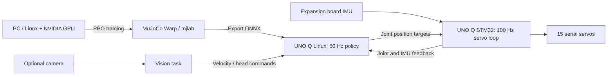

# XGO-Duck 强化学习部署路线

更新：2026-10-25。文件和目录使用英文名称。本文是本项目的研究方案，不是官方说明，也不代表实物已经验收。

## 1. 当前判断

用户已购买套件，并确认拥有 **Arduino UNO Q、机器人扩展板及舵机部分**。舵机型号、数量、板卡版本、结构件、电池和线束仍需实物核对。

建议先跑通官方预训练行走，再复现训练和部署，最后增加视觉。UNO Q 已经能承担官方板端推理，无需为基础行走另购树莓派或 Jetson；摄像头不属于现有行走策略的输入。

三份官方资料分别承担不同工作：

| 官方仓库 | 已提供的资产 | 本项目用途 |
| --- | --- | --- |
| [xgoduck_hardware](https://github.com/LuwuDynamics/xgoduck_hardware) | STL、装配 PDF、机器人 BOM、扩展板设计 | 核对实物并完成机械、电气装配 |
| [xgoduck_runtime_arduino](https://github.com/LuwuDynamics/xgoduck_runtime_arduino) | UNO Q 程序、浏览器界面、ONNX 策略 | 舵机 ID、校准、传感器读数和板端运行 |
| [xgoduck_rl](https://github.com/LuwuDynamics/xgoduck_rl) | XGO-Duck URDF/MJCF、网格、1910 舵机 BAM 模型、PPO 任务和导出脚本 | 复现训练、修改奖励和仿真参数 |

版本与校验入口：[官方资料归档](../official_resources/README.md)。不要用 Microduck 原版 XL330 舵机模型替代这里的 1910 执行器模型。

## 2. 系统分工



50 Hz 和 100 Hz 是源码中的设计频率，实物频率及尾延迟需要测量。Arduino Bridge 配置为 2 Mbps，舵机总线是另一条链路，不能混淆其波特率。

当前控制方式是**策略输出关节位置目标，由舵机执行位置控制**。不能据此声称已经具有可用的关节力矩控制、FOC 接口或在线力矩反馈。训练中的执行器力矩属于仿真内部量。

## 3. 现有硬件能先做什么

| 条件 | 可以开展 | 暂不开展 |
| --- | --- | --- |
| UNO Q + 扩展板 + 单个舵机 + 已核验供电 | 启动运行程序、读 IMU、逐个设置 ID、读位置、确定中位与方向 | 整机自由运动 |
| 全部舵机、结构、脚底、轴承和线束装配完成 | 托举校准、默认姿态、推理但不使能电机 | 未校准时直接运行行走策略 |
| 反馈、方向、限位、姿态和失联行为验证通过 | 官方低速平地行走和日志基线 | 将翻滚、起身或滑轮当作首个验机动作 |
| 仿真与实物映射一致 | 新策略导出、离线比较、分阶段上机 | 直接在实物上从零做 PPO 探索 |

## 4. 推进阶段与通过条件

### A. 完成硬件基线

1. 核对主控内存版本、扩展板批次、15 个舵机的实际型号与数量。
2. 阅读 [PCBA 接线更正](https://github.com/LuwuDynamics/xgoduck_hardware/blob/b5e9ff16a98f7bbe5c146aad29ad38f0dde30a89/PCBA/README.md)。旧版 U3/U4/U5 的 GND 与 SIGNAL 曾互换；是否适用必须依据实物网络确认，不能只看购买日期。仅对确认受影响的旧板按原文处理。
3. 根据 [BOM](https://github.com/LuwuDynamics/xgoduck_hardware/blob/b5e9ff16a98f7bbe5c146aad29ad38f0dde30a89/BOM.md)、[打印清单](https://github.com/LuwuDynamics/xgoduck_hardware/blob/b5e9ff16a98f7bbe5c146aad29ad38f0dde30a89/docs/PRINTING.md) 和装配图补齐缺件。
4. 单舵机设置 ID、确认中位后再装舵盘。左腿 10–14，右腿 20–24，头颈 30–33，嘴部 34。
5. 记录电池/充电器、线束、舵机参数、零点和机械限位；将板上生成的校准文件单独备份。

通过条件：全部 15 路舵机反馈和 IMU 在线；每个关节的正方向、零点和活动范围经人工确认；线束在关节运动范围内无拉扯。

### B. 建立官方预训练策略基线

按 [运行仓库 README](https://github.com/LuwuDynamics/xgoduck_runtime_arduino/blob/8837d5a3bc7cf3746f6da2b55c7b9191026b9838/README.md) 在 UNO Q 上用 Arduino App Lab 启动。首次准备包括官方的 `tools/prepare-bridge.py` 和 `tools/router-2m.sh`，执行位置是 **UNO Q 上的运行项目目录**。这些脚本会修改板端配置，应先记录现有系统与库版本。

浏览器入口为 `http://<board-ip>:9527`。先用 Inference only，再在托举状态检查 Default pose，最后进行低速、短时的平地行走。

当前源码中，浏览器命令超过约 1 秒未更新会归零行进命令，但不等同于卸载电机。**Zero motion 与 Torque off 含义不同**。反馈失效另有停机逻辑，需要在支撑状态实测；网页按钮不能替代可直接切断动力的措施。

当前主分支已没有早期 README 提到的 `tools/measure.py`（音视频开发分支仍有），因此不要直接照旧索引运行。板上可用以下只读采样保存一分钟状态；采样频率约 1 Hz，控制频率统计由 `/api/status` 本身提供：

```bash
python3 - <<'PY'
import json, time, urllib.request
samples = []
for _ in range(60):
    with urllib.request.urlopen('http://127.0.0.1:9527/api/status', timeout=2) as response:
        samples.append({'time': time.time(), 'status': json.load(response)})
    time.sleep(1)
with open('baseline_status.json', 'w') as output:
    json.dump(samples, output, indent=2)
PY
```

建议记录：反馈/推理实际频率、推理 p99、反馈数据年龄、丢帧、循环错过次数、供电、电机温升，以及每次测试对应的校准和 ONNX 哈希。运行程序是否提供某项电气/温度遥测需逐项核对，没有时使用外部测量，不能把仿真字段当成实测值。

建议的项目验收目标（不是官方保证）：持续 60 秒采集；没有持续的反馈过期或控制掉线；推理留有 20 ms 周期内的余量；多次低速起停和转向可复现。正式判定还需记录地面、速度、持续时间和跌倒次数。

### C. 在 PC 上复现训练

本机只读检查结果：Windows 主机 RTX 5070，显存 12,227 MiB，驱动 595.97；安装了 WSL2 Ubuntu / Ubuntu-24.04，在 Ubuntu-24.04 内也可读取同一 GPU。**仅确认 GPU 可见，尚未安装训练依赖或执行训练。**

推荐先使用 Ubuntu-24.04 WSL2，在 Linux 文件系统内建立开发副本。mjlab 官方优先支持 Linux；WSL 路径仍需通过依赖安装与最小训练验证。[平台说明](https://mujocolab.github.io/mjlab/v1.6.0/source/faq.html)

归档版本的 `pyproject.toml` 固定 Python 3.12、mjlab 1.3.0、warp-lang 1.12.0、torch 2.9.1，并使用仓库中的 `vendor/bam`。应首先保持这些版本及 `uv.lock`，不要因为在线文档是新版本而直接升级。

以下为待执行步骤，工作目录是你建立的 **xgoduck_rl 开发副本**，不要在官方归档目录产生训练输出：

```bash
uv sync --locked
uv run python -c "import torch; print(torch.__version__, torch.version.cuda, torch.cuda.is_available()); print(torch.cuda.get_device_name(0))"
uv run list-envs
uv run train Mjlab-Velocity-Flat-XgoDuck --help
uv run train Mjlab-Velocity-Flat-XgoDuck --env.scene.num-envs 256
```

256 是面向本机的保守起始建议，不是测得的性能上限。首次编译和显存验证成功后，再试 512、1024 或更高并行数；官方示例的 4096 不保证适合所有 12 GB 显卡和任务。不要在 UNO Q 上承担这类训练。

优先训练 Flat Velocity，分别检查前进、停止、转向。之后才考虑 Rough、StandUp、GroundPick 或 Roller；每类任务所需运行状态机、碰撞模型和动作语义都要对应。

```bash
uv run play Mjlab-Velocity-Flat-XgoDuck --checkpoint-file logs/rsl_rl/xgoduck_velocity/<run>/model_XXXX.pt
uv run python scripts/export.py Mjlab-Velocity-Flat-XgoDuck \
  --checkpoint-file logs/rsl_rl/xgoduck_velocity/<run>/model_XXXX.pt \
  --onnx-file logs/rsl_rl/xgoduck_velocity/<run>/walk_candidate.onnx
```

`<run>` 和 `model_XXXX.pt` 是必须替换的占位符。导出脚本把观测归一化放入 ONNX 图；板端不得再次重复应用同一归一化。

### D. 新策略部署前的接口核对

运行程序接受 `[1,61]` 观测，产生 `[1,14]` 动作；嘴部 34 号舵机另行控制。14 维策略关节顺序并非舵机 ID 数值升序：

```text
10 11 12 13 14 | 30 31 32 33 | 20 21 22 23 24
left leg      | neck/head   | right leg
```

普通行走观测布局见 [rl_core.py](https://github.com/LuwuDynamics/xgoduck_runtime_arduino/blob/8837d5a3bc7cf3746f6da2b55c7b9191026b9838/python/rl_core.py)：

| 切片 | 含义 | 单位/约定 |
| --- | --- | --- |
| 0:3 | 角速度 | rad/s，机体坐标系 |
| 3:6 | 重力方向 | 静止站正约为 `[0,0,-1]` |
| 6:20 | 相对默认姿态的关节位置 | rad，策略顺序 |
| 20:34 | 关节速度 | rad/s，策略顺序 |
| 34:48 | 前一帧网络原始动作 | 不能替换成平滑后的动作 |
| 48:51 | 速度指令 | vx、vy、yaw rate |
| 51:55 | 头颈姿态指令 | 4 维 |
| 55:61 | 身体姿态指令槽位 | 当前普通运行路径填零 |

位置目标由默认姿态加动作增量得到，并完成弧度到角度转换。策略顺序、IMU 轴向、动作尺度、滤波、周期、单位、限位和归一化必须成套核对，形状正确不等于兼容。

运行仓库的 `python/requirements.txt` 固定 `onnxruntime==1.22.1`，训练仓库则要求 `onnxruntime>=1.24.4`。导出后还需核对 ONNX 的 IR/opset 和算子在板端版本的兼容性，并在与板端相同版本的 CPU Runtime 上比较数值；不能仅以训练机能够加载作为部署通过标准。

**已确认的源码差异：训练行走默认姿态与运行默认姿态不完全一致。**

- `xgoduck_rl/src/mjlab_microduck/robot/xgoduck_constants.py` 的 `XGODUCK_WALK_HOME_FRAME` 使用髋俯仰/踝关节 ±24°，膝关节还有小的非零偏置。
- `xgoduck_runtime_arduino/python/rl_core.py` 的普通行走 `DEFAULT_DEG` 对应 ±22°，膝为 0°。
- `python/policy.py` 只有 `use_model_home=True` 才采用 ONNX 的 `default_joint_pos` 元数据；当前 `controller.py` 对 Roller 启用此选项，普通行走没有启用。

因此，新训练行走策略上机前，应在开发副本中明确采用训练默认姿态，或训练时与已验证的运行默认姿态统一，并对全部 14 关节做数值比较。不能只把新 ONNX 覆盖成 `xgoduck_walk.onnx`。

本次也以只读方式解析了随附 5 个 ONNX 的接口和元数据：都标记为 `[1,61] → [1,14]`；`xgoduck_walk.onnx` 的 `default_joint_pos` 中相关关节为约 ±0.419 rad（±24°），getup/pick 则为约 ±20°。具体形状、元数据和文件哈希保存在 [policy_contract_report.json](policy_contract_report.json)。这说明必须按模型逐项记录，不能假设所有策略共享同一个训练默认姿态。元数据与运行偏置的差异可能涉及板端调参；本次未进行推理或实机验证，不能据此断言官方模型失效，也没有自动修改其姿态。

另外，`policy.py` 当前平滑切片是 `[0:5]`、`[5:10]`、`[10:14]`；中间切片包含头颈之外的第一个右腿关节。复现时应按实际代码记录，不能仅根据界面“Head/Leg”名称推断分组。

上线顺序：离线比较同一观测下 PyTorch/ONNX 输出 → 仿真回放导出模型 → 板端不使能电机的推理 → 支撑下默认姿态与小动作 → 短时平地试走。保留已验证模型、校准和配置，出现异常即可回退。

### E. 视觉与自主行为

见 [hardware_and_accessories.md](hardware_and_accessories.md)。第一版视觉建议输出限幅的速度/头部指令，低层继续运行已验证步态。当前主分支虽有 `/api/command`，但没有为相机识别自动打通控制，需要实现视觉进程、命令仲裁和超时归零。

官方另有 `next-audio-video-tof` 开发分支，已提供视频预览、音频和手柄相关功能，归档在 `official_resources/runtime_media_preview/`。ToF 集成尚未实现。该分支的控制代码、校准流程和默认姿态也与主分支不同，不能把整个分支直接当作主分支的兼容升级。

## 5. 后续实验记录必须包含

- 硬件、运行、训练三个提交号；电机型号/固件/参数；板卡与电源版本。
- 校准、关节映射、默认姿态、IMU 安装方向和动作滤波设置。
- 训练任务、seed、依赖锁、训练配置、checkpoint 与 ONNX 哈希。
- 仿真/实机日志、测试条件、通过与失败的动作及回退版本。
- 相机、线束或电池更换带来的质量/重心变化，是否已经反馈到模型。

本次完成范围：资料归档和部署路径研究。尚未接入实物、刷写固件、安装完整训练栈或验证行走效果。
