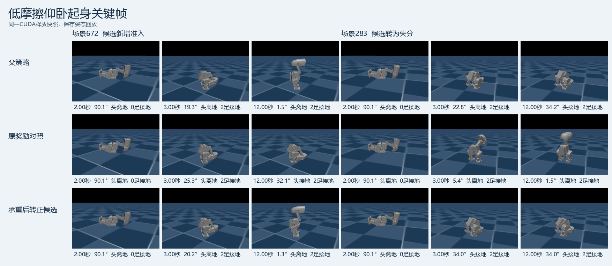

# XGO-Duck关键成果与复现入口

训练已暂停。当前按原厂套机的通信、零点、IMU、站姿走停及飞智黑武士4Pro进行实机验收。部署链路验收完成后，从保存的低摩擦仿真位置恢复训练。[首次部署和遥控手册](../../../docs/runbooks/xgo_duck_first_deployment_and_vader4pro.md) · [现场验收表](../../../docs/runbooks/hardware_acceptance_checklist.md)

## 复现所需文件

| 内容 | 入口 |
| --- | --- |
| 环境、官方短流程、单变量修改、导出 | [电脑环境与训练复现](../../../docs/runbooks/essential_pc_workflow.md) |
| 固定来源 | [官方源码与提交清单](../../../official_resources/source_manifest.json) |
| 原厂策略、自训练策略与用于继续训练的保存点 | [模型目录](../../../artifacts/delivery/) · [文件哈希](../../../artifacts/delivery/key-models.json) · [关键权重与迭代](../../../artifacts/delivery/key_model_iterations.md) · [标称连续路线模型清单](../../../artifacts/delivery/nominal-continuous-simulation.json) |
| 原厂关节映射及模型推理离线预检 | [Linux验证结果](../../hardware/deployment-preparation/essential-bundle-check.json) · [Windows固定运行时验证结果](../../hardware/deployment-preparation/essential-bundle-check-ort1221.json) · [离线验证脚本](../../../scripts/validation/verify_deployment_bundle.py) |
| 完整过程和恢复数据 | 本机目录`records/handoff/2026-11-21/`与`records/training-archive/` |

## 关键结果

| 阶段 | 数据与入口 |
| --- | --- |
| 环境和导出链路 | 官方线速度奖励权重3.0，修改组3.3。两组各训练5次迭代，导出后分别用1,000帧做ONNX闭环数值检查，超差帧均为0。这项结果用于验证训练和导出流程。[环境及两组运行索引](../../deployment/2026-10-31/completion-check.json) |
| 标称连续动作 | 种子2256、摩擦1.0，896个首次回合中有872个在42.5秒内完成起身、站立、前滚翻、再次站立和分配指令。七指令逐项计数见冻结清单。[独立评分](../../reports/nominal-skill-composition/closed-loop-timestep-confirmation/analysis.json) · [42.5秒原片](media/nominal-continuous-seed2256.mp4) |
| 低摩擦配对学习 | 两训练组各17次更新、1,253,376条转移。种子1257、摩擦0.8，同释放的父策略、原奖励组和承重转正候选滚翻前准入分别为880/896、882/896和881/896，前进分组分别为125/128、126/128和125/128。该对照保留用于定位前进起身差异。[容量选择](../../reports/nominal-skill-composition/low-friction-early-transfer-authority/loaded-upright-ppo/measured-capacity/selection.json) · [逐项评分](../../reports/nominal-skill-composition/low-friction-early-transfer-authority/loaded-upright-ppo/action-comparison/analysis.json) · [父策略原片](media/low-friction-parent-seed1257.mp4) · [候选原片](media/low-friction-candidate-seed1257.mp4) |
| 最后一次仿真复核 | 同一条完整轨迹独立配对后，第一遍4ms参照的正向配对为13/15，父策略为10/13。后续仿真恢复点为原始完整轨迹，独立种子2246保留。[正式协议](../../../configs/experiments/nominal_low_friction_full_trace_progress.json) · [逐分支数据](../../reports/nominal-skill-composition/low-friction-forward-support/pre-support-geometry/progress-qualification/full-trace/analysis.json) |

低摩擦仰卧起身关键帧与录像可在VS Code中查看。三段原片保留原始字节，来源见[录像清单](media.json)。

训练曲线按运行编号保存。[原奖励组曲线](../../reports/nominal-skill-composition/low-friction-early-transfer-authority/loaded-upright-ppo/control/final-view/native-curve.png) · [承重转正候选曲线](../../reports/nominal-skill-composition/low-friction-early-transfer-authority/loaded-upright-ppo/candidate/final-view/native-curve.png)
